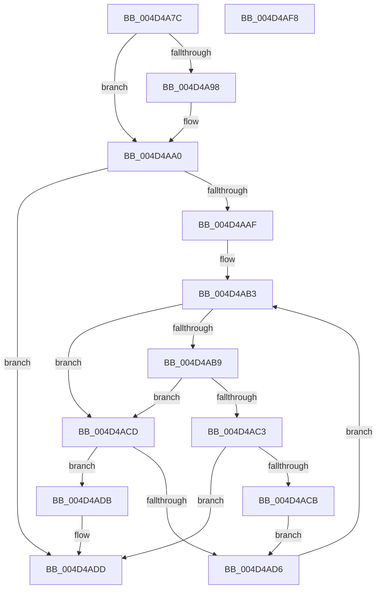

# MiInsertClone

- RVA: `0x004D4A7C`–`0x004D4AF9` (길이 `125` bytes)
- VA: `0x00000001404D4A7C`
- 실행 섹션: `.text`
- PDB 이름 있음: `예`; PDB Function 태그: `아니요`
- unwind 정보 RVA: `0x00060BC4`
- 디코드: `40`개 명령, `125/125` bytes 표시
- 미해석 바이트: `0` (있으면 어셈블리에 `.byte`로 보존)

> 이 문서는 커널 이미지의 기계어와 PDB 기호를 분석해 생성했습니다. 4번과 5번은 함수 원형과 자료형을 바이너리 사용 방식에서 추정한 C 해석이며 원본 소스 복구 결과는 아닙니다.

## 1. Dependencies

- 직접 호출 지점: **2**; 고유 호출 대상: **2**
- 직접 호출자로 확인된 함수: **2**
- RIP 상대 이미지 참조: **0**

### Outgoing calls
- `0x004D4A9B` → [MiDeleteCloneZombies](../49/MiDeleteCloneZombies_function_0049A7B8.md) (function, `0x0049A7B8`)
- `0x004D4AE3` → [RtlAvlInsertNodeEx](../26/RtlAvlInsertNodeEx_function_00265790.md) (function, `0x00265790`)

### Direct callers
- [MiCloneVads](../22/MiCloneVads_function_0022DC1C.md) at `0x0022DDDF`
- [MiCloneVads](../22/MiCloneVads_function_0022DC1C.md) at `0x0022E106`
- [MiCloneProcessAddressSpace](../../page/AD/MiCloneProcessAddressSpace_function_00AD6F7C.md) at `0x00AD7253`

### Static image references
- 디코드된 RIP-relative 메모리 참조가 없습니다.

## 2. Other-region calls and transfers

- 다른 실행 섹션으로 향하는 call: **0**
- 별도 외부 분기/꼬리 이동을 확인하지 못했습니다.

## 3. Assembly (complete function range)

```asm
004D4A7C  48 89 5C 24 08                  mov qword ptr [rsp + 8], rbx
004D4A81  48 89 74 24 10                  mov qword ptr [rsp + 0x10], rsi
004D4A86  57                              push rdi
004D4A87  48 83 EC 20                     sub rsp, 0x20
004D4A8B  33 DB                           xor ebx, ebx
004D4A8D  48 8B F2                        mov rsi, rdx
004D4A90  48 8B F9                        mov rdi, rcx
004D4A93  45 85 C0                        test r8d, r8d
004D4A96  74 08                           je 0x1404d4aa0
004D4A98  8D 53 01                        lea edx, [rbx + 1]
004D4A9B  E8 18 5D FC FF                  call 0x14049a7b8
004D4AA0  48 8D 8F 80 02 00 00            lea rcx, [rdi + 0x280]
004D4AA7  48 8B 11                        mov rdx, qword ptr [rcx]
004D4AAA  48 85 D2                        test rdx, rdx
004D4AAD  74 2E                           je 0x1404d4add
004D4AAF  4C 8B 46 18                     mov r8, qword ptr [rsi + 0x18]
004D4AB3  4C 3B 42 20                     cmp r8, qword ptr [rdx + 0x20]
004D4AB7  77 14                           ja 0x1404d4acd
004D4AB9  48 8B 42 18                     mov rax, qword ptr [rdx + 0x18]
004D4ABD  48 39 46 20                     cmp qword ptr [rsi + 0x20], rax
004D4AC1  73 0A                           jae 0x1404d4acd
004D4AC3  48 8B 02                        mov rax, qword ptr [rdx]
004D4AC6  48 85 C0                        test rax, rax
004D4AC9  74 12                           je 0x1404d4add
004D4ACB  EB 09                           jmp 0x1404d4ad6
004D4ACD  48 8B 42 08                     mov rax, qword ptr [rdx + 8]
004D4AD1  48 85 C0                        test rax, rax
004D4AD4  74 05                           je 0x1404d4adb
004D4AD6  48 8B D0                        mov rdx, rax
004D4AD9  EB D8                           jmp 0x1404d4ab3
004D4ADB  B3 01                           mov bl, 1
004D4ADD  4C 8B CE                        mov r9, rsi
004D4AE0  44 8A C3                        mov r8b, bl
004D4AE3  E8 A8 0C D9 FF                  call 0x140265790
004D4AE8  48 8B 5C 24 30                  mov rbx, qword ptr [rsp + 0x30]
004D4AED  48 8B 74 24 38                  mov rsi, qword ptr [rsp + 0x38]
004D4AF2  48 83 C4 20                     add rsp, 0x20
004D4AF6  5F                              pop rdi
004D4AF7  C3                              ret
004D4AF8  CC                              int3
```

## 4. C-style interpretation (structured pseudocode)

```c
__int64 __fastcall MiInsertClone(__int64 a1, __int64 a2, int a3)
{
    __int64 result;
    __int64 v_rbx;
    __int64 v_rsp;
    unsigned __int64 v_stack_p10;
    unsigned __int64 v_stack_p8;

    v_stack_p8 = v_rbx;
    v_stack_p10 = v_rsi;
    v_rsp = (v_rsp) - (32);
    v_rbx = 0;
    if (a3 != 0) {
        a2 = v_rbx + 1;
        result = MiDeleteCloneZombies(a1, a2, a3, a4);
    }
    if (*(unsigned __int64 *)(a1 + 640) == 0) goto loc_004D4ADD;
loc_004D4AB3:
    if ((*(unsigned __int64 *)(a2 + 24)) > (*(unsigned __int64 *)(*(unsigned __int64 *)(a1 + 640) + 32))) goto loc_004D4ACD;
    if ((*(unsigned __int64 *)(a2 + 32)) >= (*(unsigned __int64 *)(*(unsigned __int64 *)(a1 + 640) + 24))) goto loc_004D4ACD;
    if (*(unsigned __int64 *)(*(unsigned __int64 *)(a1 + 640)) == 0) goto loc_004D4ADD;
    goto loc_004D4AD6;
loc_004D4ACD:
    if (*(unsigned __int64 *)(*(unsigned __int64 *)(a1 + 640) + 8) == 0) goto loc_004D4ADB;
loc_004D4AD6:
    goto loc_004D4AB3;
loc_004D4ADB:
loc_004D4ADD:
    result = RtlAvlInsertNodeEx(a1 + 640, *(unsigned __int64 *)(*(unsigned __int64 *)(a1 + 640) + 8), 1, a2);
    v_rsp = (v_rsp) + (32);
    return result;
}
```

## 5. (Beta) C Style

```c
int64_t MiInsertClone(void *Arg1, void *Arg2, int32_t Arg3)
{
    uint8_t *arg1 = (uint8_t *)Arg1;
    uint8_t *arg2 = (uint8_t *)Arg2;

    int64_t result;
    int64_t local_rbx;
    int64_t local_rsp;
    uint64_t v_stack_p10;
    uint64_t v_stack_p8;

    v_stack_p8 = local_rbx;
    v_stack_p10 = local_rsi;
    local_rsp = (local_rsp) - (32);
    local_rbx = 0;
    if (Arg3 != 0) {
        Arg2 = local_rbx + 1;
        result = MiDeleteCloneZombies(Arg1, Arg2, Arg3, a4);
    }
    if (*(uint64_t *)(arg1 + 0x280) == 0) goto loc_004D4ADD;
loc_004D4AB3:
    if ((*(uint64_t *)(arg2 + 0x18)) > (*(uint64_t *)(*(uint64_t *)(arg1 + 0x280) + 0x20))) goto loc_004D4ACD;
    if ((*(uint64_t *)(arg2 + 0x20)) >= (*(uint64_t *)(*(uint64_t *)(arg1 + 0x280) + 0x18))) goto loc_004D4ACD;
    if (*(uint64_t *)(*(uint64_t *)(arg1 + 0x280)) == 0) goto loc_004D4ADD;
    goto loc_004D4AD6;
loc_004D4ACD:
    if (*(uint64_t *)(*(uint64_t *)(arg1 + 0x280) + 0x8) == 0) goto loc_004D4ADB;
loc_004D4AD6:
    goto loc_004D4AB3;
loc_004D4ADB:
loc_004D4ADD:
    result = RtlAvlInsertNodeEx(Arg1 + 640, *(uint64_t *)(*(uint64_t *)(arg1 + 0x280) + 0x8), 1, Arg2);
    local_rsp = (local_rsp) + (32);
    return result;
}
```

### 관측된 메모리 오프셋

구조체 형식이 확인되지 않은 접근은 인자 기준의 오프셋으로만 기록했습니다.

| 기준 인자 | 오프셋 표현 | 폭 (bit) | 접근 |
|---|---:|---:|---|
| `Arg1` | `+ 0x0` | `64` | `R` |
| `Arg1` | `+ 0x280` | `64` | `R` |
| `Arg2` | `+ 0x18` | `64` | `R` |
| `Arg2` | `+ 0x20` | `64` | `R` |

## 6. Execution-region graph

[열기: 2D/3D 그래프와 함수 탐색 컨트롤 패널](../../../control-panel.html?section=text&rva=0x004D4A7C&view=graph)

- 2D 그래프는 위에서 아래로 흐르고, 3D 그래프는 빈 공간을 드래그해 회전합니다. Shift+드래그는 이동, 휠은 확대·축소, 함수 노드 선택은 대상 보고서 이동입니다.

### Static fallback


