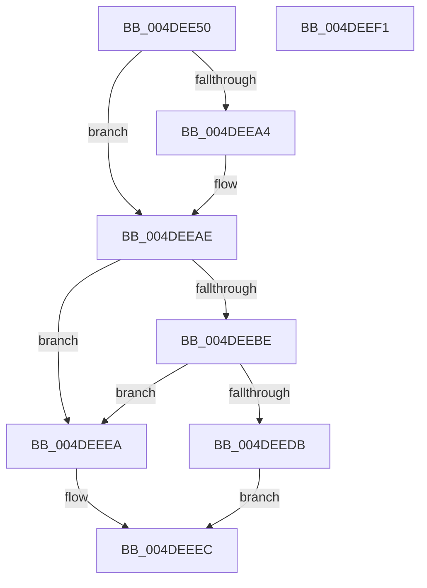

# MiIsStandbyPageCorrupted

- RVA: `0x004DEE50`–`0x004DEEF2` (길이 `162` bytes)
- VA: `0x00000001404DEE50`
- 실행 섹션: `.text`
- PDB 이름 있음: `예`; PDB Function 태그: `아니요`
- unwind 정보 RVA: `0x0005C788`
- 디코드: `42`개 명령, `162/162` bytes 표시
- 미해석 바이트: `0` (있으면 어셈블리에 `.byte`로 보존)

> 이 문서는 커널 이미지의 기계어와 PDB 기호를 분석해 생성했습니다. 4번과 5번은 함수 원형과 자료형을 바이너리 사용 방식에서 추정한 C 해석이며 원본 소스 복구 결과는 아닙니다.

## 1. Dependencies

- 직접 호출 지점: **2**; 고유 호출 대상: **2**
- 직접 호출자로 확인된 함수: **1**
- RIP 상대 이미지 참조: **1**

### Outgoing calls
- `0x004DEEB5` → [MiIsPteInStore](../36/MiIsPteInStore_function_00362460.md) (function, `0x00362460`)
- `0x004DEEE3` → [MiArePagefileContentsCorrupted](../38/MiArePagefileContentsCorrupted_function_003818C8.md) (function, `0x003818C8`)

### Direct callers
- [sub_006DBBC0](../6D/Unknown_function_006DBBC0.md) at `0x006DBC52`

### Static image references
- `0x004DEE75` → RVA `0x00E30088` (`.data`; read)

## 2. Other-region calls and transfers

- 다른 실행 섹션으로 향하는 call: **0**
- 별도 외부 분기/꼬리 이동을 확인하지 못했습니다.

## 3. Assembly (complete function range)

```asm
004DEE50  48 83 EC 28                     sub rsp, 0x28
004DEE54  4C 8D 14 49                     lea r10, [rcx + rcx*2]
004DEE58  4C 8B D9                        mov r11, rcx
004DEE5B  49 C1 E2 04                     shl r10, 4
004DEE5F  48 B8 00 00 00 00 00 DE FF FF   movabs rax, 0xffffde0000000000
004DEE69  4C 03 D0                        add r10, rax
004DEE6C  BA FF 03 00 00                  mov edx, 0x3ff
004DEE71  49 8B 42 28                     mov rax, qword ptr [r10 + 0x28]
004DEE75  48 8B 0D 0C 12 95 00            mov rcx, qword ptr [rip + 0x95120c]
004DEE7C  48 C1 E8 2B                     shr rax, 0x2b
004DEE80  48 23 C2                        and rax, rdx
004DEE83  4C 8B 0C C1                     mov r9, qword ptr [rcx + rax*8]
004DEE87  49 8B 42 28                     mov rax, qword ptr [r10 + 0x28]
004DEE8B  48 8B 0D F6 11 95 00            mov rcx, qword ptr [rip + 0x9511f6]
004DEE92  48 C1 E8 2B                     shr rax, 0x2b
004DEE96  48 23 C2                        and rax, rdx
004DEE99  48 8B 04 C1                     mov rax, qword ptr [rcx + rax*8]
004DEE9D  8B 40 04                        mov eax, dword ptr [rax + 4]
004DEEA0  84 C0                           test al, al
004DEEA2  79 0A                           jns 0x1404deeae
004DEEA4  49 8B 81 D8 44 00 00            mov rax, qword ptr [r9 + 0x44d8]
004DEEAB  4C 8B 08                        mov r9, qword ptr [rax]
004DEEAE  49 8B 52 10                     mov rdx, qword ptr [r10 + 0x10]
004DEEB2  49 8B C9                        mov rcx, r9
004DEEB5  E8 A6 35 E8 FF                  call 0x140362460
004DEEBA  85 C0                           test eax, eax
004DEEBC  75 2C                           jne 0x1404deeea
004DEEBE  41 8B 42 10                     mov eax, dword ptr [r10 + 0x10]
004DEEC2  48 C1 E8 0C                     shr rax, 0xc
004DEEC6  83 E0 0F                        and eax, 0xf
004DEEC9  49 8B 84 C1 60 48 00 00         mov rax, qword ptr [r9 + rax*8 + 0x4860]
004DEED1  48 83 B8 B8 00 00 00 00         cmp qword ptr [rax + 0xb8], 0
004DEED9  74 0F                           je 0x1404deeea
004DEEDB  45 33 C0                        xor r8d, r8d
004DEEDE  33 D2                           xor edx, edx
004DEEE0  49 8B CB                        mov rcx, r11
004DEEE3  E8 E0 29 EA FF                  call 0x1403818c8
004DEEE8  EB 02                           jmp 0x1404deeec
004DEEEA  33 C0                           xor eax, eax
004DEEEC  48 83 C4 28                     add rsp, 0x28
004DEEF0  C3                              ret
004DEEF1  CC                              int3
```

## 4. C-style interpretation (structured pseudocode)

```c
__int64 __fastcall MiIsStandbyPageCorrupted(__int64 a1, __int64 a2, int a3)
{
    __int64 result;
    __int64 v_r10;
    __int64 v_rsp;

    v_rsp = (v_rsp) - (40);
    v_r10 = (a1 + a1 * 2) << (4);
    v_r10 = (v_r10) + (result);
    result = (*(unsigned __int64 *)(v_r10 + 40)) >> (43);
    result = (result) & ((unsigned int)(0x3FFULL));
    result = (*(unsigned __int64 *)(v_r10 + 40)) >> (43);
    result = (result) & ((unsigned int)(0x3FFULL));
    result = (unsigned int)(*(unsigned int *)(*(unsigned __int64 *)(*(unsigned __int64 *)(v_rip + 9769462) + result * 8) + 4));
    if (sign_flag) {
        result = *(unsigned __int64 *)(*(unsigned __int64 *)(*(unsigned __int64 *)(v_rip + 9769484) + result * 8) + 17624);
        a4 = *(unsigned __int64 *)(result);
    }
    result = MiIsPteInStore(a4, *(unsigned __int64 *)(v_r10 + 16), a3, a4);
    if ((unsigned int)(result) != 0) goto loc_004DEEEA;
    result = ((unsigned int)(*(unsigned int *)(v_r10 + 16))) >> (12);
    result = (unsigned int)((result) & (15));
    if ((*(unsigned __int64 *)(*(unsigned __int64 *)(a4 + result * 8 + 18528) + 184)) == 0) goto loc_004DEEEA;
    a3 = 0;
    a2 = 0;
    result = MiArePagefileContentsCorrupted(a1, a2, a3, a4);
    goto loc_004DEEEC;
loc_004DEEEA:
    result = 0;
loc_004DEEEC:
    v_rsp = (v_rsp) + (40);
    return result;
}
```

## 5. (Beta) C Style

```c
int64_t MiIsStandbyPageCorrupted(void *Arg1, int64_t Arg2, int32_t Arg3)
{
    uint8_t *arg1 = (uint8_t *)Arg1;

    int64_t result;
    int64_t local_r10;
    int64_t local_rsp;

    local_rsp = (local_rsp) - (40);
    local_r10 = (Arg1 + Arg1 * 2) << (4);
    local_r10 = (local_r10) + (result);
    result = (*(uint64_t *)(local_r10 + 0x28)) >> (43);
    result = (result) & ((uint32_t)(0x3FFULL));
    result = (*(uint64_t *)(local_r10 + 0x28)) >> (43);
    result = (result) & ((uint32_t)(0x3FFULL));
    result = (uint32_t)(*(uint32_t *)(*(uint64_t *)(*(uint64_t *)(v_rip + 0x9511F6) + result * 8) + 0x4));
    if (sign_flag) {
        result = *(uint64_t *)(*(uint64_t *)(*(uint64_t *)(v_rip + 0x95120C) + result * 8) + 0x44D8);
        a4 = *(uint64_t *)(result);
    }
    result = MiIsPteInStore(a4, *(uint64_t *)(local_r10 + 0x10), Arg3, a4);
    if ((uint32_t)(result) != 0) goto loc_004DEEEA;
    result = ((uint32_t)(*(uint32_t *)(local_r10 + 0x10))) >> (12);
    result = (uint32_t)((result) & (15));
    if ((*(uint64_t *)(*(uint64_t *)(a4 + result * 8 + 0x4860) + 0xB8)) == 0) goto loc_004DEEEA;
    Arg3 = 0;
    Arg2 = 0;
    result = MiArePagefileContentsCorrupted(Arg1, Arg2, Arg3, a4);
    goto loc_004DEEEC;
loc_004DEEEA:
    result = 0;
loc_004DEEEC:
    local_rsp = (local_rsp) + (40);
    return result;
}
```

### 관측된 메모리 오프셋

구조체 형식이 확인되지 않은 접근은 인자 기준의 오프셋으로만 기록했습니다.

| 기준 인자 | 오프셋 표현 | 폭 (bit) | 접근 |
|---|---:|---:|---|
| `Arg1` | `+ 0x0 + rcx*2` | `64` | `R` |

## 6. Execution-region graph

[열기: 2D/3D 그래프와 함수 탐색 컨트롤 패널](../../../control-panel.html?section=text&rva=0x004DEE50&view=graph)

- 2D 그래프는 위에서 아래로 흐르고, 3D 그래프는 빈 공간을 드래그해 회전합니다. Shift+드래그는 이동, 휠은 확대·축소, 함수 노드 선택은 대상 보고서 이동입니다.

### Static fallback


