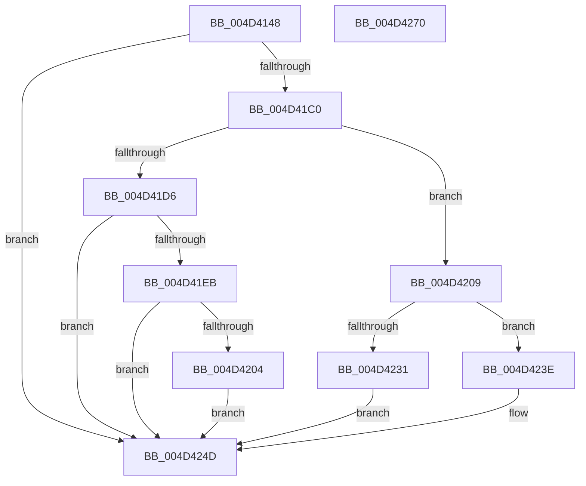

# MiLateWritePageHash

- RVA: `0x004D4148`–`0x004D4271` (길이 `297` bytes)
- VA: `0x00000001404D4148`
- 실행 섹션: `.text`
- PDB 이름 있음: `예`; PDB Function 태그: `아니요`
- unwind 정보 RVA: `0x00084C9C`
- 디코드: `76`개 명령, `297/297` bytes 표시
- 미해석 바이트: `0` (있으면 어셈블리에 `.byte`로 보존)

> 이 문서는 커널 이미지의 기계어와 PDB 기호를 분석해 생성했습니다. 4번과 5번은 함수 원형과 자료형을 바이너리 사용 방식에서 추정한 C 해석이며 원본 소스 복구 결과는 아닙니다.

## 1. Dependencies

- 직접 호출 지점: **5**; 고유 호출 대상: **4**
- 직접 호출자로 확인된 함수: **1**
- RIP 상대 이미지 참조: **3**

### Outgoing calls
- `0x004D417E` → [ExAcquireSpinLockExclusiveAtDpcLevel](../24/ExAcquireSpinLockExclusiveAtDpcLevel_function_00248E80.md) (function, `0x00248E80`)
- `0x004D41C8` → [MiReadEntirePageHashEntry](../46/MiReadEntirePageHashEntry_function_0046A494.md) (function, `0x0046A494`)
- `0x004D41DE` → [MiWriteEntirePageHashEntry](../38/MiWriteEntirePageHashEntry_function_003821C8.md) (function, `0x003821C8`)
- `0x004D4237` → [MiWriteEntirePageHashEntry](../38/MiWriteEntirePageHashEntry_function_003821C8.md) (function, `0x003821C8`)
- `0x004D4250` → [ExReleaseSpinLockExclusiveFromDpcLevel](../24/ExReleaseSpinLockExclusiveFromDpcLevel_function_002497E0.md) (function, `0x002497E0`)

### Direct callers
- [MiArePagefileContentsCorrupted](../38/MiArePagefileContentsCorrupted_function_003818C8.md) at `0x003819EF`

### Static image references
- `0x004D4183` → RVA `0x00E3738C` (`.data`; read)
- `0x004D41E3` → RVA `0x00E37390` (`.data`; read)
- `0x004D423E` → RVA `0x00E302C8` (`.data`; read)

## 2. Other-region calls and transfers

- 다른 실행 섹션으로 향하는 call: **0**
- 별도 외부 분기/꼬리 이동을 확인하지 못했습니다.

## 3. Assembly (complete function range)

```asm
004D4148  48 8B C4                        mov rax, rsp
004D414B  48 89 58 08                     mov qword ptr [rax + 8], rbx
004D414F  48 89 68 10                     mov qword ptr [rax + 0x10], rbp
004D4153  48 89 70 18                     mov qword ptr [rax + 0x18], rsi
004D4157  57                              push rdi
004D4158  41 56                           push r14
004D415A  41 57                           push r15
004D415C  48 83 EC 30                     sub rsp, 0x30
004D4160  48 8D A9 C8 00 00 00            lea rbp, [rcx + 0xc8]
004D4167  48 8B F9                        mov rdi, rcx
004D416A  0F 57 C0                        xorps xmm0, xmm0
004D416D  48 8B CD                        mov rcx, rbp
004D4170  4D 8B F1                        mov r14, r9
004D4173  4D 8B F8                        mov r15, r8
004D4176  8B DA                           mov ebx, edx
004D4178  33 F6                           xor esi, esi
004D417A  0F 11 40 D8                     movups xmmword ptr [rax - 0x28], xmm0
004D417E  E8 FD 4C D7 FF                  call 0x140248e80
004D4183  0F AF 1D 02 32 96 00            imul ebx, dword ptr [rip + 0x963202]
004D418A  48 B8 F8 FF FF FF 7F 00 00 00   movabs rax, 0x7ffffffff8
004D4194  44 8B CB                        mov r9d, ebx
004D4197  4C 03 8F B8 00 00 00            add r9, qword ptr [rdi + 0xb8]
004D419E  4D 8B C1                        mov r8, r9
004D41A1  49 C1 E8 09                     shr r8, 9
004D41A5  4C 23 C0                        and r8, rax
004D41A8  48 B8 00 00 00 00 80 F6 FF FF   movabs rax, 0xfffff68000000000
004D41B2  4D 8B 04 00                     mov r8, qword ptr [r8 + rax]
004D41B6  41 F6 C0 01                     test r8b, 1
004D41BA  0F 84 8D 00 00 00               je 0x1404d424d
004D41C0  48 8D 54 24 20                  lea rdx, [rsp + 0x20]
004D41C5  49 8B C9                        mov rcx, r9
004D41C8  E8 C7 62 F9 FF                  call 0x14046a494
004D41CD  41 8B 0E                        mov ecx, dword ptr [r14]
004D41D0  39 4C 24 20                     cmp dword ptr [rsp + 0x20], ecx
004D41D4  75 33                           jne 0x1404d4209
004D41D6  48 8D 54 24 20                  lea rdx, [rsp + 0x20]
004D41DB  49 8B CF                        mov rcx, r15
004D41DE  E8 E5 DF EA FF                  call 0x1403821c8
004D41E3  39 35 A7 31 96 00               cmp dword ptr [rip + 0x9631a7], esi
004D41E9  74 62                           je 0x1404d424d
004D41EB  49 8B 46 08                     mov rax, qword ptr [r14 + 8]
004D41EF  8D 4E 3B                        lea ecx, [rsi + 0x3b]
004D41F2  48 39 44 24 28                  cmp qword ptr [rsp + 0x28], rax
004D41F7  41 8B 46 04                     mov eax, dword ptr [r14 + 4]
004D41FB  0F 45 F1                        cmovne esi, ecx
004D41FE  39 44 24 24                     cmp dword ptr [rsp + 0x24], eax
004D4202  74 49                           je 0x1404d424d
004D4204  8D 71 FD                        lea esi, [rcx - 3]
004D4207  EB 44                           jmp 0x1404d424d
004D4209  48 B8 FF FF FF FF FF 00 00 00   movabs rax, 0xffffffffff
004D4213  49 C1 E8 0C                     shr r8, 0xc
004D4217  4C 23 C0                        and r8, rax
004D421A  4B 8D 04 40                     lea rax, [r8 + r8*2]
004D421E  48 03 C0                        add rax, rax
004D4221  48 B9 22 00 00 00 00 DE FF FF   movabs rcx, 0xffffde0000000022
004D422B  F6 04 C1 10                     test byte ptr [rcx + rax*8], 0x10
004D422F  75 0D                           jne 0x1404d423e
004D4231  49 8B D6                        mov rdx, r14
004D4234  49 8B C9                        mov rcx, r9
004D4237  E8 8C DF EA FF                  call 0x1403821c8
004D423C  EB 0F                           jmp 0x1404d424d
004D423E  40 38 35 83 C0 95 00            cmp byte ptr [rip + 0x95c083], sil
004D4245  B8 3A 00 00 00                  mov eax, 0x3a
004D424A  0F 44 F0                        cmove esi, eax
004D424D  48 8B CD                        mov rcx, rbp
004D4250  E8 8B 55 D7 FF                  call 0x1402497e0
004D4255  48 8B 5C 24 50                  mov rbx, qword ptr [rsp + 0x50]
004D425A  8B C6                           mov eax, esi
004D425C  48 8B 74 24 60                  mov rsi, qword ptr [rsp + 0x60]
004D4261  48 8B 6C 24 58                  mov rbp, qword ptr [rsp + 0x58]
004D4266  48 83 C4 30                     add rsp, 0x30
004D426A  41 5F                           pop r15
004D426C  41 5E                           pop r14
004D426E  5F                              pop rdi
004D426F  C3                              ret
004D4270  CC                              int3
```

## 4. C-style interpretation (structured pseudocode)

```c
__int64 __fastcall MiLateWritePageHash(__int64 a1, int a2, __int64 a3, __int64 a4)
{
    __int64 result;
    __int64 v_rbx;
    __int64 v_rsi;
    __int64 v_rsp;
    unsigned __int64 v_stack_m20;
    unsigned int v_stack_m24;
    unsigned __int64 v_stack_m28;
    unsigned __int64 v_stack_p10;
    unsigned __int64 v_stack_p18;
    unsigned __int64 v_stack_p8;

    *(unsigned __int64 *)(v_rsp + 8) = v_rbx;
    *(unsigned __int64 *)(v_rsp + 16) = v_rbp;
    *(unsigned __int64 *)(v_rsp + 24) = v_rsi;
    v_rsp = (v_rsp) - (48);
    v_rsi = 0;
    *(unsigned __int64 *)(v_rsp - 40) = v_xmm0;
    result = ExAcquireSpinLockExclusiveAtDpcLevel(a1 + 200, a2, a3, a4);
    v_rbx = (unsigned int)(((unsigned int)(a2)) * (*(unsigned int *)(v_rip + 9843202)));
    a4 = ((unsigned int)((unsigned int)(v_rbx))) + (*(unsigned __int64 *)(a1 + 184));
    a3 = (a4) >> (9);
    a3 = (a3) & (result);
    if ((((unsigned __int8)(*(unsigned __int64 *)(a3 + result * 1))) & (1)) == 0) goto loc_004D424D;
    result = MiReadEntirePageHashEntry(a4, v_stack_m28, *(unsigned __int64 *)(a3 + result * 1), a4);
    if (v_stack_m28 != ((unsigned int)((unsigned int)(*(unsigned int *)(a4))))) goto loc_004D4209;
    result = MiWriteEntirePageHashEntry(a3, v_stack_m28, *(unsigned __int64 *)(a3 + result * 1), a4);
    if ((*(unsigned int *)(v_rip + 9843111)) == 0) goto loc_004D424D;
    if (v_stack_m20 != (*(unsigned __int64 *)(a4 + 8))) { v_rsi = (unsigned int)(v_rsi + 59); }
    if (v_stack_m24 == ((unsigned int)((unsigned int)(*(unsigned int *)(a4 + 4))))) goto loc_004D424D;
    goto loc_004D424D;
loc_004D4209:
    a3 = (*(unsigned __int64 *)(a3 + result * 1)) >> (12);
    a3 = (a3) & ((unsigned int)(*(unsigned int *)(a4 + 4)));
    result = (a3 + a3 * 2) + (a3 + a3 * 2);
    if (((*(unsigned __int8 *)(v_rsi + 59 + result * 8)) & (16)) != 0) goto loc_004D423E;
    result = MiWriteEntirePageHashEntry(a4, a4, a3, a4);
    goto loc_004D424D;
loc_004D423E:
    v_rsi = v_rsi + 59 - 3;
    if ((*(unsigned __int8 *)(v_rip + 9814147)) == ((unsigned __int8)(v_rsi + 59 - 3))) { v_rsi = 58; }
loc_004D424D:
    result = ExReleaseSpinLockExclusiveFromDpcLevel(a1 + 200, a4, a3, a4);
    v_rsp = (v_rsp) + (48);
    return (unsigned int)((unsigned int)(v_rsi));
}
```

## 5. (Beta) C Style

```c
int64_t MiLateWritePageHash(void *Arg1, int32_t Arg2, int64_t Arg3, void *Arg4)
{
    uint8_t *arg1 = (uint8_t *)Arg1;
    uint8_t *arg4 = (uint8_t *)Arg4;

    int64_t result;
    int64_t local_rbx;
    int64_t local_rsi;
    int64_t local_rsp;
    uint64_t v_stack_m20;
    uint32_t v_stack_m24;
    uint64_t v_stack_m28;
    uint64_t v_stack_p10;
    uint64_t v_stack_p18;
    uint64_t v_stack_p8;

    *(uint64_t *)(local_rsp + 0x8) = local_rbx;
    *(uint64_t *)(local_rsp + 0x10) = local_rbp;
    *(uint64_t *)(local_rsp + 0x18) = local_rsi;
    local_rsp = (local_rsp) - (48);
    local_rsi = 0;
    *(uint64_t *)(local_rsp - 0x28) = v_xmm0;
    result = ExAcquireSpinLockExclusiveAtDpcLevel(Arg1 + 200, Arg2, Arg3, Arg4);
    local_rbx = (uint32_t)(((uint32_t)(Arg2)) * (*(uint32_t *)(v_rip + 0x963202)));
    Arg4 = ((uint32_t)((uint32_t)(local_rbx))) + (*(uint64_t *)(arg1 + 0xB8));
    Arg3 = (Arg4) >> (9);
    Arg3 = (Arg3) & (result);
    if ((((uint8_t)(*(uint64_t *)(Arg3 + result * 1))) & (1)) == 0) goto loc_004D424D;
    result = MiReadEntirePageHashEntry(Arg4, v_stack_m28, *(uint64_t *)(Arg3 + result * 1), Arg4);
    if (v_stack_m28 != ((uint32_t)((uint32_t)(*(uint32_t *)(arg4))))) goto loc_004D4209;
    result = MiWriteEntirePageHashEntry(Arg3, v_stack_m28, *(uint64_t *)(Arg3 + result * 1), Arg4);
    if ((*(uint32_t *)(v_rip + 0x9631A7)) == 0) goto loc_004D424D;
    if (v_stack_m20 != (*(uint64_t *)(arg4 + 0x8))) { local_rsi = (uint32_t)(local_rsi + 59); }
    if (v_stack_m24 == ((uint32_t)((uint32_t)(*(uint32_t *)(arg4 + 0x4))))) goto loc_004D424D;
    goto loc_004D424D;
loc_004D4209:
    Arg3 = (*(uint64_t *)(Arg3 + result * 1)) >> (12);
    Arg3 = (Arg3) & ((uint32_t)(*(uint32_t *)(arg4 + 0x4)));
    result = (Arg3 + Arg3 * 2) + (Arg3 + Arg3 * 2);
    if (((*(uint8_t *)(local_rsi + 0x3B + result * 8)) & (16)) != 0) goto loc_004D423E;
    result = MiWriteEntirePageHashEntry(Arg4, Arg4, Arg3, Arg4);
    goto loc_004D424D;
loc_004D423E:
    local_rsi = local_rsi + 59 - 3;
    if ((*(uint8_t *)(v_rip + 0x95C083)) == ((uint8_t)(local_rsi + 59 - 3))) { local_rsi = 58; }
loc_004D424D:
    result = ExReleaseSpinLockExclusiveFromDpcLevel(Arg1 + 200, Arg4, Arg3, Arg4);
    local_rsp = (local_rsp) + (48);
    return (uint32_t)((uint32_t)(local_rsi));
}
```

### 관측된 메모리 오프셋

구조체 형식이 확인되지 않은 접근은 인자 기준의 오프셋으로만 기록했습니다.

| 기준 인자 | 오프셋 표현 | 폭 (bit) | 접근 |
|---|---:|---:|---|
| `Arg1` | `+ 0xB8` | `64` | `R` |
| `Arg1` | `+ 0xC8` | `64` | `R` |
| `Arg4` | `+ 0x0` | `32` | `R` |
| `Arg4` | `+ 0x4` | `32` | `R` |
| `Arg4` | `+ 0x8` | `64` | `R` |

## 6. Execution-region graph

[열기: 2D/3D 그래프와 함수 탐색 컨트롤 패널](../../../control-panel.html?section=text&rva=0x004D4148&view=graph)

- 2D 그래프는 위에서 아래로 흐르고, 3D 그래프는 빈 공간을 드래그해 회전합니다. Shift+드래그는 이동, 휠은 확대·축소, 함수 노드 선택은 대상 보고서 이동입니다.

### Static fallback


