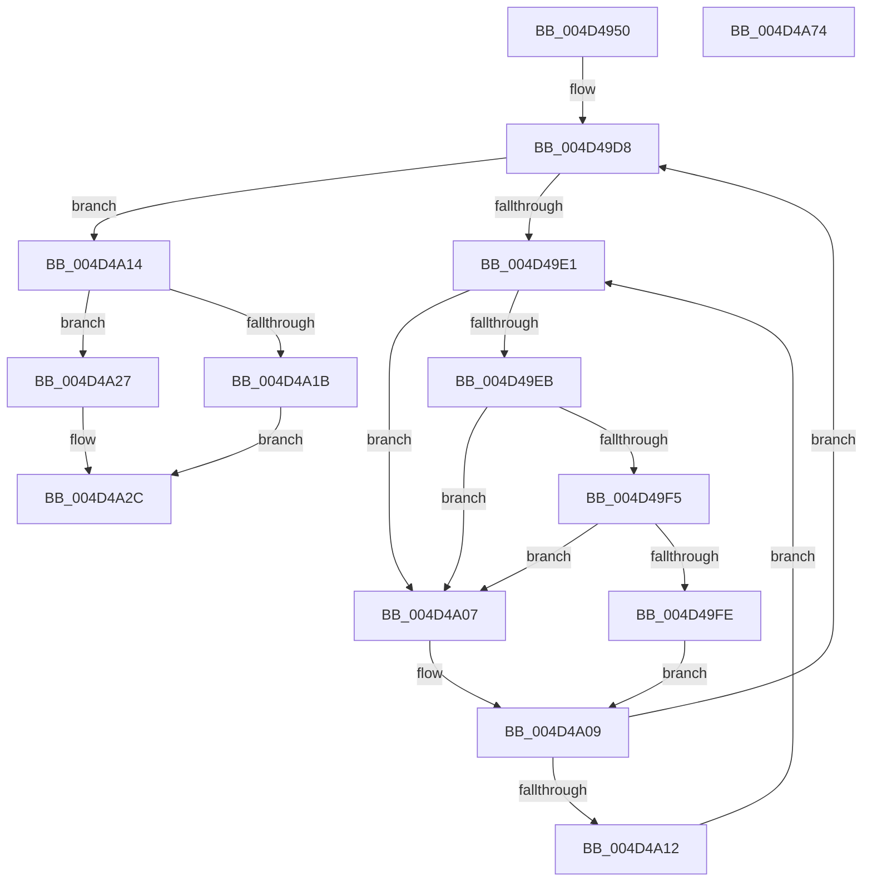

# MiLockDownWorkingSet

- RVA: `0x004D4950`–`0x004D4A75` (길이 `293` bytes)
- VA: `0x00000001404D4950`
- 실행 섹션: `.text`
- PDB 이름 있음: `예`; PDB Function 태그: `아니요`
- unwind 정보 RVA: `0x000BE160`
- 디코드: `77`개 명령, `293/293` bytes 표시
- 미해석 바이트: `0` (있으면 어셈블리에 `.byte`로 보존)

> 이 문서는 커널 이미지의 기계어와 PDB 기호를 분석해 생성했습니다. 4번과 5번은 함수 원형과 자료형을 바이너리 사용 방식에서 추정한 C 해석이며 원본 소스 복구 결과는 아닙니다.

## 1. Dependencies

- 직접 호출 지점: **9**; 고유 호출 대상: **9**
- 직접 호출자로 확인된 함수: **1**
- RIP 상대 이미지 참조: **3**

### Outgoing calls
- `0x004D4993` → [KiStackAttachProcess](../21/KiStackAttachProcess_function_00216820.md) (function, `0x00216820`)
- `0x004D499B` → [MiLockWorkingSetExclusive](../32/MiLockWorkingSetExclusive_function_003238A0.md) (function, `0x003238A0`)
- `0x004D49F5` → [KiCheckVpBackingLongSpinWaitHypercall](../30/KiCheckVpBackingLongSpinWaitHypercall_function_0030F490.md) (function, `0x0030F490`)
- `0x004D4A00` → [HvlNotifyLongSpinWait](../30/HvlNotifyLongSpinWait_function_0030F460.md) (function, `0x0030F460`)
- `0x004D4A20` → [MiAddLockedPageCharge](../28/MiAddLockedPageCharge_function_0028B550.md) (function, `0x0028B550`)
- `0x004D4A27` → [MiRemoveLockedPageChargeAndDecRef](../24/MiRemoveLockedPageChargeAndDecRef_function_002459D0.md) (function, `0x002459D0`)
- `0x004D4A41` → [MiUnlockWorkingSetExclusive](../27/MiUnlockWorkingSetExclusive_function_0027EC70.md) (function, `0x0027EC70`)
- `0x004D4A4D` → [KiUnstackDetachProcess](../21/KiUnstackDetachProcess_function_00217D30.md) (function, `0x00217D30`)
- `0x004D4A5A` → [_security_check_cookie](../6A/_security_check_cookie_function_006AC640.md) (function, `0x006AC640`)

### Direct callers
- [MiCloneProcessAddressSpace](../../page/AD/MiCloneProcessAddressSpace_function_00AD6F7C.md) at `0x00AD7007`
- [MiCloneProcessAddressSpace](../../page/AD/MiCloneProcessAddressSpace_function_00AD6F7C.md) at `0x00AD70D4`
- [MiCloneProcessAddressSpace](../../page/AD/MiCloneProcessAddressSpace_function_00AD6F7C.md) at `0x00AD7275`

### Static image references
- `0x004D4962` → RVA `0x00E0A740` (`.data`; read)
- `0x004D49E3` → RVA `0x00FC52AC` (`ALMOSTRO`; reference)
- `0x004D49EB` → RVA `0x00FC6AB8` (`ALMOSTRO`; read)

## 2. Other-region calls and transfers

- 다른 실행 섹션으로 향하는 call: **0**
- 별도 외부 분기/꼬리 이동을 확인하지 못했습니다.

## 3. Assembly (complete function range)

```asm
004D4950  48 89 5C 24 10                  mov qword ptr [rsp + 0x10], rbx
004D4955  48 89 6C 24 18                  mov qword ptr [rsp + 0x18], rbp
004D495A  56                              push rsi
004D495B  57                              push rdi
004D495C  41 56                           push r14
004D495E  48 83 EC 60                     sub rsp, 0x60
004D4962  48 8B 05 D7 5D 93 00            mov rax, qword ptr [rip + 0x935dd7]
004D4969  48 33 C4                        xor rax, rsp
004D496C  48 89 44 24 50                  mov qword ptr [rsp + 0x50], rax
004D4971  0F 57 C0                        xorps xmm0, xmm0
004D4974  4C 8D 44 24 20                  lea r8, [rsp + 0x20]
004D4979  8B F2                           mov esi, edx
004D497B  48 8D A9 00 04 00 00            lea rbp, [rcx + 0x400]
004D4982  33 D2                           xor edx, edx
004D4984  0F 11 44 24 20                  movups xmmword ptr [rsp + 0x20], xmm0
004D4989  0F 11 44 24 30                  movups xmmword ptr [rsp + 0x30], xmm0
004D498E  0F 11 44 24 40                  movups xmmword ptr [rsp + 0x40], xmm0
004D4993  E8 88 1E D4 FF                  call 0x140216820
004D4998  48 8B CD                        mov rcx, rbp
004D499B  E8 00 EF E4 FF                  call 0x1403238a0
004D49A0  44 8A F0                        mov r14b, al
004D49A3  48 B9 68 DF BE 7D FB F6 FF FF   movabs rcx, 0xfffff6fb7dbedf68
004D49AD  48 8B 09                        mov rcx, qword ptr [rcx]
004D49B0  48 B8 FF FF FF FF FF 00 00 00   movabs rax, 0xffffffffff
004D49BA  48 C1 E9 0C                     shr rcx, 0xc
004D49BE  48 23 C8                        and rcx, rax
004D49C1  48 8D 1C 49                     lea rbx, [rcx + rcx*2]
004D49C5  48 C1 E3 04                     shl rbx, 4
004D49C9  48 B8 00 00 00 00 00 DE FF FF   movabs rax, 0xffffde0000000000
004D49D3  48 03 D8                        add rbx, rax
004D49D6  33 FF                           xor edi, edi
004D49D8  F0 48 0F BA 6B 18 3F            lock bts qword ptr [rbx + 0x18], 0x3f
004D49DF  73 33                           jae 0x1404d4a14
004D49E1  FF C7                           inc edi
004D49E3  85 3D C3 08 AF 00               test dword ptr [rip + 0xaf08c3], edi
004D49E9  75 1C                           jne 0x1404d4a07
004D49EB  8B 05 C7 20 AF 00               mov eax, dword ptr [rip + 0xaf20c7]
004D49F1  A8 40                           test al, 0x40
004D49F3  74 12                           je 0x1404d4a07
004D49F5  E8 96 AA E3 FF                  call 0x14030f490
004D49FA  84 C0                           test al, al
004D49FC  74 09                           je 0x1404d4a07
004D49FE  8B CF                           mov ecx, edi
004D4A00  E8 5B AA E3 FF                  call 0x14030f460
004D4A05  EB 02                           jmp 0x1404d4a09
004D4A07  F3 90                           pause
004D4A09  48 8B 43 18                     mov rax, qword ptr [rbx + 0x18]
004D4A0D  48 85 C0                        test rax, rax
004D4A10  79 C6                           jns 0x1404d49d8
004D4A12  EB CD                           jmp 0x1404d49e1
004D4A14  48 8B CB                        mov rcx, rbx
004D4A17  85 F6                           test esi, esi
004D4A19  74 0C                           je 0x1404d4a27
004D4A1B  BA 01 00 00 00                  mov edx, 1
004D4A20  E8 2B 6B DB FF                  call 0x14028b550
004D4A25  EB 05                           jmp 0x1404d4a2c
004D4A27  E8 A4 0F D7 FF                  call 0x1402459d0
004D4A2C  48 B8 FF FF FF FF FF FF FF 7F   movabs rax, 0x7fffffffffffffff
004D4A36  F0 48 21 43 18                  lock and qword ptr [rbx + 0x18], rax
004D4A3B  41 8A D6                        mov dl, r14b
004D4A3E  48 8B CD                        mov rcx, rbp
004D4A41  E8 2A A2 DA FF                  call 0x14027ec70
004D4A46  33 D2                           xor edx, edx
004D4A48  48 8D 4C 24 20                  lea rcx, [rsp + 0x20]
004D4A4D  E8 DE 32 D4 FF                  call 0x140217d30
004D4A52  48 8B 4C 24 50                  mov rcx, qword ptr [rsp + 0x50]
004D4A57  48 33 CC                        xor rcx, rsp
004D4A5A  E8 E1 7B 1D 00                  call 0x1406ac640
004D4A5F  4C 8D 5C 24 60                  lea r11, [rsp + 0x60]
004D4A64  49 8B 5B 28                     mov rbx, qword ptr [r11 + 0x28]
004D4A68  49 8B 6B 30                     mov rbp, qword ptr [r11 + 0x30]
004D4A6C  49 8B E3                        mov rsp, r11
004D4A6F  41 5E                           pop r14
004D4A71  5F                              pop rdi
004D4A72  5E                              pop rsi
004D4A73  C3                              ret
004D4A74  CC                              int3
```

## 4. C-style interpretation (structured pseudocode)

```c
__int64 __fastcall MiLockDownWorkingSet(__int64 a1, int a2)
{
    __int64 result;
    __int64 v_rbx;
    __int64 v_rdi;
    __int64 v_rsp;
    unsigned __int64 v_stack_m18;
    unsigned __int64 v_stack_m28;
    unsigned __int64 v_stack_m38;
    unsigned __int64 v_stack_m48;
    unsigned __int64 v_stack_m58;
    unsigned __int64 v_stack_p10;
    unsigned __int64 v_stack_p18;

    v_stack_p10 = v_rbx;
    v_stack_p18 = v_rbp;
    v_rsp = (v_rsp) - (96);
    result = (*(unsigned __int64 *)(v_rip + 9657815)) ^ (v_rsp);
    v_stack_m28 = result;
    a2 = 0;
    v_stack_m58 = v_xmm0;
    v_stack_m48 = v_xmm0;
    v_stack_m38 = v_xmm0;
    result = KiStackAttachProcess(a1, a2, v_stack_m58, a4);
    result = MiLockWorkingSetExclusive(a1 + 1024, a2, v_stack_m58, a4);
    a1 = (*(unsigned __int64 *)(a1 + 1024)) >> (12);
    a1 = (a1) & (result);
    v_rbx = (a1 + a1 * 2) << (4);
    v_rbx = (v_rbx) + (result);
    v_rdi = 0;
loc_004D49D8:
    if (condition_is_above_or_equal) goto loc_004D4A14;
loc_004D49E1:
    v_rdi = (unsigned int)((v_rdi) + 1);
    if (((*(unsigned int *)(v_rip + 11471043)) & ((unsigned int)(v_rdi))) != 0) goto loc_004D4A07;
    if ((((unsigned __int8)((unsigned int)(*(unsigned int *)(v_rip + 11477191)))) & (64)) == 0) goto loc_004D4A07;
    result = KiCheckVpBackingLongSpinWaitHypercall(a1, a2, v_stack_m58, a4);
    if ((unsigned __int8)(result) == 0) goto loc_004D4A07;
    result = HvlNotifyLongSpinWait((unsigned int)((unsigned int)(v_rdi)), a2, v_stack_m58, a4);
    goto loc_004D4A09;
loc_004D4A07:
loc_004D4A09:
    if (!sign_flag) goto loc_004D49D8;
    goto loc_004D49E1;
loc_004D4A14:
    if ((unsigned int)((unsigned int)(a2)) == 0) goto loc_004D4A27;
    result = MiAddLockedPageCharge(v_rbx, 1, v_stack_m58, a4);
    goto loc_004D4A2C;
loc_004D4A27:
    result = MiRemoveLockedPageChargeAndDecRef(v_rbx, 1, v_stack_m58, a4);
loc_004D4A2C:
    result = MiUnlockWorkingSetExclusive(a1 + 1024, (unsigned __int8)((unsigned __int8)(result)), v_stack_m58, a4);
    a2 = 0;
    result = KiUnstackDetachProcess(v_stack_m58, a2, v_stack_m58, a4);
    a1 = (v_stack_m28) ^ (v_rsp);
    result = _security_check_cookie(a1, a2, v_stack_m58, a4);
    return result;
}
```

## 5. (Beta) C Style

```c
int64_t MiLockDownWorkingSet(void *Arg1, int32_t Arg2)
{
    uint8_t *arg1 = (uint8_t *)Arg1;

    int64_t result;
    int64_t local_rbx;
    int64_t local_rdi;
    int64_t local_rsp;
    uint64_t v_stack_m18;
    uint64_t v_stack_m28;
    uint64_t v_stack_m38;
    uint64_t v_stack_m48;
    uint64_t v_stack_m58;
    uint64_t v_stack_p10;
    uint64_t v_stack_p18;

    v_stack_p10 = local_rbx;
    v_stack_p18 = local_rbp;
    local_rsp = (local_rsp) - (96);
    result = (*(uint64_t *)(v_rip + 0x935DD7)) ^ (local_rsp);
    v_stack_m28 = result;
    Arg2 = 0;
    v_stack_m58 = v_xmm0;
    v_stack_m48 = v_xmm0;
    v_stack_m38 = v_xmm0;
    result = KiStackAttachProcess(Arg1, Arg2, v_stack_m58, a4);
    result = MiLockWorkingSetExclusive(Arg1 + 1024, Arg2, v_stack_m58, a4);
    Arg1 = (*(uint64_t *)(arg1 + 0x400)) >> (12);
    Arg1 = (Arg1) & (result);
    local_rbx = (Arg1 + Arg1 * 2) << (4);
    local_rbx = (local_rbx) + (result);
    local_rdi = 0;
loc_004D49D8:
    if (condition_is_above_or_equal) goto loc_004D4A14;
loc_004D49E1:
    local_rdi = (uint32_t)((local_rdi) + 1);
    if (((*(uint32_t *)(v_rip + 0xAF08C3)) & ((uint32_t)(local_rdi))) != 0) goto loc_004D4A07;
    if ((((uint8_t)((uint32_t)(*(uint32_t *)(v_rip + 0xAF20C7)))) & (64)) == 0) goto loc_004D4A07;
    result = KiCheckVpBackingLongSpinWaitHypercall(Arg1, Arg2, v_stack_m58, a4);
    if ((uint8_t)(result) == 0) goto loc_004D4A07;
    result = HvlNotifyLongSpinWait((uint32_t)((uint32_t)(local_rdi)), Arg2, v_stack_m58, a4);
    goto loc_004D4A09;
loc_004D4A07:
loc_004D4A09:
    if (!sign_flag) goto loc_004D49D8;
    goto loc_004D49E1;
loc_004D4A14:
    if ((uint32_t)((uint32_t)(Arg2)) == 0) goto loc_004D4A27;
    result = MiAddLockedPageCharge(local_rbx, 1, v_stack_m58, a4);
    goto loc_004D4A2C;
loc_004D4A27:
    result = MiRemoveLockedPageChargeAndDecRef(local_rbx, 1, v_stack_m58, a4);
loc_004D4A2C:
    result = MiUnlockWorkingSetExclusive(Arg1 + 1024, (uint8_t)((uint8_t)(result)), v_stack_m58, a4);
    Arg2 = 0;
    result = KiUnstackDetachProcess(v_stack_m58, Arg2, v_stack_m58, a4);
    Arg1 = (v_stack_m28) ^ (local_rsp);
    result = _security_check_cookie(Arg1, Arg2, v_stack_m58, a4);
    return result;
}
```

### 관측된 메모리 오프셋

구조체 형식이 확인되지 않은 접근은 인자 기준의 오프셋으로만 기록했습니다.

| 기준 인자 | 오프셋 표현 | 폭 (bit) | 접근 |
|---|---:|---:|---|
| `Arg1` | `+ 0x400` | `64` | `R` |

## 6. Execution-region graph

[열기: 2D/3D 그래프와 함수 탐색 컨트롤 패널](../../../control-panel.html?section=text&rva=0x004D4950&view=graph)

- 2D 그래프는 위에서 아래로 흐르고, 3D 그래프는 빈 공간을 드래그해 회전합니다. Shift+드래그는 이동, 휠은 확대·축소, 함수 노드 선택은 대상 보고서 이동입니다.

### Static fallback


