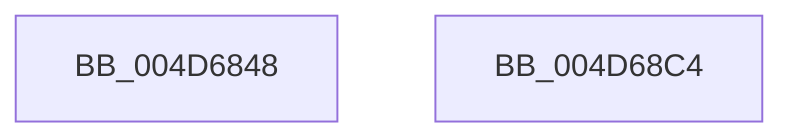

# MiLogKernelStackEvent

- RVA: `0x004D6848`–`0x004D68C5` (길이 `125` bytes)
- VA: `0x00000001404D6848`
- 실행 섹션: `.text`
- PDB 이름 있음: `예`; PDB Function 태그: `아니요`
- unwind 정보 RVA: `0x000BE484`
- 디코드: `29`개 명령, `125/125` bytes 표시
- 미해석 바이트: `0` (있으면 어셈블리에 `.byte`로 보존)

> 이 문서는 커널 이미지의 기계어와 PDB 기호를 분석해 생성했습니다. 4번과 5번은 함수 원형과 자료형을 바이너리 사용 방식에서 추정한 C 해석이며 원본 소스 복구 결과는 아닙니다.

## 1. Dependencies

- 직접 호출 지점: **2**; 고유 호출 대상: **2**
- 직접 호출자로 확인된 함수: **3**
- RIP 상대 이미지 참조: **1**

### Outgoing calls
- `0x004D68AD` → [EtwTraceKernelEvent](../23/EtwTraceKernelEvent_function_00235350.md) (function, `0x00235350`)
- `0x004D68BA` → [_security_check_cookie](../6A/_security_check_cookie_function_006AC640.md) (function, `0x006AC640`)

### Direct callers
- [sub_00338691](../33/Unknown_function_00338691.md) at `0x003386B8`
- [MmDeleteKernelStack](../33/MmDeleteKernelStack_function_0033A960.md) at `0x0033AE16`
- [MiInPageSingleKernelStack](../36/MiInPageSingleKernelStack_function_0036A3E8.md) at `0x0036A810`

### Static image references
- `0x004D684F` → RVA `0x00E0A740` (`.data`; read)

## 2. Other-region calls and transfers

- 다른 실행 섹션으로 향하는 call: **0**
- 별도 외부 분기/꼬리 이동을 확인하지 못했습니다.

## 3. Assembly (complete function range)

```asm
004D6848  4C 8B DC                        mov r11, rsp
004D684B  48 83 EC 68                     sub rsp, 0x68
004D684F  48 8B 05 EA 3E 93 00            mov rax, qword ptr [rip + 0x933eea]
004D6856  48 33 C4                        xor rax, rsp
004D6859  48 89 44 24 58                  mov qword ptr [rsp + 0x58], rax
004D685E  33 C0                           xor eax, eax
004D6860  49 89 4B D0                     mov qword ptr [r11 - 0x30], rcx
004D6864  48 83 E0 FB                     and rax, 0xfffffffffffffffb
004D6868  49 89 53 D8                     mov qword ptr [r11 - 0x28], rdx
004D686C  48 83 C8 0B                     or rax, 0xb
004D6870  C7 44 24 20 04 1B 50 11         mov dword ptr [rsp + 0x20], 0x11501b04
004D6878  49 89 43 C8                     mov qword ptr [r11 - 0x38], rax
004D687C  49 8D 4B E0                     lea rcx, [r11 - 0x20]
004D6880  49 8D 43 C8                     lea rax, [r11 - 0x38]
004D6884  BA 01 00 00 00                  mov edx, 1
004D6889  49 89 43 E0                     mov qword ptr [r11 - 0x20], rax
004D688D  83 64 24 54 00                  and dword ptr [rsp + 0x54], 0
004D6892  41 F7 D8                        neg r8d
004D6895  C7 44 24 50 18 00 00 00         mov dword ptr [rsp + 0x50], 0x18
004D689D  41 B8 01 00 00 20               mov r8d, 0x20000001
004D68A3  66 45 1B C9                     sbb r9w, r9w
004D68A7  66 41 81 C1 79 02               add r9w, 0x279
004D68AD  E8 9E EA D5 FF                  call 0x140235350
004D68B2  48 8B 4C 24 58                  mov rcx, qword ptr [rsp + 0x58]
004D68B7  48 33 CC                        xor rcx, rsp
004D68BA  E8 81 5D 1D 00                  call 0x1406ac640
004D68BF  48 83 C4 68                     add rsp, 0x68
004D68C3  C3                              ret
004D68C4  CC                              int3
```

## 4. C-style interpretation (structured pseudocode)

```c
__int64 __fastcall MiLogKernelStackEvent(__int64 a1, __int64 a2, int a3, unsigned __int16 a4)
{
    __int64 result;
    __int64 v_rsp;
    unsigned __int64 v_stack_m10;
    unsigned int v_stack_m14;
    unsigned int v_stack_m18;
    unsigned int v_stack_m48;

    v_rsp = (v_rsp) - (104);
    result = (*(unsigned __int64 *)(v_rip + 9649898)) ^ (v_rsp);
    v_stack_m10 = result;
    result = 0;
    *(unsigned __int64 *)(v_rsp - 48) = a1;
    result = (result) & (-5);
    *(unsigned __int64 *)(v_rsp - 40) = a2;
    result = (result) | (11);
    v_stack_m48 = 0x11501B04ULL;
    *(unsigned __int64 *)(v_rsp - 56) = result;
    *(unsigned __int64 *)(v_rsp - 32) = v_rsp - 56;
    a3 = (unsigned int)(-(a3));
    v_stack_m18 = 24;
    a4 = (unsigned __int16)((a4) + (633));
    result = EtwTraceKernelEvent(v_rsp - 32, 1, (unsigned int)(0x20000001ULL), a4);
    a1 = (v_stack_m10) ^ (v_rsp);
    result = _security_check_cookie(a1, 1, (unsigned int)(0x20000001ULL), a4);
    v_rsp = (v_rsp) + (104);
    return result;
}
```

## 5. (Beta) C Style

```c
int64_t MiLogKernelStackEvent(int64_t Arg1, int64_t Arg2, int32_t Arg3, uint16_t Arg4)
{
    int64_t result;
    int64_t local_rsp;
    uint64_t v_stack_m10;
    uint32_t v_stack_m14;
    uint32_t v_stack_m18;
    uint32_t v_stack_m48;

    local_rsp = (local_rsp) - (104);
    result = (*(uint64_t *)(v_rip + 0x933EEA)) ^ (local_rsp);
    v_stack_m10 = result;
    result = 0;
    *(uint64_t *)(local_rsp - 0x30) = Arg1;
    result = (result) & (-5);
    *(uint64_t *)(local_rsp - 0x28) = Arg2;
    result = (result) | (11);
    v_stack_m48 = 0x11501B04ULL;
    *(uint64_t *)(local_rsp - 0x38) = result;
    *(uint64_t *)(local_rsp - 0x20) = local_rsp - 56;
    Arg3 = (uint32_t)(-(Arg3));
    v_stack_m18 = 24;
    Arg4 = (uint16_t)((Arg4) + (633));
    result = EtwTraceKernelEvent(local_rsp - 32, 1, (uint32_t)(0x20000001ULL), Arg4);
    Arg1 = (v_stack_m10) ^ (local_rsp);
    result = _security_check_cookie(Arg1, 1, (uint32_t)(0x20000001ULL), Arg4);
    local_rsp = (local_rsp) + (104);
    return result;
}
```

## 6. Execution-region graph

[열기: 2D/3D 그래프와 함수 탐색 컨트롤 패널](../../../control-panel.html?section=text&rva=0x004D6848&view=graph)

- 2D 그래프는 위에서 아래로 흐르고, 3D 그래프는 빈 공간을 드래그해 회전합니다. Shift+드래그는 이동, 휠은 확대·축소, 함수 노드 선택은 대상 보고서 이동입니다.

### Static fallback


