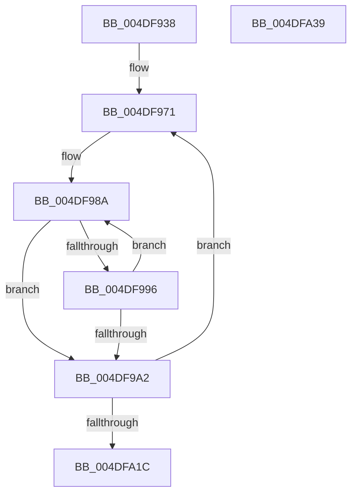

# MiLogNonPagedPoolReleaseEvent

- RVA: `0x004DF938`–`0x004DFA3A` (길이 `258` bytes)
- VA: `0x00000001404DF938`
- 실행 섹션: `.text`
- PDB 이름 있음: `예`; PDB Function 태그: `아니요`
- unwind 정보 RVA: `0x000B6754`
- 디코드: `60`개 명령, `258/258` bytes 표시
- 미해석 바이트: `0` (있으면 어셈블리에 `.byte`로 보존)

> 이 문서는 커널 이미지의 기계어와 PDB 기호를 분석해 생성했습니다. 4번과 5번은 함수 원형과 자료형을 바이너리 사용 방식에서 추정한 C 해석이며 원본 소스 복구 결과는 아닙니다.

## 1. Dependencies

- 직접 호출 지점: **2**; 고유 호출 대상: **2**
- 직접 호출자로 확인된 함수: **1**
- RIP 상대 이미지 참조: **1**

### Outgoing calls
- `0x004DFA0E` → [EtwTraceKernelEvent](../23/EtwTraceKernelEvent_function_00235350.md) (function, `0x00235350`)
- `0x004DFA24` → [_security_check_cookie](../6A/_security_check_cookie_function_006AC640.md) (function, `0x006AC640`)

### Direct callers
- [MiClearNonPagedPtes](../2C/MiClearNonPagedPtes_function_002C17A0.md) at `0x002C18E6`

### Static image references
- `0x004DF947` → RVA `0x00E0A740` (`.data`; read)

## 2. Other-region calls and transfers

- 다른 실행 섹션으로 향하는 call: **0**
- 별도 외부 분기/꼬리 이동을 확인하지 못했습니다.

## 3. Assembly (complete function range)

```asm
004DF938  48 89 5C 24 08                  mov qword ptr [rsp + 8], rbx
004DF93D  48 89 74 24 10                  mov qword ptr [rsp + 0x10], rsi
004DF942  57                              push rdi
004DF943  48 83 EC 60                     sub rsp, 0x60
004DF947  48 8B 05 F2 AD 92 00            mov rax, qword ptr [rip + 0x92adf2]
004DF94E  48 33 C4                        xor rax, rsp
004DF951  48 89 44 24 58                  mov qword ptr [rsp + 0x58], rax
004DF956  48 8B 19                        mov rbx, qword ptr [rcx]
004DF959  48 BF 00 00 00 00 80 F6 FF FF   movabs rdi, 0xfffff68000000000
004DF963  48 C1 E7 19                     shl rdi, 0x19
004DF967  48 BE 00 00 00 00 00 00 00 80   movabs rsi, 0x8000000000000000
004DF971  33 C0                           xor eax, eax
004DF973  0F 57 C0                        xorps xmm0, xmm0
004DF976  0F 11 44 24 30                  movups xmmword ptr [rsp + 0x30], xmm0
004DF97B  48 89 44 24 40                  mov qword ptr [rsp + 0x40], rax
004DF980  48 8B 4B 08                     mov rcx, qword ptr [rbx + 8]
004DF984  48 0B CE                        or rcx, rsi
004DF987  48 8B D1                        mov rdx, rcx
004DF98A  48 8B 1B                        mov rbx, qword ptr [rbx]
004DF98D  48 83 E9 08                     sub rcx, 8
004DF991  48 85 DB                        test rbx, rbx
004DF994  74 0C                           je 0x1404df9a2
004DF996  48 8B 43 08                     mov rax, qword ptr [rbx + 8]
004DF99A  48 0B C6                        or rax, rsi
004DF99D  48 3B C1                        cmp rax, rcx
004DF9A0  74 E8                           je 0x1404df98a
004DF9A2  48 8B 44 24 30                  mov rax, qword ptr [rsp + 0x30]
004DF9A7  48 2B D1                        sub rdx, rcx
004DF9AA  83 64 24 54 00                  and dword ptr [rsp + 0x54], 0
004DF9AF  48 83 E0 F5                     and rax, 0xfffffffffffffff5
004DF9B3  48 83 C8 05                     or rax, 5
004DF9B7  48 C1 FA 03                     sar rdx, 3
004DF9BB  48 89 44 24 30                  mov qword ptr [rsp + 0x30], rax
004DF9C0  41 B9 79 02 00 00               mov r9d, 0x279
004DF9C6  48 8B C1                        mov rax, rcx
004DF9C9  48 89 54 24 40                  mov qword ptr [rsp + 0x40], rdx
004DF9CE  48 C1 E0 19                     shl rax, 0x19
004DF9D2  48 8D 4C 24 48                  lea rcx, [rsp + 0x48]
004DF9D7  48 2B C7                        sub rax, rdi
004DF9DA  C7 44 24 50 18 00 00 00         mov dword ptr [rsp + 0x50], 0x18
004DF9E2  48 05 00 00 00 10               add rax, 0x10000000
004DF9E8  C7 44 24 20 04 1B 50 11         mov dword ptr [rsp + 0x20], 0x11501b04
004DF9F0  48 C1 F8 10                     sar rax, 0x10
004DF9F4  BA 01 00 00 00                  mov edx, 1
004DF9F9  48 89 44 24 38                  mov qword ptr [rsp + 0x38], rax
004DF9FE  41 B8 01 00 00 20               mov r8d, 0x20000001
004DFA04  48 8D 44 24 30                  lea rax, [rsp + 0x30]
004DFA09  48 89 44 24 48                  mov qword ptr [rsp + 0x48], rax
004DFA0E  E8 3D 59 D5 FF                  call 0x140235350
004DFA13  48 85 DB                        test rbx, rbx
004DFA16  0F 85 55 FF FF FF               jne 0x1404df971
004DFA1C  48 8B 4C 24 58                  mov rcx, qword ptr [rsp + 0x58]
004DFA21  48 33 CC                        xor rcx, rsp
004DFA24  E8 17 CC 1C 00                  call 0x1406ac640
004DFA29  48 8B 5C 24 70                  mov rbx, qword ptr [rsp + 0x70]
004DFA2E  48 8B 74 24 78                  mov rsi, qword ptr [rsp + 0x78]
004DFA33  48 83 C4 60                     add rsp, 0x60
004DFA37  5F                              pop rdi
004DFA38  C3                              ret
004DFA39  CC                              int3
```

## 4. C-style interpretation (structured pseudocode)

```c
__int64 __fastcall MiLogNonPagedPoolReleaseEvent(__int64 a1)
{
    __int64 result;
    __int64 v_rdi;
    __int64 v_rsp;
    unsigned __int64 v_stack_m10;
    unsigned int v_stack_m14;
    unsigned int v_stack_m18;
    unsigned __int64 v_stack_m20;
    unsigned __int64 v_stack_m28;
    unsigned __int64 v_stack_m30;
    unsigned __int64 v_stack_m38;
    unsigned int v_stack_m48;
    unsigned __int64 v_stack_p10;
    unsigned __int64 v_stack_p8;

    v_stack_p8 = v_rbx;
    v_stack_p10 = v_rsi;
    v_rsp = (v_rsp) - (96);
    result = (*(unsigned __int64 *)(v_rip + 9612786)) ^ (v_rsp);
    v_stack_m10 = result;
    v_rdi = (v_rdi) << (25);
loc_004DF971:
    result = 0;
    v_stack_m38 = v_xmm0;
    v_stack_m28 = 0;
    a1 = (*(unsigned __int64 *)(*(unsigned __int64 *)(a1) + 8)) | (v_rsi);
loc_004DF98A:
    a1 = (a1) - (8);
    if (*(unsigned __int64 *)(*(unsigned __int64 *)(a1)) == 0) goto loc_004DF9A2;
    result = (*(unsigned __int64 *)(*(unsigned __int64 *)(*(unsigned __int64 *)(a1)) + 8)) | (v_rsi);
    if (result == a1) goto loc_004DF98A;
loc_004DF9A2:
    a2 = (a1) - (a1);
    result = (v_stack_m38) & (-11);
    result = (result) | (5);
    a2 = (a2) >> (3);
    v_stack_m38 = result;
    v_stack_m28 = a2;
    result = (a1) << (25);
    result = (result) - (v_rdi);
    v_stack_m18 = 24;
    result = (result) + (0x10000000ULL);
    v_stack_m48 = 0x11501B04ULL;
    result = (result) >> (16);
    v_stack_m30 = result;
    v_stack_m20 = v_stack_m38;
    result = EtwTraceKernelEvent(v_stack_m20, 1, (unsigned int)(0x20000001ULL), 633);
    if (*(unsigned __int64 *)(*(unsigned __int64 *)(a1)) != 0) goto loc_004DF971;
    a1 = (v_stack_m10) ^ (v_rsp);
    result = _security_check_cookie(a1, 1, (unsigned int)(0x20000001ULL), 633);
    v_rsp = (v_rsp) + (96);
    return result;
}
```

## 5. (Beta) C Style

```c
int64_t MiLogNonPagedPoolReleaseEvent(void *Arg1)
{
    uint8_t *arg1 = (uint8_t *)Arg1;

    int64_t result;
    int64_t local_rdi;
    int64_t local_rsp;
    uint64_t v_stack_m10;
    uint32_t v_stack_m14;
    uint32_t v_stack_m18;
    uint64_t v_stack_m20;
    uint64_t v_stack_m28;
    uint64_t v_stack_m30;
    uint64_t v_stack_m38;
    uint32_t v_stack_m48;
    uint64_t v_stack_p10;
    uint64_t v_stack_p8;

    v_stack_p8 = local_rbx;
    v_stack_p10 = local_rsi;
    local_rsp = (local_rsp) - (96);
    result = (*(uint64_t *)(v_rip + 0x92ADF2)) ^ (local_rsp);
    v_stack_m10 = result;
    local_rdi = (local_rdi) << (25);
loc_004DF971:
    result = 0;
    v_stack_m38 = v_xmm0;
    v_stack_m28 = 0;
    Arg1 = (*(uint64_t *)(*(uint64_t *)(arg1) + 0x8)) | (local_rsi);
loc_004DF98A:
    Arg1 = (Arg1) - (8);
    if (*(uint64_t *)(*(uint64_t *)(arg1)) == 0) goto loc_004DF9A2;
    result = (*(uint64_t *)(*(uint64_t *)(*(uint64_t *)(arg1)) + 0x8)) | (local_rsi);
    if (result == Arg1) goto loc_004DF98A;
loc_004DF9A2:
    a2 = (Arg1) - (Arg1);
    result = (v_stack_m38) & (-11);
    result = (result) | (5);
    a2 = (a2) >> (3);
    v_stack_m38 = result;
    v_stack_m28 = a2;
    result = (Arg1) << (25);
    result = (result) - (local_rdi);
    v_stack_m18 = 24;
    result = (result) + (0x10000000ULL);
    v_stack_m48 = 0x11501B04ULL;
    result = (result) >> (16);
    v_stack_m30 = result;
    v_stack_m20 = v_stack_m38;
    result = EtwTraceKernelEvent(v_stack_m20, 1, (uint32_t)(0x20000001ULL), 633);
    if (*(uint64_t *)(*(uint64_t *)(arg1)) != 0) goto loc_004DF971;
    Arg1 = (v_stack_m10) ^ (local_rsp);
    result = _security_check_cookie(Arg1, 1, (uint32_t)(0x20000001ULL), 633);
    local_rsp = (local_rsp) + (96);
    return result;
}
```

### 관측된 메모리 오프셋

구조체 형식이 확인되지 않은 접근은 인자 기준의 오프셋으로만 기록했습니다.

| 기준 인자 | 오프셋 표현 | 폭 (bit) | 접근 |
|---|---:|---:|---|
| `Arg1` | `+ 0x0` | `64` | `R` |

## 6. Execution-region graph

[열기: 2D/3D 그래프와 함수 탐색 컨트롤 패널](../../../control-panel.html?section=text&rva=0x004DF938&view=graph)

- 2D 그래프는 위에서 아래로 흐르고, 3D 그래프는 빈 공간을 드래그해 회전합니다. Shift+드래그는 이동, 휠은 확대·축소, 함수 노드 선택은 대상 보고서 이동입니다.

### Static fallback


