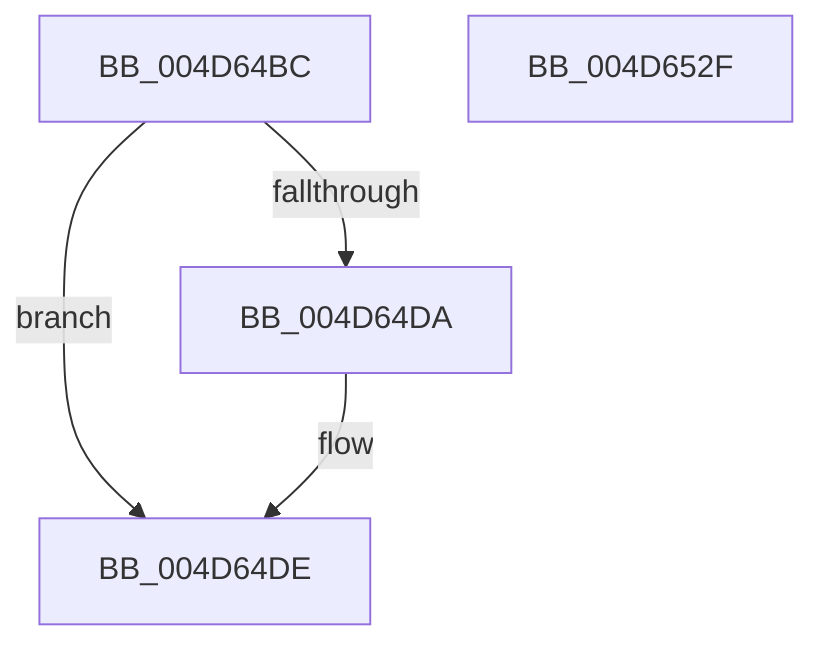

# MiLogRemoveWsleEvent

- RVA: `0x004D64BC`–`0x004D6530` (길이 `116` bytes)
- VA: `0x00000001404D64BC`
- 실행 섹션: `.text`
- PDB 이름 있음: `예`; PDB Function 태그: `아니요`
- unwind 정보 RVA: `0x000B3A94`
- 디코드: `25`개 명령, `116/116` bytes 표시
- 미해석 바이트: `0` (있으면 어셈블리에 `.byte`로 보존)

> 이 문서는 커널 이미지의 기계어와 PDB 기호를 분석해 생성했습니다. 4번과 5번은 함수 원형과 자료형을 바이너리 사용 방식에서 추정한 C 해석이며 원본 소스 복구 결과는 아닙니다.

## 1. Dependencies

- 직접 호출 지점: **2**; 고유 호출 대상: **2**
- 직접 호출자로 확인된 함수: **3**
- RIP 상대 이미지 참조: **1**

### Outgoing calls
- `0x004D6518` → [EtwTraceKernelEvent](../23/EtwTraceKernelEvent_function_00235350.md) (function, `0x00235350`)
- `0x004D6525` → [_security_check_cookie](../6A/_security_check_cookie_function_006AC640.md) (function, `0x006AC640`)

### Direct callers
- [MiRemoveWsle](../22/MiRemoveWsle_function_0022D0C4.md) at `0x0022D33B`
- [MiDecommitAddToList](../24/MiDecommitAddToList_function_00242264.md) at `0x002425F2`
- [sub_0029273F](../29/Unknown_function_0029273F.md) at `0x00292AD1`

### Static image references
- `0x004D64C0` → RVA `0x00E0A740` (`.data`; read)

## 2. Other-region calls and transfers

- 다른 실행 섹션으로 향하는 call: **0**
- 별도 외부 분기/꼬리 이동을 확인하지 못했습니다.

## 3. Assembly (complete function range)

```asm
004D64BC  48 83 EC 58                     sub rsp, 0x58
004D64C0  48 8B 05 79 42 93 00            mov rax, qword ptr [rip + 0x934279]
004D64C7  48 33 C4                        xor rax, rsp
004D64CA  48 89 44 24 48                  mov qword ptr [rsp + 0x48], rax
004D64CF  48 81 E1 00 F0 FF FF            and rcx, 0xfffffffffffff000
004D64D6  85 D2                           test edx, edx
004D64D8  74 04                           je 0x1404d64de
004D64DA  48 83 C9 02                     or rcx, 2
004D64DE  83 64 24 44 00                  and dword ptr [rsp + 0x44], 0
004D64E3  48 8D 44 24 30                  lea rax, [rsp + 0x30]
004D64E8  48 89 4C 24 30                  mov qword ptr [rsp + 0x30], rcx
004D64ED  41 B9 83 02 00 00               mov r9d, 0x283
004D64F3  48 8D 4C 24 38                  lea rcx, [rsp + 0x38]
004D64F8  48 89 44 24 38                  mov qword ptr [rsp + 0x38], rax
004D64FD  BA 01 00 00 00                  mov edx, 1
004D6502  C7 44 24 40 08 00 00 00         mov dword ptr [rsp + 0x40], 8
004D650A  41 B8 00 00 00 28               mov r8d, 0x28000000
004D6510  C7 44 24 20 02 1B 50 11         mov dword ptr [rsp + 0x20], 0x11501b02
004D6518  E8 33 EE D5 FF                  call 0x140235350
004D651D  48 8B 4C 24 48                  mov rcx, qword ptr [rsp + 0x48]
004D6522  48 33 CC                        xor rcx, rsp
004D6525  E8 16 61 1D 00                  call 0x1406ac640
004D652A  48 83 C4 58                     add rsp, 0x58
004D652E  C3                              ret
004D652F  CC                              int3
```

## 4. C-style interpretation (structured pseudocode)

```c
__int64 __fastcall MiLogRemoveWsleEvent(__int64 a1, int a2)
{
    __int64 result;
    __int64 v_rsp;
    unsigned __int64 v_stack_m10;
    unsigned int v_stack_m14;
    unsigned int v_stack_m18;
    unsigned __int64 v_stack_m20;
    unsigned __int64 v_stack_m28;
    unsigned int v_stack_m38;

    v_rsp = (v_rsp) - (88);
    result = (*(unsigned __int64 *)(v_rip + 9650809)) ^ (v_rsp);
    v_stack_m10 = result;
    a1 = (a1) & (0xFFFFFFFFFFFFF000ULL);
    if (a2 != 0) {
        a1 = (a1) | (2);
    }
    v_stack_m28 = a1;
    v_stack_m20 = v_stack_m28;
    v_stack_m18 = 8;
    v_stack_m38 = 0x11501B02ULL;
    result = EtwTraceKernelEvent(v_stack_m20, 1, (unsigned int)(0x28000000ULL), 643);
    a1 = (v_stack_m10) ^ (v_rsp);
    result = _security_check_cookie(a1, 1, (unsigned int)(0x28000000ULL), 643);
    v_rsp = (v_rsp) + (88);
    return result;
}
```

## 5. (Beta) C Style

```c
int64_t MiLogRemoveWsleEvent(int64_t Arg1, int32_t Arg2)
{
    int64_t result;
    int64_t local_rsp;
    uint64_t v_stack_m10;
    uint32_t v_stack_m14;
    uint32_t v_stack_m18;
    uint64_t v_stack_m20;
    uint64_t v_stack_m28;
    uint32_t v_stack_m38;

    local_rsp = (local_rsp) - (88);
    result = (*(uint64_t *)(v_rip + 0x934279)) ^ (local_rsp);
    v_stack_m10 = result;
    Arg1 = (Arg1) & (0xFFFFFFFFFFFFF000ULL);
    if (Arg2 != 0) {
        Arg1 = (Arg1) | (2);
    }
    v_stack_m28 = Arg1;
    v_stack_m20 = v_stack_m28;
    v_stack_m18 = 8;
    v_stack_m38 = 0x11501B02ULL;
    result = EtwTraceKernelEvent(v_stack_m20, 1, (uint32_t)(0x28000000ULL), 643);
    Arg1 = (v_stack_m10) ^ (local_rsp);
    result = _security_check_cookie(Arg1, 1, (uint32_t)(0x28000000ULL), 643);
    local_rsp = (local_rsp) + (88);
    return result;
}
```

## 6. Execution-region graph

[열기: 2D/3D 그래프와 함수 탐색 컨트롤 패널](../../../control-panel.html?section=text&rva=0x004D64BC&view=graph)

- 2D 그래프는 위에서 아래로 흐르고, 3D 그래프는 빈 공간을 드래그해 회전합니다. Shift+드래그는 이동, 휠은 확대·축소, 함수 노드 선택은 대상 보고서 이동입니다.

### Static fallback


