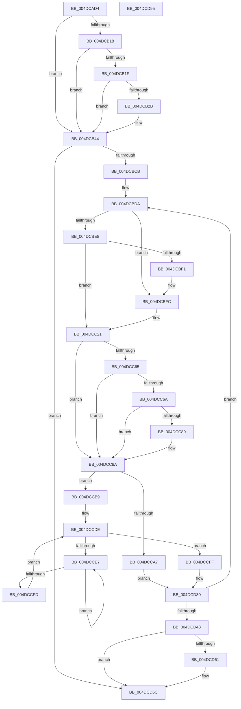

# MiMapKernelScp

- RVA: `0x004DCAD4`–`0x004DCD96` (길이 `706` bytes)
- VA: `0x00000001404DCAD4`
- 실행 섹션: `.text`
- PDB 이름 있음: `예`; PDB Function 태그: `아니요`
- unwind 정보 RVA: `0x000BEB2C`
- 디코드: `168`개 명령, `706/706` bytes 표시
- 미해석 바이트: `0` (있으면 어셈블리에 `.byte`로 보존)

> 이 문서는 커널 이미지의 기계어와 PDB 기호를 분석해 생성했습니다. 4번과 5번은 함수 원형과 자료형을 바이너리 사용 방식에서 추정한 C 해석이며 원본 소스 복구 결과는 아닙니다.

## 1. Dependencies

- 직접 호출 지점: **14**; 고유 호출 대상: **13**
- 직접 호출자로 확인된 함수: **2**
- RIP 상대 이미지 참조: **6**

### Outgoing calls
- `0x004DCB03` → [memset](../6C/memset_function_006C6C40.md) (function, `0x006C6C40`)
- `0x004DCB22` → [VslMapKernelScpPages](../4C/VslMapKernelScpPages_function_004C8054.md) (function, `0x004C8054`)
- `0x004DCB3E` → [KeBugCheckEx](../4F/KeBugCheckEx_function_004FD660.md) (function, `0x004FD660`)
- `0x004DCBAE` → [MiLockWorkingSetShared](../27/MiLockWorkingSetShared_function_0027CBF0.md) (function, `0x0027CBF0`)
- `0x004DCBF7` → [MiUnlockPageTable](../21/MiUnlockPageTable_function_00216EC0.md) (function, `0x00216EC0`)
- `0x004DCC1C` → [MiLockNestedPageTable](../23/MiLockNestedPageTable_function_0023E890.md) (function, `0x0023E890`)
- `0x004DCC27` → [MiLockAndIncrementShareCount](../49/MiLockAndIncrementShareCount_function_0049BE04.md) (function, `0x0049BE04`)
- `0x004DCC38` → [MiMakeValidPte](../2C/MiMakeValidPte_function_002C5590.md) (function, `0x002C5590`)
- `0x004DCC95` → [MiCheckLinearProtectedPteAccessedBit](../29/MiCheckLinearProtectedPteAccessedBit_function_00292D80.md) (function, `0x00292D80`)
- `0x004DCCB2` → [MiIncreaseUsedPtes](../24/MiIncreaseUsedPtes_function_00243630.md) (function, `0x00243630`)
- `0x004DCCBC` → [MiGetContainingPageTable](../34/MiGetContainingPageTable_function_003467F0.md) (function, `0x003467F0`)
- `0x004DCCEF` → [KeYieldProcessorEx](../3F/KeYieldProcessorEx_function_003FBD00.md) (function, `0x003FBD00`)
- `0x004DCD67` → [MiUnlockPageTable](../21/MiUnlockPageTable_function_00216EC0.md) (function, `0x00216EC0`)
- `0x004DCD72` → [MiUnlockWorkingSetShared](../27/MiUnlockWorkingSetShared_function_0027D690.md) (function, `0x0027D690`)

### Direct callers
- [MiFinalizeKernelScpForSystemImage](../../page/AA/MiFinalizeKernelScpForSystemImage_function_00AA02F8.md) at `0x00AA0310`
- [MiReloadBootLoadedDrivers](../../init/C6/MiReloadBootLoadedDrivers_function_00C6C3F8.md) at `0x00C6C49C`

### Static image references
- `0x004DCB08` → RVA `0x00FC6A88` (`ALMOSTRO`; read)
- `0x004DCB44` → RVA `0x00E375B0` (`.data`; read)
- `0x004DCB4C` → RVA `0x00E375AC` (`.data`; read)
- `0x004DCB95` → RVA `0x00E37E40` (`.data`; read)
- `0x004DCB9C` → RVA `0x00E2D840` (`.data`; read)
- `0x004DCBBC` → RVA `0x00E2D83C` (`.data`; read)

## 2. Other-region calls and transfers

- 다른 실행 섹션으로 향하는 call: **0**
- 별도 외부 분기/꼬리 이동을 확인하지 못했습니다.

## 3. Assembly (complete function range)

```asm
004DCAD4  48 89 5C 24 08                  mov qword ptr [rsp + 8], rbx
004DCAD9  44 89 44 24 18                  mov dword ptr [rsp + 0x18], r8d
004DCADE  55                              push rbp
004DCADF  56                              push rsi
004DCAE0  57                              push rdi
004DCAE1  41 54                           push r12
004DCAE3  41 55                           push r13
004DCAE5  41 56                           push r14
004DCAE7  41 57                           push r15
004DCAE9  48 81 EC 00 01 00 00            sub rsp, 0x100
004DCAF0  48 8B F2                        mov rsi, rdx
004DCAF3  48 8B D9                        mov rbx, rcx
004DCAF6  33 D2                           xor edx, edx
004DCAF8  48 8D 4C 24 40                  lea rcx, [rsp + 0x40]
004DCAFD  41 B8 C0 00 00 00               mov r8d, 0xc0
004DCB03  E8 38 A1 1E 00                  call 0x1406c6c40
004DCB08  48 8B 05 79 9F AE 00            mov rax, qword ptr [rip + 0xae9f79]
004DCB0F  33 FF                           xor edi, edi
004DCB11  48 0F BA E0 0E                  bt rax, 0xe
004DCB16  73 2C                           jae 0x1404dcb44
004DCB18  48 0F BA E0 0F                  bt rax, 0xf
004DCB1D  73 25                           jae 0x1404dcb44
004DCB1F  48 8B CB                        mov rcx, rbx
004DCB22  E8 2D B5 FE FF                  call 0x1404c8054
004DCB27  85 C0                           test eax, eax
004DCB29  79 19                           jns 0x1404dcb44
004DCB2B  48 21 7C 24 20                  and qword ptr [rsp + 0x20], rdi
004DCB30  8D 4F 1A                        lea ecx, [rdi + 0x1a]
004DCB33  4C 63 C8                        movsxd r9, eax
004DCB36  4C 8B C3                        mov r8, rbx
004DCB39  BA 14 15 05 00                  mov edx, 0x51514
004DCB3E  E8 1D 0B 02 00                  call 0x1404fd660
004DCB43  CC                              int3
004DCB44  8B 15 66 AA 95 00               mov edx, dword ptr [rip + 0x95aa66]
004DCB4A  8B C7                           mov eax, edi
004DCB4C  03 15 5A AA 95 00               add edx, dword ptr [rip + 0x95aa5a]
004DCB52  F7 C2 FF 0F 00 00               test edx, 0xfff
004DCB58  49 BE 00 00 00 00 80 F6 FF FF   movabs r14, 0xfffff68000000000
004DCB62  0F 95 C0                        setne al
004DCB65  C1 EA 0C                        shr edx, 0xc
004DCB68  44 8D 3C 02                     lea r15d, [rdx + rax]
004DCB6C  48 B8 F8 FF FF FF 7F 00 00 00   movabs rax, 0x7ffffffff8
004DCB76  4C 03 FE                        add r15, rsi
004DCB79  49 C1 E7 0C                     shl r15, 0xc
004DCB7D  4C 03 FB                        add r15, rbx
004DCB80  4D 8B E7                        mov r12, r15
004DCB83  4C 89 7C 24 30                  mov qword ptr [rsp + 0x30], r15
004DCB88  49 C1 EC 09                     shr r12, 9
004DCB8C  4C 23 E0                        and r12, rax
004DCB8F  49 8B C6                        mov rax, r14
004DCB92  4C 03 E0                        add r12, rax
004DCB95  48 8D 1D A4 B2 95 00            lea rbx, [rip + 0x95b2a4]
004DCB9C  48 8B 05 9D 0C 95 00            mov rax, qword ptr [rip + 0x950c9d]
004DCBA3  48 8B CB                        mov rcx, rbx
004DCBA6  48 89 84 24 58 01 00 00         mov qword ptr [rsp + 0x158], rax
004DCBAE  E8 3D 00 DA FF                  call 0x14027cbf0
004DCBB3  33 ED                           xor ebp, ebp
004DCBB5  88 84 24 50 01 00 00            mov byte ptr [rsp + 0x150], al
004DCBBC  39 3D 7A 0C 95 00               cmp dword ptr [rip + 0x950c7a], edi
004DCBC2  44 8A E8                        mov r13b, al
004DCBC5  0F 86 A1 01 00 00               jbe 0x1404dcd6c
004DCBCB  4C 8B BC 24 58 01 00 00         mov r15, qword ptr [rsp + 0x158]
004DCBD3  4C 8D 2D 66 B2 95 00            lea r13, [rip + 0x95b266]
004DCBDA  49 8B 5C EF 30                  mov rbx, qword ptr [r15 + rbp*8 + 0x30]
004DCBDF  49 8D 34 EC                     lea rsi, [r12 + rbp*8]
004DCBE3  48 85 FF                        test rdi, rdi
004DCBE6  74 14                           je 0x1404dcbfc
004DCBE8  48 F7 C6 FF 0F 00 00            test rsi, 0xfff
004DCBEF  75 30                           jne 0x1404dcc21
004DCBF1  48 8B D7                        mov rdx, rdi
004DCBF4  49 8B CD                        mov rcx, r13
004DCBF7  E8 C4 A2 D3 FF                  call 0x140216ec0
004DCBFC  48 8B FE                        mov rdi, rsi
004DCBFF  48 B8 F8 FF FF FF 7F 00 00 00   movabs rax, 0x7ffffffff8
004DCC09  48 C1 EF 09                     shr rdi, 9
004DCC0D  48 23 F8                        and rdi, rax
004DCC10  49 8B C6                        mov rax, r14
004DCC13  48 03 F8                        add rdi, rax
004DCC16  49 8B CD                        mov rcx, r13
004DCC19  48 8B D7                        mov rdx, rdi
004DCC1C  E8 6F 1C D6 FF                  call 0x14023e890
004DCC21  4C 8B 36                        mov r14, qword ptr [rsi]
004DCC24  48 8B CB                        mov rcx, rbx
004DCC27  E8 D8 F1 FB FF                  call 0x14049be04
004DCC2C  41 B8 03 00 00 00               mov r8d, 3
004DCC32  48 8B D3                        mov rdx, rbx
004DCC35  48 8B CE                        mov rcx, rsi
004DCC38  E8 53 89 DE FF                  call 0x1402c5590
004DCC3D  48 8B D8                        mov rbx, rax
004DCC40  48 B8 FF FF FF FF FF FF FF F9   movabs rax, 0xf9ffffffffffffff
004DCC4A  48 23 D8                        and rbx, rax
004DCC4D  48 B8 00 00 00 00 00 00 00 09   movabs rax, 0x900000000000000
004DCC57  48 0B D8                        or rbx, rax
004DCC5A  48 0F BA 25 25 9E AE 00 24      bt qword ptr [rip + 0xae9e25], 0x24
004DCC63  73 35                           jae 0x1404dcc9a
004DCC65  F6 C3 20                        test bl, 0x20
004DCC68  75 30                           jne 0x1404dcc9a
004DCC6A  48 B8 00 00 00 00 80 F6 FF FF   movabs rax, 0xfffff68000000000
004DCC74  48 8B C0                        mov rax, rax
004DCC77  48 B9 00 00 00 00 40 00 00 00   movabs rcx, 0x4000000000
004DCC81  48 03 C1                        add rax, rcx
004DCC84  48 3B F0                        cmp rsi, rax
004DCC87  72 11                           jb 0x1404dcc9a
004DCC89  41 B8 80 00 00 00               mov r8d, 0x80
004DCC8F  48 8B D3                        mov rdx, rbx
004DCC92  48 8B CE                        mov rcx, rsi
004DCC95  E8 E6 60 DB FF                  call 0x140292d80
004DCC9A  48 89 1E                        mov qword ptr [rsi], rbx
004DCC9D  4C 89 6C 24 60                  mov qword ptr [rsp + 0x60], r13
004DCCA2  4D 85 F6                        test r14, r14
004DCCA5  75 12                           jne 0x1404dccb9
004DCCA7  45 8D 4E 06                     lea r9d, [r14 + 6]
004DCCAB  48 8B D7                        mov rdx, rdi
004DCCAE  45 8D 46 01                     lea r8d, [r14 + 1]
004DCCB2  E8 79 69 D6 FF                  call 0x140243630
004DCCB7  EB 77                           jmp 0x1404dcd30
004DCCB9  48 8B CE                        mov rcx, rsi
004DCCBC  E8 2F 9B E6 FF                  call 0x1403467f0
004DCCC1  48 8D 1C 40                     lea rbx, [rax + rax*2]
004DCCC5  48 C1 E3 04                     shl rbx, 4
004DCCC9  48 B8 00 00 00 00 00 DE FF FF   movabs rax, 0xffffde0000000000
004DCCD3  48 03 D8                        add rbx, rax
004DCCD6  83 A4 24 58 01 00 00 00         and dword ptr [rsp + 0x158], 0
004DCCDE  F0 48 0F BA 6B 18 3F            lock bts qword ptr [rbx + 0x18], 0x3f
004DCCE5  73 18                           jae 0x1404dccff
004DCCE7  48 8D 8C 24 58 01 00 00         lea rcx, [rsp + 0x158]
004DCCEF  E8 0C F0 F1 FF                  call 0x1403fbd00
004DCCF4  48 8B 43 18                     mov rax, qword ptr [rbx + 0x18]
004DCCF8  48 85 C0                        test rax, rax
004DCCFB  78 EA                           js 0x1404dcce7
004DCCFD  EB DF                           jmp 0x1404dccde
004DCCFF  48 8B 43 18                     mov rax, qword ptr [rbx + 0x18]
004DCD03  48 8D 48 01                     lea rcx, [rax + 1]
004DCD07  48 8B D1                        mov rdx, rcx
004DCD0A  48 33 D0                        xor rdx, rax
004DCD0D  48 B8 00 00 00 00 00 00 00 C0   movabs rax, 0xc000000000000000
004DCD17  48 23 D0                        and rdx, rax
004DCD1A  48 B8 FF FF FF FF FF FF FF 7F   movabs rax, 0x7fffffffffffffff
004DCD24  48 33 D1                        xor rdx, rcx
004DCD27  48 89 53 18                     mov qword ptr [rbx + 0x18], rdx
004DCD2B  F0 48 21 43 18                  lock and qword ptr [rbx + 0x18], rax
004DCD30  FF C5                           inc ebp
004DCD32  49 BE 00 00 00 00 80 F6 FF FF   movabs r14, 0xfffff68000000000
004DCD3C  3B 2D FA 0A 95 00               cmp ebp, dword ptr [rip + 0x950afa]
004DCD42  0F 82 92 FE FF FF               jb 0x1404dcbda
004DCD48  4C 8B 7C 24 30                  mov r15, qword ptr [rsp + 0x30]
004DCD4D  48 8D 1D EC B0 95 00            lea rbx, [rip + 0x95b0ec]
004DCD54  44 8A AC 24 50 01 00 00         mov r13b, byte ptr [rsp + 0x150]
004DCD5C  48 85 FF                        test rdi, rdi
004DCD5F  74 0B                           je 0x1404dcd6c
004DCD61  48 8B D7                        mov rdx, rdi
004DCD64  48 8B CB                        mov rcx, rbx
004DCD67  E8 54 A1 D3 FF                  call 0x140216ec0
004DCD6C  41 8A D5                        mov dl, r13b
004DCD6F  48 8B CB                        mov rcx, rbx
004DCD72  E8 19 09 DA FF                  call 0x14027d690
004DCD77  48 8B 9C 24 40 01 00 00         mov rbx, qword ptr [rsp + 0x140]
004DCD7F  49 8B C7                        mov rax, r15
004DCD82  48 81 C4 00 01 00 00            add rsp, 0x100
004DCD89  41 5F                           pop r15
004DCD8B  41 5E                           pop r14
004DCD8D  41 5D                           pop r13
004DCD8F  41 5C                           pop r12
004DCD91  5F                              pop rdi
004DCD92  5E                              pop rsi
004DCD93  5D                              pop rbp
004DCD94  C3                              ret
004DCD95  CC                              int3
```

## 4. C-style interpretation (structured pseudocode)

```c
__int64 __fastcall MiMapKernelScp(__int64 a1, __int64 a2, int a3)
{
    __int64 result;
    __int64 v_r12;
    __int64 v_r15;
    __int64 v_rbp;
    __int64 v_rbx;
    __int64 v_rdi;
    __int64 v_rsp;
    unsigned __int64 v_stack_m108;
    unsigned __int64 v_stack_m118;
    unsigned __int64 v_stack_mD8;
    unsigned __int64 v_stack_mF8;
    unsigned int v_stack_p18;
    unsigned __int64 v_stack_p20;
    unsigned __int64 v_stack_p8;

    v_stack_p8 = v_rbx;
    v_stack_p18 = a3;
    v_rsp = (v_rsp) - (256);
    a2 = 0;
    result = memset(v_stack_mF8, a2, 192, a4);
    v_rdi = 0;
    if (condition_is_above_or_equal) goto loc_004DCB44;
    if (condition_is_above_or_equal) goto loc_004DCB44;
    result = VslMapKernelScpPages(a1, a2, 192, a4);
    if (sign_flag) {
        a1 = v_rdi + 26;
        a4 = (int)((unsigned int)(result));
        a3 = a1;
        a2 = 0x51514ULL;
        result = KeBugCheckEx(a1, a2, a3, a4);
    }
    a2 = (unsigned int)(((unsigned int)(*(unsigned int *)(v_rip + 9808486))) + (*(unsigned int *)(v_rip + 9808474)));
    result = ((((unsigned int)(a2)) & (0xFFFULL)) != 0) ? 1 : 0;
    a2 = (unsigned int)((a2) >> (12));
    v_r15 = (a2 + result * 1) + (a2);
    v_r15 = (v_r15) << (12);
    v_r15 = (v_r15) + (a1);
    v_stack_m108 = v_r15;
    v_r12 = (v_r15) >> (9);
    v_r12 = (v_r12) & (result);
    v_r12 = (v_r12) + (v_r14);
    v_stack_p20 = *(unsigned __int64 *)(v_rip + 9768093);
    result = MiLockWorkingSetShared(v_rip + 9810596, a2, a3, a4);
    v_rbp = 0;
    v_stack_p18 = (unsigned __int8)(result);
    if ((*(unsigned int *)(v_rip + 9768058)) <= 0) goto loc_004DCD6C;
loc_004DCBDA:
    if (0 == 0) goto loc_004DCBFC;
    if (((v_r12 + v_rbp * 8) & (0xFFFULL)) != 0) goto loc_004DCC21;
    result = MiUnlockPageTable(v_rip + 9810534, 0, a3, a4);
loc_004DCBFC:
    v_rdi = (v_r12 + v_rbp * 8) >> (9);
    v_rdi = (v_rdi) & (result);
    v_rdi = (v_rdi) + (v_r14);
    result = MiLockNestedPageTable(v_rip + 9810534, v_rdi, a3, a4);
loc_004DCC21:
    result = MiLockAndIncrementShareCount(*(unsigned __int64 *)(v_stack_p20 + v_rbp * 8 + 48), v_rdi, a3, a4);
    result = MiMakeValidPte(v_r12 + v_rbp * 8, *(unsigned __int64 *)(v_stack_p20 + v_rbp * 8 + 48), 3, a4);
    v_rbx = (result) & (result);
    v_rbx = (v_rbx) | (result);
    if (condition_is_above_or_equal) goto loc_004DCC9A;
    if ((((unsigned __int8)(v_rbx)) & (32)) != 0) goto loc_004DCC9A;
    result = (result) + (v_r12 + v_rbp * 8);
    if ((v_r12 + v_rbp * 8) >= result) {
        a3 = 128;
        a2 = v_rbx;
        a1 = v_r12 + v_rbp * 8;
        result = MiCheckLinearProtectedPteAccessedBit(a1, a2, a3, a4);
    }
    *(unsigned __int64 *)(v_r12 + v_rbp * 8) = v_rbx;
    v_stack_mD8 = v_rip + 9810534;
    if (*(unsigned __int64 *)(v_r12 + v_rbp * 8) != 0) goto loc_004DCCB9;
    result = MiIncreaseUsedPtes(a1, v_rdi, *(unsigned __int64 *)(v_r12 + v_rbp * 8) + 1, *(unsigned __int64 *)(v_r12 + v_rbp * 8) + 6);
    goto loc_004DCD30;
loc_004DCCB9:
    result = MiGetContainingPageTable(v_r12 + v_rbp * 8, v_rdi, *(unsigned __int64 *)(v_r12 + v_rbp * 8) + 1, *(unsigned __int64 *)(v_r12 + v_rbp * 8) + 6);
    v_rbx = (result + result * 2) << (4);
    v_rbx = (v_rbx) + (result);
loc_004DCCDE:
    if (condition_is_above_or_equal) goto loc_004DCCFF;
loc_004DCCE7:
    result = KeYieldProcessorEx(v_stack_p20, v_rdi, *(unsigned __int64 *)(v_r12 + v_rbp * 8) + 1, *(unsigned __int64 *)(v_r12 + v_rbp * 8) + 6);
    if (sign_flag) goto loc_004DCCE7;
    goto loc_004DCCDE;
loc_004DCCFF:
    a2 = (*(unsigned __int64 *)(v_rbx + 24) + 1) ^ (*(unsigned __int64 *)(v_rbx + 24));
    a2 = (a2) & (*(unsigned __int64 *)(v_rbx + 24));
    a2 = (a2) ^ (*(unsigned __int64 *)(v_rbx + 24) + 1);
    *(unsigned __int64 *)(v_rbx + 24) = a2;
loc_004DCD30:
    v_rbp = (unsigned int)((v_rbp) + 1);
    if (((unsigned int)(v_rbp)) < (*(unsigned int *)(v_rip + 9767674))) goto loc_004DCBDA;
    result = *(unsigned __int64 *)(v_rbx + 24);
    if (v_rdi != 0) {
        a2 = v_rdi;
        a1 = v_rip + 9810156;
        result = MiUnlockPageTable(a1, a2, *(unsigned __int64 *)(v_r12 + v_rbp * 8) + 1, *(unsigned __int64 *)(v_r12 + v_rbp * 8) + 6);
    }
    result = MiUnlockWorkingSetShared(v_rip + 9810156, (unsigned __int8)(v_stack_p18), *(unsigned __int64 *)(v_r12 + v_rbp * 8) + 1, *(unsigned __int64 *)(v_r12 + v_rbp * 8) + 6);
    v_rsp = (v_rsp) + (256);
    return v_stack_m108;
}
```

## 5. (Beta) C Style

```c
int64_t MiMapKernelScp(int64_t Arg1, int64_t Arg2, int32_t Arg3)
{
    int64_t result;
    int64_t local_r12;
    int64_t local_r15;
    int64_t local_rbp;
    int64_t local_rbx;
    int64_t local_rdi;
    int64_t local_rsp;
    uint64_t v_stack_m108;
    uint64_t v_stack_m118;
    uint64_t v_stack_mD8;
    uint64_t v_stack_mF8;
    uint32_t v_stack_p18;
    uint64_t v_stack_p20;
    uint64_t v_stack_p8;

    v_stack_p8 = local_rbx;
    v_stack_p18 = Arg3;
    local_rsp = (local_rsp) - (256);
    Arg2 = 0;
    result = memset(v_stack_mF8, Arg2, 192, a4);
    local_rdi = 0;
    if (condition_is_above_or_equal) goto loc_004DCB44;
    if (condition_is_above_or_equal) goto loc_004DCB44;
    result = VslMapKernelScpPages(Arg1, Arg2, 192, a4);
    if (sign_flag) {
        Arg1 = local_rdi + 26;
        a4 = (int32_t)((uint32_t)(result));
        Arg3 = Arg1;
        Arg2 = 0x51514ULL;
        result = KeBugCheckEx(Arg1, Arg2, Arg3, a4);
    }
    Arg2 = (uint32_t)(((uint32_t)(*(uint32_t *)(v_rip + 0x95AA66))) + (*(uint32_t *)(v_rip + 0x95AA5A)));
    result = ((((uint32_t)(Arg2)) & (0xFFFULL)) != 0) ? 1 : 0;
    Arg2 = (uint32_t)((Arg2) >> (12));
    local_r15 = (Arg2 + result * 1) + (Arg2);
    local_r15 = (local_r15) << (12);
    local_r15 = (local_r15) + (Arg1);
    v_stack_m108 = local_r15;
    local_r12 = (local_r15) >> (9);
    local_r12 = (local_r12) & (result);
    local_r12 = (local_r12) + (local_r14);
    v_stack_p20 = *(uint64_t *)(v_rip + 0x950C9D);
    result = MiLockWorkingSetShared(v_rip + 9810596, Arg2, Arg3, a4);
    local_rbp = 0;
    v_stack_p18 = (uint8_t)(result);
    if ((*(uint32_t *)(v_rip + 0x950C7A)) <= 0) goto loc_004DCD6C;
loc_004DCBDA:
    if (0 == 0) goto loc_004DCBFC;
    if (((local_r12 + local_rbp * 8) & (0xFFFULL)) != 0) goto loc_004DCC21;
    result = MiUnlockPageTable(v_rip + 9810534, 0, Arg3, a4);
loc_004DCBFC:
    local_rdi = (local_r12 + local_rbp * 8) >> (9);
    local_rdi = (local_rdi) & (result);
    local_rdi = (local_rdi) + (local_r14);
    result = MiLockNestedPageTable(v_rip + 9810534, local_rdi, Arg3, a4);
loc_004DCC21:
    result = MiLockAndIncrementShareCount(*(uint64_t *)(v_stack_p20 + local_rbp * 8 + 0x30), local_rdi, Arg3, a4);
    result = MiMakeValidPte(local_r12 + local_rbp * 8, *(uint64_t *)(v_stack_p20 + local_rbp * 8 + 0x30), 3, a4);
    local_rbx = (result) & (result);
    local_rbx = (local_rbx) | (result);
    if (condition_is_above_or_equal) goto loc_004DCC9A;
    if ((((uint8_t)(local_rbx)) & (32)) != 0) goto loc_004DCC9A;
    result = (result) + (local_r12 + local_rbp * 8);
    if ((local_r12 + local_rbp * 8) >= result) {
        Arg3 = 128;
        Arg2 = local_rbx;
        Arg1 = local_r12 + local_rbp * 8;
        result = MiCheckLinearProtectedPteAccessedBit(Arg1, Arg2, Arg3, a4);
    }
    *(uint64_t *)(local_r12 + local_rbp * 8) = local_rbx;
    v_stack_mD8 = v_rip + 9810534;
    if (*(uint64_t *)(local_r12 + local_rbp * 8) != 0) goto loc_004DCCB9;
    result = MiIncreaseUsedPtes(Arg1, local_rdi, *(uint64_t *)(local_r12 + local_rbp * 8) + 1, *(uint64_t *)(local_r12 + local_rbp * 8) + 6);
    goto loc_004DCD30;
loc_004DCCB9:
    result = MiGetContainingPageTable(local_r12 + local_rbp * 8, local_rdi, *(uint64_t *)(local_r12 + local_rbp * 8) + 1, *(uint64_t *)(local_r12 + local_rbp * 8) + 6);
    local_rbx = (result + result * 2) << (4);
    local_rbx = (local_rbx) + (result);
loc_004DCCDE:
    if (condition_is_above_or_equal) goto loc_004DCCFF;
loc_004DCCE7:
    result = KeYieldProcessorEx(v_stack_p20, local_rdi, *(uint64_t *)(local_r12 + local_rbp * 8) + 1, *(uint64_t *)(local_r12 + local_rbp * 8) + 6);
    if (sign_flag) goto loc_004DCCE7;
    goto loc_004DCCDE;
loc_004DCCFF:
    Arg2 = (*(uint64_t *)(local_rbx + 0x18) + 1) ^ (*(uint64_t *)(local_rbx + 0x18));
    Arg2 = (Arg2) & (*(uint64_t *)(local_rbx + 0x18));
    Arg2 = (Arg2) ^ (*(uint64_t *)(local_rbx + 0x18) + 1);
    *(uint64_t *)(local_rbx + 0x18) = Arg2;
loc_004DCD30:
    local_rbp = (uint32_t)((local_rbp) + 1);
    if (((uint32_t)(local_rbp)) < (*(uint32_t *)(v_rip + 0x950AFA))) goto loc_004DCBDA;
    result = *(uint64_t *)(local_rbx + 0x18);
    if (local_rdi != 0) {
        Arg2 = local_rdi;
        Arg1 = v_rip + 9810156;
        result = MiUnlockPageTable(Arg1, Arg2, *(uint64_t *)(local_r12 + local_rbp * 8) + 1, *(uint64_t *)(local_r12 + local_rbp * 8) + 6);
    }
    result = MiUnlockWorkingSetShared(v_rip + 9810156, (uint8_t)(v_stack_p18), *(uint64_t *)(local_r12 + local_rbp * 8) + 1, *(uint64_t *)(local_r12 + local_rbp * 8) + 6);
    local_rsp = (local_rsp) + (256);
    return v_stack_m108;
}
```

## 6. Execution-region graph

[열기: 2D/3D 그래프와 함수 탐색 컨트롤 패널](../../../control-panel.html?section=text&rva=0x004DCAD4&view=graph)

- 2D 그래프는 위에서 아래로 흐르고, 3D 그래프는 빈 공간을 드래그해 회전합니다. Shift+드래그는 이동, 휠은 확대·축소, 함수 노드 선택은 대상 보고서 이동입니다.

### Static fallback


