# MiMapMdlWithLargePages

- RVA: `0x004D10B8`–`0x004D156C` (길이 `1,204` bytes)
- VA: `0x00000001404D10B8`
- 실행 섹션: `.text`
- PDB 이름 있음: `예`; PDB Function 태그: `아니요`
- unwind 정보 RVA: `0x000BDD38`
- 디코드: `295`개 명령, `1,204/1,204` bytes 표시
- 미해석 바이트: `0` (있으면 어셈블리에 `.byte`로 보존)

> 이 문서는 커널 이미지의 기계어와 PDB 기호를 분석해 생성했습니다. 4번과 5번은 함수 원형과 자료형을 바이너리 사용 방식에서 추정한 C 해석이며 원본 소스 복구 결과는 아닙니다.

## 1. Dependencies

- 직접 호출 지점: **23**; 고유 호출 대상: **23**
- 직접 호출자로 확인된 함수: **1**
- RIP 상대 이미지 참조: **10**

### Outgoing calls
- `0x004D110E` → [memset](../6C/memset_function_006C6C40.md) (function, `0x006C6C40`)
- `0x004D11A7` → [MiLockWorkingSetSharedAtDpc](../23/MiLockWorkingSetSharedAtDpc_function_00239574.md) (function, `0x00239574`)
- `0x004D11AE` → [MiLockWorkingSetShared](../27/MiLockWorkingSetShared_function_0027CBF0.md) (function, `0x0027CBF0`)
- `0x004D11E8` → [MiGetAnyMultiplexedVm](../44/MiGetAnyMultiplexedVm_function_00448BD0.md) (function, `0x00448BD0`)
- `0x004D1221` → [MiLockNestedPageTable](../23/MiLockNestedPageTable_function_0023E890.md) (function, `0x0023E890`)
- `0x004D1282` → [MiRewritePteWithLockBit](../32/MiRewritePteWithLockBit_function_00322FEC.md) (function, `0x00322FEC`)
- `0x004D12AB` → [MiInsertPageChainHead](../2A/MiInsertPageChainHead_function_002A24EC.md) (function, `0x002A24EC`)
- `0x004D12DD` → [MiInitializeTbFlushList](../29/MiInitializeTbFlushList_function_00294F00.md) (function, `0x00294F00`)
- `0x004D12FB` → [MiInsertTbFlushEntry](../29/MiInsertTbFlushEntry_function_00293670.md) (function, `0x00293670`)
- `0x004D1304` → [MiFlushTbList](../31/MiFlushTbList_function_00311FC0.md) (function, `0x00311FC0`)
- `0x004D1368` → [MiMakeProtectionPfnCompatible](../22/MiMakeProtectionPfnCompatible_function_00229CD0.md) (function, `0x00229CD0`)
- `0x004D13AA` → [KiRaiseIrqlProcessIrqlFlags](../4F/KiRaiseIrqlProcessIrqlFlags_function_004F56FC.md) (function, `0x004F56FC`)
- `0x004D13B5` → [MiIoSpaceGetBounds](../2A/MiIoSpaceGetBounds_function_002AC728.md) (function, `0x002AC728`)
- `0x004D13CF` → [KiLowerIrqlProcessIrqlFlags](../4F/KiLowerIrqlProcessIrqlFlags_function_004F5698.md) (function, `0x004F5698`)
- `0x004D13F3` → [MiLookupIoPageNode](../2A/MiLookupIoPageNode_function_002AC5C8.md) (function, `0x002AC5C8`)
- `0x004D1441` → [MiGetLeafVa](../27/MiGetLeafVa_function_0027C0A0.md) (function, `0x0027C0A0`)
- `0x004D1452` → [MiWriteLargePte](../2C/MiWriteLargePte_function_002C6DE0.md) (function, `0x002C6DE0`)
- `0x004D1488` → [MiUnlockPageTable](../21/MiUnlockPageTable_function_00216EC0.md) (function, `0x00216EC0`)
- `0x004D14CD` → [MiUnlockWorkingSetShared](../27/MiUnlockWorkingSetShared_function_0027D690.md) (function, `0x0027D690`)
- `0x004D14E3` → [ExAcquireSpinLockExclusiveAtDpcLevel](../24/ExAcquireSpinLockExclusiveAtDpcLevel_function_00248E80.md) (function, `0x00248E80`)
- `0x004D14EA` → [ExAcquireSpinLockExclusive](../24/ExAcquireSpinLockExclusive_function_00248690.md) (function, `0x00248690`)
- `0x004D1543` → [MiReleaseSpinLockExclusive](../24/MiReleaseSpinLockExclusive_function_002482C0.md) (function, `0x002482C0`)
- `0x004D1552` → [_security_check_cookie](../6A/_security_check_cookie_function_006AC640.md) (function, `0x006AC640`)

### Direct callers
- [MiMapMdlCommon](../67/MiMapMdlCommon_function_00674524.md) at `0x006748C2`

### Static image references
- `0x004D10D4` → RVA `0x00E0A740` (`.data`; read)
- `0x004D1276` → RVA `0x00010880` (`.rdata`; read)
- `0x004D132B` → RVA `0x00E2DCE0` (`.data`; read)
- `0x004D139C` → RVA `0x00FC6D20` (`ALMOSTRO`; read)
- `0x004D14D7` → RVA `0x00E35FA8` (`.data`; read)
- `0x004D14F2` → RVA `0x00E35FB8` (`.data`; read)
- `0x004D150D` → RVA `0x00E35FC8` (`.data`; write)
- `0x004D1517` → RVA `0x00E35FC0` (`.data`; read)
- `0x004D152B` → RVA `0x00E35FC8` (`.data`; read/write)
- `0x004D1532` → RVA `0x00E35FC0` (`.data`; write)

## 2. Other-region calls and transfers

- 다른 실행 섹션으로 향하는 call: **0**
- 별도 외부 분기/꼬리 이동을 확인하지 못했습니다.

## 3. Assembly (complete function range)

```asm
004D10B8  40 55                           push rbp
004D10BA  53                              push rbx
004D10BB  56                              push rsi
004D10BC  57                              push rdi
004D10BD  41 54                           push r12
004D10BF  41 55                           push r13
004D10C1  41 56                           push r14
004D10C3  41 57                           push r15
004D10C5  48 8D AC 24 68 FF FF FF         lea rbp, [rsp - 0x98]
004D10CD  48 81 EC 98 01 00 00            sub rsp, 0x198
004D10D4  48 8B 05 65 96 93 00            mov rax, qword ptr [rip + 0x939665]
004D10DB  48 33 C4                        xor rax, rsp
004D10DE  48 89 85 80 00 00 00            mov qword ptr [rbp + 0x80], rax
004D10E5  48 8B 85 08 01 00 00            mov rax, qword ptr [rbp + 0x108]
004D10EC  4D 8B E8                        mov r13, r8
004D10EF  4C 89 45 A8                     mov qword ptr [rbp - 0x58], r8
004D10F3  48 8B F2                        mov rsi, rdx
004D10F6  48 8B F9                        mov rdi, rcx
004D10F9  48 89 45 A0                     mov qword ptr [rbp - 0x60], rax
004D10FD  33 D2                           xor edx, edx
004D10FF  44 89 4C 24 38                  mov dword ptr [rsp + 0x38], r9d
004D1104  41 B8 C8 00 00 00               mov r8d, 0xc8
004D110A  48 8D 4D B0                     lea rcx, [rbp - 0x50]
004D110E  E8 2D 5B 1F 00                  call 0x1406c6c40
004D1113  0F 57 C0                        xorps xmm0, xmm0
004D1116  48 C1 EE 09                     shr rsi, 9
004D111A  48 8D 47 30                     lea rax, [rdi + 0x30]
004D111E  48 BA 00 00 00 00 80 F6 FF FF   movabs rdx, 0xfffff68000000000
004D1128  49 B8 F8 FF FF FF 7F 00 00 00   movabs r8, 0x7ffffffff8
004D1132  48 89 44 24 48                  mov qword ptr [rsp + 0x48], rax
004D1137  45 33 F6                        xor r14d, r14d
004D113A  49 23 F0                        and rsi, r8
004D113D  0F 11 45 80                     movups xmmword ptr [rbp - 0x80], xmm0
004D1141  4C 89 74 24 78                  mov qword ptr [rsp + 0x78], r14
004D1146  0F 11 44 24 68                  movups xmmword ptr [rsp + 0x68], xmm0
004D114B  48 8B C2                        mov rax, rdx
004D114E  8B 4F 2C                        mov ecx, dword ptr [rdi + 0x2c]
004D1151  48 03 F0                        add rsi, rax
004D1154  03 4F 20                        add ecx, dword ptr [rdi + 0x20]
004D1157  8B 47 28                        mov eax, dword ptr [rdi + 0x28]
004D115A  81 E1 FF 0F 00 00               and ecx, 0xfff
004D1160  48 05 FF 0F 00 00               add rax, 0xfff
004D1166  48 03 C8                        add rcx, rax
004D1169  48 C1 E9 15                     shr rcx, 0x15
004D116D  45 33 FF                        xor r15d, r15d
004D1170  4C 89 7C 24 50                  mov qword ptr [rsp + 0x50], r15
004D1175  48 8D 1C CE                     lea rbx, [rsi + rcx*8]
004D1179  48 89 5C 24 58                  mov qword ptr [rsp + 0x58], rbx
004D117E  44 0F 20 C7                     mov rdi, cr8
004D1182  48 89 7C 24 60                  mov qword ptr [rsp + 0x60], rdi
004D1187  41 B4 11                        mov r12b, 0x11
004D118A  41 8D 46 02                     lea eax, [r14 + 2]
004D118E  4D 85 ED                        test r13, r13
004D1191  74 3A                           je 0x1404d11cd
004D1193  8D 58 FF                        lea ebx, [rax - 1]
004D1196  49 8B CD                        mov rcx, r13
004D1199  89 5C 24 34                     mov dword ptr [rsp + 0x34], ebx
004D119D  40 3A F8                        cmp dil, al
004D11A0  75 0C                           jne 0x1404d11ae
004D11A2  44 88 64 24 30                  mov byte ptr [rsp + 0x30], r12b
004D11A7  E8 C8 83 D6 FF                  call 0x140239574
004D11AC  EB 09                           jmp 0x1404d11b7
004D11AE  E8 3D BA DA FF                  call 0x14027cbf0
004D11B3  88 44 24 30                     mov byte ptr [rsp + 0x30], al
004D11B7  48 BA 00 00 00 00 80 F6 FF FF   movabs rdx, 0xfffff68000000000
004D11C1  49 B8 F8 FF FF FF 7F 00 00 00   movabs r8, 0x7ffffffff8
004D11CB  EB 0B                           jmp 0x1404d11d8
004D11CD  33 DB                           xor ebx, ebx
004D11CF  44 88 64 24 30                  mov byte ptr [rsp + 0x30], r12b
004D11D4  89 5C 24 34                     mov dword ptr [rsp + 0x34], ebx
004D11D8  48 3B 74 24 58                  cmp rsi, qword ptr [rsp + 0x58]
004D11DD  0F 83 DC 02 00 00               jae 0x1404d14bf
004D11E3  B9 04 00 00 00                  mov ecx, 4
004D11E8  E8 E3 79 F7 FF                  call 0x140448bd0
004D11ED  48 89 45 98                     mov qword ptr [rbp - 0x68], rax
004D11F1  48 8B C2                        mov rax, rdx
004D11F4  48 C1 E0 19                     shl rax, 0x19
004D11F8  48 89 45 80                     mov qword ptr [rbp - 0x80], rax
004D11FC  EB 04                           jmp 0x1404d1202
004D11FE  8B 5C 24 34                     mov ebx, dword ptr [rsp + 0x34]
004D1202  85 DB                           test ebx, ebx
004D1204  74 20                           je 0x1404d1226
004D1206  4C 8B FE                        mov r15, rsi
004D1209  49 C1 EF 09                     shr r15, 9
004D120D  4D 23 F8                        and r15, r8
004D1210  48 8B C2                        mov rax, rdx
004D1213  4C 03 F8                        add r15, rax
004D1216  49 8B CD                        mov rcx, r13
004D1219  49 8B D7                        mov rdx, r15
004D121C  4C 89 7C 24 50                  mov qword ptr [rsp + 0x50], r15
004D1221  E8 6A D6 D6 FF                  call 0x14023e890
004D1226  48 8B C6                        mov rax, rsi
004D1229  BF 00 02 00 00                  mov edi, 0x200
004D122E  48 C1 E8 03                     shr rax, 3
004D1232  25 FF 01 00 00                  and eax, 0x1ff
004D1237  48 2B F8                        sub rdi, rax
004D123A  48 8B 44 24 58                  mov rax, qword ptr [rsp + 0x58]
004D123F  48 2B C6                        sub rax, rsi
004D1242  48 C1 F8 03                     sar rax, 3
004D1246  48 3B F8                        cmp rdi, rax
004D1249  48 0F 47 F8                     cmova rdi, rax
004D124D  4C 8D 34 FD 00 00 00 00         lea r14, [rdi*8]
004D1255  49 8D 04 36                     lea rax, [r14 + rsi]
004D1259  48 89 44 24 40                  mov qword ptr [rsp + 0x40], rax
004D125E  48 3B F0                        cmp rsi, rax
004D1261  73 63                           jae 0x1404d12c6
004D1263  4C 8B F8                        mov r15, rax
004D1266  49 BE 00 00 00 00 00 DE FF FF   movabs r14, 0xffffde0000000000
004D1270  48 8B 1E                        mov rbx, qword ptr [rsi]
004D1273  4C 8B C6                        mov r8, rsi
004D1276  4C 8B 0D 03 F6 B3 FF            mov r9, qword ptr [rip - 0x4c09fd]
004D127D  33 D2                           xor edx, edx
004D127F  49 8B CD                        mov rcx, r13
004D1282  E8 65 1D E5 FF                  call 0x140322fec
004D1287  48 B8 FF FF FF FF FF 00 00 00   movabs rax, 0xffffffffff
004D1291  48 C1 EB 0C                     shr rbx, 0xc
004D1295  48 23 D8                        and rbx, rax
004D1298  48 8D 14 5B                     lea rdx, [rbx + rbx*2]
004D129C  48 C1 E2 04                     shl rdx, 4
004D12A0  49 8B C6                        mov rax, r14
004D12A3  48 03 D0                        add rdx, rax
004D12A6  48 8D 4C 24 68                  lea rcx, [rsp + 0x68]
004D12AB  E8 3C 12 DD FF                  call 0x1402a24ec
004D12B0  48 83 C6 08                     add rsi, 8
004D12B4  49 3B F7                        cmp rsi, r15
004D12B7  72 B7                           jb 0x1404d1270
004D12B9  4C 8B 7C 24 50                  mov r15, qword ptr [rsp + 0x50]
004D12BE  4C 8D 34 FD 00 00 00 00         lea r14, [rdi*8]
004D12C6  48 8B 55 98                     mov rdx, qword ptr [rbp - 0x68]
004D12CA  48 8D 4D B0                     lea rcx, [rbp - 0x50]
004D12CE  45 33 C9                        xor r9d, r9d
004D12D1  C7 44 24 20 01 00 00 00         mov dword ptr [rsp + 0x20], 1
004D12D9  45 8D 41 14                     lea r8d, [r9 + 0x14]
004D12DD  E8 1E 3C DC FF                  call 0x140294f00
004D12E2  49 2B F6                        sub rsi, r14
004D12E5  48 8D 4D B0                     lea rcx, [rbp - 0x50]
004D12E9  48 8B D6                        mov rdx, rsi
004D12EC  4C 8B C7                        mov r8, rdi
004D12EF  48 C1 E2 19                     shl rdx, 0x19
004D12F3  48 2B 55 80                     sub rdx, qword ptr [rbp - 0x80]
004D12F7  48 C1 FA 10                     sar rdx, 0x10
004D12FB  E8 70 23 DC FF                  call 0x140293670
004D1300  48 8D 4D B0                     lea rcx, [rbp - 0x50]
004D1304  E8 B7 0C E4 FF                  call 0x140311fc0
004D1309  48 8B 7C 24 40                  mov rdi, qword ptr [rsp + 0x40]
004D130E  48 3B F7                        cmp rsi, rdi
004D1311  0F 83 66 01 00 00               jae 0x1404d147d
004D1317  4C 8B 6D A0                     mov r13, qword ptr [rbp - 0x60]
004D131B  44 8B 7C 24 34                  mov r15d, dword ptr [rsp + 0x34]
004D1320  48 8B 44 24 48                  mov rax, qword ptr [rsp + 0x48]
004D1325  48 8B 18                        mov rbx, qword ptr [rax]
004D1328  45 33 F6                        xor r14d, r14d
004D132B  48 3B 1D AE C9 95 00            cmp rbx, qword ptr [rip + 0x95c9ae]
004D1332  77 3E                           ja 0x1404d1372
004D1334  48 8D 0C 5B                     lea rcx, [rbx + rbx*2]
004D1338  48 03 C9                        add rcx, rcx
004D133B  48 B8 28 00 00 00 00 DE FF FF   movabs rax, 0xffffde0000000028
004D1345  48 8B 04 C8                     mov rax, qword ptr [rax + rcx*8]
004D1349  48 C1 E8 36                     shr rax, 0x36
004D134D  0F BA E0 00                     bt eax, 0
004D1351  73 1F                           jae 0x1404d1372
004D1353  48 B8 00 00 00 00 00 DE FF FF   movabs rax, 0xffffde0000000000
004D135D  48 8B C0                        mov rax, rax
004D1360  48 8D 14 C8                     lea rdx, [rax + rcx*8]
004D1364  8B 4C 24 38                     mov ecx, dword ptr [rsp + 0x38]
004D1368  E8 63 89 D5 FF                  call 0x140229cd0
004D136D  E9 B5 00 00 00                  jmp 0x1404d1427
004D1372  45 39 75 14                     cmp dword ptr [r13 + 0x14], r14d
004D1376  74 0C                           je 0x1404d1384
004D1378  49 3B 5D 00                     cmp rbx, qword ptr [r13]
004D137C  72 06                           jb 0x1404d1384
004D137E  49 3B 5D 08                     cmp rbx, qword ptr [r13 + 8]
004D1382  76 5D                           jbe 0x1404d13e1
004D1384  B8 02 00 00 00                  mov eax, 2
004D1389  38 44 24 60                     cmp byte ptr [rsp + 0x60], al
004D138D  75 05                           jne 0x1404d1394
004D138F  41 8A FC                        mov dil, r12b
004D1392  EB 1B                           jmp 0x1404d13af
004D1394  44 0F 20 C7                     mov rdi, cr8
004D1398  44 0F 22 C0                     mov cr8, rax
004D139C  44 39 35 7D 59 AF 00            cmp dword ptr [rip + 0xaf597d], r14d
004D13A3  74 0A                           je 0x1404d13af
004D13A5  8A D0                           mov dl, al
004D13A7  40 8A CF                        mov cl, dil
004D13AA  E8 4D 43 02 00                  call 0x1404f56fc
004D13AF  48 8B D3                        mov rdx, rbx
004D13B2  49 8B CD                        mov rcx, r13
004D13B5  E8 6E B3 DD FF                  call 0x1402ac728
004D13BA  45 85 FF                        test r15d, r15d
004D13BD  75 1D                           jne 0x1404d13dc
004D13BF  44 39 35 5A 59 AF 00            cmp dword ptr [rip + 0xaf595a], r14d
004D13C6  74 0C                           je 0x1404d13d4
004D13C8  44 0F 20 C1                     mov rcx, cr8
004D13CC  40 8A D7                        mov dl, dil
004D13CF  E8 C4 42 02 00                  call 0x1404f5698
004D13D4  40 0F B6 C7                     movzx eax, dil
004D13D8  44 0F 22 C0                     mov cr8, rax
004D13DC  48 8B 7C 24 40                  mov rdi, qword ptr [rsp + 0x40]
004D13E1  41 83 7D 14 03                  cmp dword ptr [r13 + 0x14], 3
004D13E6  74 06                           je 0x1404d13ee
004D13E8  41 8B 4D 10                     mov ecx, dword ptr [r13 + 0x10]
004D13EC  EB 17                           jmp 0x1404d1405
004D13EE  33 D2                           xor edx, edx
004D13F0  48 8B CB                        mov rcx, rbx
004D13F3  E8 D0 B1 DD FF                  call 0x1402ac5c8
004D13F8  8B C8                           mov ecx, eax
004D13FA  83 F8 03                        cmp eax, 3
004D13FD  75 0C                           jne 0x1404d140b
004D13FF  8B 8D 00 01 00 00               mov ecx, dword ptr [rbp + 0x100]
004D1405  41 BE 01 00 00 00               mov r14d, 1
004D140B  8B 44 24 38                     mov eax, dword ptr [rsp + 0x38]
004D140F  83 E0 07                        and eax, 7
004D1412  85 C9                           test ecx, ecx
004D1414  74 0E                           je 0x1404d1424
004D1416  BA 02 00 00 00                  mov edx, 2
004D141B  3B CA                           cmp ecx, edx
004D141D  75 08                           jne 0x1404d1427
004D141F  83 C8 18                        or eax, 0x18
004D1422  EB 03                           jmp 0x1404d1427
004D1424  83 C8 10                        or eax, 0x10
004D1427  41 F7 DE                        neg r14d
004D142A  48 8B CE                        mov rcx, rsi
004D142D  45 1B C9                        sbb r9d, r9d
004D1430  41 81 E1 00 00 00 01            and r9d, 0x1000000
004D1437  41 81 C1 00 00 00 A4            add r9d, 0xa4000000
004D143E  44 0B C8                        or r9d, eax
004D1441  E8 5A AC DA FF                  call 0x14027c0a0
004D1446  48 8B C8                        mov rcx, rax
004D1449  41 B8 01 00 00 00               mov r8d, 1
004D144F  48 8B D3                        mov rdx, rbx
004D1452  E8 89 59 DF FF                  call 0x1402c6de0
004D1457  48 8B 44 24 48                  mov rax, qword ptr [rsp + 0x48]
004D145C  48 83 C6 08                     add rsi, 8
004D1460  48 05 00 10 00 00               add rax, 0x1000
004D1466  48 89 44 24 48                  mov qword ptr [rsp + 0x48], rax
004D146B  48 3B F7                        cmp rsi, rdi
004D146E  0F 82 B1 FE FF FF               jb 0x1404d1325
004D1474  4C 8B 7C 24 50                  mov r15, qword ptr [rsp + 0x50]
004D1479  4C 8B 6D A8                     mov r13, qword ptr [rbp - 0x58]
004D147D  4D 85 FF                        test r15, r15
004D1480  74 0B                           je 0x1404d148d
004D1482  49 8B D7                        mov rdx, r15
004D1485  49 8B CD                        mov rcx, r13
004D1488  E8 33 5A D4 FF                  call 0x140216ec0
004D148D  49 B8 F8 FF FF FF 7F 00 00 00   movabs r8, 0x7ffffffff8
004D1497  48 BA 00 00 00 00 80 F6 FF FF   movabs rdx, 0xfffff68000000000
004D14A1  48 3B 74 24 58                  cmp rsi, qword ptr [rsp + 0x58]
004D14A6  0F 82 52 FD FF FF               jb 0x1404d11fe
004D14AC  0F 10 44 24 68                  movups xmm0, xmmword ptr [rsp + 0x68]
004D14B1  4C 8B 74 24 78                  mov r14, qword ptr [rsp + 0x78]
004D14B6  48 8B 7C 24 60                  mov rdi, qword ptr [rsp + 0x60]
004D14BB  0F 11 45 80                     movups xmmword ptr [rbp - 0x80], xmm0
004D14BF  83 7C 24 34 00                  cmp dword ptr [rsp + 0x34], 0
004D14C4  74 0C                           je 0x1404d14d2
004D14C6  8A 54 24 30                     mov dl, byte ptr [rsp + 0x30]
004D14CA  49 8B CD                        mov rcx, r13
004D14CD  E8 BE C1 DA FF                  call 0x14027d690
004D14D2  B8 02 00 00 00                  mov eax, 2
004D14D7  48 8D 0D CA 4A 96 00            lea rcx, [rip + 0x964aca]
004D14DE  40 3A F8                        cmp dil, al
004D14E1  75 07                           jne 0x1404d14ea
004D14E3  E8 98 79 D7 FF                  call 0x140248e80
004D14E8  EB 08                           jmp 0x1404d14f2
004D14EA  E8 A1 71 D7 FF                  call 0x140248690
004D14EF  44 8A E0                        mov r12b, al
004D14F2  48 83 3D BE 4A 96 00 00         cmp qword ptr [rip + 0x964abe], 0
004D14FA  75 1B                           jne 0x1404d1517
004D14FC  0F 10 45 80                     movups xmm0, xmmword ptr [rbp - 0x80]
004D1500  0F 11 05 B1 4A 96 00            movups xmmword ptr [rip + 0x964ab1], xmm0
004D1507  F2 0F 10 44 24 78               movsd xmm0, qword ptr [rsp + 0x78]
004D150D  F2 0F 11 05 B3 4A 96 00         movsd qword ptr [rip + 0x964ab3], xmm0
004D1515  EB 22                           jmp 0x1404d1539
004D1517  48 8B 15 A2 4A 96 00            mov rdx, qword ptr [rip + 0x964aa2]
004D151E  48 8B 44 24 68                  mov rax, qword ptr [rsp + 0x68]
004D1523  48 89 02                        mov qword ptr [rdx], rax
004D1526  48 8B 44 24 70                  mov rax, qword ptr [rsp + 0x70]
004D152B  4C 01 35 96 4A 96 00            add qword ptr [rip + 0x964a96], r14
004D1532  48 89 05 87 4A 96 00            mov qword ptr [rip + 0x964a87], rax
004D1539  41 8A D4                        mov dl, r12b
004D153C  48 8D 0D 65 4A 96 00            lea rcx, [rip + 0x964a65]
004D1543  E8 78 6D D7 FF                  call 0x1402482c0
004D1548  48 8B 8D 80 00 00 00            mov rcx, qword ptr [rbp + 0x80]
004D154F  48 33 CC                        xor rcx, rsp
004D1552  E8 E9 B0 1D 00                  call 0x1406ac640
004D1557  48 81 C4 98 01 00 00            add rsp, 0x198
004D155E  41 5F                           pop r15
004D1560  41 5E                           pop r14
004D1562  41 5D                           pop r13
004D1564  41 5C                           pop r12
004D1566  5F                              pop rdi
004D1567  5E                              pop rsi
004D1568  5B                              pop rbx
004D1569  5D                              pop rbp
004D156A  C3                              ret
004D156B  CC                              int3
```

## 4. C-style interpretation (structured pseudocode)

```c
__int64 __fastcall MiMapMdlWithLargePages(__int64 a1, __int64 a2, __int64 a3, int a4, unsigned int a5, __int64 a6)
{
    __int64 result;
    __int64 v_r14;
    __int64 v_r15;
    __int64 v_rbx;
    __int64 v_rdi;
    __int64 v_rsi;
    __int64 v_rsp;
    unsigned __int64 v_stack_m128;
    unsigned __int64 v_stack_m130;
    unsigned __int64 v_stack_m138;
    unsigned __int64 v_stack_m140;
    unsigned __int64 v_stack_m158;
    unsigned __int64 v_stack_m160;
    unsigned __int64 v_stack_m168;
    unsigned __int64 v_stack_m170;
    unsigned __int64 v_stack_m178;
    unsigned __int64 v_stack_m180;
    unsigned __int64 v_stack_m188;
    unsigned __int64 v_stack_m190;
    unsigned __int64 v_stack_m198;
    unsigned int v_stack_m1A0;
    unsigned int v_stack_m1A4;
    unsigned __int8 v_stack_m1A8;
    unsigned int v_stack_m1B8;
    unsigned __int64 v_stack_m58;
    unsigned __int64 v_stack_mD8;

    v_rsp = (v_rsp) - (408);
    result = (*(unsigned __int64 *)(v_rip + 9672293)) ^ (v_rsp);
    v_stack_m58 = result;
    v_stack_m130 = a3;
    v_stack_m138 = a6;
    a2 = 0;
    v_stack_m1A0 = a4;
    result = memset(v_stack_m128, a2, 200, a4);
    v_rsi = (a2) >> (9);
    v_stack_m190 = a1 + 48;
    v_r14 = 0;
    v_rsi = (v_rsi) & (200);
    v_stack_m158 = v_xmm0;
    v_stack_m160 = 0;
    v_stack_m170 = v_xmm0;
    v_rsi = (v_rsi) + (0);
    a1 = (unsigned int)(((unsigned int)(*(unsigned int *)(a1 + 44))) + (*(unsigned int *)(a1 + 32)));
    a1 = (unsigned int)((a1) & (0xFFFULL));
    result = ((unsigned int)(*(unsigned int *)(a1 + 40))) + (0xFFFULL);
    a1 = (a1) + (result);
    a1 = (a1) >> (21);
    v_r15 = 0;
    v_stack_m188 = 0;
    v_stack_m180 = v_rsi + a1 * 8;
    v_stack_m178 = v_cr8;
    if (a3 == 0) goto loc_004D11CD;
    v_stack_m1A4 = (unsigned int)(v_r14 + 2 - 1);
    if (((unsigned __int8)(v_cr8)) != ((unsigned __int8)(v_r14 + 2))) goto loc_004D11AE;
    v_stack_m1A8 = 17;
    result = MiLockWorkingSetSharedAtDpc(a3, a2, 200, a4);
    goto loc_004D11B7;
loc_004D11AE:
    result = MiLockWorkingSetShared(a3, a2, 200, a4);
    v_stack_m1A8 = (unsigned __int8)(result);
loc_004D11B7:
    goto loc_004D11D8;
loc_004D11CD:
    v_rbx = 0;
    v_stack_m1A8 = 17;
    v_stack_m1A4 = 0;
loc_004D11D8:
    if (v_rsi >= v_stack_m180) goto loc_004D14BF;
    result = MiGetAnyMultiplexedVm(4, a2, 200, a4);
    v_stack_m140 = result;
    result = (0) << (25);
    v_stack_m158 = result;
    goto loc_004D1202;
loc_004D11FE:
loc_004D1202:
    if ((unsigned int)((unsigned int)(v_stack_m1A4)) != 0) {
        v_r15 = v_rsi;
        v_r15 = (v_r15) >> (9);
        v_r15 = (v_r15) & (200);
        result = 0;
        v_r15 = (v_r15) + (result);
        a1 = a3;
        a2 = v_r15;
        v_stack_m188 = v_r15;
        result = MiLockNestedPageTable(a1, a2, 200, a4);
    }
    result = (v_rsi) >> (3);
    result = (unsigned int)((result) & (511));
    v_rdi = (512) - (result);
    result = (v_stack_m180) - (v_rsi);
    result = (result) >> (3);
    if (v_rdi > result) { v_rdi = result; }
    v_stack_m198 = v_rdi * 8 + v_rsi * 1;
    if (v_rsi >= (v_rdi * 8 + v_rsi * 1)) goto loc_004D12C6;
loc_004D1270:
    a2 = 0;
    result = MiRewritePteWithLockBit(a3, a2, v_rsi, *(unsigned __int64 *)(v_rip - 4983293));
    v_rbx = (*(unsigned __int64 *)(v_rsi)) >> (12);
    v_rbx = (v_rbx) & (result);
    a2 = (v_rbx + v_rbx * 2) << (4);
    a2 = (a2) + (v_rdi * 8);
    result = MiInsertPageChainHead(v_stack_m170, a2, v_rsi, *(unsigned __int64 *)(v_rip - 4983293));
    v_rsi = (v_rsi) + (8);
    if (v_rsi < (v_rdi * 8 + v_rsi * 1)) goto loc_004D1270;
loc_004D12C6:
    a4 = 0;
    v_stack_m1B8 = 1;
    result = MiInitializeTbFlushList(v_stack_m128, v_stack_m140, a4 + 20, a4);
    v_rsi = (v_rsi) - (v_rdi * 8);
    a2 = (v_rsi) << (25);
    a2 = (a2) - (v_stack_m158);
    a2 = (a2) >> (16);
    result = MiInsertTbFlushEntry(v_stack_m128, a2, v_rdi, a4);
    result = MiFlushTbList(v_stack_m128, a2, v_rdi, a4);
    if (v_rsi >= v_stack_m198) goto loc_004D147D;
loc_004D1325:
    v_r14 = 0;
    if ((*(unsigned __int64 *)(v_stack_m190)) > (*(unsigned __int64 *)(v_rip + 9816494))) goto loc_004D1372;
    a1 = (*(unsigned __int64 *)(v_stack_m190) + *(unsigned __int64 *)(v_stack_m190) * 2) + (*(unsigned __int64 *)(v_stack_m190) + *(unsigned __int64 *)(v_stack_m190) * 2);
    result = (*(unsigned __int64 *)(v_stack_m190 + a1 * 8)) >> (54);
    if (condition_is_above_or_equal) goto loc_004D1372;
    result = MiMakeProtectionPfnCompatible((unsigned int)(v_stack_m1A0), result + a1 * 8, v_rdi, a4);
    goto loc_004D1427;
loc_004D1372:
    if ((*(unsigned int *)(v_stack_m138 + 20)) == 0) goto loc_004D1384;
    if ((*(unsigned __int64 *)(v_stack_m190)) < (*(unsigned __int64 *)(v_stack_m138))) goto loc_004D1384;
    if ((*(unsigned __int64 *)(v_stack_m190)) <= (*(unsigned __int64 *)(v_stack_m138 + 8))) goto loc_004D13E1;
loc_004D1384:
    if (v_stack_m178 != 2) goto loc_004D1394;
    goto loc_004D13AF;
loc_004D1394:
    result = 2;
    if ((*(unsigned int *)(v_rip + 11491709)) != 0) {
        a2 = 2;
        a1 = (unsigned __int8)(v_cr8);
        result = KiRaiseIrqlProcessIrqlFlags(a1, a2, v_rdi, a4);
    }
    result = MiIoSpaceGetBounds(v_stack_m138, *(unsigned __int64 *)(v_stack_m190), v_rdi, a4);
    if ((unsigned int)((unsigned int)(v_stack_m1A4)) != 0) goto loc_004D13DC;
    if ((*(unsigned int *)(v_rip + 11491674)) != 0) {
        a1 = 2;
        a2 = (unsigned __int8)(v_cr8);
        result = KiLowerIrqlProcessIrqlFlags(a1, a2, v_rdi, a4);
    }
loc_004D13DC:
loc_004D13E1:
    if ((*(unsigned int *)(v_stack_m138 + 20)) == 3) goto loc_004D13EE;
    goto loc_004D1405;
loc_004D13EE:
    a2 = 0;
    result = MiLookupIoPageNode(*(unsigned __int64 *)(v_stack_m190), a2, v_rdi, a4);
    if (((unsigned int)(result)) != 3) goto loc_004D140B;
loc_004D1405:
loc_004D140B:
    result = (unsigned int)(((unsigned int)(v_stack_m1A0)) & (7));
    if ((unsigned int)((unsigned int)(a5)) == 0) goto loc_004D1424;
    if (((unsigned int)((unsigned int)(a5))) != 2) goto loc_004D1427;
    result = (unsigned int)((result) | (24));
    goto loc_004D1427;
loc_004D1424:
    result = (unsigned int)((result) | (16));
loc_004D1427:
    v_r14 = (unsigned int)(-(1));
    a4 = (unsigned int)((a4) & (0x1000000ULL));
    a4 = (unsigned int)((a4) + (0xA4000000ULL));
    a4 = (unsigned int)((a4) | ((unsigned int)(result)));
    result = MiGetLeafVa(v_rsi, 2, v_rdi, a4);
    result = MiWriteLargePte(result, *(unsigned __int64 *)(v_stack_m190), 1, a4);
    v_rsi = (v_rsi) + (8);
    result = (v_stack_m190) + (0x1000ULL);
    v_stack_m190 = result;
    if (v_rsi < v_stack_m198) goto loc_004D1325;
loc_004D147D:
    if (v_stack_m188 != 0) {
        a2 = v_stack_m188;
        a1 = v_stack_m130;
        result = MiUnlockPageTable(a1, a2, 1, a4);
    }
    if (v_rsi < v_stack_m180) goto loc_004D11FE;
    v_stack_m158 = v_xmm0;
loc_004D14BF:
    if (v_stack_m1A4 != 0) {
        a2 = v_stack_m1A8;
        a1 = v_stack_m130;
        result = MiUnlockWorkingSetShared(a1, a2, 1, a4);
    }
    if (((unsigned __int8)(v_stack_m178)) != 2) goto loc_004D14EA;
    result = ExAcquireSpinLockExclusiveAtDpcLevel(v_rip + 9849546, a2, 1, a4);
    goto loc_004D14F2;
loc_004D14EA:
    result = ExAcquireSpinLockExclusive(v_rip + 9849546, a2, 1, a4);
loc_004D14F2:
    if ((*(unsigned __int64 *)(v_rip + 9849534)) != 0) goto loc_004D1517;
    *(unsigned __int64 *)(v_rip + 9849521) = v_xmm0;
    *(unsigned __int64 *)(v_rip + 9849523) = v_xmm0;
    goto loc_004D1539;
loc_004D1517:
    *(unsigned __int64 *)(*(unsigned __int64 *)(v_rip + 9849506)) = v_stack_m170;
    *(unsigned __int64 *)(v_rip + 9849479) = v_stack_m168;
loc_004D1539:
    result = MiReleaseSpinLockExclusive(v_rip + 9849445, (unsigned __int8)((unsigned __int8)(result)), 1, a4);
    a1 = (v_stack_m58) ^ (v_rsp);
    result = _security_check_cookie(a1, (unsigned __int8)((unsigned __int8)(result)), 1, a4);
    v_rsp = (v_rsp) + (408);
    return result;
}
```

## 5. (Beta) C Style

```c
int64_t MiMapMdlWithLargePages(void *Arg1, int64_t Arg2, int64_t Arg3, int32_t Arg4, uint32_t Arg5, int64_t Arg6)
{
    uint8_t *arg1 = (uint8_t *)Arg1;

    int64_t result;
    int64_t local_r14;
    int64_t local_r15;
    int64_t local_rbx;
    int64_t local_rdi;
    int64_t local_rsi;
    int64_t local_rsp;
    uint64_t v_stack_m128;
    uint64_t v_stack_m130;
    uint64_t v_stack_m138;
    uint64_t v_stack_m140;
    uint64_t v_stack_m158;
    uint64_t v_stack_m160;
    uint64_t v_stack_m168;
    uint64_t v_stack_m170;
    uint64_t v_stack_m178;
    uint64_t v_stack_m180;
    uint64_t v_stack_m188;
    uint64_t v_stack_m190;
    uint64_t v_stack_m198;
    uint32_t v_stack_m1A0;
    uint32_t v_stack_m1A4;
    uint8_t v_stack_m1A8;
    uint32_t v_stack_m1B8;
    uint64_t v_stack_m58;
    uint64_t v_stack_mD8;

    local_rsp = (local_rsp) - (408);
    result = (*(uint64_t *)(v_rip + 0x939665)) ^ (local_rsp);
    v_stack_m58 = result;
    v_stack_m130 = Arg3;
    v_stack_m138 = Arg6;
    Arg2 = 0;
    v_stack_m1A0 = Arg4;
    result = memset(v_stack_m128, Arg2, 200, Arg4);
    local_rsi = (Arg2) >> (9);
    v_stack_m190 = Arg1 + 48;
    local_r14 = 0;
    local_rsi = (local_rsi) & (200);
    v_stack_m158 = v_xmm0;
    v_stack_m160 = 0;
    v_stack_m170 = v_xmm0;
    local_rsi = (local_rsi) + (0);
    Arg1 = (uint32_t)(((uint32_t)(*(uint32_t *)(arg1 + 0x2C))) + (*(uint32_t *)(arg1 + 0x20)));
    Arg1 = (uint32_t)((Arg1) & (0xFFFULL));
    result = ((uint32_t)(*(uint32_t *)(arg1 + 0x28))) + (0xFFFULL);
    Arg1 = (Arg1) + (result);
    Arg1 = (Arg1) >> (21);
    local_r15 = 0;
    v_stack_m188 = 0;
    v_stack_m180 = local_rsi + Arg1 * 8;
    v_stack_m178 = v_cr8;
    if (Arg3 == 0) goto loc_004D11CD;
    v_stack_m1A4 = (uint32_t)(local_r14 + 2 - 1);
    if (((uint8_t)(v_cr8)) != ((uint8_t)(local_r14 + 2))) goto loc_004D11AE;
    v_stack_m1A8 = 17;
    result = MiLockWorkingSetSharedAtDpc(Arg3, Arg2, 200, Arg4);
    goto loc_004D11B7;
loc_004D11AE:
    result = MiLockWorkingSetShared(Arg3, Arg2, 200, Arg4);
    v_stack_m1A8 = (uint8_t)(result);
loc_004D11B7:
    goto loc_004D11D8;
loc_004D11CD:
    local_rbx = 0;
    v_stack_m1A8 = 17;
    v_stack_m1A4 = 0;
loc_004D11D8:
    if (local_rsi >= v_stack_m180) goto loc_004D14BF;
    result = MiGetAnyMultiplexedVm(4, Arg2, 200, Arg4);
    v_stack_m140 = result;
    result = (0) << (25);
    v_stack_m158 = result;
    goto loc_004D1202;
loc_004D11FE:
loc_004D1202:
    if ((uint32_t)((uint32_t)(v_stack_m1A4)) != 0) {
        local_r15 = local_rsi;
        local_r15 = (local_r15) >> (9);
        local_r15 = (local_r15) & (200);
        result = 0;
        local_r15 = (local_r15) + (result);
        Arg1 = Arg3;
        Arg2 = local_r15;
        v_stack_m188 = local_r15;
        result = MiLockNestedPageTable(Arg1, Arg2, 200, Arg4);
    }
    result = (local_rsi) >> (3);
    result = (uint32_t)((result) & (511));
    local_rdi = (512) - (result);
    result = (v_stack_m180) - (local_rsi);
    result = (result) >> (3);
    if (local_rdi > result) { local_rdi = result; }
    v_stack_m198 = local_rdi * 8 + local_rsi * 1;
    if (local_rsi >= (local_rdi * 8 + local_rsi * 1)) goto loc_004D12C6;
loc_004D1270:
    Arg2 = 0;
    result = MiRewritePteWithLockBit(Arg3, Arg2, local_rsi, *(uint64_t *)(v_rip - 0x4C09FD));
    local_rbx = (*(uint64_t *)(local_rsi)) >> (12);
    local_rbx = (local_rbx) & (result);
    Arg2 = (local_rbx + local_rbx * 2) << (4);
    Arg2 = (Arg2) + (local_rdi * 8);
    result = MiInsertPageChainHead(v_stack_m170, Arg2, local_rsi, *(uint64_t *)(v_rip - 0x4C09FD));
    local_rsi = (local_rsi) + (8);
    if (local_rsi < (local_rdi * 8 + local_rsi * 1)) goto loc_004D1270;
loc_004D12C6:
    Arg4 = 0;
    v_stack_m1B8 = 1;
    result = MiInitializeTbFlushList(v_stack_m128, v_stack_m140, Arg4 + 20, Arg4);
    local_rsi = (local_rsi) - (local_rdi * 8);
    Arg2 = (local_rsi) << (25);
    Arg2 = (Arg2) - (v_stack_m158);
    Arg2 = (Arg2) >> (16);
    result = MiInsertTbFlushEntry(v_stack_m128, Arg2, local_rdi, Arg4);
    result = MiFlushTbList(v_stack_m128, Arg2, local_rdi, Arg4);
    if (local_rsi >= v_stack_m198) goto loc_004D147D;
loc_004D1325:
    local_r14 = 0;
    if ((*(uint64_t *)(v_stack_m190)) > (*(uint64_t *)(v_rip + 0x95C9AE))) goto loc_004D1372;
    Arg1 = (*(uint64_t *)(v_stack_m190) + *(uint64_t *)(v_stack_m190) * 2) + (*(uint64_t *)(v_stack_m190) + *(uint64_t *)(v_stack_m190) * 2);
    result = (*(uint64_t *)(v_stack_m190 + arg1 * 8)) >> (54);
    if (condition_is_above_or_equal) goto loc_004D1372;
    result = MiMakeProtectionPfnCompatible((uint32_t)(v_stack_m1A0), result + Arg1 * 8, local_rdi, Arg4);
    goto loc_004D1427;
loc_004D1372:
    if ((*(uint32_t *)(v_stack_m138 + 0x14)) == 0) goto loc_004D1384;
    if ((*(uint64_t *)(v_stack_m190)) < (*(uint64_t *)(v_stack_m138))) goto loc_004D1384;
    if ((*(uint64_t *)(v_stack_m190)) <= (*(uint64_t *)(v_stack_m138 + 0x8))) goto loc_004D13E1;
loc_004D1384:
    if (v_stack_m178 != 2) goto loc_004D1394;
    goto loc_004D13AF;
loc_004D1394:
    result = 2;
    if ((*(uint32_t *)(v_rip + 0xAF597D)) != 0) {
        Arg2 = 2;
        Arg1 = (uint8_t)(v_cr8);
        result = KiRaiseIrqlProcessIrqlFlags(Arg1, Arg2, local_rdi, Arg4);
    }
    result = MiIoSpaceGetBounds(v_stack_m138, *(uint64_t *)(v_stack_m190), local_rdi, Arg4);
    if ((uint32_t)((uint32_t)(v_stack_m1A4)) != 0) goto loc_004D13DC;
    if ((*(uint32_t *)(v_rip + 0xAF595A)) != 0) {
        Arg1 = 2;
        Arg2 = (uint8_t)(v_cr8);
        result = KiLowerIrqlProcessIrqlFlags(Arg1, Arg2, local_rdi, Arg4);
    }
loc_004D13DC:
loc_004D13E1:
    if ((*(uint32_t *)(v_stack_m138 + 0x14)) == 3) goto loc_004D13EE;
    goto loc_004D1405;
loc_004D13EE:
    Arg2 = 0;
    result = MiLookupIoPageNode(*(uint64_t *)(v_stack_m190), Arg2, local_rdi, Arg4);
    if (((uint32_t)(result)) != 3) goto loc_004D140B;
loc_004D1405:
loc_004D140B:
    result = (uint32_t)(((uint32_t)(v_stack_m1A0)) & (7));
    if ((uint32_t)((uint32_t)(Arg5)) == 0) goto loc_004D1424;
    if (((uint32_t)((uint32_t)(Arg5))) != 2) goto loc_004D1427;
    result = (uint32_t)((result) | (24));
    goto loc_004D1427;
loc_004D1424:
    result = (uint32_t)((result) | (16));
loc_004D1427:
    local_r14 = (uint32_t)(-(1));
    Arg4 = (uint32_t)((Arg4) & (0x1000000ULL));
    Arg4 = (uint32_t)((Arg4) + (0xA4000000ULL));
    Arg4 = (uint32_t)((Arg4) | ((uint32_t)(result)));
    result = MiGetLeafVa(local_rsi, 2, local_rdi, Arg4);
    result = MiWriteLargePte(result, *(uint64_t *)(v_stack_m190), 1, Arg4);
    local_rsi = (local_rsi) + (8);
    result = (v_stack_m190) + (0x1000ULL);
    v_stack_m190 = result;
    if (local_rsi < v_stack_m198) goto loc_004D1325;
loc_004D147D:
    if (v_stack_m188 != 0) {
        Arg2 = v_stack_m188;
        Arg1 = v_stack_m130;
        result = MiUnlockPageTable(Arg1, Arg2, 1, Arg4);
    }
    if (local_rsi < v_stack_m180) goto loc_004D11FE;
    v_stack_m158 = v_xmm0;
loc_004D14BF:
    if (v_stack_m1A4 != 0) {
        Arg2 = v_stack_m1A8;
        Arg1 = v_stack_m130;
        result = MiUnlockWorkingSetShared(Arg1, Arg2, 1, Arg4);
    }
    if (((uint8_t)(v_stack_m178)) != 2) goto loc_004D14EA;
    result = ExAcquireSpinLockExclusiveAtDpcLevel(v_rip + 9849546, Arg2, 1, Arg4);
    goto loc_004D14F2;
loc_004D14EA:
    result = ExAcquireSpinLockExclusive(v_rip + 9849546, Arg2, 1, Arg4);
loc_004D14F2:
    if ((*(uint64_t *)(v_rip + 0x964ABE)) != 0) goto loc_004D1517;
    *(uint64_t *)(v_rip + 0x964AB1) = v_xmm0;
    *(uint64_t *)(v_rip + 0x964AB3) = v_xmm0;
    goto loc_004D1539;
loc_004D1517:
    *(uint64_t *)(*(uint64_t *)(v_rip + 0x964AA2)) = v_stack_m170;
    *(uint64_t *)(v_rip + 0x964A87) = v_stack_m168;
loc_004D1539:
    result = MiReleaseSpinLockExclusive(v_rip + 9849445, (uint8_t)((uint8_t)(result)), 1, Arg4);
    Arg1 = (v_stack_m58) ^ (local_rsp);
    result = _security_check_cookie(Arg1, (uint8_t)((uint8_t)(result)), 1, Arg4);
    local_rsp = (local_rsp) + (408);
    return result;
}
```

### 관측된 메모리 오프셋

구조체 형식이 확인되지 않은 접근은 인자 기준의 오프셋으로만 기록했습니다.

| 기준 인자 | 오프셋 표현 | 폭 (bit) | 접근 |
|---|---:|---:|---|
| `Arg1` | `+ 0x20` | `32` | `R` |
| `Arg1` | `+ 0x28` | `32` | `R` |
| `Arg1` | `+ 0x2C` | `32` | `R` |
| `Arg1` | `+ 0x30` | `64` | `R` |

## 6. Execution-region graph

[열기: 2D/3D 그래프와 함수 탐색 컨트롤 패널](../../../control-panel.html?section=text&rva=0x004D10B8&view=graph)

- 2D 그래프는 위에서 아래로 흐르고, 3D 그래프는 빈 공간을 드래그해 회전합니다. Shift+드래그는 이동, 휠은 확대·축소, 함수 노드 선택은 대상 보고서 이동입니다.

### Static fallback

```mermaid
flowchart TD
  bb_004D10B8[BB_004D10B8]
  bb_004D1193[BB_004D1193]
  bb_004D11A2[BB_004D11A2]
  bb_004D11AE[BB_004D11AE]
  bb_004D11B7[BB_004D11B7]
  bb_004D11CD[BB_004D11CD]
  bb_004D11D8[BB_004D11D8]
  bb_004D11E3[BB_004D11E3]
  bb_004D11FE[BB_004D11FE]
  bb_004D1202[BB_004D1202]
  bb_004D1206[BB_004D1206]
  bb_004D1226[BB_004D1226]
  bb_004D1263[BB_004D1263]
  bb_004D1270[BB_004D1270]
  bb_004D12B9[BB_004D12B9]
  bb_004D12C6[BB_004D12C6]
  bb_004D1317[BB_004D1317]
  bb_004D1325[BB_004D1325]
  bb_004D1334[BB_004D1334]
  bb_004D1353[BB_004D1353]
  bb_004D1372[BB_004D1372]
  bb_004D1378[BB_004D1378]
  bb_004D137E[BB_004D137E]
  bb_004D1384[BB_004D1384]
  bb_004D138F[BB_004D138F]
  bb_004D1394[BB_004D1394]
  bb_004D13A5[BB_004D13A5]
  bb_004D13AF[BB_004D13AF]
  bb_004D13BF[BB_004D13BF]
  bb_004D13C8[BB_004D13C8]
  bb_004D13D4[BB_004D13D4]
  bb_004D13DC[BB_004D13DC]
  bb_004D13E1[BB_004D13E1]
  bb_004D13E8[BB_004D13E8]
  bb_004D13EE[BB_004D13EE]
  bb_004D13FF[BB_004D13FF]
  bb_004D1405[BB_004D1405]
  bb_004D140B[BB_004D140B]
  bb_004D1416[BB_004D1416]
  bb_004D141F[BB_004D141F]
  bb_004D1424[BB_004D1424]
  bb_004D1427[BB_004D1427]
  bb_004D1474[BB_004D1474]
  bb_004D147D[BB_004D147D]
  bb_004D1482[BB_004D1482]
  bb_004D148D[BB_004D148D]
  bb_004D14AC[BB_004D14AC]
  bb_004D14BF[BB_004D14BF]
  bb_004D14C6[BB_004D14C6]
  bb_004D14D2[BB_004D14D2]
  bb_004D14E3[BB_004D14E3]
  bb_004D14EA[BB_004D14EA]
  bb_004D14F2[BB_004D14F2]
  bb_004D14FC[BB_004D14FC]
  bb_004D1517[BB_004D1517]
  bb_004D1539[BB_004D1539]
  bb_004D156B[BB_004D156B]
  bb_004D10B8 -->|branch| bb_004D11CD
  bb_004D10B8 -->|fallthrough| bb_004D1193
  bb_004D1193 -->|branch| bb_004D11AE
  bb_004D1193 -->|fallthrough| bb_004D11A2
  bb_004D11A2 -->|branch| bb_004D11B7
  bb_004D11AE -->|flow| bb_004D11B7
  bb_004D11B7 -->|branch| bb_004D11D8
  bb_004D11CD -->|flow| bb_004D11D8
  bb_004D11D8 -->|branch| bb_004D14BF
  bb_004D11D8 -->|fallthrough| bb_004D11E3
  bb_004D11E3 -->|branch| bb_004D1202
  bb_004D11FE -->|flow| bb_004D1202
  bb_004D1202 -->|branch| bb_004D1226
  bb_004D1202 -->|fallthrough| bb_004D1206
  bb_004D1206 -->|flow| bb_004D1226
  bb_004D1226 -->|branch| bb_004D12C6
  bb_004D1226 -->|fallthrough| bb_004D1263
  bb_004D1263 -->|flow| bb_004D1270
  bb_004D1270 -->|branch| bb_004D1270
  bb_004D1270 -->|fallthrough| bb_004D12B9
  bb_004D12B9 -->|flow| bb_004D12C6
  bb_004D12C6 -->|branch| bb_004D147D
  bb_004D12C6 -->|fallthrough| bb_004D1317
  bb_004D1317 -->|flow| bb_004D1325
  bb_004D1325 -->|branch| bb_004D1372
  bb_004D1325 -->|fallthrough| bb_004D1334
  bb_004D1334 -->|branch| bb_004D1372
  bb_004D1334 -->|fallthrough| bb_004D1353
  bb_004D1353 -->|branch| bb_004D1427
  bb_004D1372 -->|branch| bb_004D1384
  bb_004D1372 -->|fallthrough| bb_004D1378
  bb_004D1378 -->|branch| bb_004D1384
  bb_004D1378 -->|fallthrough| bb_004D137E
  bb_004D137E -->|branch| bb_004D13E1
  bb_004D137E -->|fallthrough| bb_004D1384
  bb_004D1384 -->|branch| bb_004D1394
  bb_004D1384 -->|fallthrough| bb_004D138F
  bb_004D138F -->|branch| bb_004D13AF
  bb_004D1394 -->|branch| bb_004D13AF
  bb_004D1394 -->|fallthrough| bb_004D13A5
  bb_004D13A5 -->|flow| bb_004D13AF
  bb_004D13AF -->|branch| bb_004D13DC
  bb_004D13AF -->|fallthrough| bb_004D13BF
  bb_004D13BF -->|branch| bb_004D13D4
  bb_004D13BF -->|fallthrough| bb_004D13C8
  bb_004D13C8 -->|flow| bb_004D13D4
  bb_004D13D4 -->|flow| bb_004D13DC
  bb_004D13DC -->|flow| bb_004D13E1
  bb_004D13E1 -->|branch| bb_004D13EE
  bb_004D13E1 -->|fallthrough| bb_004D13E8
  bb_004D13E8 -->|branch| bb_004D1405
  bb_004D13EE -->|branch| bb_004D140B
  bb_004D13EE -->|fallthrough| bb_004D13FF
  bb_004D13FF -->|flow| bb_004D1405
  bb_004D1405 -->|flow| bb_004D140B
  bb_004D140B -->|branch| bb_004D1424
  bb_004D140B -->|fallthrough| bb_004D1416
  bb_004D1416 -->|branch| bb_004D1427
  bb_004D1416 -->|fallthrough| bb_004D141F
  bb_004D141F -->|branch| bb_004D1427
  bb_004D1424 -->|flow| bb_004D1427
  bb_004D1427 -->|branch| bb_004D1325
  bb_004D1427 -->|fallthrough| bb_004D1474
  bb_004D1474 -->|flow| bb_004D147D
  bb_004D147D -->|branch| bb_004D148D
  bb_004D147D -->|fallthrough| bb_004D1482
  bb_004D1482 -->|flow| bb_004D148D
  bb_004D148D -->|branch| bb_004D11FE
  bb_004D148D -->|fallthrough| bb_004D14AC
  bb_004D14AC -->|flow| bb_004D14BF
  bb_004D14BF -->|branch| bb_004D14D2
  bb_004D14BF -->|fallthrough| bb_004D14C6
  bb_004D14C6 -->|flow| bb_004D14D2
  bb_004D14D2 -->|branch| bb_004D14EA
  bb_004D14D2 -->|fallthrough| bb_004D14E3
  bb_004D14E3 -->|branch| bb_004D14F2
  bb_004D14EA -->|flow| bb_004D14F2
  bb_004D14F2 -->|branch| bb_004D1517
  bb_004D14F2 -->|fallthrough| bb_004D14FC
  bb_004D14FC -->|branch| bb_004D1539
  bb_004D1517 -->|flow| bb_004D1539
```


