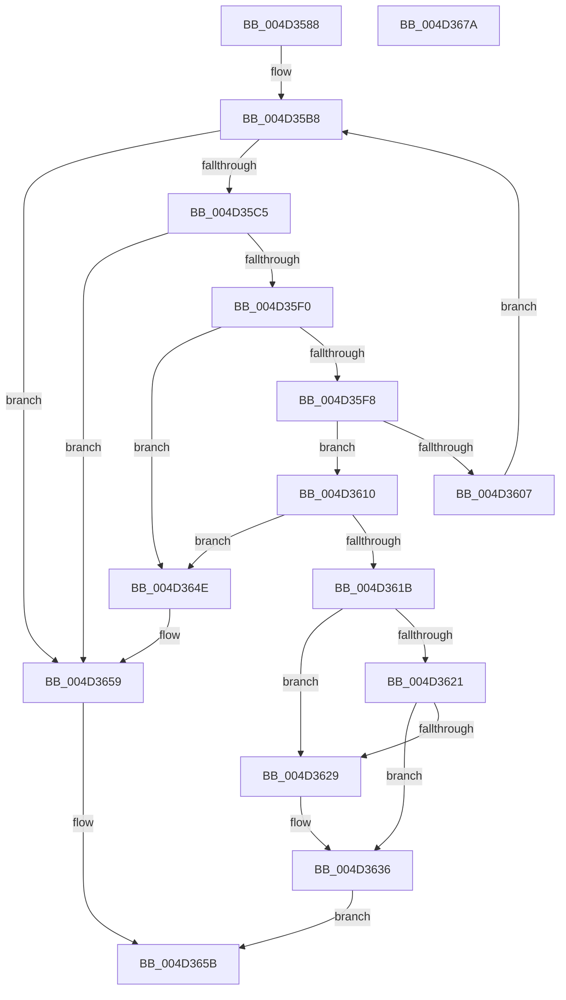

# MiMapSystemCachePage

- RVA: `0x004D3588`–`0x004D367B` (길이 `243` bytes)
- VA: `0x00000001404D3588`
- 실행 섹션: `.text`
- PDB 이름 있음: `예`; PDB Function 태그: `아니요`
- unwind 정보 RVA: `0x0005FEF8`
- 디코드: `70`개 명령, `243/243` bytes 표시
- 미해석 바이트: `0` (있으면 어셈블리에 `.byte`로 보존)

> 이 문서는 커널 이미지의 기계어와 PDB 기호를 분석해 생성했습니다. 4번과 5번은 함수 원형과 자료형을 바이너리 사용 방식에서 추정한 C 해석이며 원본 소스 복구 결과는 아닙니다.

## 1. Dependencies

- 직접 호출 지점: **7**; 고유 호출 대상: **5**
- 직접 호출자로 확인된 함수: **1**
- RIP 상대 이미지 참조: **0**

### Outgoing calls
- `0x004D35E4` → [MiSafeLockPage](../32/MiSafeLockPage_function_00321620.md) (function, `0x00321620`)
- `0x004D3609` → [MiUnlockPage](../31/MiUnlockPage_function_0031A3E0.md) (function, `0x0031A3E0`)
- `0x004D3612` → [MiAddLockedPageCharge](../28/MiAddLockedPageCharge_function_0028B550.md) (function, `0x0028B550`)
- `0x004D3631` → [MiSetPfnModified](../36/MiSetPfnModified_function_00362960.md) (function, `0x00362960`)
- `0x004D363C` → [MiUnlockPage](../31/MiUnlockPage_function_0031A3E0.md) (function, `0x0031A3E0`)
- `0x004D3647` → [MiMapFrame](../2C/MiMapFrame_function_002C7190.md) (function, `0x002C7190`)
- `0x004D3654` → [MiUnlockPage](../31/MiUnlockPage_function_0031A3E0.md) (function, `0x0031A3E0`)

### Direct callers
- [MmCopyToCachedPage](../34/MmCopyToCachedPage_function_00347B44.md) at `0x00347DC7`
- [MmCopyToCachedPage](../34/MmCopyToCachedPage_function_00347B44.md) at `0x00348022`

### Static image references
- 디코드된 RIP-relative 메모리 참조가 없습니다.

## 2. Other-region calls and transfers

- 다른 실행 섹션으로 향하는 call: **0**
- 별도 외부 분기/꼬리 이동을 확인하지 못했습니다.

## 3. Assembly (complete function range)

```asm
004D3588  48 8B C4                        mov rax, rsp
004D358B  48 89 58 08                     mov qword ptr [rax + 8], rbx
004D358F  48 89 68 10                     mov qword ptr [rax + 0x10], rbp
004D3593  48 89 70 18                     mov qword ptr [rax + 0x18], rsi
004D3597  48 89 78 20                     mov qword ptr [rax + 0x20], rdi
004D359B  41 54                           push r12
004D359D  41 56                           push r14
004D359F  41 57                           push r15
004D35A1  48 83 EC 20                     sub rsp, 0x20
004D35A5  41 8B E8                        mov ebp, r8d
004D35A8  4C 8B F2                        mov r14, rdx
004D35AB  4C 8B F9                        mov r15, rcx
004D35AE  49 BC FF FF FF FF FF 00 00 00   movabs r12, 0xffffffffff
004D35B8  49 8B 3E                        mov rdi, qword ptr [r14]
004D35BB  40 F6 C7 01                     test dil, 1
004D35BF  0F 84 94 00 00 00               je 0x1404d3659
004D35C5  48 C1 EF 0C                     shr rdi, 0xc
004D35C9  49 23 FC                        and rdi, r12
004D35CC  48 8D 1C 7F                     lea rbx, [rdi + rdi*2]
004D35D0  48 C1 E3 04                     shl rbx, 4
004D35D4  48 B8 00 00 00 00 00 DE FF FF   movabs rax, 0xffffde0000000000
004D35DE  48 8B CF                        mov rcx, rdi
004D35E1  48 03 D8                        add rbx, rax
004D35E4  E8 37 E0 E4 FF                  call 0x140321620
004D35E9  40 8A F0                        mov sil, al
004D35EC  3C 11                           cmp al, 0x11
004D35EE  74 69                           je 0x1404d3659
004D35F0  49 8B 16                        mov rdx, qword ptr [r14]
004D35F3  F6 C2 01                        test dl, 1
004D35F6  74 56                           je 0x1404d364e
004D35F8  48 C1 EA 0C                     shr rdx, 0xc
004D35FC  48 8B CB                        mov rcx, rbx
004D35FF  49 23 D4                        and rdx, r12
004D3602  48 3B D7                        cmp rdx, rdi
004D3605  74 09                           je 0x1404d3610
004D3607  8A D0                           mov dl, al
004D3609  E8 D2 6D E4 FF                  call 0x14031a3e0
004D360E  EB A8                           jmp 0x1404d35b8
004D3610  33 D2                           xor edx, edx
004D3612  E8 39 7F DB FF                  call 0x14028b550
004D3617  85 C0                           test eax, eax
004D3619  74 33                           je 0x1404d364e
004D361B  40 F6 C5 04                     test bpl, 4
004D361F  74 08                           je 0x1404d3629
004D3621  48 0F BA 63 28 35               bt qword ptr [rbx + 0x28], 0x35
004D3627  72 0D                           jb 0x1404d3636
004D3629  BA 01 00 00 00                  mov edx, 1
004D362E  48 8B CB                        mov rcx, rbx
004D3631  E8 2A F3 E8 FF                  call 0x140362960
004D3636  40 8A D6                        mov dl, sil
004D3639  48 8B CB                        mov rcx, rbx
004D363C  E8 9F 6D E4 FF                  call 0x14031a3e0
004D3641  48 8B D7                        mov rdx, rdi
004D3644  49 8B CF                        mov rcx, r15
004D3647  E8 44 3B DF FF                  call 0x1402c7190
004D364C  EB 0D                           jmp 0x1404d365b
004D364E  40 8A D6                        mov dl, sil
004D3651  48 8B CB                        mov rcx, rbx
004D3654  E8 87 6D E4 FF                  call 0x14031a3e0
004D3659  33 C0                           xor eax, eax
004D365B  48 8B 5C 24 40                  mov rbx, qword ptr [rsp + 0x40]
004D3660  48 8B 6C 24 48                  mov rbp, qword ptr [rsp + 0x48]
004D3665  48 8B 74 24 50                  mov rsi, qword ptr [rsp + 0x50]
004D366A  48 8B 7C 24 58                  mov rdi, qword ptr [rsp + 0x58]
004D366F  48 83 C4 20                     add rsp, 0x20
004D3673  41 5F                           pop r15
004D3675  41 5E                           pop r14
004D3677  41 5C                           pop r12
004D3679  C3                              ret
004D367A  CC                              int3
```

## 4. C-style interpretation (structured pseudocode)

```c
__int64 __fastcall MiMapSystemCachePage(__int64 a1, __int64 a2, int a3)
{
    __int64 result;
    __int64 v_rbx;
    __int64 v_rdi;
    __int64 v_rsp;
    unsigned __int64 v_stack_p10;
    unsigned __int64 v_stack_p18;
    unsigned __int64 v_stack_p20;
    unsigned __int64 v_stack_p8;

    *(unsigned __int64 *)(v_rsp + 8) = v_rbx;
    *(unsigned __int64 *)(v_rsp + 16) = v_rbp;
    *(unsigned __int64 *)(v_rsp + 24) = v_rsi;
    *(unsigned __int64 *)(v_rsp + 32) = v_rdi;
    v_rsp = (v_rsp) - (32);
loc_004D35B8:
    if ((((unsigned __int8)(*(unsigned __int64 *)(a2))) & (1)) == 0) goto loc_004D3659;
    v_rdi = (*(unsigned __int64 *)(a2)) >> (12);
    v_rdi = (v_rdi) & (v_r12);
    v_rbx = (v_rdi + v_rdi * 2) << (4);
    v_rbx = (v_rbx) + (v_rsp);
    result = MiSafeLockPage(v_rdi, a2, a3, a4);
    if (((unsigned __int8)(result)) == 17) goto loc_004D3659;
    if ((((unsigned __int8)(*(unsigned __int64 *)(a2))) & (1)) == 0) goto loc_004D364E;
    a2 = (*(unsigned __int64 *)(a2)) >> (12);
    a2 = (a2) & (v_r12);
    if (a2 == v_rdi) goto loc_004D3610;
    result = MiUnlockPage(v_rbx, (unsigned __int8)(result), a3, a4);
    goto loc_004D35B8;
loc_004D3610:
    a2 = 0;
    result = MiAddLockedPageCharge(v_rbx, a2, a3, a4);
    if ((unsigned int)(result) == 0) goto loc_004D364E;
    if ((((unsigned __int8)((unsigned int)(a3))) & (4)) == 0) goto loc_004D3629;
    if (!(condition_is_below)) {
        a2 = 1;
        a1 = v_rbx;
        result = MiSetPfnModified(a1, a2, a3, a4);
    }
    result = MiUnlockPage(v_rbx, (unsigned __int8)((unsigned __int8)(result)), a3, a4);
    result = MiMapFrame(a1, v_rdi, a3, a4);
    goto loc_004D365B;
loc_004D364E:
    result = MiUnlockPage(v_rbx, (unsigned __int8)((unsigned __int8)(result)), a3, a4);
loc_004D3659:
    result = 0;
loc_004D365B:
    v_rsp = (v_rsp) + (32);
    return result;
}
```

## 5. (Beta) C Style

```c
int64_t MiMapSystemCachePage(int64_t Arg1, void *Arg2, int32_t Arg3)
{
    uint8_t *arg2 = (uint8_t *)Arg2;

    int64_t result;
    int64_t local_rbx;
    int64_t local_rdi;
    int64_t local_rsp;
    uint64_t v_stack_p10;
    uint64_t v_stack_p18;
    uint64_t v_stack_p20;
    uint64_t v_stack_p8;

    *(uint64_t *)(local_rsp + 0x8) = local_rbx;
    *(uint64_t *)(local_rsp + 0x10) = local_rbp;
    *(uint64_t *)(local_rsp + 0x18) = local_rsi;
    *(uint64_t *)(local_rsp + 0x20) = local_rdi;
    local_rsp = (local_rsp) - (32);
loc_004D35B8:
    if ((((uint8_t)(*(uint64_t *)(arg2))) & (1)) == 0) goto loc_004D3659;
    local_rdi = (*(uint64_t *)(arg2)) >> (12);
    local_rdi = (local_rdi) & (local_r12);
    local_rbx = (local_rdi + local_rdi * 2) << (4);
    local_rbx = (local_rbx) + (local_rsp);
    result = MiSafeLockPage(local_rdi, Arg2, Arg3, a4);
    if (((uint8_t)(result)) == 17) goto loc_004D3659;
    if ((((uint8_t)(*(uint64_t *)(arg2))) & (1)) == 0) goto loc_004D364E;
    Arg2 = (*(uint64_t *)(arg2)) >> (12);
    Arg2 = (Arg2) & (local_r12);
    if (Arg2 == local_rdi) goto loc_004D3610;
    result = MiUnlockPage(local_rbx, (uint8_t)(result), Arg3, a4);
    goto loc_004D35B8;
loc_004D3610:
    Arg2 = 0;
    result = MiAddLockedPageCharge(local_rbx, Arg2, Arg3, a4);
    if ((uint32_t)(result) == 0) goto loc_004D364E;
    if ((((uint8_t)((uint32_t)(Arg3))) & (4)) == 0) goto loc_004D3629;
    if (!(condition_is_below)) {
        Arg2 = 1;
        Arg1 = local_rbx;
        result = MiSetPfnModified(Arg1, Arg2, Arg3, a4);
    }
    result = MiUnlockPage(local_rbx, (uint8_t)((uint8_t)(result)), Arg3, a4);
    result = MiMapFrame(Arg1, local_rdi, Arg3, a4);
    goto loc_004D365B;
loc_004D364E:
    result = MiUnlockPage(local_rbx, (uint8_t)((uint8_t)(result)), Arg3, a4);
loc_004D3659:
    result = 0;
loc_004D365B:
    local_rsp = (local_rsp) + (32);
    return result;
}
```

### 관측된 메모리 오프셋

구조체 형식이 확인되지 않은 접근은 인자 기준의 오프셋으로만 기록했습니다.

| 기준 인자 | 오프셋 표현 | 폭 (bit) | 접근 |
|---|---:|---:|---|
| `Arg2` | `+ 0x0` | `64` | `R` |

## 6. Execution-region graph

[열기: 2D/3D 그래프와 함수 탐색 컨트롤 패널](../../../control-panel.html?section=text&rva=0x004D3588&view=graph)

- 2D 그래프는 위에서 아래로 흐르고, 3D 그래프는 빈 공간을 드래그해 회전합니다. Shift+드래그는 이동, 휠은 확대·축소, 함수 노드 선택은 대상 보고서 이동입니다.

### Static fallback


