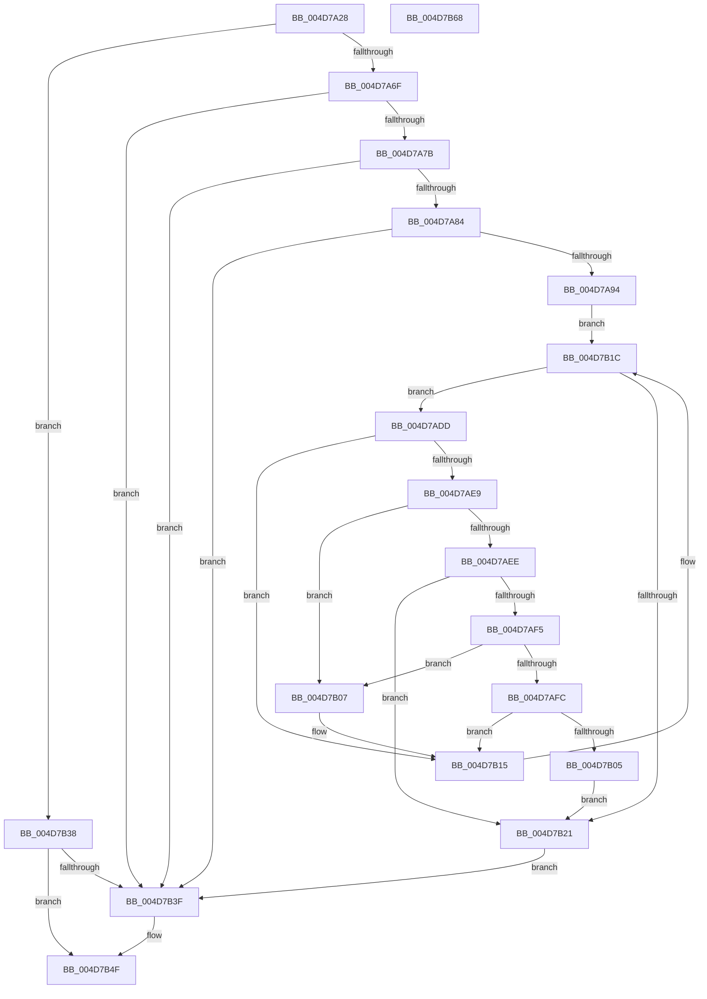

# MiPrefetchJumpVad

- RVA: `0x004D7A28`–`0x004D7B69` (길이 `321` bytes)
- VA: `0x00000001404D7A28`
- 실행 섹션: `.text`
- PDB 이름 있음: `예`; PDB Function 태그: `아니요`
- unwind 정보 RVA: `0x000A1FF8`
- 디코드: `89`개 명령, `321/321` bytes 표시
- 미해석 바이트: `0` (있으면 어셈블리에 `.byte`로 보존)

> 이 문서는 커널 이미지의 기계어와 PDB 기호를 분석해 생성했습니다. 4번과 5번은 함수 원형과 자료형을 바이너리 사용 방식에서 추정한 C 해석이며 원본 소스 복구 결과는 아닙니다.

## 1. Dependencies

- 직접 호출 지점: **4**; 고유 호출 대상: **4**
- 직접 호출자로 확인된 함수: **1**
- RIP 상대 이미지 참조: **0**

### Outgoing calls
- `0x004D7A87` → [MiIsVadLargePrivate](../32/MiIsVadLargePrivate_function_0032F720.md) (function, `0x0032F720`)
- `0x004D7AFC` → [IS_PTE_NOT_DEMAND_ZERO](../22/IS_PTE_NOT_DEMAND_ZERO_function_0022F4D0.md) (function, `0x0022F4D0`)
- `0x004D7B10` → [MiUpdatePrefetchPriority](../40/MiUpdatePrefetchPriority_function_00402CB0.md) (function, `0x00402CB0`)
- `0x004D7B45` → [MiLeapPrefetch](../4C/MiLeapPrefetch_function_004CAED0.md) (function, `0x004CAED0`)

### Direct callers
- [sub_0032DE99](../32/Unknown_function_0032DE99.md) at `0x0032DF27`

### Static image references
- 디코드된 RIP-relative 메모리 참조가 없습니다.

## 2. Other-region calls and transfers

- 다른 실행 섹션으로 향하는 call: **0**
- 별도 외부 분기/꼬리 이동을 확인하지 못했습니다.

## 3. Assembly (complete function range)

```asm
004D7A28  48 89 5C 24 08                  mov qword ptr [rsp + 8], rbx
004D7A2D  48 89 6C 24 10                  mov qword ptr [rsp + 0x10], rbp
004D7A32  48 89 74 24 18                  mov qword ptr [rsp + 0x18], rsi
004D7A37  57                              push rdi
004D7A38  41 54                           push r12
004D7A3A  41 56                           push r14
004D7A3C  48 83 EC 20                     sub rsp, 0x20
004D7A40  8B 42 1C                        mov eax, dword ptr [rdx + 0x1c]
004D7A43  49 8B E8                        mov rbp, r8
004D7A46  0F B6 5A 21                     movzx ebx, byte ptr [rdx + 0x21]
004D7A4A  48 8B F2                        mov rsi, rdx
004D7A4D  48 C1 E3 20                     shl rbx, 0x20
004D7A51  4C 8B F1                        mov r14, rcx
004D7A54  48 0B D8                        or rbx, rax
004D7A57  8B 42 30                        mov eax, dword ptr [rdx + 0x30]
004D7A5A  48 C1 E3 0C                     shl rbx, 0xc
004D7A5E  48 81 C3 00 10 00 00            add rbx, 0x1000
004D7A65  0F BA E0 15                     bt eax, 0x15
004D7A69  0F 83 C9 00 00 00               jae 0x1404d7b38
004D7A6F  83 E0 70                        and eax, 0x70
004D7A72  83 F8 30                        cmp eax, 0x30
004D7A75  0F 84 C4 00 00 00               je 0x1404d7b3f
004D7A7B  83 F8 10                        cmp eax, 0x10
004D7A7E  0F 84 BB 00 00 00               je 0x1404d7b3f
004D7A84  48 8B CA                        mov rcx, rdx
004D7A87  E8 94 7C E5 FF                  call 0x14032f720
004D7A8C  85 C0                           test eax, eax
004D7A8E  0F 85 AB 00 00 00               jne 0x1404d7b3f
004D7A94  49 8B F8                        mov rdi, r8
004D7A97  49 BC 00 00 00 00 80 F6 FF FF   movabs r12, 0xfffff68000000000
004D7AA1  48 C1 EF 09                     shr rdi, 9
004D7AA5  48 B9 F8 FF FF FF 7F 00 00 00   movabs rcx, 0x7ffffffff8
004D7AAF  48 23 F9                        and rdi, rcx
004D7AB2  49 8B C4                        mov rax, r12
004D7AB5  48 C1 EB 09                     shr rbx, 9
004D7AB9  48 03 F8                        add rdi, rax
004D7ABC  48 23 D9                        and rbx, rcx
004D7ABF  49 8B C4                        mov rax, r12
004D7AC2  48 03 D8                        add rbx, rax
004D7AC5  48 8B C7                        mov rax, rdi
004D7AC8  48 25 00 F0 FF FF               and rax, 0xfffffffffffff000
004D7ACE  48 05 00 10 00 00               add rax, 0x1000
004D7AD4  48 3B D8                        cmp rbx, rax
004D7AD7  48 0F 47 D8                     cmova rbx, rax
004D7ADB  EB 3F                           jmp 0x1404d7b1c
004D7ADD  48 8B 0F                        mov rcx, qword ptr [rdi]
004D7AE0  48 83 C7 08                     add rdi, 8
004D7AE4  48 85 C9                        test rcx, rcx
004D7AE7  74 2C                           je 0x1404d7b15
004D7AE9  F6 C1 01                        test cl, 1
004D7AEC  75 19                           jne 0x1404d7b07
004D7AEE  48 0F BA E1 0A                  bt rcx, 0xa
004D7AF3  72 2C                           jb 0x1404d7b21
004D7AF5  48 0F BA E1 0B                  bt rcx, 0xb
004D7AFA  72 0B                           jb 0x1404d7b07
004D7AFC  E8 CF 79 D5 FF                  call 0x14022f4d0
004D7B01  85 C0                           test eax, eax
004D7B03  74 10                           je 0x1404d7b15
004D7B05  EB 1A                           jmp 0x1404d7b21
004D7B07  4C 8B C6                        mov r8, rsi
004D7B0A  48 8B D5                        mov rdx, rbp
004D7B0D  49 8B CE                        mov rcx, r14
004D7B10  E8 9B B1 F2 FF                  call 0x140402cb0
004D7B15  48 81 C5 00 10 00 00            add rbp, 0x1000
004D7B1C  48 3B FB                        cmp rdi, rbx
004D7B1F  72 BC                           jb 0x1404d7add
004D7B21  48 8B DF                        mov rbx, rdi
004D7B24  48 C1 E3 19                     shl rbx, 0x19
004D7B28  49 8B C4                        mov rax, r12
004D7B2B  48 C1 E0 19                     shl rax, 0x19
004D7B2F  48 2B D8                        sub rbx, rax
004D7B32  48 C1 FB 10                     sar rbx, 0x10
004D7B36  EB 07                           jmp 0x1404d7b3f
004D7B38  8B 42 40                        mov eax, dword ptr [rdx + 0x40]
004D7B3B  A8 01                           test al, 1
004D7B3D  74 10                           je 0x1404d7b4f
004D7B3F  48 8B D3                        mov rdx, rbx
004D7B42  49 8B CE                        mov rcx, r14
004D7B45  E8 86 33 FF FF                  call 0x1404caed0
004D7B4A  41 C6 46 01 01                  mov byte ptr [r14 + 1], 1
004D7B4F  48 8B 5C 24 40                  mov rbx, qword ptr [rsp + 0x40]
004D7B54  48 8B 6C 24 48                  mov rbp, qword ptr [rsp + 0x48]
004D7B59  48 8B 74 24 50                  mov rsi, qword ptr [rsp + 0x50]
004D7B5E  48 83 C4 20                     add rsp, 0x20
004D7B62  41 5E                           pop r14
004D7B64  41 5C                           pop r12
004D7B66  5F                              pop rdi
004D7B67  C3                              ret
004D7B68  CC                              int3
```

## 4. C-style interpretation (structured pseudocode)

```c
__int64 __fastcall MiPrefetchJumpVad(__int64 a1, __int64 a2, __int64 a3)
{
    __int64 result;
    __int64 v_rbp;
    __int64 v_rbx;
    __int64 v_rdi;
    __int64 v_rsp;
    unsigned __int64 v_stack_p10;
    unsigned __int64 v_stack_p18;
    unsigned __int64 v_stack_p8;

    v_stack_p8 = v_rbx;
    v_stack_p10 = v_rbp;
    v_stack_p18 = v_rsi;
    v_rsp = (v_rsp) - (32);
    v_rbx = (*(unsigned __int8 *)(a2 + 33)) << (32);
    v_rbx = (v_rbx) | ((unsigned int)(*(unsigned int *)(a2 + 28)));
    v_rbx = (v_rbx) << (12);
    v_rbx = (v_rbx) + (0x1000ULL);
    if (condition_is_above_or_equal) goto loc_004D7B38;
    result = (unsigned int)(((unsigned int)(*(unsigned int *)(a2 + 48))) & (112));
    if (((unsigned int)(result)) == 48) goto loc_004D7B3F;
    if (((unsigned int)(result)) == 16) goto loc_004D7B3F;
    result = MiIsVadLargePrivate(a2, a2, a3, a4);
    if ((unsigned int)(result) != 0) goto loc_004D7B3F;
    v_rdi = (a3) >> (9);
    v_rdi = (v_rdi) & (a2);
    v_rbx = (v_rbx) >> (9);
    v_rdi = (v_rdi) + (v_r12);
    v_rbx = (v_rbx) & (a2);
    v_rbx = (v_rbx) + (v_r12);
    result = (v_rdi) & (0xFFFFFFFFFFFFF000ULL);
    result = (result) + (0x1000ULL);
    if (v_rbx > result) { v_rbx = result; }
    goto loc_004D7B1C;
loc_004D7ADD:
    v_rdi = (v_rdi) + (8);
    if (*(unsigned __int64 *)(v_rdi) == 0) goto loc_004D7B15;
    if ((((unsigned __int8)(*(unsigned __int64 *)(v_rdi))) & (1)) != 0) goto loc_004D7B07;
    if (condition_is_below) goto loc_004D7B21;
    if (condition_is_below) goto loc_004D7B07;
    result = IS_PTE_NOT_DEMAND_ZERO(*(unsigned __int64 *)(v_rdi), a2, a3, a4);
    if ((unsigned int)(result) == 0) goto loc_004D7B15;
    goto loc_004D7B21;
loc_004D7B07:
    result = MiUpdatePrefetchPriority(a1, a3, a2, a4);
loc_004D7B15:
    v_rbp = (a3) + (0x1000ULL);
loc_004D7B1C:
    if (v_rdi < v_rbx) goto loc_004D7ADD;
loc_004D7B21:
    v_rbx = (v_rdi) << (25);
    result = (v_r12) << (25);
    v_rbx = (v_rbx) - (result);
    v_rbx = (v_rbx) >> (16);
    goto loc_004D7B3F;
loc_004D7B38:
    result = (unsigned int)(*(unsigned int *)(a3 + 64));
    if ((((unsigned __int8)((unsigned int)(*(unsigned int *)(a3 + 64)))) & (1)) != 0) {
        a2 = v_rbx;
        a1 = a1;
        result = MiLeapPrefetch(a1, a2, a2, a4);
        *(unsigned __int8 *)(a1 + 1) = 1;
    }
    v_rsp = (v_rsp) + (32);
    return result;
}
```

## 5. (Beta) C Style

```c
int64_t MiPrefetchJumpVad(void *Arg1, void *Arg2, int64_t Arg3)
{
    uint8_t *arg1 = (uint8_t *)Arg1;
    uint8_t *arg2 = (uint8_t *)Arg2;

    int64_t result;
    int64_t local_rbp;
    int64_t local_rbx;
    int64_t local_rdi;
    int64_t local_rsp;
    uint64_t v_stack_p10;
    uint64_t v_stack_p18;
    uint64_t v_stack_p8;

    v_stack_p8 = local_rbx;
    v_stack_p10 = local_rbp;
    v_stack_p18 = local_rsi;
    local_rsp = (local_rsp) - (32);
    local_rbx = (*(uint8_t *)(arg2 + 0x21)) << (32);
    local_rbx = (local_rbx) | ((uint32_t)(*(uint32_t *)(arg2 + 0x1C)));
    local_rbx = (local_rbx) << (12);
    local_rbx = (local_rbx) + (0x1000ULL);
    if (condition_is_above_or_equal) goto loc_004D7B38;
    result = (uint32_t)(((uint32_t)(*(uint32_t *)(arg2 + 0x30))) & (112));
    if (((uint32_t)(result)) == 48) goto loc_004D7B3F;
    if (((uint32_t)(result)) == 16) goto loc_004D7B3F;
    result = MiIsVadLargePrivate(Arg2, Arg2, Arg3, a4);
    if ((uint32_t)(result) != 0) goto loc_004D7B3F;
    local_rdi = (Arg3) >> (9);
    local_rdi = (local_rdi) & (Arg2);
    local_rbx = (local_rbx) >> (9);
    local_rdi = (local_rdi) + (local_r12);
    local_rbx = (local_rbx) & (Arg2);
    local_rbx = (local_rbx) + (local_r12);
    result = (local_rdi) & (0xFFFFFFFFFFFFF000ULL);
    result = (result) + (0x1000ULL);
    if (local_rbx > result) { local_rbx = result; }
    goto loc_004D7B1C;
loc_004D7ADD:
    local_rdi = (local_rdi) + (8);
    if (*(uint64_t *)(local_rdi) == 0) goto loc_004D7B15;
    if ((((uint8_t)(*(uint64_t *)(local_rdi))) & (1)) != 0) goto loc_004D7B07;
    if (condition_is_below) goto loc_004D7B21;
    if (condition_is_below) goto loc_004D7B07;
    result = IS_PTE_NOT_DEMAND_ZERO(*(uint64_t *)(local_rdi), Arg2, Arg3, a4);
    if ((uint32_t)(result) == 0) goto loc_004D7B15;
    goto loc_004D7B21;
loc_004D7B07:
    result = MiUpdatePrefetchPriority(Arg1, Arg3, Arg2, a4);
loc_004D7B15:
    local_rbp = (Arg3) + (0x1000ULL);
loc_004D7B1C:
    if (local_rdi < local_rbx) goto loc_004D7ADD;
loc_004D7B21:
    local_rbx = (local_rdi) << (25);
    result = (local_r12) << (25);
    local_rbx = (local_rbx) - (result);
    local_rbx = (local_rbx) >> (16);
    goto loc_004D7B3F;
loc_004D7B38:
    result = (uint32_t)(*(uint32_t *)(Arg3 + 0x40));
    if ((((uint8_t)((uint32_t)(*(uint32_t *)(Arg3 + 0x40)))) & (1)) != 0) {
        Arg2 = local_rbx;
        Arg1 = Arg1;
        result = MiLeapPrefetch(Arg1, Arg2, Arg2, a4);
        *(uint8_t *)(arg1 + 0x1) = 1;
    }
    local_rsp = (local_rsp) + (32);
    return result;
}
```

### 관측된 메모리 오프셋

구조체 형식이 확인되지 않은 접근은 인자 기준의 오프셋으로만 기록했습니다.

| 기준 인자 | 오프셋 표현 | 폭 (bit) | 접근 |
|---|---:|---:|---|
| `Arg1` | `+ 0x1` | `8` | `W` |
| `Arg2` | `+ 0x1C` | `32` | `R` |
| `Arg2` | `+ 0x21` | `8` | `R` |
| `Arg2` | `+ 0x30` | `32` | `R` |
| `Arg2` | `+ 0x40` | `32` | `R` |

## 6. Execution-region graph

[열기: 2D/3D 그래프와 함수 탐색 컨트롤 패널](../../../control-panel.html?section=text&rva=0x004D7A28&view=graph)

- 2D 그래프는 위에서 아래로 흐르고, 3D 그래프는 빈 공간을 드래그해 회전합니다. Shift+드래그는 이동, 휠은 확대·축소, 함수 노드 선택은 대상 보고서 이동입니다.

### Static fallback


