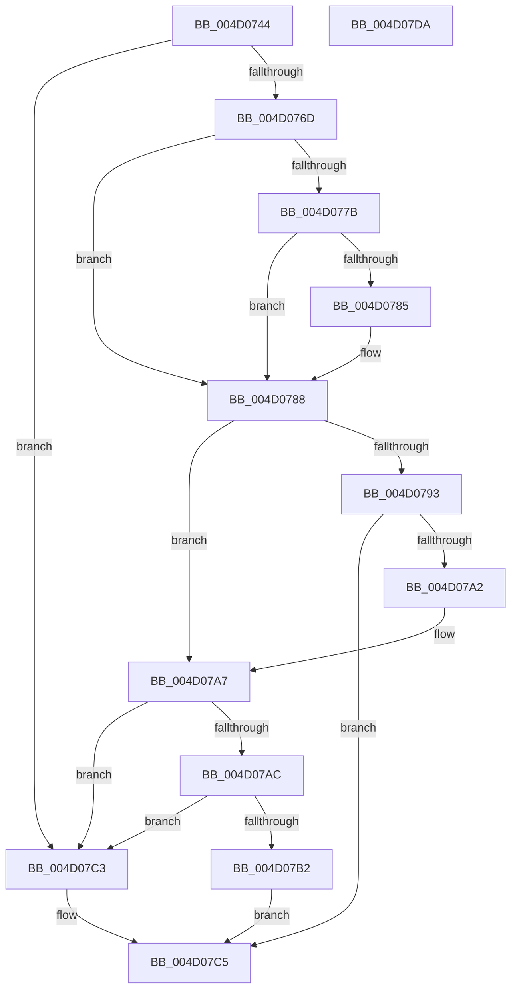

# MiProcessKernelCfgImage

- RVA: `0x004D0744`–`0x004D07DB` (길이 `151` bytes)
- VA: `0x00000001404D0744`
- 실행 섹션: `.text`
- PDB 이름 있음: `예`; PDB Function 태그: `아니요`
- unwind 정보 RVA: `0x0005C954`
- 디코드: `45`개 명령, `151/151` bytes 표시
- 미해석 바이트: `0` (있으면 어셈블리에 `.byte`로 보존)

> 이 문서는 커널 이미지의 기계어와 PDB 기호를 분석해 생성했습니다. 4번과 5번은 함수 원형과 자료형을 바이너리 사용 방식에서 추정한 C 해석이며 원본 소스 복구 결과는 아닙니다.

## 1. Dependencies

- 직접 호출 지점: **2**; 고유 호출 대상: **2**
- 직접 호출자로 확인된 함수: **2**
- RIP 상대 이미지 참조: **1**

### Outgoing calls
- `0x004D0799` → [MiMarkKernelImageCfgBits](../../page/A4/MiMarkKernelImageCfgBits_function_00A4B1E0.md) (function, `0x00A4B1E0`)
- `0x004D07B5` → [MiProcessKernelCfgAddressTakenImports](../../page/AD/MiProcessKernelCfgAddressTakenImports_function_00AD4384.md) (function, `0x00AD4384`)

### Direct callers
- [MiFinalizeDriverCfgState](../../page/A4/MiFinalizeDriverCfgState_function_00A4AD54.md) at `0x00A4AD5D`
- [MiInitializeKernelCfgImages](../../init/C6/MiInitializeKernelCfgImages_function_00C6A430.md) at `0x00C6A4D2`

### Static image references
- `0x004D0758` → RVA `0x00FC6A88` (`ALMOSTRO`; read)

## 2. Other-region calls and transfers

- 다른 실행 섹션으로 향하는 call: **2**
  - `0x004D0799` → [MiMarkKernelImageCfgBits](../../page/A4/MiMarkKernelImageCfgBits_function_00A4B1E0.md) (`.text` → `PAGE`)
  - `0x004D07B5` → [MiProcessKernelCfgAddressTakenImports](../../page/AD/MiProcessKernelCfgAddressTakenImports_function_00AD4384.md) (`.text` → `PAGE`)
- 별도 외부 분기/꼬리 이동을 확인하지 못했습니다.

## 3. Assembly (complete function range)

```asm
004D0744  48 89 5C 24 08                  mov qword ptr [rsp + 8], rbx
004D0749  48 89 6C 24 10                  mov qword ptr [rsp + 0x10], rbp
004D074E  48 89 74 24 18                  mov qword ptr [rsp + 0x18], rsi
004D0753  57                              push rdi
004D0754  48 83 EC 20                     sub rsp, 0x20
004D0758  48 F7 05 25 63 AF 00 00 00 04 00  test qword ptr [rip + 0xaf6325], 0x40000
004D0763  49 8B F0                        mov rsi, r8
004D0766  8B EA                           mov ebp, edx
004D0768  48 8B F9                        mov rdi, rcx
004D076B  74 56                           je 0x1404d07c3
004D076D  48 8B 49 30                     mov rcx, qword ptr [rcx + 0x30]
004D0771  48 8D 41 FF                     lea rax, [rcx - 1]
004D0775  48 83 F8 FD                     cmp rax, -3
004D0779  77 0D                           ja 0x1404d0788
004D077B  B8 4D 5A 00 00                  mov eax, 0x5a4d
004D0780  66 39 01                        cmp word ptr [rcx], ax
004D0783  75 03                           jne 0x1404d0788
004D0785  8B 41 3C                        mov eax, dword ptr [rcx + 0x3c]
004D0788  33 DB                           xor ebx, ebx
004D078A  F7 47 68 00 20 00 00            test dword ptr [rdi + 0x68], 0x2000
004D0791  75 14                           jne 0x1404d07a7
004D0793  8D 53 01                        lea edx, [rbx + 1]
004D0796  48 8B CF                        mov rcx, rdi
004D0799  E8 42 AA 57 00                  call 0x140a4b1e0
004D079E  85 C0                           test eax, eax
004D07A0  78 23                           js 0x1404d07c5
004D07A2  0F BA 6F 68 0D                  bts dword ptr [rdi + 0x68], 0xd
004D07A7  48 85 F6                        test rsi, rsi
004D07AA  74 17                           je 0x1404d07c3
004D07AC  40 F6 C5 08                     test bpl, 8
004D07B0  75 11                           jne 0x1404d07c3
004D07B2  48 8B CF                        mov rcx, rdi
004D07B5  E8 CA 3B 60 00                  call 0x140ad4384
004D07BA  85 C0                           test eax, eax
004D07BC  0F 48 D8                        cmovs ebx, eax
004D07BF  8B C3                           mov eax, ebx
004D07C1  EB 02                           jmp 0x1404d07c5
004D07C3  33 C0                           xor eax, eax
004D07C5  48 8B 5C 24 30                  mov rbx, qword ptr [rsp + 0x30]
004D07CA  48 8B 6C 24 38                  mov rbp, qword ptr [rsp + 0x38]
004D07CF  48 8B 74 24 40                  mov rsi, qword ptr [rsp + 0x40]
004D07D4  48 83 C4 20                     add rsp, 0x20
004D07D8  5F                              pop rdi
004D07D9  C3                              ret
004D07DA  CC                              int3
```

## 4. C-style interpretation (structured pseudocode)

```c
__int64 __fastcall MiProcessKernelCfgImage(__int64 a1, int a2, __int64 a3)
{
    __int64 result;
    __int64 v_rbx;
    __int64 v_rsp;
    unsigned __int64 v_stack_p10;
    unsigned __int64 v_stack_p18;
    unsigned __int64 v_stack_p8;

    v_stack_p8 = v_rbx;
    v_stack_p10 = v_rbp;
    v_stack_p18 = v_rsi;
    v_rsp = (v_rsp) - (32);
    if (((*(unsigned __int64 *)(v_rip + 11494181)) & (0x40000ULL)) == 0) goto loc_004D07C3;
    if ((*(unsigned __int64 *)(a1 + 48) - 1) > -3) goto loc_004D0788;
    result = (unsigned int)(0x5A4DULL);
    if ((*(unsigned __int16 *)(*(unsigned __int64 *)(a1 + 48))) == ((unsigned __int16)((unsigned int)(0x5A4DULL)))) {
        result = *(unsigned int *)(*(unsigned __int64 *)(a1 + 48) + 60);
    }
    v_rbx = 0;
    if (((*(unsigned int *)(a1 + 104)) & (0x2000ULL)) != 0) goto loc_004D07A7;
    result = MiMarkKernelImageCfgBits(a1, v_rbx + 1, a3, a4);
    if (sign_flag) goto loc_004D07C5;
loc_004D07A7:
    if (a3 == 0) goto loc_004D07C3;
    if ((((unsigned __int8)((unsigned int)(a2))) & (8)) != 0) goto loc_004D07C3;
    result = MiProcessKernelCfgAddressTakenImports(a1, v_rbx + 1, a3, a4);
    if (sign_flag) { v_rbx = (unsigned int)(result); }
    goto loc_004D07C5;
loc_004D07C3:
    result = 0;
loc_004D07C5:
    v_rsp = (v_rsp) + (32);
    return result;
}
```

## 5. (Beta) C Style

```c
int64_t MiProcessKernelCfgImage(void *Arg1, int32_t Arg2, int64_t Arg3)
{
    uint8_t *arg1 = (uint8_t *)Arg1;

    int64_t result;
    int64_t local_rbx;
    int64_t local_rsp;
    uint64_t v_stack_p10;
    uint64_t v_stack_p18;
    uint64_t v_stack_p8;

    v_stack_p8 = local_rbx;
    v_stack_p10 = local_rbp;
    v_stack_p18 = local_rsi;
    local_rsp = (local_rsp) - (32);
    if (((*(uint64_t *)(v_rip + 0xAF6325)) & (0x40000ULL)) == 0) goto loc_004D07C3;
    if ((*(uint64_t *)(arg1 + 0x30) - 1) > -3) goto loc_004D0788;
    result = (uint32_t)(0x5A4DULL);
    if ((*(uint16_t *)(*(uint64_t *)(arg1 + 0x30))) == ((uint16_t)((uint32_t)(0x5A4DULL)))) {
        result = *(uint32_t *)(*(uint64_t *)(arg1 + 0x30) + 0x3C);
    }
    local_rbx = 0;
    if (((*(uint32_t *)(arg1 + 0x68)) & (0x2000ULL)) != 0) goto loc_004D07A7;
    result = MiMarkKernelImageCfgBits(Arg1, local_rbx + 1, Arg3, a4);
    if (sign_flag) goto loc_004D07C5;
loc_004D07A7:
    if (Arg3 == 0) goto loc_004D07C3;
    if ((((uint8_t)((uint32_t)(Arg2))) & (8)) != 0) goto loc_004D07C3;
    result = MiProcessKernelCfgAddressTakenImports(Arg1, local_rbx + 1, Arg3, a4);
    if (sign_flag) { local_rbx = (uint32_t)(result); }
    goto loc_004D07C5;
loc_004D07C3:
    result = 0;
loc_004D07C5:
    local_rsp = (local_rsp) + (32);
    return result;
}
```

### 관측된 메모리 오프셋

구조체 형식이 확인되지 않은 접근은 인자 기준의 오프셋으로만 기록했습니다.

| 기준 인자 | 오프셋 표현 | 폭 (bit) | 접근 |
|---|---:|---:|---|
| `Arg1` | `+ 0x30` | `64` | `R` |
| `Arg1` | `+ 0x68` | `32` | `R` |
| `Arg1` | `+ 0x68` | `32` | `R/W` |

## 6. Execution-region graph

[열기: 2D/3D 그래프와 함수 탐색 컨트롤 패널](../../../control-panel.html?section=text&rva=0x004D0744&view=graph)

- 2D 그래프는 위에서 아래로 흐르고, 3D 그래프는 빈 공간을 드래그해 회전합니다. Shift+드래그는 이동, 휠은 확대·축소, 함수 노드 선택은 대상 보고서 이동입니다.

### Static fallback


