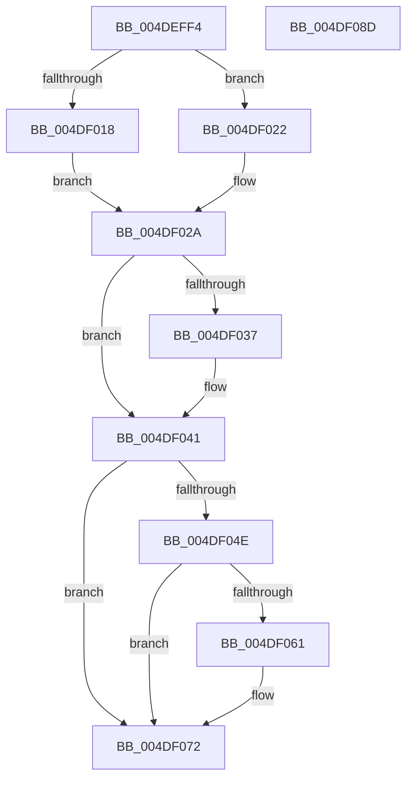

# MiPulseCommitSignal

- RVA: `0x004DEFF4`–`0x004DF08E` (길이 `154` bytes)
- VA: `0x00000001404DEFF4`
- 실행 섹션: `.text`
- PDB 이름 있음: `예`; PDB Function 태그: `아니요`
- unwind 정보 RVA: `0x00060BC4`
- 디코드: `41`개 명령, `154/154` bytes 표시
- 미해석 바이트: `0` (있으면 어셈블리에 `.byte`로 보존)

> 이 문서는 커널 이미지의 기계어와 PDB 기호를 분석해 생성했습니다. 4번과 5번은 함수 원형과 자료형을 바이너리 사용 방식에서 추정한 C 해석이며 원본 소스 복구 결과는 아닙니다.

## 1. Dependencies

- 직접 호출 지점: **5**; 고유 호출 대상: **4**
- 직접 호출자로 확인된 함수: **1**
- RIP 상대 이미지 참조: **0**

### Outgoing calls
- `0x004DF01B` → [ExAcquireSpinLockExclusiveAtDpcLevel](../24/ExAcquireSpinLockExclusiveAtDpcLevel_function_00248E80.md) (function, `0x00248E80`)
- `0x004DF022` → [ExAcquireSpinLockExclusive](../24/ExAcquireSpinLockExclusive_function_00248690.md) (function, `0x00248690`)
- `0x004DF03C` → [KePulseEvent](../35/KePulseEvent_function_00351EF0.md) (function, `0x00351EF0`)
- `0x004DF06D` → [KePulseEvent](../35/KePulseEvent_function_00351EF0.md) (function, `0x00351EF0`)
- `0x004DF078` → [MiReleaseSpinLockExclusive](../24/MiReleaseSpinLockExclusive_function_002482C0.md) (function, `0x002482C0`)

### Direct callers
- [MiChargeCommit](../28/MiChargeCommit_function_00286EB0.md) at `0x00287342`
- [MiChargeCommit](../28/MiChargeCommit_function_00286EB0.md) at `0x00287461`

### Static image references
- 디코드된 RIP-relative 메모리 참조가 없습니다.

## 2. Other-region calls and transfers

- 다른 실행 섹션으로 향하는 call: **0**
- 별도 외부 분기/꼬리 이동을 확인하지 못했습니다.

## 3. Assembly (complete function range)

```asm
004DEFF4  48 89 5C 24 08                  mov qword ptr [rsp + 8], rbx
004DEFF9  48 89 74 24 10                  mov qword ptr [rsp + 0x10], rsi
004DEFFE  57                              push rdi
004DEFFF  48 83 EC 20                     sub rsp, 0x20
004DF003  48 8B D9                        mov rbx, rcx
004DF006  44 0F 20 C0                     mov rax, cr8
004DF00A  48 8D B9 F8 41 00 00            lea rdi, [rcx + 0x41f8]
004DF011  48 8B CF                        mov rcx, rdi
004DF014  3C 02                           cmp al, 2
004DF016  75 0A                           jne 0x1404df022
004DF018  40 B6 11                        mov sil, 0x11
004DF01B  E8 60 9E D6 FF                  call 0x140248e80
004DF020  EB 08                           jmp 0x1404df02a
004DF022  E8 69 96 D6 FF                  call 0x140248690
004DF027  40 8A F0                        mov sil, al
004DF02A  48 8B 8B 30 01 00 00            mov rcx, qword ptr [rbx + 0x130]
004DF031  83 79 04 00                     cmp dword ptr [rcx + 4], 0
004DF035  75 0A                           jne 0x1404df041
004DF037  45 33 C0                        xor r8d, r8d
004DF03A  33 D2                           xor edx, edx
004DF03C  E8 AF 2E E7 FF                  call 0x140351ef0
004DF041  48 8B 83 38 01 00 00            mov rax, qword ptr [rbx + 0x138]
004DF048  83 78 04 00                     cmp dword ptr [rax + 4], 0
004DF04C  75 24                           jne 0x1404df072
004DF04E  48 8B 93 98 4C 00 00            mov rdx, qword ptr [rbx + 0x4c98]
004DF055  48 8B 83 C8 41 00 00            mov rax, qword ptr [rbx + 0x41c8]
004DF05C  48 3B D0                        cmp rdx, rax
004DF05F  75 11                           jne 0x1404df072
004DF061  48 8B 8B 38 01 00 00            mov rcx, qword ptr [rbx + 0x138]
004DF068  45 33 C0                        xor r8d, r8d
004DF06B  33 D2                           xor edx, edx
004DF06D  E8 7E 2E E7 FF                  call 0x140351ef0
004DF072  40 8A D6                        mov dl, sil
004DF075  48 8B CF                        mov rcx, rdi
004DF078  E8 43 92 D6 FF                  call 0x1402482c0
004DF07D  48 8B 5C 24 30                  mov rbx, qword ptr [rsp + 0x30]
004DF082  48 8B 74 24 38                  mov rsi, qword ptr [rsp + 0x38]
004DF087  48 83 C4 20                     add rsp, 0x20
004DF08B  5F                              pop rdi
004DF08C  C3                              ret
004DF08D  CC                              int3
```

## 4. C-style interpretation (structured pseudocode)

```c
__int64 __fastcall MiPulseCommitSignal(__int64 a1, int a2, int a3)
{
    __int64 result;
    __int64 v_rsp;
    unsigned __int64 v_stack_p10;
    unsigned __int64 v_stack_p8;

    v_stack_p8 = v_rbx;
    v_stack_p10 = v_rsi;
    v_rsp = (v_rsp) - (32);
    if (((unsigned __int8)(v_cr8)) != 2) goto loc_004DF022;
    result = ExAcquireSpinLockExclusiveAtDpcLevel(a1 + 16888, a2, a3, a4);
    goto loc_004DF02A;
loc_004DF022:
    result = ExAcquireSpinLockExclusive(a1 + 16888, a2, a3, a4);
loc_004DF02A:
    if ((*(unsigned int *)(*(unsigned __int64 *)(a1 + 304) + 4)) == 0) {
        a3 = 0;
        a2 = 0;
        result = KePulseEvent(*(unsigned __int64 *)(a1 + 304), a2, a3, a4);
    }
    if ((*(unsigned int *)(*(unsigned __int64 *)(a1 + 312) + 4)) != 0) goto loc_004DF072;
    result = *(unsigned __int64 *)(a1 + 16840);
    if ((*(unsigned __int64 *)(a1 + 19608)) == (*(unsigned __int64 *)(a1 + 16840))) {
        a1 = *(unsigned __int64 *)(a1 + 312);
        a3 = 0;
        a2 = 0;
        result = KePulseEvent(a1, a2, a3, a4);
    }
    result = MiReleaseSpinLockExclusive(a1 + 16888, (unsigned __int8)((unsigned __int8)(result)), a3, a4);
    v_rsp = (v_rsp) + (32);
    return result;
}
```

## 5. (Beta) C Style

```c
int64_t MiPulseCommitSignal(void *Arg1, int32_t Arg2, int32_t Arg3)
{
    uint8_t *arg1 = (uint8_t *)Arg1;

    int64_t result;
    int64_t local_rsp;
    uint64_t v_stack_p10;
    uint64_t v_stack_p8;

    v_stack_p8 = local_rbx;
    v_stack_p10 = local_rsi;
    local_rsp = (local_rsp) - (32);
    if (((uint8_t)(v_cr8)) != 2) goto loc_004DF022;
    result = ExAcquireSpinLockExclusiveAtDpcLevel(Arg1 + 16888, Arg2, Arg3, a4);
    goto loc_004DF02A;
loc_004DF022:
    result = ExAcquireSpinLockExclusive(Arg1 + 16888, Arg2, Arg3, a4);
loc_004DF02A:
    if ((*(uint32_t *)(*(uint64_t *)(arg1 + 0x130) + 0x4)) == 0) {
        Arg3 = 0;
        Arg2 = 0;
        result = KePulseEvent(*(uint64_t *)(arg1 + 0x130), Arg2, Arg3, a4);
    }
    if ((*(uint32_t *)(*(uint64_t *)(arg1 + 0x138) + 0x4)) != 0) goto loc_004DF072;
    result = *(uint64_t *)(arg1 + 0x41C8);
    if ((*(uint64_t *)(arg1 + 0x4C98)) == (*(uint64_t *)(arg1 + 0x41C8))) {
        Arg1 = *(uint64_t *)(arg1 + 0x138);
        Arg3 = 0;
        Arg2 = 0;
        result = KePulseEvent(Arg1, Arg2, Arg3, a4);
    }
    result = MiReleaseSpinLockExclusive(Arg1 + 16888, (uint8_t)((uint8_t)(result)), Arg3, a4);
    local_rsp = (local_rsp) + (32);
    return result;
}
```

### 관측된 메모리 오프셋

구조체 형식이 확인되지 않은 접근은 인자 기준의 오프셋으로만 기록했습니다.

| 기준 인자 | 오프셋 표현 | 폭 (bit) | 접근 |
|---|---:|---:|---|
| `Arg1` | `+ 0x130` | `64` | `R` |
| `Arg1` | `+ 0x138` | `64` | `R` |
| `Arg1` | `+ 0x41C8` | `64` | `R` |
| `Arg1` | `+ 0x41F8` | `64` | `R` |
| `Arg1` | `+ 0x4C98` | `64` | `R` |

## 6. Execution-region graph

[열기: 2D/3D 그래프와 함수 탐색 컨트롤 패널](../../../control-panel.html?section=text&rva=0x004DEFF4&view=graph)

- 2D 그래프는 위에서 아래로 흐르고, 3D 그래프는 빈 공간을 드래그해 회전합니다. Shift+드래그는 이동, 휠은 확대·축소, 함수 노드 선택은 대상 보고서 이동입니다.

### Static fallback


