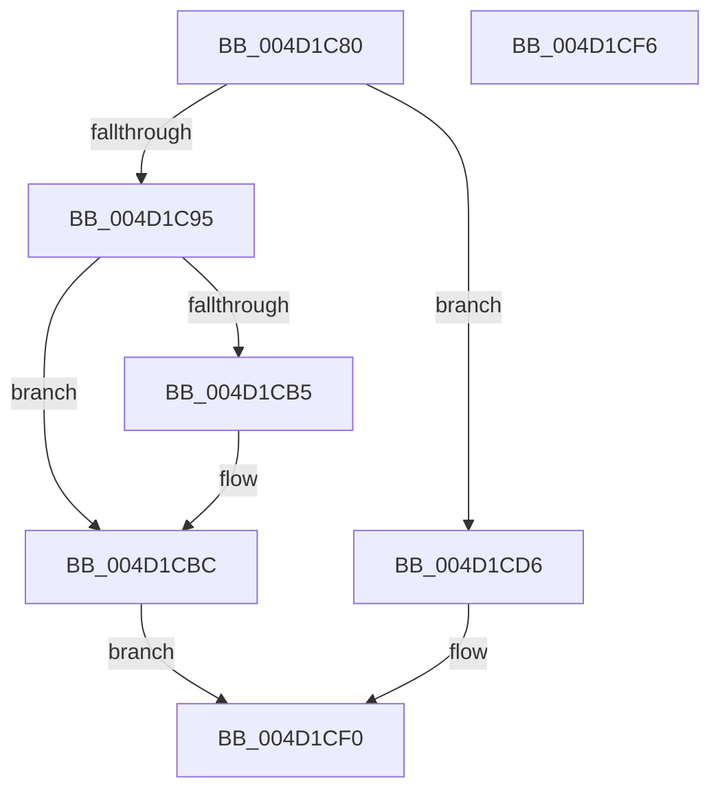

# MiQueueExtentPfnDeletion

- RVA: `0x004D1C80`–`0x004D1CF7` (길이 `119` bytes)
- VA: `0x00000001404D1C80`
- 실행 섹션: `.text`
- PDB 이름 있음: `예`; PDB Function 태그: `아니요`
- unwind 정보 RVA: `0x0005CF00`
- 디코드: `28`개 명령, `119/119` bytes 표시
- 미해석 바이트: `0` (있으면 어셈블리에 `.byte`로 보존)

> 이 문서는 커널 이미지의 기계어와 PDB 기호를 분석해 생성했습니다. 4번과 5번은 함수 원형과 자료형을 바이너리 사용 방식에서 추정한 C 해석이며 원본 소스 복구 결과는 아닙니다.

## 1. Dependencies

- 직접 호출 지점: **6**; 고유 호출 대상: **5**
- 직접 호출자로 확인된 함수: **2**
- RIP 상대 이미지 참조: **6**

### Outgoing calls
- `0x004D1C95` → [ExAcquireSpinLockExclusiveAtDpcLevel](../24/ExAcquireSpinLockExclusiveAtDpcLevel_function_00248E80.md) (function, `0x00248E80`)
- `0x004D1CC3` → [MiWakeFileOnlyReaper](MiWakeFileOnlyReaper_function_004D1D00.md) (function, `0x004D1D00`)
- `0x004D1CCF` → [ExReleaseSpinLockExclusiveFromDpcLevel](../24/ExReleaseSpinLockExclusiveFromDpcLevel_function_002497E0.md) (function, `0x002497E0`)
- `0x004D1CD6` → [ExAcquireSpinLockExclusive](../24/ExAcquireSpinLockExclusive_function_00248690.md) (function, `0x00248690`)
- `0x004D1CDD` → [MiWakeFileOnlyReaper](MiWakeFileOnlyReaper_function_004D1D00.md) (function, `0x004D1D00`)
- `0x004D1CEB` → [MiReleaseSpinLockExclusive](../24/MiReleaseSpinLockExclusive_function_002482C0.md) (function, `0x002482C0`)

### Direct callers
- [MiWorkingSetManager](../2D/MiWorkingSetManager_function_002DA7E0.md) at `0x002DAB3E`
- [MiClearFileOnlyPfn](MiClearFileOnlyPfn_function_004D1B84.md) at `0x004D1C66`

### Static image references
- `0x004D1C8C` → RVA `0x00E3A8A0` (`.data`; read)
- `0x004D1C9A` → RVA `0x00E2D6A8` (`.data`; read)
- `0x004D1CA4` → RVA `0x00E2D6B0` (`.data`; read)
- `0x004D1CAC` → RVA `0x00E2D6A8` (`.data`; write)
- `0x004D1CB5` → RVA `0x00E2D6B0` (`.data`; write)
- `0x004D1CBC` → RVA `0x00E2D6B8` (`.data`; read/write)

## 2. Other-region calls and transfers

- 다른 실행 섹션으로 향하는 call: **0**
- 별도 외부 분기/꼬리 이동을 확인하지 못했습니다.

## 3. Assembly (complete function range)

```asm
004D1C80  40 53                           push rbx
004D1C82  48 83 EC 20                     sub rsp, 0x20
004D1C86  48 8B D9                        mov rbx, rcx
004D1C89  48 85 C9                        test rcx, rcx
004D1C8C  48 8D 0D 0D 8C 96 00            lea rcx, [rip + 0x968c0d]
004D1C93  74 41                           je 0x1404d1cd6
004D1C95  E8 E6 71 D7 FF                  call 0x140248e80
004D1C9A  48 8B 05 07 BA 95 00            mov rax, qword ptr [rip + 0x95ba07]
004D1CA1  48 89 03                        mov qword ptr [rbx], rax
004D1CA4  48 83 3D 04 BA 95 00 00         cmp qword ptr [rip + 0x95ba04], 0
004D1CAC  48 89 1D F5 B9 95 00            mov qword ptr [rip + 0x95b9f5], rbx
004D1CB3  75 07                           jne 0x1404d1cbc
004D1CB5  48 89 1D F4 B9 95 00            mov qword ptr [rip + 0x95b9f4], rbx
004D1CBC  48 FF 05 F5 B9 95 00            inc qword ptr [rip + 0x95b9f5]
004D1CC3  E8 38 00 00 00                  call 0x1404d1d00
004D1CC8  48 8D 0D D1 8B 96 00            lea rcx, [rip + 0x968bd1]
004D1CCF  E8 0C 7B D7 FF                  call 0x1402497e0
004D1CD4  EB 1A                           jmp 0x1404d1cf0
004D1CD6  E8 B5 69 D7 FF                  call 0x140248690
004D1CDB  8A D8                           mov bl, al
004D1CDD  E8 1E 00 00 00                  call 0x1404d1d00
004D1CE2  8A D3                           mov dl, bl
004D1CE4  48 8D 0D B5 8B 96 00            lea rcx, [rip + 0x968bb5]
004D1CEB  E8 D0 65 D7 FF                  call 0x1402482c0
004D1CF0  48 83 C4 20                     add rsp, 0x20
004D1CF4  5B                              pop rbx
004D1CF5  C3                              ret
004D1CF6  CC                              int3
```

## 4. C-style interpretation (structured pseudocode)

```c
__int64 __fastcall MiQueueExtentPfnDeletion(__int64 a1)
{
    __int64 result;
    __int64 v_rsp;

    v_rsp = (v_rsp) - (32);
    if (a1 == 0) goto loc_004D1CD6;
    result = ExAcquireSpinLockExclusiveAtDpcLevel(v_rip + 9866253, a2, a3, a4);
    *(unsigned __int64 *)(a1) = *(unsigned __int64 *)(v_rip + 9812487);
    *(unsigned __int64 *)(v_rip + 9812469) = a1;
    if ((*(unsigned __int64 *)(v_rip + 9812484)) == 0) {
        *(unsigned __int64 *)(v_rip + 9812468) = a1;
    }
    result = MiWakeFileOnlyReaper(v_rip + 9866253, a2, a3, a4);
    result = ExReleaseSpinLockExclusiveFromDpcLevel(v_rip + 9866193, a2, a3, a4);
    goto loc_004D1CF0;
loc_004D1CD6:
    result = ExAcquireSpinLockExclusive(v_rip + 9866193, a2, a3, a4);
    result = MiWakeFileOnlyReaper(v_rip + 9866193, a2, a3, a4);
    result = MiReleaseSpinLockExclusive(v_rip + 9866165, (unsigned __int8)((unsigned __int8)(result)), a3, a4);
loc_004D1CF0:
    v_rsp = (v_rsp) + (32);
    return result;
}
```

## 5. (Beta) C Style

```c
int64_t MiQueueExtentPfnDeletion(void *Arg1)
{
    uint8_t *arg1 = (uint8_t *)Arg1;

    int64_t result;
    int64_t local_rsp;

    local_rsp = (local_rsp) - (32);
    if (Arg1 == NULL) goto loc_004D1CD6;
    result = ExAcquireSpinLockExclusiveAtDpcLevel(v_rip + 9866253, a2, a3, a4);
    *(uint64_t *)(arg1) = *(uint64_t *)(v_rip + 0x95BA07);
    *(void **)(v_rip + 0x95B9F5) = Arg1;
    if ((*(uint64_t *)(v_rip + 0x95BA04)) == 0) {
        *(void **)(v_rip + 0x95B9F4) = Arg1;
    }
    result = MiWakeFileOnlyReaper(v_rip + 9866253, a2, a3, a4);
    result = ExReleaseSpinLockExclusiveFromDpcLevel(v_rip + 9866193, a2, a3, a4);
    goto loc_004D1CF0;
loc_004D1CD6:
    result = ExAcquireSpinLockExclusive(v_rip + 9866193, a2, a3, a4);
    result = MiWakeFileOnlyReaper(v_rip + 9866193, a2, a3, a4);
    result = MiReleaseSpinLockExclusive(v_rip + 9866165, (uint8_t)((uint8_t)(result)), a3, a4);
loc_004D1CF0:
    local_rsp = (local_rsp) + (32);
    return result;
}
```

### 관측된 메모리 오프셋

구조체 형식이 확인되지 않은 접근은 인자 기준의 오프셋으로만 기록했습니다.

| 기준 인자 | 오프셋 표현 | 폭 (bit) | 접근 |
|---|---:|---:|---|
| `Arg1` | `+ 0x0` | `64` | `W` |

## 6. Execution-region graph

[열기: 2D/3D 그래프와 함수 탐색 컨트롤 패널](../../../control-panel.html?section=text&rva=0x004D1C80&view=graph)

- 2D 그래프는 위에서 아래로 흐르고, 3D 그래프는 빈 공간을 드래그해 회전합니다. Shift+드래그는 이동, 휠은 확대·축소, 함수 노드 선택은 대상 보고서 이동입니다.

### Static fallback


