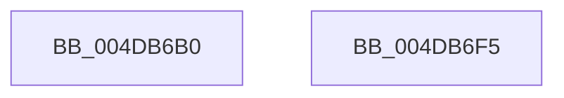

# MiReadFromMemoryPagefile

- RVA: `0x004DB6B0`–`0x004DB6F6` (길이 `70` bytes)
- VA: `0x00000001404DB6B0`
- 실행 섹션: `.text`
- PDB 이름 있음: `예`; PDB Function 태그: `아니요`
- unwind 정보 RVA: `0x0005CF00`
- 디코드: `19`개 명령, `70/70` bytes 표시
- 미해석 바이트: `0` (있으면 어셈블리에 `.byte`로 보존)

> 이 문서는 커널 이미지의 기계어와 PDB 기호를 분석해 생성했습니다. 4번과 5번은 함수 원형과 자료형을 바이너리 사용 방식에서 추정한 C 해석이며 원본 소스 복구 결과는 아닙니다.

## 1. Dependencies

- 직접 호출 지점: **2**; 고유 호출 대상: **2**
- 직접 호출자로 확인된 함수: **3**
- RIP 상대 이미지 참조: **0**

### Outgoing calls
- `0x004DB6CE` → [MiTransferMemoryPagefileData](MiTransferMemoryPagefileData_function_004DB6FC.md) (function, `0x004DB6FC`)
- `0x004DB6EA` → [KeSetEvent](../33/KeSetEvent_function_0033F310.md) (function, `0x0033F310`)

### Direct callers
- [MiResolvePageFileFault](../36/MiResolvePageFileFault_function_0036D968.md) at `0x0036F0E9`
- [MiReadPagefilePage](../66/MiReadPagefilePage_function_0066F78C.md) at `0x0066F927`
- [MiPfExecuteReadList](../../page/93/MiPfExecuteReadList_function_0093E1AC.md) at `0x0093E274`

### Static image references
- 디코드된 RIP-relative 메모리 참조가 없습니다.

## 2. Other-region calls and transfers

- 다른 실행 섹션으로 향하는 call: **0**
- 별도 외부 분기/꼬리 이동을 확인하지 못했습니다.

## 3. Assembly (complete function range)

```asm
004DB6B0  40 53                           push rbx
004DB6B2  48 83 EC 20                     sub rsp, 0x20
004DB6B6  4C 8B 42 60                     mov r8, qword ptr [rdx + 0x60]
004DB6BA  48 8B DA                        mov rbx, rdx
004DB6BD  49 C1 E8 0C                     shr r8, 0xc
004DB6C1  48 81 C2 10 01 00 00            add rdx, 0x110
004DB6C8  41 B9 01 00 00 00               mov r9d, 1
004DB6CE  E8 29 00 00 00                  call 0x1404db6fc
004DB6D3  8B 83 38 01 00 00               mov eax, dword ptr [rbx + 0x138]
004DB6D9  48 8D 4B 20                     lea rcx, [rbx + 0x20]
004DB6DD  83 63 50 00                     and dword ptr [rbx + 0x50], 0
004DB6E1  45 33 C0                        xor r8d, r8d
004DB6E4  33 D2                           xor edx, edx
004DB6E6  48 89 43 58                     mov qword ptr [rbx + 0x58], rax
004DB6EA  E8 21 3C E6 FF                  call 0x14033f310
004DB6EF  48 83 C4 20                     add rsp, 0x20
004DB6F3  5B                              pop rbx
004DB6F4  C3                              ret
004DB6F5  CC                              int3
```

## 4. C-style interpretation (structured pseudocode)

```c
__int64 __fastcall MiReadFromMemoryPagefile(__int64 a1, __int64 a2)
{
    __int64 result;
    __int64 v_rsp;

    v_rsp = (v_rsp) - (32);
    a3 = (*(unsigned __int64 *)(a2 + 96)) >> (12);
    a2 = (a2) + (272);
    result = MiTransferMemoryPagefileData(a1, a2, a3, 1);
    a3 = 0;
    a2 = 0;
    *(unsigned __int64 *)(a2 + 88) = (unsigned int)(*(unsigned int *)(a2 + 312));
    result = KeSetEvent(a2 + 32, a2, a3, 1);
    v_rsp = (v_rsp) + (32);
    return result;
}
```

## 5. (Beta) C Style

```c
int64_t MiReadFromMemoryPagefile(int64_t Arg1, void *Arg2)
{
    uint8_t *arg2 = (uint8_t *)Arg2;

    int64_t result;
    int64_t local_rsp;

    local_rsp = (local_rsp) - (32);
    a3 = (*(uint64_t *)(arg2 + 0x60)) >> (12);
    Arg2 = (Arg2) + (272);
    result = MiTransferMemoryPagefileData(Arg1, Arg2, a3, 1);
    a3 = 0;
    Arg2 = 0;
    *(uint64_t *)(arg2 + 0x58) = (uint32_t)(*(uint32_t *)(arg2 + 0x138));
    result = KeSetEvent(Arg2 + 32, Arg2, a3, 1);
    local_rsp = (local_rsp) + (32);
    return result;
}
```

### 관측된 메모리 오프셋

구조체 형식이 확인되지 않은 접근은 인자 기준의 오프셋으로만 기록했습니다.

| 기준 인자 | 오프셋 표현 | 폭 (bit) | 접근 |
|---|---:|---:|---|
| `Arg2` | `+ 0x20` | `64` | `R` |
| `Arg2` | `+ 0x50` | `32` | `R/W` |
| `Arg2` | `+ 0x58` | `64` | `W` |
| `Arg2` | `+ 0x60` | `64` | `R` |
| `Arg2` | `+ 0x138` | `32` | `R` |

## 6. Execution-region graph

[열기: 2D/3D 그래프와 함수 탐색 컨트롤 패널](../../../control-panel.html?section=text&rva=0x004DB6B0&view=graph)

- 2D 그래프는 위에서 아래로 흐르고, 3D 그래프는 빈 공간을 드래그해 회전합니다. Shift+드래그는 이동, 휠은 확대·축소, 함수 노드 선택은 대상 보고서 이동입니다.

### Static fallback


