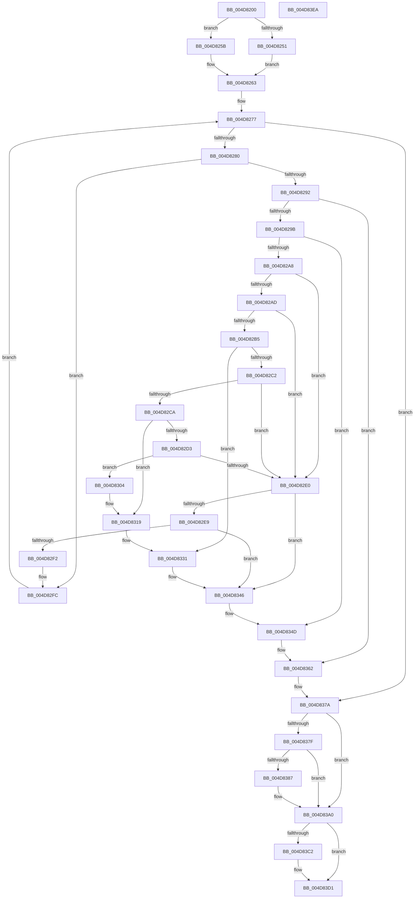

# MiRemovePteTracker

- RVA: `0x004D8200`–`0x004D83EB` (길이 `491` bytes)
- VA: `0x00000001404D8200`
- 실행 섹션: `.text`
- PDB 이름 있음: `예`; PDB Function 태그: `아니요`
- unwind 정보 RVA: `0x00084C9C`
- 디코드: `131`개 명령, `491/491` bytes 표시
- 미해석 바이트: `0` (있으면 어셈블리에 `.byte`로 보존)

> 이 문서는 커널 이미지의 기계어와 PDB 기호를 분석해 생성했습니다. 4번과 5번은 함수 원형과 자료형을 바이너리 사용 방식에서 추정한 C 해석이며 원본 소스 복구 결과는 아닙니다.

## 1. Dependencies

- 직접 호출 지점: **10**; 고유 호출 대상: **5**
- 직접 호출자로 확인된 함수: **2**
- RIP 상대 이미지 참조: **7**

### Outgoing calls
- `0x004D8254` → [ExAcquireSpinLockExclusiveAtDpcLevel](../24/ExAcquireSpinLockExclusiveAtDpcLevel_function_00248E80.md) (function, `0x00248E80`)
- `0x004D825B` → [ExAcquireSpinLockExclusive](../24/ExAcquireSpinLockExclusive_function_00248690.md) (function, `0x00248690`)
- `0x004D8313` → [KeBugCheckEx](../4F/KeBugCheckEx_function_004FD660.md) (function, `0x004FD660`)
- `0x004D832B` → [KeBugCheckEx](../4F/KeBugCheckEx_function_004FD660.md) (function, `0x004FD660`)
- `0x004D8340` → [KeBugCheckEx](../4F/KeBugCheckEx_function_004FD660.md) (function, `0x004FD660`)
- `0x004D835C` → [KeBugCheckEx](../4F/KeBugCheckEx_function_004FD660.md) (function, `0x004FD660`)
- `0x004D8374` → [KeBugCheckEx](../4F/KeBugCheckEx_function_004FD660.md) (function, `0x004FD660`)
- `0x004D839A` → [KeBugCheckEx](../4F/KeBugCheckEx_function_004FD660.md) (function, `0x004FD660`)
- `0x004D83B8` → [MiReleaseSpinLockExclusive](../24/MiReleaseSpinLockExclusive_function_002482C0.md) (function, `0x002482C0`)
- `0x004D83CC` → [ExpInterlockedPushEntrySList](../6B/ExpInterlockedPushEntrySList_function_006BA5B0.md) (function, `0x006BA5B0`)

### Direct callers
- [MiUnmapContiguousMemory](../3F/MiUnmapContiguousMemory_function_003F7908.md) at `0x003F7B7B`
- [MmFreeMappingAddress](../../page/A7/MmFreeMappingAddress_function_00A75F20.md) at `0x00A7602E`

### Static image references
- `0x004D8246` → RVA `0x00E35E10` (`.data`; read)
- `0x004D8266` → RVA `0x00E388F0` (`.data`; read)
- `0x004D82C2` → RVA `0x00E3741C` (`.data`; read)
- `0x004D837F` → RVA `0x00E35FA5` (`.data`; read)
- `0x004D83A0` → RVA `0x00E389F0` (`.data`; read/write)
- `0x004D83AE` → RVA `0x00E389F8` (`.data`; read/write)
- `0x004D83C5` → RVA `0x00E35E00` (`.data`; read)

## 2. Other-region calls and transfers

- 다른 실행 섹션으로 향하는 call: **0**
- 별도 외부 분기/꼬리 이동을 확인하지 못했습니다.

## 3. Assembly (complete function range)

```asm
004D8200  48 89 5C 24 08                  mov qword ptr [rsp + 8], rbx
004D8205  48 89 6C 24 10                  mov qword ptr [rsp + 0x10], rbp
004D820A  48 89 74 24 18                  mov qword ptr [rsp + 0x18], rsi
004D820F  57                              push rdi
004D8210  41 56                           push r14
004D8212  41 57                           push r15
004D8214  48 83 EC 30                     sub rsp, 0x30
004D8218  48 8B C2                        mov rax, rdx
004D821B  4C 8B F2                        mov r14, rdx
004D821E  48 C1 E8 0C                     shr rax, 0xc
004D8222  33 DB                           xor ebx, ebx
004D8224  4C 69 C8 5F 9E 00 00            imul r9, rax, 0x9e5f
004D822B  49 8B E8                        mov rbp, r8
004D822E  48 8B F9                        mov rdi, rcx
004D8231  49 8B F1                        mov rsi, r9
004D8234  48 C1 EE 20                     shr rsi, 0x20
004D8238  49 33 F1                        xor rsi, r9
004D823B  49 81 E6 00 F0 FF FF            and r14, 0xfffffffffffff000
004D8242  44 0F 20 C0                     mov rax, cr8
004D8246  48 8D 0D C3 DB 95 00            lea rcx, [rip + 0x95dbc3]
004D824D  3C 02                           cmp al, 2
004D824F  75 0A                           jne 0x1404d825b
004D8251  41 B7 11                        mov r15b, 0x11
004D8254  E8 27 0C D7 FF                  call 0x140248e80
004D8259  EB 08                           jmp 0x1404d8263
004D825B  E8 30 04 D7 FF                  call 0x140248690
004D8260  44 8A F8                        mov r15b, al
004D8263  83 E6 0F                        and esi, 0xf
004D8266  48 8D 15 83 06 96 00            lea rdx, [rip + 0x960683]
004D826D  48 C1 E6 04                     shl rsi, 4
004D8271  48 03 D6                        add rdx, rsi
004D8274  4C 8B 02                        mov r8, qword ptr [rdx]
004D8277  4C 3B C2                        cmp r8, rdx
004D827A  0F 84 FA 00 00 00               je 0x1404d837a
004D8280  49 8B 48 20                     mov rcx, qword ptr [r8 + 0x20]
004D8284  48 8B C1                        mov rax, rcx
004D8287  48 25 00 F0 FF FF               and rax, 0xfffffffffffff000
004D828D  4C 3B F0                        cmp r14, rax
004D8290  75 6A                           jne 0x1404d82fc
004D8292  48 85 DB                        test rbx, rbx
004D8295  0F 85 C7 00 00 00               jne 0x1404d8362
004D829B  4D 8B 48 18                     mov r9, qword ptr [r8 + 0x18]
004D829F  4C 3B CD                        cmp r9, rbp
004D82A2  0F 85 A5 00 00 00               jne 0x1404d834d
004D82A8  48 85 FF                        test rdi, rdi
004D82AB  74 33                           je 0x1404d82e0
004D82AD  66 0F BA 67 0A 09               bt word ptr [rdi + 0xa], 9
004D82B3  72 2B                           jb 0x1404d82e0
004D82B5  4D 8B 48 38                     mov r9, qword ptr [r8 + 0x38]
004D82B9  48 8B 47 30                     mov rax, qword ptr [rdi + 0x30]
004D82BD  4C 3B C8                        cmp r9, rax
004D82C0  75 6F                           jne 0x1404d8331
004D82C2  38 1D 54 F1 95 00               cmp byte ptr [rip + 0x95f154], bl
004D82C8  75 16                           jne 0x1404d82e0
004D82CA  48 8B 47 18                     mov rax, qword ptr [rdi + 0x18]
004D82CE  48 3B C8                        cmp rcx, rax
004D82D1  75 46                           jne 0x1404d8319
004D82D3  4D 8B 48 28                     mov r9, qword ptr [r8 + 0x28]
004D82D7  48 8B 47 20                     mov rax, qword ptr [rdi + 0x20]
004D82DB  4C 3B C8                        cmp r9, rax
004D82DE  75 24                           jne 0x1404d8304
004D82E0  49 8B 08                        mov rcx, qword ptr [r8]
004D82E3  4C 39 41 08                     cmp qword ptr [rcx + 8], r8
004D82E7  75 5D                           jne 0x1404d8346
004D82E9  49 8B 40 08                     mov rax, qword ptr [r8 + 8]
004D82ED  4C 39 00                        cmp qword ptr [rax], r8
004D82F0  75 54                           jne 0x1404d8346
004D82F2  48 89 08                        mov qword ptr [rax], rcx
004D82F5  49 8B D8                        mov rbx, r8
004D82F8  48 89 41 08                     mov qword ptr [rcx + 8], rax
004D82FC  4D 8B 00                        mov r8, qword ptr [r8]
004D82FF  E9 73 FF FF FF                  jmp 0x1404d8277
004D8304  BA 05 00 00 00                  mov edx, 5
004D8309  48 89 44 24 20                  mov qword ptr [rsp + 0x20], rax
004D830E  B9 DA 00 00 00                  mov ecx, 0xda
004D8313  E8 48 53 02 00                  call 0x1404fd660
004D8318  CC                              int3
004D8319  4C 8B C9                        mov r9, rcx
004D831C  48 89 44 24 20                  mov qword ptr [rsp + 0x20], rax
004D8321  B9 DA 00 00 00                  mov ecx, 0xda
004D8326  BA 03 00 00 00                  mov edx, 3
004D832B  E8 30 53 02 00                  call 0x1404fd660
004D8330  CC                              int3
004D8331  BA 04 00 00 00                  mov edx, 4
004D8336  48 89 44 24 20                  mov qword ptr [rsp + 0x20], rax
004D833B  B9 DA 00 00 00                  mov ecx, 0xda
004D8340  E8 1B 53 02 00                  call 0x1404fd660
004D8345  CC                              int3
004D8346  B9 03 00 00 00                  mov ecx, 3
004D834B  CD 29                           int 0x29
004D834D  BA 02 00 00 00                  mov edx, 2
004D8352  48 89 6C 24 20                  mov qword ptr [rsp + 0x20], rbp
004D8357  B9 DA 00 00 00                  mov ecx, 0xda
004D835C  E8 FF 52 02 00                  call 0x1404fd660
004D8361  CC                              int3
004D8362  4C 8B CF                        mov r9, rdi
004D8365  48 89 5C 24 20                  mov qword ptr [rsp + 0x20], rbx
004D836A  BA 01 00 00 00                  mov edx, 1
004D836F  B9 DA 00 00 00                  mov ecx, 0xda
004D8374  E8 E7 52 02 00                  call 0x1404fd660
004D8379  CC                              int3
004D837A  48 85 DB                        test rbx, rbx
004D837D  75 21                           jne 0x1404d83a0
004D837F  38 1D 20 DC 95 00               cmp byte ptr [rip + 0x95dc20], bl
004D8385  75 19                           jne 0x1404d83a0
004D8387  4D 8B CE                        mov r9, r14
004D838A  48 89 6C 24 20                  mov qword ptr [rsp + 0x20], rbp
004D838F  4C 8B C7                        mov r8, rdi
004D8392  8D 53 06                        lea edx, [rbx + 6]
004D8395  B9 DA 00 00 00                  mov ecx, 0xda
004D839A  E8 C1 52 02 00                  call 0x1404fd660
004D839F  CC                              int3
004D83A0  48 29 2D 49 06 96 00            sub qword ptr [rip + 0x960649], rbp
004D83A7  48 8D 0D 62 DA 95 00            lea rcx, [rip + 0x95da62]
004D83AE  48 FF 0D 43 06 96 00            dec qword ptr [rip + 0x960643]
004D83B5  41 8A D7                        mov dl, r15b
004D83B8  E8 03 FF D6 FF                  call 0x1402482c0
004D83BD  48 85 DB                        test rbx, rbx
004D83C0  74 0F                           je 0x1404d83d1
004D83C2  48 8B D3                        mov rdx, rbx
004D83C5  48 8D 0D 34 DA 95 00            lea rcx, [rip + 0x95da34]
004D83CC  E8 DF 21 1E 00                  call 0x1406ba5b0
004D83D1  48 8B 5C 24 50                  mov rbx, qword ptr [rsp + 0x50]
004D83D6  48 8B 6C 24 58                  mov rbp, qword ptr [rsp + 0x58]
004D83DB  48 8B 74 24 60                  mov rsi, qword ptr [rsp + 0x60]
004D83E0  48 83 C4 30                     add rsp, 0x30
004D83E4  41 5F                           pop r15
004D83E6  41 5E                           pop r14
004D83E8  5F                              pop rdi
004D83E9  C3                              ret
004D83EA  CC                              int3
```

## 4. C-style interpretation (structured pseudocode)

```c
__int64 __fastcall MiRemovePteTracker(__int64 a1, __int64 a2, __int64 a3)
{
    __int64 result;
    __int64 v_r14;
    __int64 v_rbx;
    __int64 v_rsi;
    __int64 v_rsp;
    unsigned __int64 v_stack_m28;
    unsigned __int64 v_stack_p10;
    unsigned __int64 v_stack_p18;
    unsigned __int64 v_stack_p8;

    v_stack_p8 = v_rbx;
    v_stack_p10 = v_rbp;
    v_stack_p18 = v_rsi;
    v_rsp = (v_rsp) - (48);
    result = (a2) >> (12);
    v_rbx = 0;
    a4 = (a4) * (result);
    v_rsi = (a4) >> (32);
    v_rsi = (v_rsi) ^ (a4);
    v_r14 = (a2) & (0xFFFFFFFFFFFFF000ULL);
    if (((unsigned __int8)(v_cr8)) != 2) goto loc_004D825B;
    result = ExAcquireSpinLockExclusiveAtDpcLevel(v_rip + 9821123, a2, a3, a4);
    goto loc_004D8263;
loc_004D825B:
    result = ExAcquireSpinLockExclusive(v_rip + 9821123, a2, a3, a4);
loc_004D8263:
    v_rsi = (unsigned int)((v_rsi) & (15));
    v_rsi = (v_rsi) << (4);
    a2 = (v_rip + 9832067) + (v_rsi);
loc_004D8277:
    if ((*(unsigned __int64 *)(a2)) == a2) goto loc_004D837A;
    result = (*(unsigned __int64 *)(*(unsigned __int64 *)(a2) + 32)) & (0xFFFFFFFFFFFFF000ULL);
    if (v_r14 != result) goto loc_004D82FC;
    if (0 != 0) goto loc_004D8362;
    if ((*(unsigned __int64 *)(*(unsigned __int64 *)(a2) + 24)) != a3) goto loc_004D834D;
    if (a1 == 0) goto loc_004D82E0;
    if (condition_is_below) goto loc_004D82E0;
    if ((*(unsigned __int64 *)(*(unsigned __int64 *)(a2) + 56)) != (*(unsigned __int64 *)(a1 + 48))) goto loc_004D8331;
    if ((*(unsigned __int8 *)(v_rip + 9826644)) != 0) goto loc_004D82E0;
    if ((*(unsigned __int64 *)(*(unsigned __int64 *)(a2) + 32)) != (*(unsigned __int64 *)(a1 + 24))) goto loc_004D8319;
    if ((*(unsigned __int64 *)(*(unsigned __int64 *)(a2) + 40)) != (*(unsigned __int64 *)(a1 + 32))) goto loc_004D8304;
loc_004D82E0:
    if ((*(unsigned __int64 *)(*(unsigned __int64 *)(*(unsigned __int64 *)(a2)) + 8)) != (*(unsigned __int64 *)(a2))) goto loc_004D8346;
    if ((*(unsigned __int64 *)(*(unsigned __int64 *)(*(unsigned __int64 *)(a2) + 8))) != (*(unsigned __int64 *)(a2))) goto loc_004D8346;
    *(unsigned __int64 *)(*(unsigned __int64 *)(*(unsigned __int64 *)(a2) + 8)) = *(unsigned __int64 *)(*(unsigned __int64 *)(a2));
    *(unsigned __int64 *)(*(unsigned __int64 *)(*(unsigned __int64 *)(a2)) + 8) = *(unsigned __int64 *)(*(unsigned __int64 *)(a2) + 8);
loc_004D82FC:
    goto loc_004D8277;
loc_004D8304:
    v_stack_m28 = *(unsigned __int64 *)(*(unsigned __int64 *)(a2) + 8);
    result = KeBugCheckEx(218, 5, *(unsigned __int64 *)(*(unsigned __int64 *)(a2)), *(unsigned __int64 *)(*(unsigned __int64 *)(a2) + 40));
loc_004D8319:
    v_stack_m28 = result;
    result = KeBugCheckEx(218, 3, *(unsigned __int64 *)(*(unsigned __int64 *)(a2)), 218);
loc_004D8331:
    v_stack_m28 = result;
    result = KeBugCheckEx(218, 4, *(unsigned __int64 *)(*(unsigned __int64 *)(a2)), 218);
loc_004D8346:
loc_004D834D:
    v_stack_m28 = a3;
    result = KeBugCheckEx(218, 2, *(unsigned __int64 *)(*(unsigned __int64 *)(a2)), 218);
loc_004D8362:
    v_stack_m28 = *(unsigned __int64 *)(a2);
    result = KeBugCheckEx(218, 1, *(unsigned __int64 *)(*(unsigned __int64 *)(a2)), a1);
loc_004D837A:
    if (*(unsigned __int64 *)(a2) != 0) goto loc_004D83A0;
    if ((*(unsigned __int8 *)(v_rip + 9821216)) == ((unsigned __int8)(*(unsigned __int64 *)(a2)))) {
        a4 = v_r14;
        v_stack_m28 = a3;
        a3 = a1;
        a2 = *(unsigned __int64 *)(a2) + 6;
        a1 = 218;
        result = KeBugCheckEx(a1, a2, a3, a4);
    }
    result = MiReleaseSpinLockExclusive(v_rip + 9820770, (unsigned __int8)((unsigned __int8)(result)), a3, a4);
    if (*(unsigned __int64 *)(a2) != 0) {
        a2 = *(unsigned __int64 *)(a2);
        a1 = v_rip + 9820724;
        result = ExpInterlockedPushEntrySList(a1, a2, a3, a4);
    }
    v_rsp = (v_rsp) + (48);
    return result;
}
```

## 5. (Beta) C Style

```c
int64_t MiRemovePteTracker(int64_t Arg1, int64_t Arg2, int64_t Arg3)
{
    int64_t result;
    int64_t local_r14;
    int64_t local_rbx;
    int64_t local_rsi;
    int64_t local_rsp;
    uint64_t v_stack_m28;
    uint64_t v_stack_p10;
    uint64_t v_stack_p18;
    uint64_t v_stack_p8;

    v_stack_p8 = local_rbx;
    v_stack_p10 = local_rbp;
    v_stack_p18 = local_rsi;
    local_rsp = (local_rsp) - (48);
    result = (Arg2) >> (12);
    local_rbx = 0;
    a4 = (a4) * (result);
    local_rsi = (a4) >> (32);
    local_rsi = (local_rsi) ^ (a4);
    local_r14 = (Arg2) & (0xFFFFFFFFFFFFF000ULL);
    if (((uint8_t)(v_cr8)) != 2) goto loc_004D825B;
    result = ExAcquireSpinLockExclusiveAtDpcLevel(v_rip + 9821123, Arg2, Arg3, a4);
    goto loc_004D8263;
loc_004D825B:
    result = ExAcquireSpinLockExclusive(v_rip + 9821123, Arg2, Arg3, a4);
loc_004D8263:
    local_rsi = (uint32_t)((local_rsi) & (15));
    local_rsi = (local_rsi) << (4);
    Arg2 = (v_rip + 9832067) + (local_rsi);
loc_004D8277:
    if ((*(uint64_t *)(Arg2)) == Arg2) goto loc_004D837A;
    result = (*(uint64_t *)(*(uint64_t *)(Arg2) + 0x20)) & (0xFFFFFFFFFFFFF000ULL);
    if (local_r14 != result) goto loc_004D82FC;
    if (0 != 0) goto loc_004D8362;
    if ((*(uint64_t *)(*(uint64_t *)(Arg2) + 0x18)) != Arg3) goto loc_004D834D;
    if (Arg1 == 0) goto loc_004D82E0;
    if (condition_is_below) goto loc_004D82E0;
    if ((*(uint64_t *)(*(uint64_t *)(Arg2) + 0x38)) != (*(uint64_t *)(Arg1 + 0x30))) goto loc_004D8331;
    if ((*(uint8_t *)(v_rip + 0x95F154)) != 0) goto loc_004D82E0;
    if ((*(uint64_t *)(*(uint64_t *)(Arg2) + 0x20)) != (*(uint64_t *)(Arg1 + 0x18))) goto loc_004D8319;
    if ((*(uint64_t *)(*(uint64_t *)(Arg2) + 0x28)) != (*(uint64_t *)(Arg1 + 0x20))) goto loc_004D8304;
loc_004D82E0:
    if ((*(uint64_t *)(*(uint64_t *)(*(uint64_t *)(Arg2)) + 0x8)) != (*(uint64_t *)(Arg2))) goto loc_004D8346;
    if ((*(uint64_t *)(*(uint64_t *)(*(uint64_t *)(Arg2) + 0x8))) != (*(uint64_t *)(Arg2))) goto loc_004D8346;
    *(uint64_t *)(*(uint64_t *)(*(uint64_t *)(Arg2) + 0x8)) = *(uint64_t *)(*(uint64_t *)(Arg2));
    *(uint64_t *)(*(uint64_t *)(*(uint64_t *)(Arg2)) + 0x8) = *(uint64_t *)(*(uint64_t *)(Arg2) + 0x8);
loc_004D82FC:
    goto loc_004D8277;
loc_004D8304:
    v_stack_m28 = *(uint64_t *)(*(uint64_t *)(Arg2) + 0x8);
    result = KeBugCheckEx(218, 5, *(uint64_t *)(*(uint64_t *)(Arg2)), *(uint64_t *)(*(uint64_t *)(Arg2) + 0x28));
loc_004D8319:
    v_stack_m28 = result;
    result = KeBugCheckEx(218, 3, *(uint64_t *)(*(uint64_t *)(Arg2)), 218);
loc_004D8331:
    v_stack_m28 = result;
    result = KeBugCheckEx(218, 4, *(uint64_t *)(*(uint64_t *)(Arg2)), 218);
loc_004D8346:
loc_004D834D:
    v_stack_m28 = Arg3;
    result = KeBugCheckEx(218, 2, *(uint64_t *)(*(uint64_t *)(Arg2)), 218);
loc_004D8362:
    v_stack_m28 = *(uint64_t *)(Arg2);
    result = KeBugCheckEx(218, 1, *(uint64_t *)(*(uint64_t *)(Arg2)), Arg1);
loc_004D837A:
    if (*(uint64_t *)(Arg2) != 0) goto loc_004D83A0;
    if ((*(uint8_t *)(v_rip + 0x95DC20)) == ((uint8_t)(*(uint64_t *)(Arg2)))) {
        a4 = local_r14;
        v_stack_m28 = Arg3;
        Arg3 = Arg1;
        Arg2 = *(uint64_t *)(Arg2) + 6;
        Arg1 = 218;
        result = KeBugCheckEx(Arg1, Arg2, Arg3, a4);
    }
    result = MiReleaseSpinLockExclusive(v_rip + 9820770, (uint8_t)((uint8_t)(result)), Arg3, a4);
    if (*(uint64_t *)(Arg2) != 0) {
        Arg2 = *(uint64_t *)(Arg2);
        Arg1 = v_rip + 9820724;
        result = ExpInterlockedPushEntrySList(Arg1, Arg2, Arg3, a4);
    }
    local_rsp = (local_rsp) + (48);
    return result;
}
```

## 6. Execution-region graph

[열기: 2D/3D 그래프와 함수 탐색 컨트롤 패널](../../../control-panel.html?section=text&rva=0x004D8200&view=graph)

- 2D 그래프는 위에서 아래로 흐르고, 3D 그래프는 빈 공간을 드래그해 회전합니다. Shift+드래그는 이동, 휠은 확대·축소, 함수 노드 선택은 대상 보고서 이동입니다.

### Static fallback


