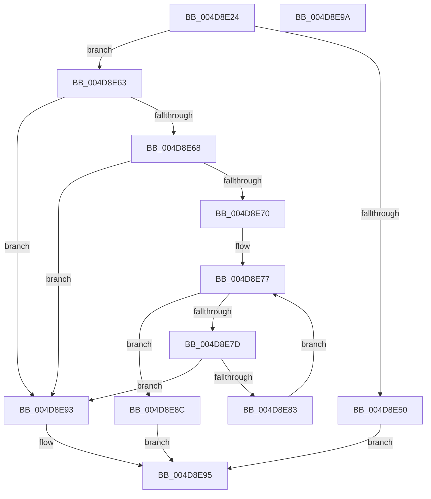

# MiReturnCrossPartitionCharge

- RVA: `0x004D8E24`–`0x004D8E9B` (길이 `119` bytes)
- VA: `0x00000001404D8E24`
- 실행 섹션: `.text`
- PDB 이름 있음: `예`; PDB Function 태그: `아니요`
- unwind 정보 RVA: `0x0005C788`
- 디코드: `35`개 명령, `119/119` bytes 표시
- 미해석 바이트: `0` (있으면 어셈블리에 `.byte`로 보존)

> 이 문서는 커널 이미지의 기계어와 PDB 기호를 분석해 생성했습니다. 4번과 5번은 함수 원형과 자료형을 바이너리 사용 방식에서 추정한 C 해석이며 원본 소스 복구 결과는 아닙니다.

## 1. Dependencies

- 직접 호출 지점: **2**; 고유 호출 대상: **2**
- 직접 호출자로 확인된 함수: **3**
- RIP 상대 이미지 참조: **0**

### Outgoing calls
- `0x004D8E52` → [MiConvertCrossPartitionChargeTypeToAggregate](MiConvertCrossPartitionChargeTypeToAggregate_function_004D8EA4.md) (function, `0x004D8EA4`)
- `0x004D8E5C` → [MiReturnCrossPartitionCharge](MiReturnCrossPartitionCharge_function_004D8E24.md) (function, `0x004D8E24`)

### Direct callers
- [MiReturnCrossPartitionCharges](../28/MiReturnCrossPartitionCharges_function_002867D0.md) at `0x00286828`
- [MiReturnCrossPartitionCharges](../28/MiReturnCrossPartitionCharges_function_002867D0.md) at `0x0028683A`
- [MiGetCrossPartitionCharges](../32/MiGetCrossPartitionCharges_function_00325BFC.md) at `0x00325CAA`
- [MiReturnCrossPartitionCharge](MiReturnCrossPartitionCharge_function_004D8E24.md) at `0x004D8E5C`

### Static image references
- 디코드된 RIP-relative 메모리 참조가 없습니다.

## 2. Other-region calls and transfers

- 다른 실행 섹션으로 향하는 call: **0**
- 별도 외부 분기/꼬리 이동을 확인하지 못했습니다.

## 3. Assembly (complete function range)

```asm
004D8E24  48 83 EC 28                     sub rsp, 0x28
004D8E28  4C 8B D1                        mov r10, rcx
004D8E2B  48 63 C2                        movsxd rax, edx
004D8E2E  48 C1 E0 05                     shl rax, 5
004D8E32  41 B9 07 00 00 00               mov r9d, 7
004D8E38  48 8B 8C 08 B8 09 00 00         mov rcx, qword ptr [rax + rcx + 0x9b8]
004D8E40  49 2B C8                        sub rcx, r8
004D8E43  4A 89 8C 10 B8 09 00 00         mov qword ptr [rax + r10 + 0x9b8], rcx
004D8E4B  41 3B D1                        cmp edx, r9d
004D8E4E  7D 13                           jge 0x1404d8e63
004D8E50  8B CA                           mov ecx, edx
004D8E52  E8 4D 00 00 00                  call 0x1404d8ea4
004D8E57  8B D0                           mov edx, eax
004D8E59  49 8B CA                        mov rcx, r10
004D8E5C  E8 C3 FF FF FF                  call 0x1404d8e24
004D8E61  EB 32                           jmp 0x1404d8e95
004D8E63  48 85 C9                        test rcx, rcx
004D8E66  75 2B                           jne 0x1404d8e93
004D8E68  41 8B 42 04                     mov eax, dword ptr [r10 + 4]
004D8E6C  A8 01                           test al, 1
004D8E6E  74 23                           je 0x1404d8e93
004D8E70  49 8D 82 98 0A 00 00            lea rax, [r10 + 0xa98]
004D8E77  49 83 F9 09                     cmp r9, 9
004D8E7B  7D 0F                           jge 0x1404d8e8c
004D8E7D  48 83 38 00                     cmp qword ptr [rax], 0
004D8E81  75 10                           jne 0x1404d8e93
004D8E83  49 FF C1                        inc r9
004D8E86  48 83 C0 20                     add rax, 0x20
004D8E8A  EB EB                           jmp 0x1404d8e77
004D8E8C  B8 01 00 00 00                  mov eax, 1
004D8E91  EB 02                           jmp 0x1404d8e95
004D8E93  33 C0                           xor eax, eax
004D8E95  48 83 C4 28                     add rsp, 0x28
004D8E99  C3                              ret
004D8E9A  CC                              int3
```

## 4. C-style interpretation (structured pseudocode)

```c
__int64 __fastcall MiReturnCrossPartitionCharge(__int64 a1, int a2, __int64 a3)
{
    __int64 result;
    __int64 v_rsp;

    v_rsp = (v_rsp) - (40);
    result = ((int)(a2)) << (5);
    a1 = (*(unsigned __int64 *)(result + a1 * 1 + 2488)) - (a3);
    *(unsigned __int64 *)(result + a1 * 1 + 2488) = a1;
    if (a2 >= 7) goto loc_004D8E63;
    result = MiConvertCrossPartitionChargeTypeToAggregate((unsigned int)(a2), a2, a3, 7);
    result = MiReturnCrossPartitionCharge(a1, (unsigned int)((unsigned int)(result)), a3, 7);
    goto loc_004D8E95;
loc_004D8E63:
    if (a1 != 0) goto loc_004D8E93;
    if ((((unsigned __int8)((unsigned int)(*(unsigned int *)(a1 + 4)))) & (1)) == 0) goto loc_004D8E93;
loc_004D8E77:
    if (7 >= 9) goto loc_004D8E8C;
    if ((*(unsigned __int64 *)(a1 + 2712)) != 0) goto loc_004D8E93;
    a4 = (7) + 1;
    result = (a1 + 2712) + (32);
    goto loc_004D8E77;
loc_004D8E8C:
    goto loc_004D8E95;
loc_004D8E93:
    result = 0;
loc_004D8E95:
    v_rsp = (v_rsp) + (40);
    return result;
}
```

## 5. (Beta) C Style

```c
int64_t MiReturnCrossPartitionCharge(void *Arg1, int32_t Arg2, int64_t Arg3)
{
    uint8_t *arg1 = (uint8_t *)Arg1;

    int64_t result;
    int64_t local_rsp;

    local_rsp = (local_rsp) - (40);
    result = ((int32_t)(Arg2)) << (5);
    Arg1 = (*(uint64_t *)(result + arg1 * 1 + 0x9B8)) - (Arg3);
    *(void **)(result + arg1 * 1 + 0x9B8) = Arg1;
    if (Arg2 >= 7) goto loc_004D8E63;
    result = MiConvertCrossPartitionChargeTypeToAggregate((uint32_t)(Arg2), Arg2, Arg3, 7);
    result = MiReturnCrossPartitionCharge(Arg1, (uint32_t)((uint32_t)(result)), Arg3, 7);
    goto loc_004D8E95;
loc_004D8E63:
    if (Arg1 != NULL) goto loc_004D8E93;
    if ((((uint8_t)((uint32_t)(*(uint32_t *)(arg1 + 0x4)))) & (1)) == 0) goto loc_004D8E93;
loc_004D8E77:
    if (7 >= 9) goto loc_004D8E8C;
    if ((*(uint64_t *)(arg1 + 0xA98)) != 0) goto loc_004D8E93;
    a4 = (7) + 1;
    result = (Arg1 + 2712) + (32);
    goto loc_004D8E77;
loc_004D8E8C:
    goto loc_004D8E95;
loc_004D8E93:
    result = 0;
loc_004D8E95:
    local_rsp = (local_rsp) + (40);
    return result;
}
```

### 관측된 메모리 오프셋

구조체 형식이 확인되지 않은 접근은 인자 기준의 오프셋으로만 기록했습니다.

| 기준 인자 | 오프셋 표현 | 폭 (bit) | 접근 |
|---|---:|---:|---|
| `Arg1` | `+ 0x0` | `64` | `R` |
| `Arg1` | `+ 0x4` | `32` | `R` |
| `Arg1` | `+ 0xA98` | `64` | `R` |

## 6. Execution-region graph

[열기: 2D/3D 그래프와 함수 탐색 컨트롤 패널](../../../control-panel.html?section=text&rva=0x004D8E24&view=graph)

- 2D 그래프는 위에서 아래로 흐르고, 3D 그래프는 빈 공간을 드래그해 회전합니다. Shift+드래그는 이동, 휠은 확대·축소, 함수 노드 선택은 대상 보고서 이동입니다.

### Static fallback


