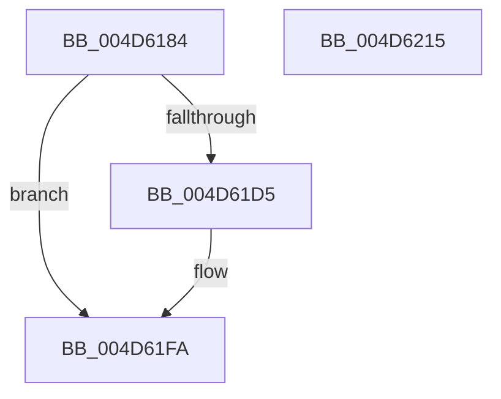

# MiReturnCrossPartitionControlAreaCharges

- RVA: `0x004D6184`–`0x004D6216` (길이 `146` bytes)
- VA: `0x00000001404D6184`
- 실행 섹션: `.text`
- PDB 이름 있음: `예`; PDB Function 태그: `아니요`
- unwind 정보 RVA: `0x0005E6B4`
- 디코드: `38`개 명령, `146/146` bytes 표시
- 미해석 바이트: `0` (있으면 어셈블리에 `.byte`로 보존)

> 이 문서는 커널 이미지의 기계어와 PDB 기호를 분석해 생성했습니다. 4번과 5번은 함수 원형과 자료형을 바이너리 사용 방식에서 추정한 C 해석이며 원본 소스 복구 결과는 아닙니다.

## 1. Dependencies

- 직접 호출 지점: **4**; 고유 호출 대상: **4**
- 직접 호출자로 확인된 함수: **6**
- RIP 상대 이미지 참조: **1**

### Outgoing calls
- `0x004D61A8` → [ExAcquireSpinLockExclusive](../24/ExAcquireSpinLockExclusive_function_00248690.md) (function, `0x00248690`)
- `0x004D61BB` → [MiDecrementSubsectionViewCount](../29/MiDecrementSubsectionViewCount_function_00298E90.md) (function, `0x00298E90`)
- `0x004D61C9` → [MiReleaseSpinLockExclusive](../24/MiReleaseSpinLockExclusive_function_002482C0.md) (function, `0x002482C0`)
- `0x004D61F5` → [MiReturnCrossPartitionSectionCharges](../4B/MiReturnCrossPartitionSectionCharges_function_004BA61C.md) (function, `0x004BA61C`)

### Direct callers
- [MiRemoveMappedPtes](../29/MiRemoveMappedPtes_function_00296A50.md) at `0x00296C4D`
- [MiDeleteVad](../../page/88/MiDeleteVad_function_00888C80.md) at `0x008890E4`
- [MiMapImageInSystemSpace](../../page/94/MiMapImageInSystemSpace_function_00941DD8.md) at `0x00941FCB`
- [MiUnmapImageInSystemSpace](../../page/94/MiUnmapImageInSystemSpace_function_0094206C.md) at `0x009420CF`
- [MiUnloadSystemImage](../../page/AA/MiUnloadSystemImage_function_00AA2FD4.md) at `0x00AA3446`
- [sub_00B2A146](../../page/B2/Unknown_function_00B2A146.md) at `0x00B2A415`

### Static image references
- `0x004D61DD` → RVA `0x00E30088` (`.data`; read)

## 2. Other-region calls and transfers

- 다른 실행 섹션으로 향하는 call: **0**
- 별도 외부 분기/꼬리 이동을 확인하지 못했습니다.

## 3. Assembly (complete function range)

```asm
004D6184  48 8B C4                        mov rax, rsp
004D6187  48 89 58 08                     mov qword ptr [rax + 8], rbx
004D618B  48 89 68 10                     mov qword ptr [rax + 0x10], rbp
004D618F  48 89 70 18                     mov qword ptr [rax + 0x18], rsi
004D6193  48 89 78 20                     mov qword ptr [rax + 0x20], rdi
004D6197  41 56                           push r14
004D6199  48 83 EC 20                     sub rsp, 0x20
004D619D  4C 8B 71 40                     mov r14, qword ptr [rcx + 0x40]
004D61A1  48 8B F1                        mov rsi, rcx
004D61A4  48 83 C1 48                     add rcx, 0x48
004D61A8  E8 E3 24 D7 FF                  call 0x140248690
004D61AD  48 8D 8E 80 00 00 00            lea rcx, [rsi + 0x80]
004D61B4  BA 18 00 00 00                  mov edx, 0x18
004D61B9  8A D8                           mov bl, al
004D61BB  E8 D0 2C DC FF                  call 0x140298e90
004D61C0  8A D3                           mov dl, bl
004D61C2  48 8D 4E 48                     lea rcx, [rsi + 0x48]
004D61C6  48 8B E8                        mov rbp, rax
004D61C9  E8 F2 20 D7 FF                  call 0x1402482c0
004D61CE  33 D2                           xor edx, edx
004D61D0  48 85 ED                        test rbp, rbp
004D61D3  74 25                           je 0x1404d61fa
004D61D5  44 0F B7 4E 3C                  movzx r9d, word ptr [rsi + 0x3c]
004D61DA  4D 85 F6                        test r14, r14
004D61DD  48 8B 0D A4 9E 95 00            mov rcx, qword ptr [rip + 0x959ea4]
004D61E4  4C 8B C5                        mov r8, rbp
004D61E7  0F 95 C2                        setne dl
004D61EA  41 81 E1 FF 03 00 00            and r9d, 0x3ff
004D61F1  4A 8B 0C C9                     mov rcx, qword ptr [rcx + r9*8]
004D61F5  E8 22 44 FE FF                  call 0x1404ba61c
004D61FA  48 8B 5C 24 30                  mov rbx, qword ptr [rsp + 0x30]
004D61FF  48 8B 6C 24 38                  mov rbp, qword ptr [rsp + 0x38]
004D6204  48 8B 74 24 40                  mov rsi, qword ptr [rsp + 0x40]
004D6209  48 8B 7C 24 48                  mov rdi, qword ptr [rsp + 0x48]
004D620E  48 83 C4 20                     add rsp, 0x20
004D6212  41 5E                           pop r14
004D6214  C3                              ret
004D6215  CC                              int3
```

## 4. C-style interpretation (structured pseudocode)

```c
__int64 __fastcall MiReturnCrossPartitionControlAreaCharges(__int64 a1)
{
    __int64 result;
    __int64 v_rsp;
    unsigned __int64 v_stack_p10;
    unsigned __int64 v_stack_p18;
    unsigned __int64 v_stack_p20;
    unsigned __int64 v_stack_p8;

    *(unsigned __int64 *)(v_rsp + 8) = v_rbx;
    *(unsigned __int64 *)(v_rsp + 16) = v_rbp;
    *(unsigned __int64 *)(v_rsp + 24) = v_rsi;
    *(unsigned __int64 *)(v_rsp + 32) = v_rdi;
    v_rsp = (v_rsp) - (32);
    a1 = (a1) + (72);
    result = ExAcquireSpinLockExclusive(a1, a2, a3, a4);
    result = MiDecrementSubsectionViewCount(a1 + 128, 24, a3, a4);
    result = MiReleaseSpinLockExclusive(a1 + 72, (unsigned __int8)((unsigned __int8)(result)), a3, a4);
    a2 = 0;
    if (result != 0) {
        a4 = *(unsigned __int16 *)(a1 + 60);
        a1 = *(unsigned __int64 *)(v_rip + 9805476);
        a3 = result;
        a2 = (*(unsigned __int64 *)(a1 + 64) != 0) ? 1 : 0;
        a4 = (unsigned int)((a4) & (0x3FFULL));
        a1 = *(unsigned __int64 *)(a1 + a4 * 8);
        result = MiReturnCrossPartitionSectionCharges(a1, a2, a3, a4);
    }
    v_rsp = (v_rsp) + (32);
    return result;
}
```

## 5. (Beta) C Style

```c
int64_t MiReturnCrossPartitionControlAreaCharges(void *Arg1)
{
    uint8_t *arg1 = (uint8_t *)Arg1;

    int64_t result;
    int64_t local_rsp;
    uint64_t v_stack_p10;
    uint64_t v_stack_p18;
    uint64_t v_stack_p20;
    uint64_t v_stack_p8;

    *(uint64_t *)(local_rsp + 0x8) = local_rbx;
    *(uint64_t *)(local_rsp + 0x10) = local_rbp;
    *(uint64_t *)(local_rsp + 0x18) = local_rsi;
    *(uint64_t *)(local_rsp + 0x20) = local_rdi;
    local_rsp = (local_rsp) - (32);
    Arg1 = (Arg1) + (72);
    result = ExAcquireSpinLockExclusive(Arg1, a2, a3, a4);
    result = MiDecrementSubsectionViewCount(Arg1 + 128, 24, a3, a4);
    result = MiReleaseSpinLockExclusive(Arg1 + 72, (uint8_t)((uint8_t)(result)), a3, a4);
    a2 = 0;
    if (result != 0) {
        a4 = *(uint16_t *)(arg1 + 0x3C);
        Arg1 = *(uint64_t *)(v_rip + 0x959EA4);
        a3 = result;
        a2 = (*(uint64_t *)(arg1 + 0x40) != 0) ? 1 : 0;
        a4 = (uint32_t)((a4) & (0x3FFULL));
        Arg1 = *(uint64_t *)(arg1 + a4 * 8);
        result = MiReturnCrossPartitionSectionCharges(Arg1, a2, a3, a4);
    }
    local_rsp = (local_rsp) + (32);
    return result;
}
```

### 관측된 메모리 오프셋

구조체 형식이 확인되지 않은 접근은 인자 기준의 오프셋으로만 기록했습니다.

| 기준 인자 | 오프셋 표현 | 폭 (bit) | 접근 |
|---|---:|---:|---|
| `Arg1` | `+ 0x3C` | `16` | `R` |
| `Arg1` | `+ 0x40` | `64` | `R` |
| `Arg1` | `+ 0x48` | `64` | `R` |
| `Arg1` | `+ 0x80` | `64` | `R` |

## 6. Execution-region graph

[열기: 2D/3D 그래프와 함수 탐색 컨트롤 패널](../../../control-panel.html?section=text&rva=0x004D6184&view=graph)

- 2D 그래프는 위에서 아래로 흐르고, 3D 그래프는 빈 공간을 드래그해 회전합니다. Shift+드래그는 이동, 휠은 확대·축소, 함수 노드 선택은 대상 보고서 이동입니다.

### Static fallback


