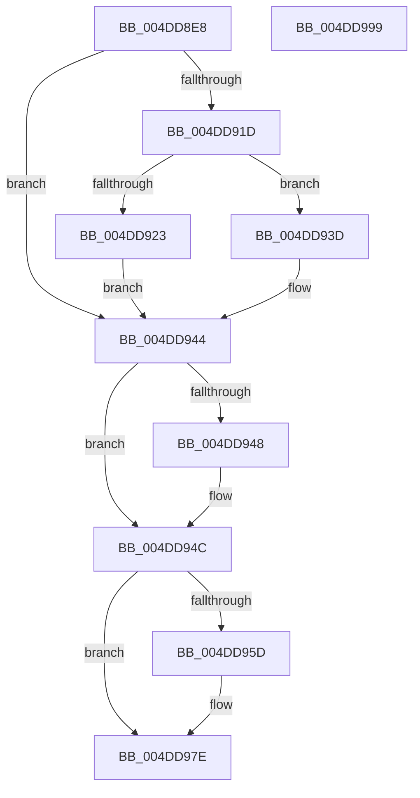

# MiSetDeleteOnClose

- RVA: `0x004DD8E8`–`0x004DD99A` (길이 `178` bytes)
- VA: `0x00000001404DD8E8`
- 실행 섹션: `.text`
- PDB 이름 있음: `예`; PDB Function 태그: `아니요`
- unwind 정보 RVA: `0x0005E6B4`
- 디코드: `50`개 명령, `178/178` bytes 표시
- 미해석 바이트: `0` (있으면 어셈블리에 `.byte`로 보존)

> 이 문서는 커널 이미지의 기계어와 PDB 기호를 분석해 생성했습니다. 4번과 5번은 함수 원형과 자료형을 바이너리 사용 방식에서 추정한 C 해석이며 원본 소스 복구 결과는 아닙니다.

## 1. Dependencies

- 직접 호출 지점: **5**; 고유 호출 대상: **5**
- 직접 호출자로 확인된 함수: **3**
- RIP 상대 이미지 참조: **1**

### Outgoing calls
- `0x004DD90C` → [ExAcquireSpinLockExclusive](../24/ExAcquireSpinLockExclusive_function_00248690.md) (function, `0x00248690`)
- `0x004DD926` → [MiRemoveUnusedSegment](../2B/MiRemoveUnusedSegment_function_002BBE74.md) (function, `0x002BBE74`)
- `0x004DD933` → [MiInsertUnusedSegment](../44/MiInsertUnusedSegment_function_004443DC.md) (function, `0x004443DC`)
- `0x004DD953` → [MiReleaseSpinLockExclusive](../24/MiReleaseSpinLockExclusive_function_002482C0.md) (function, `0x002482C0`)
- `0x004DD979` → [MiReturnCrossPartitionSectionCharges](../4B/MiReturnCrossPartitionSectionCharges_function_004BA61C.md) (function, `0x004BA61C`)

### Direct callers
- [MiWriteComplete](../40/MiWriteComplete_function_004069B0.md) at `0x00406EA7`
- [MiRelocateImage](../../page/98/MiRelocateImage_function_00988E14.md) at `0x0098953E`
- [sub_00B2B6D0](../../page/B2/Unknown_function_00B2B6D0.md) at `0x00B2B74D`

### Static image references
- `0x004DD964` → RVA `0x00E30088` (`.data`; read)

## 2. Other-region calls and transfers

- 다른 실행 섹션으로 향하는 call: **0**
- 별도 외부 분기/꼬리 이동을 확인하지 못했습니다.

## 3. Assembly (complete function range)

```asm
004DD8E8  48 8B C4                        mov rax, rsp
004DD8EB  48 89 58 08                     mov qword ptr [rax + 8], rbx
004DD8EF  48 89 68 10                     mov qword ptr [rax + 0x10], rbp
004DD8F3  48 89 70 18                     mov qword ptr [rax + 0x18], rsi
004DD8F7  48 89 78 20                     mov qword ptr [rax + 0x20], rdi
004DD8FB  41 56                           push r14
004DD8FD  48 83 EC 20                     sub rsp, 0x20
004DD901  48 8B D9                        mov rbx, rcx
004DD904  8B EA                           mov ebp, edx
004DD906  48 83 C1 48                     add rcx, 0x48
004DD90A  33 FF                           xor edi, edi
004DD90C  E8 7F AD D6 FF                  call 0x140248690
004DD911  44 8A F0                        mov r14b, al
004DD914  8B 43 38                        mov eax, dword ptr [rbx + 0x38]
004DD917  0F BA E0 12                     bt eax, 0x12
004DD91B  72 27                           jb 0x1404dd944
004DD91D  0F BA E0 1C                     bt eax, 0x1c
004DD921  73 1A                           jae 0x1404dd93d
004DD923  48 8B CB                        mov rcx, rbx
004DD926  E8 49 E5 DD FF                  call 0x1402bbe74
004DD92B  0F BA 6B 38 12                  bts dword ptr [rbx + 0x38], 0x12
004DD930  48 8B CB                        mov rcx, rbx
004DD933  E8 A4 6A F6 FF                  call 0x1404443dc
004DD938  48 8B F8                        mov rdi, rax
004DD93B  EB 07                           jmp 0x1404dd944
004DD93D  0F BA E8 12                     bts eax, 0x12
004DD941  89 43 38                        mov dword ptr [rbx + 0x38], eax
004DD944  85 ED                           test ebp, ebp
004DD946  74 04                           je 0x1404dd94c
004DD948  83 4B 38 10                     or dword ptr [rbx + 0x38], 0x10
004DD94C  41 8A D6                        mov dl, r14b
004DD94F  48 8D 4B 48                     lea rcx, [rbx + 0x48]
004DD953  E8 68 A9 D6 FF                  call 0x1402482c0
004DD958  48 85 FF                        test rdi, rdi
004DD95B  74 21                           je 0x1404dd97e
004DD95D  0F B7 43 3C                     movzx eax, word ptr [rbx + 0x3c]
004DD961  4C 8B C7                        mov r8, rdi
004DD964  48 8B 0D 1D 27 95 00            mov rcx, qword ptr [rip + 0x95271d]
004DD96B  25 FF 03 00 00                  and eax, 0x3ff
004DD970  BA 01 00 00 00                  mov edx, 1
004DD975  48 8B 0C C1                     mov rcx, qword ptr [rcx + rax*8]
004DD979  E8 9E CC FD FF                  call 0x1404ba61c
004DD97E  48 8B 5C 24 30                  mov rbx, qword ptr [rsp + 0x30]
004DD983  48 8B 6C 24 38                  mov rbp, qword ptr [rsp + 0x38]
004DD988  48 8B 74 24 40                  mov rsi, qword ptr [rsp + 0x40]
004DD98D  48 8B 7C 24 48                  mov rdi, qword ptr [rsp + 0x48]
004DD992  48 83 C4 20                     add rsp, 0x20
004DD996  41 5E                           pop r14
004DD998  C3                              ret
004DD999  CC                              int3
```

## 4. C-style interpretation (structured pseudocode)

```c
__int64 __fastcall MiSetDeleteOnClose(__int64 a1, int a2)
{
    __int64 result;
    __int64 v_rdi;
    __int64 v_rsp;
    unsigned __int64 v_stack_p10;
    unsigned __int64 v_stack_p18;
    unsigned __int64 v_stack_p20;
    unsigned __int64 v_stack_p8;

    *(unsigned __int64 *)(v_rsp + 8) = v_rbx;
    *(unsigned __int64 *)(v_rsp + 16) = v_rbp;
    *(unsigned __int64 *)(v_rsp + 24) = v_rsi;
    *(unsigned __int64 *)(v_rsp + 32) = v_rdi;
    v_rsp = (v_rsp) - (32);
    a1 = (a1) + (72);
    v_rdi = 0;
    result = ExAcquireSpinLockExclusive(a1, a2, a3, a4);
    if (condition_is_below) goto loc_004DD944;
    if (condition_is_above_or_equal) goto loc_004DD93D;
    result = MiRemoveUnusedSegment(a1, a2, a3, a4);
    result = MiInsertUnusedSegment(a1, a2, a3, a4);
    goto loc_004DD944;
loc_004DD93D:
    *(unsigned int *)(a1 + 56) = (unsigned int)(result);
loc_004DD944:
    if ((unsigned int)((unsigned int)(a2)) != 0) {
    }
    result = MiReleaseSpinLockExclusive(a1 + 72, (unsigned __int8)((unsigned __int8)(result)), a3, a4);
    if (result != 0) {
        result = *(unsigned __int16 *)(a1 + 60);
        a3 = result;
        a1 = *(unsigned __int64 *)(v_rip + 9774877);
        result = (unsigned int)((result) & (0x3FFULL));
        a2 = 1;
        a1 = *(unsigned __int64 *)(a1 + result * 8);
        result = MiReturnCrossPartitionSectionCharges(a1, a2, a3, a4);
    }
    v_rsp = (v_rsp) + (32);
    return result;
}
```

## 5. (Beta) C Style

```c
int64_t MiSetDeleteOnClose(void *Arg1, int32_t Arg2)
{
    uint8_t *arg1 = (uint8_t *)Arg1;

    int64_t result;
    int64_t local_rdi;
    int64_t local_rsp;
    uint64_t v_stack_p10;
    uint64_t v_stack_p18;
    uint64_t v_stack_p20;
    uint64_t v_stack_p8;

    *(uint64_t *)(local_rsp + 0x8) = local_rbx;
    *(uint64_t *)(local_rsp + 0x10) = local_rbp;
    *(uint64_t *)(local_rsp + 0x18) = local_rsi;
    *(uint64_t *)(local_rsp + 0x20) = local_rdi;
    local_rsp = (local_rsp) - (32);
    Arg1 = (Arg1) + (72);
    local_rdi = 0;
    result = ExAcquireSpinLockExclusive(Arg1, Arg2, a3, a4);
    if (condition_is_below) goto loc_004DD944;
    if (condition_is_above_or_equal) goto loc_004DD93D;
    result = MiRemoveUnusedSegment(Arg1, Arg2, a3, a4);
    result = MiInsertUnusedSegment(Arg1, Arg2, a3, a4);
    goto loc_004DD944;
loc_004DD93D:
    *(uint32_t *)(arg1 + 0x38) = (uint32_t)(result);
loc_004DD944:
    if ((uint32_t)((uint32_t)(Arg2)) != 0) {
    }
    result = MiReleaseSpinLockExclusive(Arg1 + 72, (uint8_t)((uint8_t)(result)), a3, a4);
    if (result != 0) {
        result = *(uint16_t *)(arg1 + 0x3C);
        a3 = result;
        Arg1 = *(uint64_t *)(v_rip + 0x95271D);
        result = (uint32_t)((result) & (0x3FFULL));
        Arg2 = 1;
        Arg1 = *(uint64_t *)(arg1 + result * 8);
        result = MiReturnCrossPartitionSectionCharges(Arg1, Arg2, a3, a4);
    }
    local_rsp = (local_rsp) + (32);
    return result;
}
```

### 관측된 메모리 오프셋

구조체 형식이 확인되지 않은 접근은 인자 기준의 오프셋으로만 기록했습니다.

| 기준 인자 | 오프셋 표현 | 폭 (bit) | 접근 |
|---|---:|---:|---|
| `Arg1` | `+ 0x38` | `32` | `R` |
| `Arg1` | `+ 0x38` | `32` | `R/W` |
| `Arg1` | `+ 0x38` | `32` | `W` |
| `Arg1` | `+ 0x3C` | `16` | `R` |
| `Arg1` | `+ 0x48` | `64` | `R` |

## 6. Execution-region graph

[열기: 2D/3D 그래프와 함수 탐색 컨트롤 패널](../../../control-panel.html?section=text&rva=0x004DD8E8&view=graph)

- 2D 그래프는 위에서 아래로 흐르고, 3D 그래프는 빈 공간을 드래그해 회전합니다. Shift+드래그는 이동, 휠은 확대·축소, 함수 노드 선택은 대상 보고서 이동입니다.

### Static fallback


