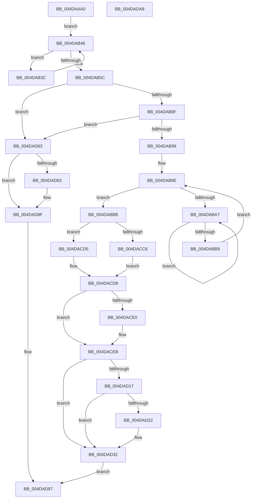

# MiSplitDirectMapPage

- RVA: `0x004DAAA0`–`0x004DADA9` (길이 `777` bytes)
- VA: `0x00000001404DAAA0`
- 실행 섹션: `.text`
- PDB 이름 있음: `예`; PDB Function 태그: `아니요`
- unwind 정보 RVA: `0x000BE9B4`
- 디코드: `210`개 명령, `777/777` bytes 표시
- 미해석 바이트: `0` (있으면 어셈블리에 `.byte`로 보존)

> 이 문서는 커널 이미지의 기계어와 PDB 기호를 분석해 생성했습니다. 4번과 5번은 함수 원형과 자료형을 바이너리 사용 방식에서 추정한 C 해석이며 원본 소스 복구 결과는 아닙니다.

## 1. Dependencies

- 직접 호출 지점: **24**; 고유 호출 대상: **24**
- 직접 호출자로 확인된 함수: **1**
- RIP 상대 이미지 참조: **3**

### Outgoing calls
- `0x004DAB41` → [MiWaitForFreePage](../2A/MiWaitForFreePage_function_002A3324.md) (function, `0x002A3324`)
- `0x004DAB4E` → [MiGetPage](../28/MiGetPage_function_002884C0.md) (function, `0x002884C0`)
- `0x004DAB77` → [MiLockPageInline](../31/MiLockPageInline_function_0031A340.md) (function, `0x0031A340`)
- `0x004DABAB` → [KeYieldProcessorEx](../3F/KeYieldProcessorEx_function_003FBD00.md) (function, `0x003FBD00`)
- `0x004DABD0` → [MiFinalizePageAttribute](../33/MiFinalizePageAttribute_function_00332E30.md) (function, `0x00332E30`)
- `0x004DABDC` → [MiCopyPfnEntryRaw](../44/MiCopyPfnEntryRaw_function_00448500.md) (function, `0x00448500`)
- `0x004DABF9` → [MiMakeDemandZeroPte](../33/MiMakeDemandZeroPte_function_00337A00.md) (function, `0x00337A00`)
- `0x004DAC09` → [MiCopyPfnEntryEx](../2B/MiCopyPfnEntryEx_function_002B2670.md) (function, `0x002B2670`)
- `0x004DAC1A` → [MiSetPfnModified](../36/MiSetPfnModified_function_00362960.md) (function, `0x00362960`)
- `0x004DAC35` → [MiAddLockedPageCharge](../28/MiAddLockedPageCharge_function_0028B550.md) (function, `0x0028B550`)
- `0x004DAC48` → [MiDereferenceControlAreaPfnList](../2A/MiDereferenceControlAreaPfnList_function_002A45E8.md) (function, `0x002A45E8`)
- `0x004DAC58` → [MiCopyPage](../2B/MiCopyPage_function_002B1B30.md) (function, `0x002B1B30`)
- `0x004DAC8C` → [MiMapPageInHyperSpaceWorker](../33/MiMapPageInHyperSpaceWorker_function_00332B10.md) (function, `0x00332B10`)
- `0x004DACAA` → [MiUpdateTransitionPteFrame](../38/MiUpdateTransitionPteFrame_function_00385EDC.md) (function, `0x00385EDC`)
- `0x004DACBD` → [MiPteInShadowRange](../23/MiPteInShadowRange_function_0023FB00.md) (function, `0x0023FB00`)
- `0x004DACCA` → [MiSanitizeShadowPxe](../29/MiSanitizeShadowPxe_function_00294B68.md) (function, `0x00294B68`)
- `0x004DACE6` → [MiWritePteShadow](../29/MiWritePteShadow_function_00294EAC.md) (function, `0x00294EAC`)
- `0x004DACF6` → [MiUnmapPageInHyperSpaceWorker](../43/MiUnmapPageInHyperSpaceWorker_function_00432800.md) (function, `0x00432800`)
- `0x004DAD19` → [MiColdPageSizeSupported](../45/MiColdPageSizeSupported_function_00454588.md) (function, `0x00454588`)
- `0x004DAD2D` → [MiAddPageToHeatList](../44/MiAddPageToHeatList_function_0044603C.md) (function, `0x0044603C`)
- `0x004DAD4E` → [MiInsertPageChainHead](../2A/MiInsertPageChainHead_function_002A24EC.md) (function, `0x002A24EC`)
- `0x004DAD59` → [MiUnlockPage](../31/MiUnlockPage_function_0031A3E0.md) (function, `0x0031A3E0`)
- `0x004DAD75` → [MiReleaseFreshPageAtDpc](../33/MiReleaseFreshPageAtDpc_function_00334B50.md) (function, `0x00334B50`)
- `0x004DAD8A` → [KiLowerIrqlProcessIrqlFlags](../4F/KiLowerIrqlProcessIrqlFlags_function_004F5698.md) (function, `0x004F5698`)

### Direct callers
- [MiWalkEntireImage](../36/MiWalkEntireImage_function_00365D70.md) at `0x003667A8`

### Static image references
- `0x004DAAFE` → RVA `0x00E2DCC0` (`.data`; read)
- `0x004DAB26` → RVA `0x00E30088` (`.data`; read)
- `0x004DAD7A` → RVA `0x00FC6D20` (`ALMOSTRO`; read)

## 2. Other-region calls and transfers

- 다른 실행 섹션으로 향하는 call: **0**
- 별도 외부 분기/꼬리 이동을 확인하지 못했습니다.

## 3. Assembly (complete function range)

```asm
004DAAA0  4C 89 4C 24 20                  mov qword ptr [rsp + 0x20], r9
004DAAA5  55                              push rbp
004DAAA6  53                              push rbx
004DAAA7  56                              push rsi
004DAAA8  57                              push rdi
004DAAA9  41 54                           push r12
004DAAAB  41 55                           push r13
004DAAAD  41 56                           push r14
004DAAAF  41 57                           push r15
004DAAB1  48 8B EC                        mov rbp, rsp
004DAAB4  48 83 EC 68                     sub rsp, 0x68
004DAAB8  0F 57 C0                        xorps xmm0, xmm0
004DAABB  48 B8 00 00 00 00 00 DE FF FF   movabs rax, 0xffffde0000000000
004DAAC5  4A 8D 3C 45 00 00 00 00         lea rdi, [r8*2]
004DAACD  4D 8B E8                        mov r13, r8
004DAAD0  49 03 F8                        add rdi, r8
004DAAD3  4C 8B E1                        mov r12, rcx
004DAAD6  48 C1 E7 04                     shl rdi, 4
004DAADA  0F 11 45 C8                     movups xmmword ptr [rbp - 0x38], xmm0
004DAADE  0F 11 45 D8                     movups xmmword ptr [rbp - 0x28], xmm0
004DAAE2  0F 11 45 E8                     movups xmmword ptr [rbp - 0x18], xmm0
004DAAE6  48 8B C0                        mov rax, rax
004DAAE9  8B 4A 08                        mov ecx, dword ptr [rdx + 8]
004DAAEC  48 03 F8                        add rdi, rax
004DAAEF  48 8B 12                        mov rdx, qword ptr [rdx]
004DAAF2  B8 01 00 00 00                  mov eax, 1
004DAAF7  F0 0F C1 02                     lock xadd dword ptr [rdx], eax
004DAAFB  44 8B C1                        mov r8d, ecx
004DAAFE  4C 8D 0D BB 31 95 00            lea r9, [rip + 0x9531bb]
004DAB05  49 C1 E8 10                     shr r8, 0x10
004DAB09  33 D2                           xor edx, edx
004DAB0B  41 83 E0 03                     and r8d, 3
004DAB0F  43 F7 34 81                     div dword ptr [r9 + r8*4]
004DAB13  49 8B 04 24                     mov rax, qword ptr [r12]
004DAB17  33 D1                           xor edx, ecx
004DAB19  48 89 45 B8                     mov qword ptr [rbp - 0x48], rax
004DAB1D  0F B6 DA                        movzx ebx, dl
004DAB20  33 D9                           xor ebx, ecx
004DAB22  0F B7 48 3C                     movzx ecx, word ptr [rax + 0x3c]
004DAB26  48 8B 05 5B 55 95 00            mov rax, qword ptr [rip + 0x95555b]
004DAB2D  81 E1 FF 03 00 00               and ecx, 0x3ff
004DAB33  45 33 FF                        xor r15d, r15d
004DAB36  48 8B 34 C8                     mov rsi, qword ptr [rax + rcx*8]
004DAB3A  EB 0A                           jmp 0x1404dab46
004DAB3C  33 D2                           xor edx, edx
004DAB3E  48 8B CE                        mov rcx, rsi
004DAB41  E8 DE 87 DC FF                  call 0x1402a3324
004DAB46  45 8B C7                        mov r8d, r15d
004DAB49  8B D3                           mov edx, ebx
004DAB4B  48 8B CE                        mov rcx, rsi
004DAB4E  E8 6D D9 DA FF                  call 0x1402884c0
004DAB53  4C 8B F0                        mov r14, rax
004DAB56  48 83 F8 FF                     cmp rax, -1
004DAB5A  74 E0                           je 0x1404dab3c
004DAB5C  48 8D 34 40                     lea rsi, [rax + rax*2]
004DAB60  48 B8 00 00 00 00 00 DE FF FF   movabs rax, 0xffffde0000000000
004DAB6A  48 C1 E6 04                     shl rsi, 4
004DAB6E  48 8B C0                        mov rax, rax
004DAB71  48 8B CF                        mov rcx, rdi
004DAB74  48 03 F0                        add rsi, rax
004DAB77  E8 C4 F7 E3 FF                  call 0x14031a340
004DAB7C  8B 4F 20                        mov ecx, dword ptr [rdi + 0x20]
004DAB7F  C1 E9 18                        shr ecx, 0x18
004DAB82  44 0F B6 F8                     movzx r15d, al
004DAB86  F6 C1 40                        test cl, 0x40
004DAB89  0F 85 D4 01 00 00               jne 0x1404dad63
004DAB8F  F6 47 23 10                     test byte ptr [rdi + 0x23], 0x10
004DAB93  0F 85 CA 01 00 00               jne 0x1404dad63
004DAB99  33 DB                           xor ebx, ebx
004DAB9B  89 5D 50                        mov dword ptr [rbp + 0x50], ebx
004DAB9E  F0 48 0F BA 6E 18 3F            lock bts qword ptr [rsi + 0x18], 0x3f
004DABA5  73 14                           jae 0x1404dabbb
004DABA7  48 8D 4D 50                     lea rcx, [rbp + 0x50]
004DABAB  E8 50 11 F2 FF                  call 0x1403fbd00
004DABB0  48 8B 46 18                     mov rax, qword ptr [rsi + 0x18]
004DABB4  48 85 C0                        test rax, rax
004DABB7  78 EE                           js 0x1404daba7
004DABB9  EB E3                           jmp 0x1404dab9e
004DABBB  8B 47 20                        mov eax, dword ptr [rdi + 0x20]
004DABBE  41 B8 01 00 00 00               mov r8d, 1
004DABC4  C1 E8 10                        shr eax, 0x10
004DABC7  48 8B CE                        mov rcx, rsi
004DABCA  0F B6 D0                        movzx edx, al
004DABCD  C1 EA 06                        shr edx, 6
004DABD0  E8 5B 82 E5 FF                  call 0x140332e30
004DABD5  48 8B D7                        mov rdx, rdi
004DABD8  48 8D 4D C8                     lea rcx, [rbp - 0x38]
004DABDC  E8 1F D9 F6 FF                  call 0x140448500
004DABE1  41 8B 4C 24 20                  mov ecx, dword ptr [r12 + 0x20]
004DABE6  49 B9 FF FF FF FF FF FF DF FF   movabs r9, 0xffdfffffffffffff
004DABF0  4C 21 4D F0                     and qword ptr [rbp - 0x10], r9
004DABF4  D1 E9                           shr ecx, 1
004DABF6  83 E1 1F                        and ecx, 0x1f
004DABF9  E8 02 CE E5 FF                  call 0x140337a00
004DABFE  48 8B CE                        mov rcx, rsi
004DAC01  48 89 45 D8                     mov qword ptr [rbp - 0x28], rax
004DAC05  48 8D 55 C8                     lea rdx, [rbp - 0x38]
004DAC09  E8 62 7A DD FF                  call 0x1402b2670
004DAC0E  41 BC 01 00 00 00               mov r12d, 1
004DAC14  48 8B CE                        mov rcx, rsi
004DAC17  41 8B D4                        mov edx, r12d
004DAC1A  E8 41 7D E8 FF                  call 0x140362960
004DAC1F  8B 46 20                        mov eax, dword ptr [rsi + 0x20]
004DAC22  41 8B D4                        mov edx, r12d
004DAC25  89 45 48                        mov dword ptr [rbp + 0x48], eax
004DAC28  48 8B CE                        mov rcx, rsi
004DAC2B  66 89 5D 48                     mov word ptr [rbp + 0x48], bx
004DAC2F  8B 45 48                        mov eax, dword ptr [rbp + 0x48]
004DAC32  89 46 20                        mov dword ptr [rsi + 0x20], eax
004DAC35  E8 16 09 DB FF                  call 0x14028b550
004DAC3A  48 8B 4D B8                     mov rcx, qword ptr [rbp - 0x48]
004DAC3E  45 8D 4C 24 01                  lea r9d, [r12 + 1]
004DAC43  45 8B C4                        mov r8d, r12d
004DAC46  33 D2                           xor edx, edx
004DAC48  E8 9B 99 DC FF                  call 0x1402a45e8
004DAC4D  45 8D 44 24 05                  lea r8d, [r12 + 5]
004DAC52  49 8B D5                        mov rdx, r13
004DAC55  49 8B CE                        mov rcx, r14
004DAC58  E8 D3 6E DD FF                  call 0x1402b1b30
004DAC5D  8B 47 20                        mov eax, dword ptr [rdi + 0x20]
004DAC60  33 D2                           xor edx, edx
004DAC62  89 45 48                        mov dword ptr [rbp + 0x48], eax
004DAC65  41 B8 00 00 00 80               mov r8d, 0x80000000
004DAC6B  C1 E8 10                        shr eax, 0x10
004DAC6E  24 FD                           and al, 0xfd
004DAC70  0C 05                           or al, 5
004DAC72  88 45 4A                        mov byte ptr [rbp + 0x4a], al
004DAC75  8B 45 48                        mov eax, dword ptr [rbp + 0x48]
004DAC78  89 47 20                        mov dword ptr [rdi + 0x20], eax
004DAC7B  48 B8 FF FF FF FF FF 00 00 00   movabs rax, 0xffffffffff
004DAC85  48 8B 4F 28                     mov rcx, qword ptr [rdi + 0x28]
004DAC89  48 23 C8                        and rcx, rax
004DAC8C  E8 7F 7E E5 FF                  call 0x140332b10
004DAC91  48 8B 4F 08                     mov rcx, qword ptr [rdi + 8]
004DAC95  49 8B D6                        mov rdx, r14
004DAC98  48 C1 E9 03                     shr rcx, 3
004DAC9C  81 E1 FF 01 00 00               and ecx, 0x1ff
004DACA2  4C 8D 24 C8                     lea r12, [rax + rcx*8]
004DACA6  49 8B 0C 24                     mov rcx, qword ptr [r12]
004DACAA  E8 2D B2 EA FF                  call 0x140385edc
004DACAF  83 65 48 00                     and dword ptr [rbp + 0x48], 0
004DACB3  49 8B CC                        mov rcx, r12
004DACB6  48 8B D8                        mov rbx, rax
004DACB9  48 89 45 58                     mov qword ptr [rbp + 0x58], rax
004DACBD  E8 3E 4E D6 FF                  call 0x14023fb00
004DACC2  85 C0                           test eax, eax
004DACC4  74 0F                           je 0x1404dacd5
004DACC6  48 8D 55 58                     lea rdx, [rbp + 0x58]
004DACCA  E8 99 9E DB FF                  call 0x140294b68
004DACCF  48 8B 5D 58                     mov rbx, qword ptr [rbp + 0x58]
004DACD3  EB 03                           jmp 0x1404dacd8
004DACD5  8B 45 48                        mov eax, dword ptr [rbp + 0x48]
004DACD8  49 89 1C 24                     mov qword ptr [r12], rbx
004DACDC  85 C0                           test eax, eax
004DACDE  74 0B                           je 0x1404daceb
004DACE0  48 8B D3                        mov rdx, rbx
004DACE3  49 8B CC                        mov rcx, r12
004DACE6  E8 C1 A1 DB FF                  call 0x140294eac
004DACEB  41 B8 00 00 00 80               mov r8d, 0x80000000
004DACF1  B2 11                           mov dl, 0x11
004DACF3  49 8B CC                        mov rcx, r12
004DACF6  E8 05 7B F5 FF                  call 0x140432800
004DACFB  48 B8 FF FF FF FF FF FF FF 7F   movabs rax, 0x7fffffffffffffff
004DAD05  F0 48 21 46 18                  lock and qword ptr [rsi + 0x18], rax
004DAD0A  8B 47 20                        mov eax, dword ptr [rdi + 0x20]
004DAD0D  B9 01 00 00 00                  mov ecx, 1
004DAD12  66 3B C1                        cmp ax, cx
004DAD15  75 1B                           jne 0x1404dad32
004DAD17  33 D2                           xor edx, edx
004DAD19  E8 6A 98 F7 FF                  call 0x140454588
004DAD1E  85 C0                           test eax, eax
004DAD20  74 10                           je 0x1404dad32
004DAD22  44 8D 41 02                     lea r8d, [rcx + 2]
004DAD26  49 8B D5                        mov rdx, r13
004DAD29  48 8B 4D 60                     mov rcx, qword ptr [rbp + 0x60]
004DAD2D  E8 0A B3 F6 FF                  call 0x14044603c
004DAD32  48 8B 47 18                     mov rax, qword ptr [rdi + 0x18]
004DAD36  48 B9 00 00 00 00 00 00 00 40   movabs rcx, 0x4000000000000000
004DAD40  48 0B C1                        or rax, rcx
004DAD43  48 8B D7                        mov rdx, rdi
004DAD46  48 8B 4D 68                     mov rcx, qword ptr [rbp + 0x68]
004DAD4A  48 89 47 18                     mov qword ptr [rdi + 0x18], rax
004DAD4E  E8 99 77 DC FF                  call 0x1402a24ec
004DAD53  41 8A D7                        mov dl, r15b
004DAD56  48 8B CF                        mov rcx, rdi
004DAD59  E8 82 F6 E3 FF                  call 0x14031a3e0
004DAD5E  49 8B C6                        mov rax, r14
004DAD61  EB 34                           jmp 0x1404dad97
004DAD63  48 B8 FF FF FF FF FF FF FF 7F   movabs rax, 0x7fffffffffffffff
004DAD6D  F0 48 21 47 18                  lock and qword ptr [rdi + 0x18], rax
004DAD72  48 8B CE                        mov rcx, rsi
004DAD75  E8 D6 9D E5 FF                  call 0x140334b50
004DAD7A  83 3D 9F BF AE 00 00            cmp dword ptr [rip + 0xaebf9f], 0
004DAD81  74 0C                           je 0x1404dad8f
004DAD83  44 0F 20 C1                     mov rcx, cr8
004DAD87  41 8A D7                        mov dl, r15b
004DAD8A  E8 09 A9 01 00                  call 0x1404f5698
004DAD8F  45 0F 22 C7                     mov cr8, r15
004DAD93  48 83 C8 FF                     or rax, 0xffffffffffffffff
004DAD97  48 83 C4 68                     add rsp, 0x68
004DAD9B  41 5F                           pop r15
004DAD9D  41 5E                           pop r14
004DAD9F  41 5D                           pop r13
004DADA1  41 5C                           pop r12
004DADA3  5F                              pop rdi
004DADA4  5E                              pop rsi
004DADA5  5B                              pop rbx
004DADA6  5D                              pop rbp
004DADA7  C3                              ret
004DADA8  CC                              int3
```

## 4. C-style interpretation (structured pseudocode)

```c
__int64 __fastcall MiSplitDirectMapPage(__int64 a1, __int64 a2, __int64 a3, __int64 a4, __int64 a5)
{
    __int64 result;
    __int64 v_r15;
    __int64 v_rbx;
    __int64 v_rdi;
    __int64 v_rsi;
    __int64 v_rsp;
    unsigned __int64 v_stack_m50;
    unsigned __int64 v_stack_m58;
    unsigned __int64 v_stack_m68;
    unsigned __int64 v_stack_m78;
    unsigned __int64 v_stack_m88;
    unsigned int v_stack_p10;
    unsigned __int64 v_stack_p18;
    unsigned __int64 v_stack_p20;
    unsigned int v_stack_p8;
    unsigned __int8 v_stack_pA;

    v_stack_p20 = a4;
    v_rsp = (v_rsp) - (104);
    v_rdi = (a3 * 2) + (a3);
    v_rdi = (v_rdi) << (4);
    v_stack_m78 = v_xmm0;
    v_stack_m68 = v_xmm0;
    v_stack_m58 = v_xmm0;
    v_rdi = (v_rdi) + (result);
    a3 = ((unsigned int)((unsigned int)((unsigned int)(*(unsigned int *)(a2 + 8))))) >> (16);
    a2 = 0;
    a3 = (unsigned int)((a3) & (3));
    a2 = (unsigned int)((a2) ^ ((unsigned int)((unsigned int)(*(unsigned int *)(a2 + 8)))));
    v_stack_m88 = *(unsigned __int64 *)(a1);
    v_rbx = (unsigned int)(((unsigned __int8)(a2)) ^ ((unsigned int)((unsigned int)(*(unsigned int *)(a2 + 8)))));
    a1 = (unsigned int)((*(unsigned __int16 *)(*(unsigned __int64 *)(a1) + 60)) & (0x3FFULL));
    v_r15 = 0;
    goto loc_004DAB46;
loc_004DAB3C:
    a2 = 0;
    result = MiWaitForFreePage(*(unsigned __int64 *)(*(unsigned __int64 *)(v_rip + 9786715) + a1 * 8), a2, a3, v_rip + 9777595);
loc_004DAB46:
    result = MiGetPage(*(unsigned __int64 *)(*(unsigned __int64 *)(v_rip + 9786715) + a1 * 8), (unsigned int)((unsigned int)(v_rbx)), 0, v_rip + 9777595);
    if (result == -1) goto loc_004DAB3C;
    v_rsi = (result + result * 2) << (4);
    v_rsi = (v_rsi) + (result);
    result = MiLockPageInline(v_rdi, (unsigned int)((unsigned int)(v_rbx)), 0, v_rip + 9777595);
    a1 = (unsigned int)(((unsigned int)(*(unsigned int *)(v_rdi + 32))) >> (24));
    if ((((unsigned __int8)(a1)) & (64)) != 0) goto loc_004DAD63;
    if (((*(unsigned __int8 *)(v_rdi + 35)) & (16)) != 0) goto loc_004DAD63;
    v_rbx = 0;
    v_stack_p10 = 0;
loc_004DAB9E:
    if (condition_is_above_or_equal) goto loc_004DABBB;
loc_004DABA7:
    result = KeYieldProcessorEx(v_stack_p10, (unsigned int)((unsigned int)(v_rbx)), 0, v_rip + 9777595);
    if (sign_flag) goto loc_004DABA7;
    goto loc_004DAB9E;
loc_004DABBB:
    result = (unsigned int)(((unsigned int)(*(unsigned int *)(v_rdi + 32))) >> (16));
    a2 = (unsigned int)(((unsigned __int8)(result)) >> (6));
    result = MiFinalizePageAttribute(v_rsi, a2, 1, v_rip + 9777595);
    result = MiCopyPfnEntryRaw(v_stack_m78, v_rdi, 1, v_rip + 9777595);
    a1 = (unsigned int)(((unsigned int)(*(unsigned int *)(a1 + 32))) >> (1));
    a1 = (unsigned int)((a1) & (31));
    result = MiMakeDemandZeroPte(a1, v_rdi, 1, v_rip + 9777595);
    v_stack_m68 = result;
    result = MiCopyPfnEntryEx(v_rsi, v_stack_m78, 1, v_rip + 9777595);
    result = MiSetPfnModified(v_rsi, 1, 1, v_rip + 9777595);
    v_stack_p8 = (unsigned int)((unsigned int)(*(unsigned int *)(v_rsi + 32)));
    v_stack_p8 = 0;
    *(unsigned int *)(v_rsi + 32) = (unsigned int)((unsigned int)(v_stack_p8));
    result = MiAddLockedPageCharge(v_rsi, 1, 1, v_rip + 9777595);
    a2 = 0;
    result = MiDereferenceControlAreaPfnList(v_stack_m88, a2, 1, 1 + 1);
    result = MiCopyPage(result, a3, 1 + 5, 1 + 1);
    a2 = 0;
    v_stack_p8 = (unsigned int)((unsigned int)(*(unsigned int *)(v_rdi + 32)));
    result = (unsigned int)(((unsigned int)(*(unsigned int *)(v_rdi + 32))) >> (16));
    result = (unsigned __int8)((result) & (253));
    result = (unsigned __int8)((result) | (5));
    v_stack_pA = (unsigned __int8)(result);
    *(unsigned int *)(v_rdi + 32) = (unsigned int)((unsigned int)(v_stack_p8));
    a1 = (*(unsigned __int64 *)(v_rdi + 40)) & ((unsigned int)(v_stack_p8));
    result = MiMapPageInHyperSpaceWorker(a1, a2, (unsigned int)(0x80000000ULL), 1 + 1);
    a1 = (*(unsigned __int64 *)(v_rdi + 8)) >> (3);
    a1 = (unsigned int)((a1) & (511));
    result = MiUpdateTransitionPteFrame(*(unsigned __int64 *)(result + a1 * 8), result, (unsigned int)(0x80000000ULL), 1 + 1);
    v_stack_p18 = result;
    result = MiPteInShadowRange(result + a1 * 8, result, (unsigned int)(0x80000000ULL), 1 + 1);
    if ((unsigned int)(result) == 0) goto loc_004DACD5;
    result = MiSanitizeShadowPxe(result + a1 * 8, v_stack_p18, (unsigned int)(0x80000000ULL), 1 + 1);
    goto loc_004DACD8;
loc_004DACD5:
loc_004DACD8:
    *(unsigned __int64 *)(result + a1 * 8) = v_stack_p18;
    result = (unsigned int)(v_stack_p8);
    if ((unsigned int)((unsigned int)(v_stack_p8)) != 0) {
        a2 = v_stack_p18;
        a1 = result + a1 * 8;
        result = MiWritePteShadow(a1, a2, (unsigned int)(0x80000000ULL), 1 + 1);
    }
    result = MiUnmapPageInHyperSpaceWorker(result + a1 * 8, 17, (unsigned int)(0x80000000ULL), 1 + 1);
    if (((unsigned __int16)((unsigned int)(*(unsigned int *)(v_rdi + 32)))) != 1) goto loc_004DAD32;
    a2 = 0;
    result = MiColdPageSizeSupported(1, a2, (unsigned int)(0x80000000ULL), 1 + 1);
    if ((unsigned int)(result) != 0) {
        a3 = 1 + 2;
        a2 = a3;
        a1 = v_stack_p20;
        result = MiAddPageToHeatList(a1, a2, a3, 1 + 1);
    }
    result = (*(unsigned __int64 *)(v_rdi + 24)) | (a1);
    *(unsigned __int64 *)(v_rdi + 24) = result;
    result = MiInsertPageChainHead(a5, v_rdi, a3, 1 + 1);
    result = MiUnlockPage(v_rdi, (unsigned __int8)((unsigned __int8)(result)), a3, 1 + 1);
    goto loc_004DAD97;
loc_004DAD63:
    result = MiReleaseFreshPageAtDpc(v_rsi, (unsigned __int8)((unsigned __int8)(result)), a3, 1 + 1);
    if ((*(unsigned int *)(v_rip + 11452319)) != 0) {
        a1 = v_cr8;
        a2 = (unsigned __int8)((unsigned __int8)(result));
        result = KiLowerIrqlProcessIrqlFlags(a1, a2, a3, 1 + 1);
    }
    result = (result) | (-1);
loc_004DAD97:
    v_rsp = (v_rsp) + (104);
    return result;
}
```

## 5. (Beta) C Style

```c
int64_t MiSplitDirectMapPage(void *Arg1, void *Arg2, int64_t Arg3, int64_t Arg4, int64_t Arg5)
{
    uint8_t *arg1 = (uint8_t *)Arg1;
    uint8_t *arg2 = (uint8_t *)Arg2;

    int64_t result;
    int64_t local_r15;
    int64_t local_rbx;
    int64_t local_rdi;
    int64_t local_rsi;
    int64_t local_rsp;
    uint64_t v_stack_m50;
    uint64_t v_stack_m58;
    uint64_t v_stack_m68;
    uint64_t v_stack_m78;
    uint64_t v_stack_m88;
    uint32_t v_stack_p10;
    uint64_t v_stack_p18;
    uint64_t v_stack_p20;
    uint32_t v_stack_p8;
    uint8_t v_stack_pA;

    v_stack_p20 = Arg4;
    local_rsp = (local_rsp) - (104);
    local_rdi = (Arg3 * 2) + (Arg3);
    local_rdi = (local_rdi) << (4);
    v_stack_m78 = v_xmm0;
    v_stack_m68 = v_xmm0;
    v_stack_m58 = v_xmm0;
    local_rdi = (local_rdi) + (result);
    Arg3 = ((uint32_t)((uint32_t)((uint32_t)(*(uint32_t *)(arg2 + 0x8))))) >> (16);
    Arg2 = 0;
    Arg3 = (uint32_t)((Arg3) & (3));
    Arg2 = (uint32_t)((Arg2) ^ ((uint32_t)((uint32_t)(*(uint32_t *)(arg2 + 0x8)))));
    v_stack_m88 = *(uint64_t *)(arg1);
    local_rbx = (uint32_t)(((uint8_t)(Arg2)) ^ ((uint32_t)((uint32_t)(*(uint32_t *)(arg2 + 0x8)))));
    Arg1 = (uint32_t)((*(uint16_t *)(*(uint64_t *)(arg1) + 0x3C)) & (0x3FFULL));
    local_r15 = 0;
    goto loc_004DAB46;
loc_004DAB3C:
    Arg2 = 0;
    result = MiWaitForFreePage(*(uint64_t *)(*(uint64_t *)(v_rip + 0x95555B) + arg1 * 8), Arg2, Arg3, v_rip + 9777595);
loc_004DAB46:
    result = MiGetPage(*(uint64_t *)(*(uint64_t *)(v_rip + 0x95555B) + arg1 * 8), (uint32_t)((uint32_t)(local_rbx)), 0, v_rip + 9777595);
    if (result == -1) goto loc_004DAB3C;
    local_rsi = (result + result * 2) << (4);
    local_rsi = (local_rsi) + (result);
    result = MiLockPageInline(local_rdi, (uint32_t)((uint32_t)(local_rbx)), 0, v_rip + 9777595);
    Arg1 = (uint32_t)(((uint32_t)(*(uint32_t *)(local_rdi + 0x20))) >> (24));
    if ((((uint8_t)(Arg1)) & (64)) != 0) goto loc_004DAD63;
    if (((*(uint8_t *)(local_rdi + 0x23)) & (16)) != 0) goto loc_004DAD63;
    local_rbx = 0;
    v_stack_p10 = 0;
loc_004DAB9E:
    if (condition_is_above_or_equal) goto loc_004DABBB;
loc_004DABA7:
    result = KeYieldProcessorEx(v_stack_p10, (uint32_t)((uint32_t)(local_rbx)), 0, v_rip + 9777595);
    if (sign_flag) goto loc_004DABA7;
    goto loc_004DAB9E;
loc_004DABBB:
    result = (uint32_t)(((uint32_t)(*(uint32_t *)(local_rdi + 0x20))) >> (16));
    Arg2 = (uint32_t)(((uint8_t)(result)) >> (6));
    result = MiFinalizePageAttribute(local_rsi, Arg2, 1, v_rip + 9777595);
    result = MiCopyPfnEntryRaw(v_stack_m78, local_rdi, 1, v_rip + 9777595);
    Arg1 = (uint32_t)(((uint32_t)(*(uint32_t *)(arg1 + 0x20))) >> (1));
    Arg1 = (uint32_t)((Arg1) & (31));
    result = MiMakeDemandZeroPte(Arg1, local_rdi, 1, v_rip + 9777595);
    v_stack_m68 = result;
    result = MiCopyPfnEntryEx(local_rsi, v_stack_m78, 1, v_rip + 9777595);
    result = MiSetPfnModified(local_rsi, 1, 1, v_rip + 9777595);
    v_stack_p8 = (uint32_t)((uint32_t)(*(uint32_t *)(local_rsi + 0x20)));
    v_stack_p8 = 0;
    *(uint32_t *)(local_rsi + 0x20) = (uint32_t)((uint32_t)(v_stack_p8));
    result = MiAddLockedPageCharge(local_rsi, 1, 1, v_rip + 9777595);
    Arg2 = 0;
    result = MiDereferenceControlAreaPfnList(v_stack_m88, Arg2, 1, 1 + 1);
    result = MiCopyPage(result, Arg3, 1 + 5, 1 + 1);
    Arg2 = 0;
    v_stack_p8 = (uint32_t)((uint32_t)(*(uint32_t *)(local_rdi + 0x20)));
    result = (uint32_t)(((uint32_t)(*(uint32_t *)(local_rdi + 0x20))) >> (16));
    result = (uint8_t)((result) & (253));
    result = (uint8_t)((result) | (5));
    v_stack_pA = (uint8_t)(result);
    *(uint32_t *)(local_rdi + 0x20) = (uint32_t)((uint32_t)(v_stack_p8));
    Arg1 = (*(uint64_t *)(local_rdi + 0x28)) & ((uint32_t)(v_stack_p8));
    result = MiMapPageInHyperSpaceWorker(Arg1, Arg2, (uint32_t)(0x80000000ULL), 1 + 1);
    Arg1 = (*(uint64_t *)(local_rdi + 0x8)) >> (3);
    Arg1 = (uint32_t)((Arg1) & (511));
    result = MiUpdateTransitionPteFrame(*(uint64_t *)(result + arg1 * 8), result, (uint32_t)(0x80000000ULL), 1 + 1);
    v_stack_p18 = result;
    result = MiPteInShadowRange(result + Arg1 * 8, result, (uint32_t)(0x80000000ULL), 1 + 1);
    if ((uint32_t)(result) == 0) goto loc_004DACD5;
    result = MiSanitizeShadowPxe(result + Arg1 * 8, v_stack_p18, (uint32_t)(0x80000000ULL), 1 + 1);
    goto loc_004DACD8;
loc_004DACD5:
loc_004DACD8:
    *(uint64_t *)(result + arg1 * 8) = v_stack_p18;
    result = (uint32_t)(v_stack_p8);
    if ((uint32_t)((uint32_t)(v_stack_p8)) != 0) {
        Arg2 = v_stack_p18;
        Arg1 = result + Arg1 * 8;
        result = MiWritePteShadow(Arg1, Arg2, (uint32_t)(0x80000000ULL), 1 + 1);
    }
    result = MiUnmapPageInHyperSpaceWorker(result + Arg1 * 8, 17, (uint32_t)(0x80000000ULL), 1 + 1);
    if (((uint16_t)((uint32_t)(*(uint32_t *)(local_rdi + 0x20)))) != 1) goto loc_004DAD32;
    Arg2 = 0;
    result = MiColdPageSizeSupported(1, Arg2, (uint32_t)(0x80000000ULL), 1 + 1);
    if ((uint32_t)(result) != 0) {
        Arg3 = 1 + 2;
        Arg2 = Arg3;
        Arg1 = v_stack_p20;
        result = MiAddPageToHeatList(Arg1, Arg2, Arg3, 1 + 1);
    }
    result = (*(uint64_t *)(local_rdi + 0x18)) | (Arg1);
    *(uint64_t *)(local_rdi + 0x18) = result;
    result = MiInsertPageChainHead(Arg5, local_rdi, Arg3, 1 + 1);
    result = MiUnlockPage(local_rdi, (uint8_t)((uint8_t)(result)), Arg3, 1 + 1);
    goto loc_004DAD97;
loc_004DAD63:
    result = MiReleaseFreshPageAtDpc(local_rsi, (uint8_t)((uint8_t)(result)), Arg3, 1 + 1);
    if ((*(uint32_t *)(v_rip + 0xAEBF9F)) != 0) {
        Arg1 = v_cr8;
        Arg2 = (uint8_t)((uint8_t)(result));
        result = KiLowerIrqlProcessIrqlFlags(Arg1, Arg2, Arg3, 1 + 1);
    }
    result = (result) | (-1);
loc_004DAD97:
    local_rsp = (local_rsp) + (104);
    return result;
}
```

### 관측된 메모리 오프셋

구조체 형식이 확인되지 않은 접근은 인자 기준의 오프셋으로만 기록했습니다.

| 기준 인자 | 오프셋 표현 | 폭 (bit) | 접근 |
|---|---:|---:|---|
| `Arg1` | `+ 0x0` | `64` | `R` |
| `Arg1` | `+ 0x20` | `32` | `R` |
| `Arg2` | `+ 0x0` | `64` | `R` |
| `Arg2` | `+ 0x8` | `32` | `R` |

## 6. Execution-region graph

[열기: 2D/3D 그래프와 함수 탐색 컨트롤 패널](../../../control-panel.html?section=text&rva=0x004DAAA0&view=graph)

- 2D 그래프는 위에서 아래로 흐르고, 3D 그래프는 빈 공간을 드래그해 회전합니다. Shift+드래그는 이동, 휠은 확대·축소, 함수 노드 선택은 대상 보고서 이동입니다.

### Static fallback


