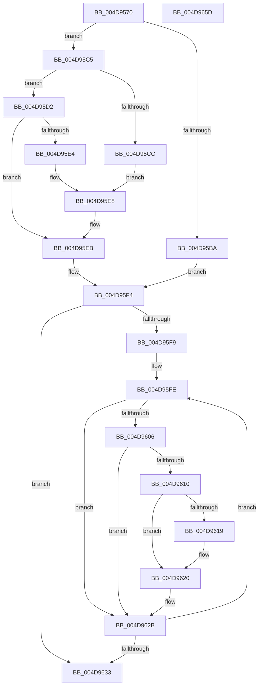

# MiSubsectionProtosCreated

- RVA: `0x004D9570`–`0x004D965E` (길이 `238` bytes)
- VA: `0x00000001404D9570`
- 실행 섹션: `.text`
- PDB 이름 있음: `예`; PDB Function 태그: `아니요`
- unwind 정보 RVA: `0x0005FEF8`
- 디코드: `72`개 명령, `238/238` bytes 표시
- 미해석 바이트: `0` (있으면 어셈블리에 `.byte`로 보존)

> 이 문서는 커널 이미지의 기계어와 PDB 기호를 분석해 생성했습니다. 4번과 5번은 함수 원형과 자료형을 바이너리 사용 방식에서 추정한 C 해석이며 원본 소스 복구 결과는 아닙니다.

## 1. Dependencies

- 직접 호출 지점: **4**; 고유 호출 대상: **4**
- 직접 호출자로 확인된 함수: **3**
- RIP 상대 이미지 참조: **0**

### Outgoing calls
- `0x004D959C` → [KeAbPostRelease](../2E/KeAbPostRelease_function_002E1600.md) (function, `0x002E1600`)
- `0x004D95A8` → [ExAcquireSpinLockExclusive](../24/ExAcquireSpinLockExclusive_function_00248690.md) (function, `0x00248690`)
- `0x004D9626` → [KeSignalGate](../2C/KeSignalGate_function_002C748C.md) (function, `0x002C748C`)
- `0x004D9639` → [MiReleaseSpinLockExclusive](../24/MiReleaseSpinLockExclusive_function_002482C0.md) (function, `0x002482C0`)

### Direct callers
- [MiPurgeSubsection](../37/MiPurgeSubsection_function_003712F0.md) at `0x00371B37`
- [MiPurgeFileOnlyPfn](../68/MiPurgeFileOnlyPfn_function_00681CEC.md) at `0x00681DCD`
- [MiAllocateFileExtents](../../page/AB/MiAllocateFileExtents_function_00ABDF54.md) at `0x00ABE36C`
- [MiAllocateFileExtents](../../page/AB/MiAllocateFileExtents_function_00ABDF54.md) at `0x00ABE46B`

### Static image references
- 디코드된 RIP-relative 메모리 참조가 없습니다.

## 2. Other-region calls and transfers

- 다른 실행 섹션으로 향하는 call: **0**
- 별도 외부 분기/꼬리 이동을 확인하지 못했습니다.

## 3. Assembly (complete function range)

```asm
004D9570  48 8B C4                        mov rax, rsp
004D9573  48 89 58 08                     mov qword ptr [rax + 8], rbx
004D9577  48 89 68 10                     mov qword ptr [rax + 0x10], rbp
004D957B  48 89 70 18                     mov qword ptr [rax + 0x18], rsi
004D957F  48 89 78 20                     mov qword ptr [rax + 0x20], rdi
004D9583  41 54                           push r12
004D9585  41 56                           push r14
004D9587  41 57                           push r15
004D9589  48 83 EC 20                     sub rsp, 0x20
004D958D  48 8B 39                        mov rdi, qword ptr [rcx]
004D9590  41 8B F1                        mov esi, r9d
004D9593  45 8B F0                        mov r14d, r8d
004D9596  48 8B EA                        mov rbp, rdx
004D9599  48 8B D9                        mov rbx, rcx
004D959C  E8 5F 80 E0 FF                  call 0x1402e1600
004D95A1  4C 8D 7F 48                     lea r15, [rdi + 0x48]
004D95A5  49 8B CF                        mov rcx, r15
004D95A8  E8 E3 F0 D6 FF                  call 0x140248690
004D95AD  44 8B 57 38                     mov r10d, dword ptr [rdi + 0x38]
004D95B1  44 8A E0                        mov r12b, al
004D95B4  41 F6 C2 20                     test r10b, 0x20
004D95B8  74 0B                           je 0x1404d95c5
004D95BA  48 8B 4F 50                     mov rcx, qword ptr [rdi + 0x50]
004D95BE  48 83 67 50 00                  and qword ptr [rdi + 0x50], 0
004D95C3  EB 2F                           jmp 0x1404d95f4
004D95C5  8B 53 34                        mov edx, dword ptr [rbx + 0x34]
004D95C8  85 F6                           test esi, esi
004D95CA  74 06                           je 0x1404d95d2
004D95CC  0F BA EA 1E                     bts edx, 0x1e
004D95D0  EB 16                           jmp 0x1404d95e8
004D95D2  8B 43 2C                        mov eax, dword ptr [rbx + 0x2c]
004D95D5  8B CA                           mov ecx, edx
004D95D7  81 E1 FF FF FF 3F               and ecx, 0x3fffffff
004D95DD  2B C1                           sub eax, ecx
004D95DF  44 3B F0                        cmp r14d, eax
004D95E2  75 07                           jne 0x1404d95eb
004D95E4  0F BA F2 1E                     btr edx, 0x1e
004D95E8  89 53 34                        mov dword ptr [rbx + 0x34], edx
004D95EB  48 8B 4B 18                     mov rcx, qword ptr [rbx + 0x18]
004D95EF  48 83 63 18 00                  and qword ptr [rbx + 0x18], 0
004D95F4  48 85 C9                        test rcx, rcx
004D95F7  74 3A                           je 0x1404d9633
004D95F9  BF 01 00 00 00                  mov edi, 1
004D95FE  48 8B 19                        mov rbx, qword ptr [rcx]
004D9601  48 3B CD                        cmp rcx, rbp
004D9604  74 25                           je 0x1404d962b
004D9606  8B 41 08                        mov eax, dword ptr [rcx + 8]
004D9609  89 79 0C                        mov dword ptr [rcx + 0xc], edi
004D960C  A8 40                           test al, 0x40
004D960E  75 1B                           jne 0x1404d962b
004D9610  F7 45 08 00 01 00 00            test dword ptr [rbp + 8], 0x100
004D9617  74 07                           je 0x1404d9620
004D9619  C7 41 0C 02 00 00 00            mov dword ptr [rcx + 0xc], 2
004D9620  48 83 C1 10                     add rcx, 0x10
004D9624  8B D7                           mov edx, edi
004D9626  E8 61 DE DE FF                  call 0x1402c748c
004D962B  48 8B CB                        mov rcx, rbx
004D962E  48 85 DB                        test rbx, rbx
004D9631  75 CB                           jne 0x1404d95fe
004D9633  41 8A D4                        mov dl, r12b
004D9636  49 8B CF                        mov rcx, r15
004D9639  E8 82 EC D6 FF                  call 0x1402482c0
004D963E  48 8B 5C 24 40                  mov rbx, qword ptr [rsp + 0x40]
004D9643  48 8B 6C 24 48                  mov rbp, qword ptr [rsp + 0x48]
004D9648  48 8B 74 24 50                  mov rsi, qword ptr [rsp + 0x50]
004D964D  48 8B 7C 24 58                  mov rdi, qword ptr [rsp + 0x58]
004D9652  48 83 C4 20                     add rsp, 0x20
004D9656  41 5F                           pop r15
004D9658  41 5E                           pop r14
004D965A  41 5C                           pop r12
004D965C  C3                              ret
004D965D  CC                              int3
```

## 4. C-style interpretation (structured pseudocode)

```c
__int64 __fastcall MiSubsectionProtosCreated(__int64 a1, __int64 a2, int a3, int a4)
{
    __int64 result;
    __int64 v_rsp;
    unsigned __int64 v_stack_p10;
    unsigned __int64 v_stack_p18;
    unsigned __int64 v_stack_p20;
    unsigned __int64 v_stack_p8;

    *(unsigned __int64 *)(v_rsp + 8) = v_rbx;
    *(unsigned __int64 *)(v_rsp + 16) = v_rbp;
    *(unsigned __int64 *)(v_rsp + 24) = v_rsi;
    *(unsigned __int64 *)(v_rsp + 32) = v_rdi;
    v_rsp = (v_rsp) - (32);
    result = KeAbPostRelease(a1, a2, a3, a4);
    result = ExAcquireSpinLockExclusive(*(unsigned __int64 *)(a1) + 72, a2, a3, a4);
    if ((((unsigned __int8)((unsigned int)(*(unsigned int *)(*(unsigned __int64 *)(a1) + 56)))) & (32)) == 0) goto loc_004D95C5;
    goto loc_004D95F4;
loc_004D95C5:
    if ((unsigned int)((unsigned int)(a4)) == 0) goto loc_004D95D2;
    goto loc_004D95E8;
loc_004D95D2:
    a1 = (unsigned int)(((unsigned int)((unsigned int)((unsigned int)(*(unsigned int *)(a1 + 52))))) & (0x3FFFFFFFULL));
    result = (unsigned int)(((unsigned int)(*(unsigned int *)(a1 + 44))) - ((unsigned int)(a1)));
    if (((unsigned int)((unsigned int)(a3))) != ((unsigned int)(result))) goto loc_004D95EB;
loc_004D95E8:
    *(unsigned int *)(a1 + 52) = (unsigned int)((unsigned int)(*(unsigned int *)(a1 + 52)));
loc_004D95EB:
loc_004D95F4:
    if (*(unsigned __int64 *)(a1 + 24) == 0) goto loc_004D9633;
loc_004D95FE:
    if ((*(unsigned __int64 *)(a1 + 24)) == a2) goto loc_004D962B;
    *(unsigned int *)(*(unsigned __int64 *)(a1 + 24) + 12) = 1;
    if ((((unsigned __int8)((unsigned int)(*(unsigned int *)(*(unsigned __int64 *)(a1 + 24) + 8)))) & (64)) != 0) goto loc_004D962B;
    if (((*(unsigned int *)(a2 + 8)) & (256)) != 0) {
        *(unsigned int *)(*(unsigned __int64 *)(a1 + 24) + 12) = 2;
    }
    a1 = (*(unsigned __int64 *)(a1 + 24)) + (16);
    result = KeSignalGate(a1, 1, a3, a4);
loc_004D962B:
    if (*(unsigned __int64 *)(*(unsigned __int64 *)(a1 + 24)) != 0) goto loc_004D95FE;
loc_004D9633:
    result = MiReleaseSpinLockExclusive(*(unsigned __int64 *)(a1) + 72, (unsigned __int8)((unsigned __int8)(result)), a3, a4);
    v_rsp = (v_rsp) + (32);
    return result;
}
```

## 5. (Beta) C Style

```c
int64_t MiSubsectionProtosCreated(void *Arg1, void *Arg2, int32_t Arg3, int32_t Arg4)
{
    uint8_t *arg1 = (uint8_t *)Arg1;
    uint8_t *arg2 = (uint8_t *)Arg2;

    int64_t result;
    int64_t local_rsp;
    uint64_t v_stack_p10;
    uint64_t v_stack_p18;
    uint64_t v_stack_p20;
    uint64_t v_stack_p8;

    *(uint64_t *)(local_rsp + 0x8) = local_rbx;
    *(uint64_t *)(local_rsp + 0x10) = local_rbp;
    *(uint64_t *)(local_rsp + 0x18) = local_rsi;
    *(uint64_t *)(local_rsp + 0x20) = local_rdi;
    local_rsp = (local_rsp) - (32);
    result = KeAbPostRelease(Arg1, Arg2, Arg3, Arg4);
    result = ExAcquireSpinLockExclusive(*(uint64_t *)(arg1) + 72, Arg2, Arg3, Arg4);
    if ((((uint8_t)((uint32_t)(*(uint32_t *)(*(uint64_t *)(arg1) + 0x38)))) & (32)) == 0) goto loc_004D95C5;
    goto loc_004D95F4;
loc_004D95C5:
    if ((uint32_t)((uint32_t)(Arg4)) == 0) goto loc_004D95D2;
    goto loc_004D95E8;
loc_004D95D2:
    Arg1 = (uint32_t)(((uint32_t)((uint32_t)((uint32_t)(*(uint32_t *)(arg1 + 0x34))))) & (0x3FFFFFFFULL));
    result = (uint32_t)(((uint32_t)(*(uint32_t *)(arg1 + 0x2C))) - ((uint32_t)(Arg1)));
    if (((uint32_t)((uint32_t)(Arg3))) != ((uint32_t)(result))) goto loc_004D95EB;
loc_004D95E8:
    *(uint32_t *)(arg1 + 0x34) = (uint32_t)((uint32_t)(*(uint32_t *)(arg1 + 0x34)));
loc_004D95EB:
loc_004D95F4:
    if (*(uint64_t *)(arg1 + 0x18) == 0) goto loc_004D9633;
loc_004D95FE:
    if ((*(uint64_t *)(arg1 + 0x18)) == Arg2) goto loc_004D962B;
    *(uint32_t *)(*(uint64_t *)(arg1 + 0x18) + 0xC) = 1;
    if ((((uint8_t)((uint32_t)(*(uint32_t *)(*(uint64_t *)(arg1 + 0x18) + 0x8)))) & (64)) != 0) goto loc_004D962B;
    if (((*(uint32_t *)(arg2 + 0x8)) & (256)) != 0) {
        *(uint32_t *)(*(uint64_t *)(arg1 + 0x18) + 0xC) = 2;
    }
    Arg1 = (*(uint64_t *)(arg1 + 0x18)) + (16);
    result = KeSignalGate(Arg1, 1, Arg3, Arg4);
loc_004D962B:
    if (*(uint64_t *)(*(uint64_t *)(arg1 + 0x18)) != 0) goto loc_004D95FE;
loc_004D9633:
    result = MiReleaseSpinLockExclusive(*(uint64_t *)(arg1) + 72, (uint8_t)((uint8_t)(result)), Arg3, Arg4);
    local_rsp = (local_rsp) + (32);
    return result;
}
```

### 관측된 메모리 오프셋

구조체 형식이 확인되지 않은 접근은 인자 기준의 오프셋으로만 기록했습니다.

| 기준 인자 | 오프셋 표현 | 폭 (bit) | 접근 |
|---|---:|---:|---|
| `Arg1` | `+ 0x0` | `64` | `R` |
| `Arg1` | `+ 0x18` | `64` | `R` |
| `Arg1` | `+ 0x18` | `64` | `R/W` |
| `Arg1` | `+ 0x2C` | `32` | `R` |
| `Arg1` | `+ 0x34` | `32` | `R` |
| `Arg1` | `+ 0x34` | `32` | `W` |
| `Arg2` | `+ 0x8` | `32` | `R` |

## 6. Execution-region graph

[열기: 2D/3D 그래프와 함수 탐색 컨트롤 패널](../../../control-panel.html?section=text&rva=0x004D9570&view=graph)

- 2D 그래프는 위에서 아래로 흐르고, 3D 그래프는 빈 공간을 드래그해 회전합니다. Shift+드래그는 이동, 휠은 확대·축소, 함수 노드 선택은 대상 보고서 이동입니다.

### Static fallback


