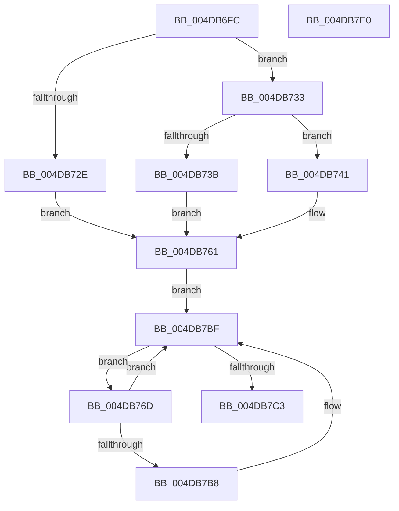

# MiTransferMemoryPagefileData

- RVA: `0x004DB6FC`–`0x004DB7E1` (길이 `229` bytes)
- VA: `0x00000001404DB6FC`
- 실행 섹션: `.text`
- PDB 이름 있음: `예`; PDB Function 태그: `아니요`
- unwind 정보 RVA: `0x0008C20C`
- 디코드: `75`개 명령, `229/229` bytes 표시
- 미해석 바이트: `0` (있으면 어셈블리에 `.byte`로 보존)

> 이 문서는 커널 이미지의 기계어와 PDB 기호를 분석해 생성했습니다. 4번과 5번은 함수 원형과 자료형을 바이너리 사용 방식에서 추정한 C 해석이며 원본 소스 복구 결과는 아닙니다.

## 1. Dependencies

- 직접 호출 지점: **3**; 고유 호출 대상: **3**
- 직접 호출자로 확인된 함수: **3**
- RIP 상대 이미지 참조: **0**

### Outgoing calls
- `0x004DB759` → [MmMapLockedPagesSpecifyCache](../31/MmMapLockedPagesSpecifyCache_function_00318800.md) (function, `0x00318800`)
- `0x004DB776` → [MiFindPageFileMemoryExtent](../69/MiFindPageFileMemoryExtent_function_00694F70.md) (function, `0x00694F70`)
- `0x004DB7A5` → [MiCopyMemoryPagefileData](../69/MiCopyMemoryPagefileData_function_00694C04.md) (function, `0x00694C04`)

### Direct callers
- [MiGatherPagefilePages](../37/MiGatherPagefilePages_function_00372B08.md) at `0x00373561`
- [MiReadFromMemoryPagefile](MiReadFromMemoryPagefile_function_004DB6B0.md) at `0x004DB6CE`
- [MiZeroPageFile](../67/MiZeroPageFile_function_00671180.md) at `0x006712B5`

### Static image references
- 디코드된 RIP-relative 메모리 참조가 없습니다.

## 2. Other-region calls and transfers

- 다른 실행 섹션으로 향하는 call: **0**
- 별도 외부 분기/꼬리 이동을 확인하지 못했습니다.

## 3. Assembly (complete function range)

```asm
004DB6FC  48 89 5C 24 08                  mov qword ptr [rsp + 8], rbx
004DB701  48 89 6C 24 10                  mov qword ptr [rsp + 0x10], rbp
004DB706  48 89 74 24 18                  mov qword ptr [rsp + 0x18], rsi
004DB70B  57                              push rdi
004DB70C  41 54                           push r12
004DB70E  41 55                           push r13
004DB710  41 56                           push r14
004DB712  41 57                           push r15
004DB714  48 83 EC 30                     sub rsp, 0x30
004DB718  45 8B E1                        mov r12d, r9d
004DB71B  45 8B F0                        mov r14d, r8d
004DB71E  48 8B DA                        mov rbx, rdx
004DB721  4C 8B E9                        mov r13, rcx
004DB724  33 F6                           xor esi, esi
004DB726  44 0F 20 C0                     mov rax, cr8
004DB72A  3C 02                           cmp al, 2
004DB72C  75 05                           jne 0x1404db733
004DB72E  8D 6E 01                        lea ebp, [rsi + 1]
004DB731  EB 2E                           jmp 0x1404db761
004DB733  33 ED                           xor ebp, ebp
004DB735  F6 42 0A 05                     test byte ptr [rdx + 0xa], 5
004DB739  74 06                           je 0x1404db741
004DB73B  48 8B 72 18                     mov rsi, qword ptr [rdx + 0x18]
004DB73F  EB 20                           jmp 0x1404db761
004DB741  45 33 C9                        xor r9d, r9d
004DB744  C7 44 24 28 10 00 00 40         mov dword ptr [rsp + 0x28], 0x40000010
004DB74C  21 74 24 20                     and dword ptr [rsp + 0x20], esi
004DB750  33 D2                           xor edx, edx
004DB752  48 8B CB                        mov rcx, rbx
004DB755  45 8D 41 01                     lea r8d, [r9 + 1]
004DB759  E8 A2 D0 E3 FF                  call 0x140318800
004DB75E  48 8B F0                        mov rsi, rax
004DB761  8B 7B 28                        mov edi, dword ptr [rbx + 0x28]
004DB764  4C 8D 7B 30                     lea r15, [rbx + 0x30]
004DB768  C1 EF 0C                        shr edi, 0xc
004DB76B  EB 52                           jmp 0x1404db7bf
004DB76D  44 8B C5                        mov r8d, ebp
004DB770  41 8B D6                        mov edx, r14d
004DB773  49 8B CD                        mov rcx, r13
004DB776  E8 F5 97 1B 00                  call 0x140694f70
004DB77B  8B CF                           mov ecx, edi
004DB77D  44 89 64 24 20                  mov dword ptr [rsp + 0x20], r12d
004DB782  45 8B C6                        mov r8d, r14d
004DB785  8B 50 1C                        mov edx, dword ptr [rax + 0x1c]
004DB788  41 2B D6                        sub edx, r14d
004DB78B  FF C2                           inc edx
004DB78D  3B D7                           cmp edx, edi
004DB78F  0F 46 CA                        cmovbe ecx, edx
004DB792  44 2B 40 18                     sub r8d, dword ptr [rax + 0x18]
004DB796  4C 03 40 20                     add r8, qword ptr [rax + 0x20]
004DB79A  48 8B D6                        mov rdx, rsi
004DB79D  8B D9                           mov ebx, ecx
004DB79F  44 8B C9                        mov r9d, ecx
004DB7A2  49 8B CF                        mov rcx, r15
004DB7A5  E8 5A 94 1B 00                  call 0x140694c04
004DB7AA  2B FB                           sub edi, ebx
004DB7AC  4D 8D 3C DF                     lea r15, [r15 + rbx*8]
004DB7B0  44 03 F3                        add r14d, ebx
004DB7B3  48 85 F6                        test rsi, rsi
004DB7B6  74 07                           je 0x1404db7bf
004DB7B8  48 C1 E3 0C                     shl rbx, 0xc
004DB7BC  48 03 F3                        add rsi, rbx
004DB7BF  85 FF                           test edi, edi
004DB7C1  75 AA                           jne 0x1404db76d
004DB7C3  48 8B 5C 24 60                  mov rbx, qword ptr [rsp + 0x60]
004DB7C8  48 8B 6C 24 68                  mov rbp, qword ptr [rsp + 0x68]
004DB7CD  48 8B 74 24 70                  mov rsi, qword ptr [rsp + 0x70]
004DB7D2  48 83 C4 30                     add rsp, 0x30
004DB7D6  41 5F                           pop r15
004DB7D8  41 5E                           pop r14
004DB7DA  41 5D                           pop r13
004DB7DC  41 5C                           pop r12
004DB7DE  5F                              pop rdi
004DB7DF  C3                              ret
004DB7E0  CC                              int3
```

## 4. C-style interpretation (structured pseudocode)

```c
__int64 __fastcall MiTransferMemoryPagefileData(__int64 a1, __int64 a2, int a3, int a4)
{
    __int64 result;
    __int64 v_r14;
    __int64 v_rbp;
    __int64 v_rbx;
    __int64 v_rdi;
    __int64 v_rsi;
    __int64 v_rsp;
    unsigned int v_stack_m30;
    unsigned int v_stack_m38;
    unsigned __int64 v_stack_p10;
    unsigned __int64 v_stack_p18;
    unsigned __int64 v_stack_p8;

    v_stack_p8 = v_rbx;
    v_stack_p10 = v_rbp;
    v_stack_p18 = v_rsi;
    v_rsp = (v_rsp) - (48);
    v_rsi = 0;
    if (((unsigned __int8)(v_cr8)) != 2) goto loc_004DB733;
    goto loc_004DB761;
loc_004DB733:
    v_rbp = 0;
    if (((*(unsigned __int8 *)(a2 + 10)) & (5)) == 0) goto loc_004DB741;
    goto loc_004DB761;
loc_004DB741:
    a4 = 0;
    v_stack_m30 = 0x40000010ULL;
    a2 = 0;
    result = MmMapLockedPagesSpecifyCache(0, a2, a4 + 1, a4);
loc_004DB761:
    v_rdi = (unsigned int)(((unsigned int)(*(unsigned int *)(a2 + 40))) >> (12));
    goto loc_004DB7BF;
loc_004DB76D:
    result = MiFindPageFileMemoryExtent(a1, (unsigned int)((unsigned int)((unsigned int)(a3))), 0, a4);
    v_stack_m38 = (unsigned int)((unsigned int)(a4));
    a2 = (unsigned int)(((unsigned int)(*(unsigned int *)(result + 28))) - ((unsigned int)((unsigned int)(a3))));
    a2 = (unsigned int)((a2) + 1);
    a1 = (unsigned int)((unsigned int)(v_rdi));
    if (((unsigned int)(a2)) <= ((unsigned int)(v_rdi))) { a1 = (unsigned int)(a2); }
    a3 = (unsigned int)(((unsigned int)((unsigned int)((unsigned int)(a3)))) - (*(unsigned int *)(result + 24)));
    a3 = (a3) + (*(unsigned __int64 *)(result + 32));
    result = MiCopyMemoryPagefileData(a2 + 48, result, a3, (unsigned int)((unsigned int)(a1)));
    v_rdi = (unsigned int)((v_rdi) - ((unsigned int)((unsigned int)((unsigned int)(a1)))));
    v_r14 = (unsigned int)(((unsigned int)(a3)) + ((unsigned int)((unsigned int)((unsigned int)(a1)))));
    v_rbx = (unsigned int)((unsigned int)(a1));
    v_rsi = result;
    if (result != 0) {
        v_rbx = ((unsigned int)((unsigned int)(a1))) << (12);
        v_rsi = (result) + (v_rbx);
    }
    if ((unsigned int)(v_rdi) != 0) goto loc_004DB76D;
    v_rsp = (v_rsp) + (48);
    return result;
}
```

## 5. (Beta) C Style

```c
int64_t MiTransferMemoryPagefileData(int64_t Arg1, void *Arg2, int32_t Arg3, int32_t Arg4)
{
    uint8_t *arg2 = (uint8_t *)Arg2;

    int64_t result;
    int64_t local_r14;
    int64_t local_rbp;
    int64_t local_rbx;
    int64_t local_rdi;
    int64_t local_rsi;
    int64_t local_rsp;
    uint32_t v_stack_m30;
    uint32_t v_stack_m38;
    uint64_t v_stack_p10;
    uint64_t v_stack_p18;
    uint64_t v_stack_p8;

    v_stack_p8 = local_rbx;
    v_stack_p10 = local_rbp;
    v_stack_p18 = local_rsi;
    local_rsp = (local_rsp) - (48);
    local_rsi = 0;
    if (((uint8_t)(v_cr8)) != 2) goto loc_004DB733;
    goto loc_004DB761;
loc_004DB733:
    local_rbp = 0;
    if (((*(uint8_t *)(arg2 + 0xA)) & (5)) == 0) goto loc_004DB741;
    goto loc_004DB761;
loc_004DB741:
    Arg4 = 0;
    v_stack_m30 = 0x40000010ULL;
    Arg2 = 0;
    result = MmMapLockedPagesSpecifyCache(0, Arg2, Arg4 + 1, Arg4);
loc_004DB761:
    local_rdi = (uint32_t)(((uint32_t)(*(uint32_t *)(arg2 + 0x28))) >> (12));
    goto loc_004DB7BF;
loc_004DB76D:
    result = MiFindPageFileMemoryExtent(Arg1, (uint32_t)((uint32_t)((uint32_t)(Arg3))), 0, Arg4);
    v_stack_m38 = (uint32_t)((uint32_t)(Arg4));
    Arg2 = (uint32_t)(((uint32_t)(*(uint32_t *)(result + 0x1C))) - ((uint32_t)((uint32_t)(Arg3))));
    Arg2 = (uint32_t)((Arg2) + 1);
    Arg1 = (uint32_t)((uint32_t)(local_rdi));
    if (((uint32_t)(Arg2)) <= ((uint32_t)(local_rdi))) { Arg1 = (uint32_t)(Arg2); }
    Arg3 = (uint32_t)(((uint32_t)((uint32_t)((uint32_t)(Arg3)))) - (*(uint32_t *)(result + 0x18)));
    Arg3 = (Arg3) + (*(uint64_t *)(result + 0x20));
    result = MiCopyMemoryPagefileData(Arg2 + 48, result, Arg3, (uint32_t)((uint32_t)(Arg1)));
    local_rdi = (uint32_t)((local_rdi) - ((uint32_t)((uint32_t)((uint32_t)(Arg1)))));
    local_r14 = (uint32_t)(((uint32_t)(Arg3)) + ((uint32_t)((uint32_t)((uint32_t)(Arg1)))));
    local_rbx = (uint32_t)((uint32_t)(Arg1));
    local_rsi = result;
    if (result != 0) {
        local_rbx = ((uint32_t)((uint32_t)(Arg1))) << (12);
        local_rsi = (result) + (local_rbx);
    }
    if ((uint32_t)(local_rdi) != 0) goto loc_004DB76D;
    local_rsp = (local_rsp) + (48);
    return result;
}
```

### 관측된 메모리 오프셋

구조체 형식이 확인되지 않은 접근은 인자 기준의 오프셋으로만 기록했습니다.

| 기준 인자 | 오프셋 표현 | 폭 (bit) | 접근 |
|---|---:|---:|---|
| `Arg2` | `+ 0x0 + rbx*8` | `64` | `R` |
| `Arg2` | `+ 0xA` | `8` | `R` |
| `Arg2` | `+ 0x18` | `64` | `R` |
| `Arg2` | `+ 0x28` | `32` | `R` |
| `Arg2` | `+ 0x30` | `64` | `R` |

## 6. Execution-region graph

[열기: 2D/3D 그래프와 함수 탐색 컨트롤 패널](../../../control-panel.html?section=text&rva=0x004DB6FC&view=graph)

- 2D 그래프는 위에서 아래로 흐르고, 3D 그래프는 빈 공간을 드래그해 회전합니다. Shift+드래그는 이동, 휠은 확대·축소, 함수 노드 선택은 대상 보고서 이동입니다.

### Static fallback


