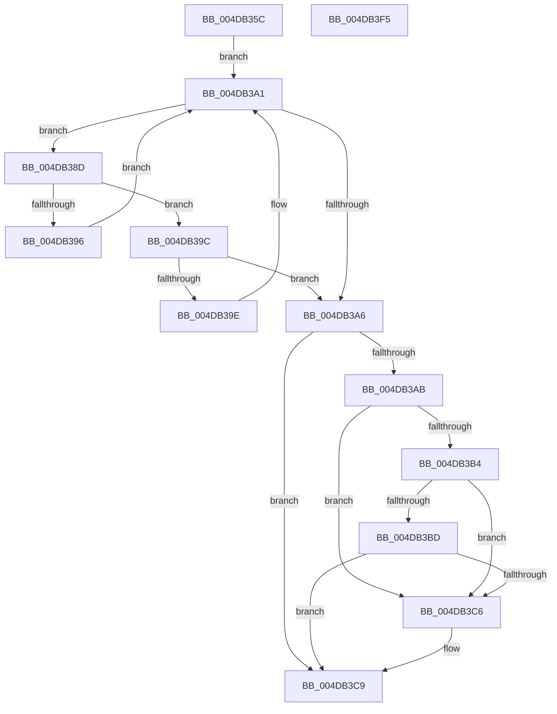

# MiTransientPageListWriter

- RVA: `0x004DB35C`–`0x004DB3F6` (길이 `154` bytes)
- VA: `0x00000001404DB35C`
- 실행 섹션: `.text`
- PDB 이름 있음: `예`; PDB Function 태그: `아니요`
- unwind 정보 RVA: `0x0005C954`
- 디코드: `42`개 명령, `154/154` bytes 표시
- 미해석 바이트: `0` (있으면 어셈블리에 `.byte`로 보존)

> 이 문서는 커널 이미지의 기계어와 PDB 기호를 분석해 생성했습니다. 4번과 5번은 함수 원형과 자료형을 바이너리 사용 방식에서 추정한 C 해석이며 원본 소스 복구 결과는 아닙니다.

## 1. Dependencies

- 직접 호출 지점: **2**; 고유 호출 대상: **2**
- 직접 호출자로 확인된 함수: **1**
- RIP 상대 이미지 참조: **2**

### Outgoing calls
- `0x004DB37D` → [ExAcquireSpinLockShared](../24/ExAcquireSpinLockShared_function_0024DCE0.md) (function, `0x0024DCE0`)
- `0x004DB3D2` → [MiReleaseSpinLockShared](../34/MiReleaseSpinLockShared_function_00348BF0.md) (function, `0x00348BF0`)

### Direct callers
- [MiSystemFault](../34/MiSystemFault_function_0034AA64.md) at `0x0034B1EE`

### Static image references
- `0x004DB376` → RVA `0x00E2FF20` (`.data`; read)
- `0x004DB382` → RVA `0x00E2FF28` (`.data`; read)

## 2. Other-region calls and transfers

- 다른 실행 섹션으로 향하는 call: **0**
- 별도 외부 분기/꼬리 이동을 확인하지 못했습니다.

## 3. Assembly (complete function range)

```asm
004DB35C  48 89 5C 24 08                  mov qword ptr [rsp + 8], rbx
004DB361  48 89 6C 24 10                  mov qword ptr [rsp + 0x10], rbp
004DB366  48 89 74 24 18                  mov qword ptr [rsp + 0x18], rsi
004DB36B  57                              push rdi
004DB36C  48 83 EC 20                     sub rsp, 0x20
004DB370  48 8B F1                        mov rsi, rcx
004DB373  48 8B EA                        mov rbp, rdx
004DB376  48 8D 0D A3 4B 95 00            lea rcx, [rip + 0x954ba3]
004DB37D  E8 5E 29 D7 FF                  call 0x14024dce0
004DB382  48 8B 1D 9F 4B 95 00            mov rbx, qword ptr [rip + 0x954b9f]
004DB389  33 FF                           xor edi, edi
004DB38B  EB 14                           jmp 0x1404db3a1
004DB38D  48 3B B3 38 01 00 00            cmp rsi, qword ptr [rbx + 0x138]
004DB394  76 06                           jbe 0x1404db39c
004DB396  48 8B 5B 08                     mov rbx, qword ptr [rbx + 8]
004DB39A  EB 05                           jmp 0x1404db3a1
004DB39C  73 08                           jae 0x1404db3a6
004DB39E  48 8B 1B                        mov rbx, qword ptr [rbx]
004DB3A1  48 85 DB                        test rbx, rbx
004DB3A4  75 E7                           jne 0x1404db38d
004DB3A6  48 85 DB                        test rbx, rbx
004DB3A9  74 1E                           je 0x1404db3c9
004DB3AB  48 39 BB 20 01 00 00            cmp qword ptr [rbx + 0x120], rdi
004DB3B2  74 12                           je 0x1404db3c6
004DB3B4  48 3B AB 28 01 00 00            cmp rbp, qword ptr [rbx + 0x128]
004DB3BB  72 09                           jb 0x1404db3c6
004DB3BD  48 3B AB 30 01 00 00            cmp rbp, qword ptr [rbx + 0x130]
004DB3C4  76 03                           jbe 0x1404db3c9
004DB3C6  48 8B DF                        mov rbx, rdi
004DB3C9  8A D0                           mov dl, al
004DB3CB  48 8D 0D 4E 4B 95 00            lea rcx, [rip + 0x954b4e]
004DB3D2  E8 19 D8 E6 FF                  call 0x140348bf0
004DB3D7  48 8B 6C 24 38                  mov rbp, qword ptr [rsp + 0x38]
004DB3DC  48 85 DB                        test rbx, rbx
004DB3DF  48 8B 5C 24 30                  mov rbx, qword ptr [rsp + 0x30]
004DB3E4  48 8B 74 24 40                  mov rsi, qword ptr [rsp + 0x40]
004DB3E9  40 0F 95 C7                     setne dil
004DB3ED  8B C7                           mov eax, edi
004DB3EF  48 83 C4 20                     add rsp, 0x20
004DB3F3  5F                              pop rdi
004DB3F4  C3                              ret
004DB3F5  CC                              int3
```

## 4. C-style interpretation (structured pseudocode)

```c
__int64 __fastcall MiTransientPageListWriter(__int64 a1, __int64 a2)
{
    __int64 result;
    __int64 v_rbx;
    __int64 v_rdi;
    __int64 v_rsp;
    unsigned __int64 v_stack_p10;
    unsigned __int64 v_stack_p18;
    unsigned __int64 v_stack_p8;

    v_stack_p8 = v_rbx;
    v_stack_p10 = v_rbp;
    v_stack_p18 = v_rsi;
    v_rsp = (v_rsp) - (32);
    result = ExAcquireSpinLockShared(v_rip + 9784227, a2, a3, a4);
    v_rdi = 0;
    goto loc_004DB3A1;
loc_004DB38D:
    if (a1 <= (*(unsigned __int64 *)(*(unsigned __int64 *)(v_rip + 9784223) + 312))) goto loc_004DB39C;
    goto loc_004DB3A1;
loc_004DB39C:
    if (a1 >= (*(unsigned __int64 *)(*(unsigned __int64 *)(v_rip + 9784223) + 312))) goto loc_004DB3A6;
loc_004DB3A1:
    if (*(unsigned __int64 *)(*(unsigned __int64 *)(*(unsigned __int64 *)(v_rip + 9784223) + 8)) != 0) goto loc_004DB38D;
loc_004DB3A6:
    if (*(unsigned __int64 *)(*(unsigned __int64 *)(*(unsigned __int64 *)(v_rip + 9784223) + 8)) == 0) goto loc_004DB3C9;
    if ((*(unsigned __int64 *)(*(unsigned __int64 *)(*(unsigned __int64 *)(*(unsigned __int64 *)(v_rip + 9784223) + 8)) + 288)) == 0) goto loc_004DB3C6;
    if (a2 < (*(unsigned __int64 *)(*(unsigned __int64 *)(*(unsigned __int64 *)(*(unsigned __int64 *)(v_rip + 9784223) + 8)) + 296))) goto loc_004DB3C6;
    v_rbx = *(unsigned __int64 *)(*(unsigned __int64 *)(*(unsigned __int64 *)(v_rip + 9784223) + 8));
    if (a2 >= = (*(unsigned __int64 *)(*(unsigned __int64 *)(*(unsigned __int64 *)(*(unsigned __int64 *)(v_rip + 9784223) + 8)) + 304))) {
        v_rbx = 0;
    }
    result = MiReleaseSpinLockShared(v_rip + 9784142, (unsigned __int8)(result), a3, a4);
    v_rdi = (v_rbx != 0) ? 1 : 0;
    v_rsp = (v_rsp) + (32);
    return (unsigned int)((unsigned int)(v_rdi));
}
```

## 5. (Beta) C Style

```c
int64_t MiTransientPageListWriter(int64_t Arg1, int64_t Arg2)
{
    int64_t result;
    int64_t local_rbx;
    int64_t local_rdi;
    int64_t local_rsp;
    uint64_t v_stack_p10;
    uint64_t v_stack_p18;
    uint64_t v_stack_p8;

    v_stack_p8 = local_rbx;
    v_stack_p10 = local_rbp;
    v_stack_p18 = local_rsi;
    local_rsp = (local_rsp) - (32);
    result = ExAcquireSpinLockShared(v_rip + 9784227, Arg2, a3, a4);
    local_rdi = 0;
    goto loc_004DB3A1;
loc_004DB38D:
    if (Arg1 <= (*(uint64_t *)(*(uint64_t *)(v_rip + 0x954B9F) + 0x138))) goto loc_004DB39C;
    goto loc_004DB3A1;
loc_004DB39C:
    if (Arg1 >= (*(uint64_t *)(*(uint64_t *)(v_rip + 0x954B9F) + 0x138))) goto loc_004DB3A6;
loc_004DB3A1:
    if (*(uint64_t *)(*(uint64_t *)(*(uint64_t *)(v_rip + 0x954B9F) + 0x8)) != 0) goto loc_004DB38D;
loc_004DB3A6:
    if (*(uint64_t *)(*(uint64_t *)(*(uint64_t *)(v_rip + 0x954B9F) + 0x8)) == 0) goto loc_004DB3C9;
    if ((*(uint64_t *)(*(uint64_t *)(*(uint64_t *)(*(uint64_t *)(v_rip + 0x954B9F) + 0x8)) + 0x120)) == 0) goto loc_004DB3C6;
    if (Arg2 < (*(uint64_t *)(*(uint64_t *)(*(uint64_t *)(*(uint64_t *)(v_rip + 0x954B9F) + 0x8)) + 0x128))) goto loc_004DB3C6;
    local_rbx = *(uint64_t *)(*(uint64_t *)(*(uint64_t *)(v_rip + 0x954B9F) + 0x8));
    if (Arg2 >= = (*(uint64_t *)(*(uint64_t *)(*(uint64_t *)(*(uint64_t *)(v_rip + 0x954B9F) + 0x8)) + 0x130))) {
        local_rbx = 0;
    }
    result = MiReleaseSpinLockShared(v_rip + 9784142, (uint8_t)(result), a3, a4);
    local_rdi = (local_rbx != 0) ? 1 : 0;
    local_rsp = (local_rsp) + (32);
    return (uint32_t)((uint32_t)(local_rdi));
}
```

## 6. Execution-region graph

[열기: 2D/3D 그래프와 함수 탐색 컨트롤 패널](../../../control-panel.html?section=text&rva=0x004DB35C&view=graph)

- 2D 그래프는 위에서 아래로 흐르고, 3D 그래프는 빈 공간을 드래그해 회전합니다. Shift+드래그는 이동, 휠은 확대·축소, 함수 노드 선택은 대상 보고서 이동입니다.

### Static fallback


