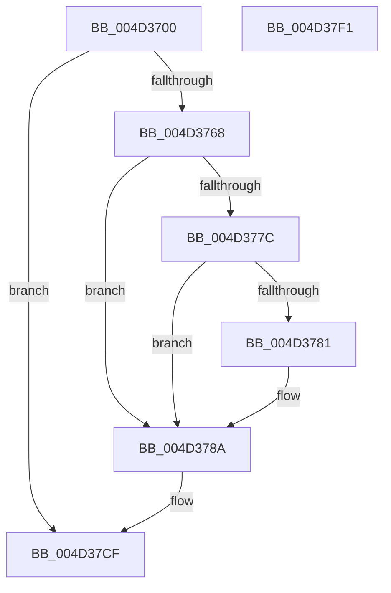

# MiTrimUnusedPageFileRegionsApc

- RVA: `0x004D3700`–`0x004D37F2` (길이 `242` bytes)
- VA: `0x00000001404D3700`
- 실행 섹션: `.text`
- PDB 이름 있음: `예`; PDB Function 태그: `아니요`
- unwind 정보 RVA: `0x0006C8E8`
- 디코드: `63`개 명령, `242/242` bytes 표시
- 미해석 바이트: `0` (있으면 어셈블리에 `.byte`로 보존)

> 이 문서는 커널 이미지의 기계어와 PDB 기호를 분석해 생성했습니다. 4번과 5번은 함수 원형과 자료형을 바이너리 사용 방식에서 추정한 C 해석이며 원본 소스 복구 결과는 아닙니다.

## 1. Dependencies

- 직접 호출 지점: **5**; 고유 호출 대상: **3**
- 직접 호출자로 확인된 함수: **0**
- RIP 상대 이미지 참조: **1**

### Outgoing calls
- `0x004D3734` → [MiMakePageFilePte](../38/MiMakePageFilePte_function_003823C8.md) (function, `0x003823C8`)
- `0x004D375C` → [MiFindFreePageFileSpace](../3E/MiFindFreePageFileSpace_function_003E2CAC.md) (function, `0x003E2CAC`)
- `0x004D379E` → [MiMakePageFilePte](../38/MiMakePageFilePte_function_003823C8.md) (function, `0x003823C8`)
- `0x004D37C5` → [MiFindFreePageFileSpace](../3E/MiFindFreePageFileSpace_function_003E2CAC.md) (function, `0x003E2CAC`)
- `0x004D37D7` → [KeSetEvent](../33/KeSetEvent_function_0033F310.md) (function, `0x0033F310`)

### Direct callers
- 이 함수 시작 RVA로 연결되는 직접 call은 확인되지 않았습니다. 간접 호출은 완전히 역산할 수 없습니다.

### Static image references
- `0x004D3768` → RVA `0x00E2DC80` (`.data`; read)

## 2. Other-region calls and transfers

- 다른 실행 섹션으로 향하는 call: **0**
- 별도 외부 분기/꼬리 이동을 확인하지 못했습니다.

## 3. Assembly (complete function range)

```asm
004D3700  48 89 5C 24 10                  mov qword ptr [rsp + 0x10], rbx
004D3705  48 89 6C 24 18                  mov qword ptr [rsp + 0x18], rbp
004D370A  48 89 74 24 20                  mov qword ptr [rsp + 0x20], rsi
004D370F  57                              push rdi
004D3710  48 83 EC 20                     sub rsp, 0x20
004D3714  48 8B 69 18                     mov rbp, qword ptr [rcx + 0x18]
004D3718  48 8B D9                        mov rbx, rcx
004D371B  8B 41 20                        mov eax, dword ptr [rcx + 0x20]
004D371E  8B 49 28                        mov ecx, dword ptr [rcx + 0x28]
004D3721  48 8B BC C5 60 48 00 00         mov rdi, qword ptr [rbp + rax*8 + 0x4860]
004D3729  0F B7 97 AC 00 00 00            movzx edx, word ptr [rdi + 0xac]
004D3730  48 C1 E2 0C                     shl rdx, 0xc
004D3734  E8 8F EC EA FF                  call 0x1403823c8
004D3739  44 8B 43 24                     mov r8d, dword ptr [rbx + 0x24]
004D373D  48 33 C2                        xor rax, rdx
004D3740  48 25 FF 0F FF FF               and rax, 0xffffffffffff0fff
004D3746  41 B9 AB 00 00 00               mov r9d, 0xab
004D374C  48 33 C2                        xor rax, rdx
004D374F  48 8B CD                        mov rcx, rbp
004D3752  48 8D 54 24 30                  lea rdx, [rsp + 0x30]
004D3757  48 89 44 24 30                  mov qword ptr [rsp + 0x30], rax
004D375C  E8 4B F5 F0 FF                  call 0x1403e2cac
004D3761  8B F0                           mov esi, eax
004D3763  3B 43 24                        cmp eax, dword ptr [rbx + 0x24]
004D3766  72 67                           jb 0x1404d37cf
004D3768  4C 8B 05 11 A5 95 00            mov r8, qword ptr [rip + 0x95a511]
004D376F  48 8B 4C 24 30                  mov rcx, qword ptr [rsp + 0x30]
004D3774  48 8B D1                        mov rdx, rcx
004D3777  4D 85 C0                        test r8, r8
004D377A  74 0E                           je 0x1404d378a
004D377C  F6 C2 10                        test dl, 0x10
004D377F  75 09                           jne 0x1404d378a
004D3781  49 8B C8                        mov rcx, r8
004D3784  48 F7 D1                        not rcx
004D3787  48 23 CA                        and rcx, rdx
004D378A  48 C1 E9 20                     shr rcx, 0x20
004D378E  89 4B 28                        mov dword ptr [rbx + 0x28], ecx
004D3791  03 CE                           add ecx, esi
004D3793  0F B7 97 AC 00 00 00            movzx edx, word ptr [rdi + 0xac]
004D379A  48 C1 E2 0C                     shl rdx, 0xc
004D379E  E8 25 EC EA FF                  call 0x1403823c8
004D37A3  44 8B 07                        mov r8d, dword ptr [rdi]
004D37A6  48 33 C2                        xor rax, rdx
004D37A9  48 25 FF 0F FF FF               and rax, 0xffffffffffff0fff
004D37AF  41 B9 6B 00 00 00               mov r9d, 0x6b
004D37B5  48 33 C2                        xor rax, rdx
004D37B8  48 8B CD                        mov rcx, rbp
004D37BB  48 8D 54 24 30                  lea rdx, [rsp + 0x30]
004D37C0  48 89 44 24 30                  mov qword ptr [rsp + 0x30], rax
004D37C5  E8 E2 F4 F0 FF                  call 0x1403e2cac
004D37CA  03 C6                           add eax, esi
004D37CC  89 43 2C                        mov dword ptr [rbx + 0x2c], eax
004D37CF  45 33 C0                        xor r8d, r8d
004D37D2  33 D2                           xor edx, edx
004D37D4  48 8B CB                        mov rcx, rbx
004D37D7  E8 34 BB E6 FF                  call 0x14033f310
004D37DC  48 8B 5C 24 38                  mov rbx, qword ptr [rsp + 0x38]
004D37E1  48 8B 6C 24 40                  mov rbp, qword ptr [rsp + 0x40]
004D37E6  48 8B 74 24 48                  mov rsi, qword ptr [rsp + 0x48]
004D37EB  48 83 C4 20                     add rsp, 0x20
004D37EF  5F                              pop rdi
004D37F0  C3                              ret
004D37F1  CC                              int3
```

## 4. C-style interpretation (structured pseudocode)

```c
__int64 __fastcall MiTrimUnusedPageFileRegionsApc(__int64 a1)
{
    __int64 result;
    __int64 v_rsp;
    unsigned __int64 v_stack_p10;
    unsigned __int64 v_stack_p18;
    unsigned __int64 v_stack_p20;
    unsigned __int64 v_stack_p8;

    v_stack_p10 = v_rbx;
    v_stack_p18 = v_rbp;
    v_stack_p20 = v_rsi;
    v_rsp = (v_rsp) - (32);
    a2 = (*(unsigned __int16 *)(*(unsigned __int64 *)(*(unsigned __int64 *)(a1 + 24) + (unsigned int)(*(unsigned int *)(a1 + 32)) * 8 + 18528) + 172)) << (12);
    result = MiMakePageFilePte((unsigned int)(*(unsigned int *)(a1 + 40)), a2, a3, a4);
    result = (result) ^ (a2);
    result = (result) & (0xFFFFFFFFFFFF0FFFULL);
    result = (result) ^ (a2);
    v_stack_p8 = result;
    result = MiFindFreePageFileSpace(*(unsigned __int64 *)(a1 + 24), v_stack_p8, (unsigned int)(*(unsigned int *)(a1 + 36)), 171);
    if (((unsigned int)(result)) < (*(unsigned int *)(a1 + 36))) goto loc_004D37CF;
    if (*(unsigned __int64 *)(v_rip + 9807121) == 0) goto loc_004D378A;
    if ((((unsigned __int8)(v_stack_p8)) & (16)) == 0) {
        a1 = *(unsigned __int64 *)(v_rip + 9807121);
        a1 = ~(a1);
        a1 = (a1) & (v_stack_p8);
    }
    a1 = (a1) >> (32);
    *(unsigned int *)(a1 + 40) = (unsigned int)(a1);
    a1 = (unsigned int)((a1) + ((unsigned int)((unsigned int)((unsigned int)(result)))));
    a2 = (*(unsigned __int16 *)(*(unsigned __int64 *)(*(unsigned __int64 *)(a1 + 24) + (unsigned int)(*(unsigned int *)(a1 + 32)) * 8 + 18528) + 172)) << (12);
    result = MiMakePageFilePte(a1, a2, *(unsigned __int64 *)(v_rip + 9807121), 171);
    result = (result) ^ (a2);
    result = (result) & (0xFFFFFFFFFFFF0FFFULL);
    result = (result) ^ (a2);
    v_stack_p8 = result;
    result = MiFindFreePageFileSpace(*(unsigned __int64 *)(a1 + 24), v_stack_p8, (unsigned int)(*(unsigned int *)(*(unsigned __int64 *)(*(unsigned __int64 *)(a1 + 24) + (unsigned int)(*(unsigned int *)(a1 + 32)) * 8 + 18528))), 107);
    result = (unsigned int)((result) + ((unsigned int)((unsigned int)((unsigned int)(result)))));
    *(unsigned int *)(a1 + 44) = (unsigned int)(result);
loc_004D37CF:
    a3 = 0;
    a2 = 0;
    result = KeSetEvent(a1, a2, a3, 107);
    v_rsp = (v_rsp) + (32);
    return result;
}
```

## 5. (Beta) C Style

```c
int64_t MiTrimUnusedPageFileRegionsApc(void *Arg1)
{
    uint8_t *arg1 = (uint8_t *)Arg1;

    int64_t result;
    int64_t local_rsp;
    uint64_t v_stack_p10;
    uint64_t v_stack_p18;
    uint64_t v_stack_p20;
    uint64_t v_stack_p8;

    v_stack_p10 = local_rbx;
    v_stack_p18 = local_rbp;
    v_stack_p20 = local_rsi;
    local_rsp = (local_rsp) - (32);
    a2 = (*(uint16_t *)(*(uint64_t *)(*(uint64_t *)(arg1 + 0x18) + (uint32_t)(*(uint32_t *)(arg1 + 0x20)) * 8 + 0x4860) + 0xAC)) << (12);
    result = MiMakePageFilePte((uint32_t)(*(uint32_t *)(arg1 + 0x28)), a2, a3, a4);
    result = (result) ^ (a2);
    result = (result) & (0xFFFFFFFFFFFF0FFFULL);
    result = (result) ^ (a2);
    v_stack_p8 = result;
    result = MiFindFreePageFileSpace(*(uint64_t *)(arg1 + 0x18), v_stack_p8, (uint32_t)(*(uint32_t *)(arg1 + 0x24)), 171);
    if (((uint32_t)(result)) < (*(uint32_t *)(arg1 + 0x24))) goto loc_004D37CF;
    if (*(uint64_t *)(v_rip + 0x95A511) == 0) goto loc_004D378A;
    if ((((uint8_t)(v_stack_p8)) & (16)) == 0) {
        Arg1 = *(uint64_t *)(v_rip + 0x95A511);
        Arg1 = ~(Arg1);
        Arg1 = (Arg1) & (v_stack_p8);
    }
    Arg1 = (Arg1) >> (32);
    *(uint32_t *)(arg1 + 0x28) = (uint32_t)(Arg1);
    Arg1 = (uint32_t)((Arg1) + ((uint32_t)((uint32_t)((uint32_t)(result)))));
    a2 = (*(uint16_t *)(*(uint64_t *)(*(uint64_t *)(arg1 + 0x18) + (uint32_t)(*(uint32_t *)(arg1 + 0x20)) * 8 + 0x4860) + 0xAC)) << (12);
    result = MiMakePageFilePte(Arg1, a2, *(uint64_t *)(v_rip + 0x95A511), 171);
    result = (result) ^ (a2);
    result = (result) & (0xFFFFFFFFFFFF0FFFULL);
    result = (result) ^ (a2);
    v_stack_p8 = result;
    result = MiFindFreePageFileSpace(*(uint64_t *)(arg1 + 0x18), v_stack_p8, (uint32_t)(*(uint32_t *)(*(uint64_t *)(*(uint64_t *)(arg1 + 0x18) + (uint32_t)(*(uint32_t *)(arg1 + 0x20)) * 8 + 0x4860))), 107);
    result = (uint32_t)((result) + ((uint32_t)((uint32_t)((uint32_t)(result)))));
    *(uint32_t *)(arg1 + 0x2C) = (uint32_t)(result);
loc_004D37CF:
    a3 = 0;
    a2 = 0;
    result = KeSetEvent(Arg1, a2, a3, 107);
    local_rsp = (local_rsp) + (32);
    return result;
}
```

### 관측된 메모리 오프셋

구조체 형식이 확인되지 않은 접근은 인자 기준의 오프셋으로만 기록했습니다.

| 기준 인자 | 오프셋 표현 | 폭 (bit) | 접근 |
|---|---:|---:|---|
| `Arg1` | `+ 0x18` | `64` | `R` |
| `Arg1` | `+ 0x20` | `32` | `R` |
| `Arg1` | `+ 0x24` | `32` | `R` |
| `Arg1` | `+ 0x28` | `32` | `R` |
| `Arg1` | `+ 0x28` | `32` | `W` |
| `Arg1` | `+ 0x2C` | `32` | `W` |

## 6. Execution-region graph

[열기: 2D/3D 그래프와 함수 탐색 컨트롤 패널](../../../control-panel.html?section=text&rva=0x004D3700&view=graph)

- 2D 그래프는 위에서 아래로 흐르고, 3D 그래프는 빈 공간을 드래그해 회전합니다. Shift+드래그는 이동, 휠은 확대·축소, 함수 노드 선택은 대상 보고서 이동입니다.

### Static fallback


