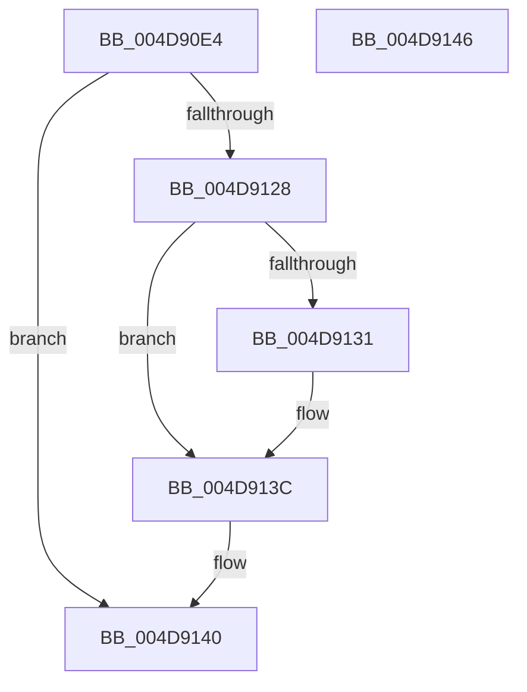

# MiUnlockHugePfn

- RVA: `0x004D90E4`–`0x004D9147` (길이 `99` bytes)
- VA: `0x00000001404D90E4`
- 실행 섹션: `.text`
- PDB 이름 있음: `예`; PDB Function 태그: `아니요`
- unwind 정보 RVA: `0x0005CF00`
- 디코드: `28`개 명령, `99/99` bytes 표시
- 미해석 바이트: `0` (있으면 어셈블리에 `.byte`로 보존)

> 이 문서는 커널 이미지의 기계어와 PDB 기호를 분석해 생성했습니다. 4번과 5번은 함수 원형과 자료형을 바이너리 사용 방식에서 추정한 C 해석이며 원본 소스 복구 결과는 아닙니다.

## 1. Dependencies

- 직접 호출 지점: **1**; 고유 호출 대상: **1**
- 직접 호출자로 확인된 함수: **11**
- RIP 상대 이미지 참조: **3**

### Outgoing calls
- `0x004D9137` → [KiLowerIrqlProcessIrqlFlags](../4F/KiLowerIrqlProcessIrqlFlags_function_004F5698.md) (function, `0x004F5698`)

### Direct callers
- [MiGetHugeBadRangeFromNode](../67/MiGetHugeBadRangeFromNode_function_00675818.md) at `0x006758F3`
- [MiGetHugeBadRangeFromNode](../67/MiGetHugeBadRangeFromNode_function_00675818.md) at `0x00675926`
- [MiGetHugeRange](../67/MiGetHugeRange_function_00675954.md) at `0x00675AA9`
- [MiGetPageInHugePageBadStatus](../67/MiGetPageInHugePageBadStatus_function_00675ADC.md) at `0x00675BE1`
- [MiGetPerfectColorHeadHugeRange](../67/MiGetPerfectColorHeadHugeRange_function_00675C08.md) at `0x00675D22`
- [MiGetPerfectColorHeadHugeRange](../67/MiGetPerfectColorHeadHugeRange_function_00675C08.md) at `0x00675D4A`
- [MiHotRemoveHugeRange](../67/MiHotRemoveHugeRange_function_00675DD0.md) at `0x00675EF9`
- [MiMarkHugePfnBad](../67/MiMarkHugePfnBad_function_00676744.md) at `0x00676895`
- [MiMarkHugePfnBad](../67/MiMarkHugePfnBad_function_00676744.md) at `0x00676A99`
- [MiMarkHugePfnBad](../67/MiMarkHugePfnBad_function_00676744.md) at `0x00676AA9`
- [MiMarkHugePfnGood](../67/MiMarkHugePfnGood_function_00676BB0.md) at `0x00676D8B`
- [MiMoveBadHugeRangeCrossPartition](../67/MiMoveBadHugeRangeCrossPartition_function_00676DD0.md) at `0x00676ECA`
- [MiReleaseMemoryRuns](../67/MiReleaseMemoryRuns_function_00676EF0.md) at `0x00676FD5`
- [MiUpdateBadPfnIdentity](../67/MiUpdateBadPfnIdentity_function_0067A890.md) at `0x0067A918`
- [MiInsertHugeRangeInPartition](../69/MiInsertHugeRangeInPartition_function_00690F28.md) at `0x00690F73`

### Static image references
- `0x004D90F0` → RVA `0x00E300C0` (`.data`; read)
- `0x004D9113` → RVA `0x00E300C8` (`.data`; read)
- `0x004D9128` → RVA `0x00FC6D20` (`ALMOSTRO`; read)

## 2. Other-region calls and transfers

- 다른 실행 섹션으로 향하는 call: **0**
- 별도 외부 분기/꼬리 이동을 확인하지 못했습니다.

## 3. Assembly (complete function range)

```asm
004D90E4  40 53                           push rbx
004D90E6  48 83 EC 20                     sub rsp, 0x20
004D90EA  48 8B C1                        mov rax, rcx
004D90ED  0F B6 DA                        movzx ebx, dl
004D90F0  48 2B 05 C9 6F 95 00            sub rax, qword ptr [rip + 0x956fc9]
004D90F7  41 B8 01 00 00 00               mov r8d, 1
004D90FD  48 C1 F8 03                     sar rax, 3
004D9101  25 FF FF 3F 00                  and eax, 0x3fffff
004D9106  8B C8                           mov ecx, eax
004D9108  83 E1 1F                        and ecx, 0x1f
004D910B  41 D3 E0                        shl r8d, cl
004D910E  8B C8                           mov ecx, eax
004D9110  41 F7 D0                        not r8d
004D9113  48 8B 05 AE 6F 95 00            mov rax, qword ptr [rip + 0x956fae]
004D911A  48 C1 E9 05                     shr rcx, 5
004D911E  F0 44 21 04 88                  lock and dword ptr [rax + rcx*4], r8d
004D9123  80 FB 11                        cmp bl, 0x11
004D9126  74 18                           je 0x1404d9140
004D9128  83 3D F1 DB AE 00 00            cmp dword ptr [rip + 0xaedbf1], 0
004D912F  74 0B                           je 0x1404d913c
004D9131  44 0F 20 C1                     mov rcx, cr8
004D9135  8A D3                           mov dl, bl
004D9137  E8 5C C5 01 00                  call 0x1404f5698
004D913C  44 0F 22 C3                     mov cr8, rbx
004D9140  48 83 C4 20                     add rsp, 0x20
004D9144  5B                              pop rbx
004D9145  C3                              ret
004D9146  CC                              int3
```

## 4. C-style interpretation (structured pseudocode)

```c
__int64 __fastcall MiUnlockHugePfn(__int64 a1, unsigned __int8 a2)
{
    __int64 result;
    __int64 v_rsp;

    v_rsp = (v_rsp) - (32);
    result = (a1) - (*(unsigned __int64 *)(v_rip + 9793481));
    result = (result) >> (3);
    result = (unsigned int)((result) & (0x3FFFFFULL));
    a1 = (unsigned int)(((unsigned int)((unsigned int)(result))) & (31));
    a3 = (unsigned int)((1) << ((unsigned __int8)(a1)));
    a3 = (unsigned int)(~(a3));
    a1 = ((unsigned int)((unsigned int)(result))) >> (5);
    if (a2 == 17) goto loc_004D9140;
    result = *(unsigned __int64 *)(v_rip + 9793454);
    if ((*(unsigned int *)(v_rip + 11459569)) != 0) {
        a1 = v_cr8;
        a2 = a2;
        result = KiLowerIrqlProcessIrqlFlags(a1, a2, a3, a4);
    }
loc_004D9140:
    v_rsp = (v_rsp) + (32);
    return result;
}
```

## 5. (Beta) C Style

```c
int64_t MiUnlockHugePfn(int64_t Arg1, uint8_t Arg2)
{
    int64_t result;
    int64_t local_rsp;

    local_rsp = (local_rsp) - (32);
    result = (Arg1) - (*(uint64_t *)(v_rip + 0x956FC9));
    result = (result) >> (3);
    result = (uint32_t)((result) & (0x3FFFFFULL));
    Arg1 = (uint32_t)(((uint32_t)((uint32_t)(result))) & (31));
    a3 = (uint32_t)((1) << ((uint8_t)(Arg1)));
    a3 = (uint32_t)(~(a3));
    Arg1 = ((uint32_t)((uint32_t)(result))) >> (5);
    if (Arg2 == 17) goto loc_004D9140;
    result = *(uint64_t *)(v_rip + 0x956FAE);
    if ((*(uint32_t *)(v_rip + 0xAEDBF1)) != 0) {
        Arg1 = v_cr8;
        Arg2 = Arg2;
        result = KiLowerIrqlProcessIrqlFlags(Arg1, Arg2, a3, a4);
    }
loc_004D9140:
    local_rsp = (local_rsp) + (32);
    return result;
}
```

## 6. Execution-region graph

[열기: 2D/3D 그래프와 함수 탐색 컨트롤 패널](../../../control-panel.html?section=text&rva=0x004D90E4&view=graph)

- 2D 그래프는 위에서 아래로 흐르고, 3D 그래프는 빈 공간을 드래그해 회전합니다. Shift+드래그는 이동, 휠은 확대·축소, 함수 노드 선택은 대상 보고서 이동입니다.

### Static fallback


