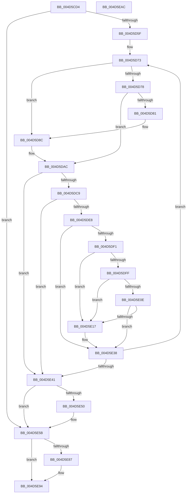

# MiVadRangeIsIoSpace

- RVA: `0x004D5CD4`–`0x004D5EAD` (길이 `473` bytes)
- VA: `0x00000001404D5CD4`
- 실행 섹션: `.text`
- PDB 이름 있음: `예`; PDB Function 태그: `아니요`
- unwind 정보 RVA: `0x000BD538`
- 디코드: `129`개 명령, `473/473` bytes 표시
- 미해석 바이트: `0` (있으면 어셈블리에 `.byte`로 보존)

> 이 문서는 커널 이미지의 기계어와 PDB 기호를 분석해 생성했습니다. 4번과 5번은 함수 원형과 자료형을 바이너리 사용 방식에서 추정한 C 해석이며 원본 소스 복구 결과는 아닙니다.

## 1. Dependencies

- 직접 호출 지점: **11**; 고유 호출 대상: **7**
- 직접 호출자로 확인된 함수: **1**
- RIP 상대 이미지 참조: **1**

### Outgoing calls
- `0x004D5D4E` → [MiLockWorkingSetShared](../27/MiLockWorkingSetShared_function_0027CBF0.md) (function, `0x0027CBF0`)
- `0x004D5D87` → [MiUnlockPageTable](../21/MiUnlockPageTable_function_00216EC0.md) (function, `0x00216EC0`)
- `0x004D5DA7` → [MiMakeSystemAddressValid](../27/MiMakeSystemAddressValid_function_0027FF70.md) (function, `0x0027FF70`)
- `0x004D5DF6` → [MiWorkingSetIsContended](../2A/MiWorkingSetIsContended_function_002AE520.md) (function, `0x002AE520`)
- `0x004D5E05` → [MiPageTableLockIsContended](../2A/MiPageTableLockIsContended_function_002AE650.md) (function, `0x002AE650`)
- `0x004D5E0E` → [KeShouldYieldProcessor](../27/KeShouldYieldProcessor_function_002773E0.md) (function, `0x002773E0`)
- `0x004D5E1D` → [MiUnlockPageTable](../21/MiUnlockPageTable_function_00216EC0.md) (function, `0x00216EC0`)
- `0x004D5E28` → [MiUnlockWorkingSetShared](../27/MiUnlockWorkingSetShared_function_0027D690.md) (function, `0x0027D690`)
- `0x004D5E33` → [MiLockWorkingSetShared](../27/MiLockWorkingSetShared_function_0027CBF0.md) (function, `0x0027CBF0`)
- `0x004D5E56` → [MiUnlockPageTable](../21/MiUnlockPageTable_function_00216EC0.md) (function, `0x00216EC0`)
- `0x004D5E61` → [MiUnlockWorkingSetShared](../27/MiUnlockWorkingSetShared_function_0027D690.md) (function, `0x0027D690`)

### Direct callers
- [MiCopyVirtualMemory](../../page/9B/MiCopyVirtualMemory_function_009BBB50.md) at `0x009BC43E`
- [MiCopyVirtualMemory](../../page/9B/MiCopyVirtualMemory_function_009BBB50.md) at `0x009BC460`

### Static image references
- `0x004D5DC0` → RVA `0x00E2DCE0` (`.data`; read)

## 2. Other-region calls and transfers

- 다른 실행 섹션으로 향하는 call: **0**
- 별도 외부 분기/꼬리 이동을 확인하지 못했습니다.

## 3. Assembly (complete function range)

```asm
004D5CD4  48 89 5C 24 20                  mov qword ptr [rsp + 0x20], rbx
004D5CD9  4C 89 44 24 18                  mov qword ptr [rsp + 0x18], r8
004D5CDE  48 89 54 24 10                  mov qword ptr [rsp + 0x10], rdx
004D5CE3  55                              push rbp
004D5CE4  56                              push rsi
004D5CE5  57                              push rdi
004D5CE6  41 54                           push r12
004D5CE8  41 55                           push r13
004D5CEA  41 56                           push r14
004D5CEC  41 57                           push r15
004D5CEE  48 83 EC 20                     sub rsp, 0x20
004D5CF2  48 8B DA                        mov rbx, rdx
004D5CF5  48 B9 00 00 00 00 80 F6 FF FF   movabs rcx, 0xfffff68000000000
004D5CFF  4C 8B E2                        mov r12, rdx
004D5D02  48 C1 EB 09                     shr rbx, 9
004D5D06  48 BA F8 FF FF FF 7F 00 00 00   movabs rdx, 0x7ffffffff8
004D5D10  4D 8B F8                        mov r15, r8
004D5D13  48 23 DA                        and rbx, rdx
004D5D16  33 FF                           xor edi, edi
004D5D18  48 8B C1                        mov rax, rcx
004D5D1B  4D 8D 70 FF                     lea r14, [r8 - 1]
004D5D1F  48 03 D8                        add rbx, rax
004D5D22  4D 03 F4                        add r14, r12
004D5D25  49 C1 EE 09                     shr r14, 9
004D5D29  4C 23 F2                        and r14, rdx
004D5D2C  48 8B C1                        mov rax, rcx
004D5D2F  4C 03 F0                        add r14, rax
004D5D32  8B F7                           mov esi, edi
004D5D34  65 48 8B 04 25 88 01 00 00      mov rax, qword ptr gs:[0x188]
004D5D3D  48 8B A8 B8 00 00 00            mov rbp, qword ptr [rax + 0xb8]
004D5D44  48 81 C5 00 04 00 00            add rbp, 0x400
004D5D4B  48 8B CD                        mov rcx, rbp
004D5D4E  E8 9D 6E DA FF                  call 0x14027cbf0
004D5D53  44 8A E8                        mov r13b, al
004D5D56  49 3B DE                        cmp rbx, r14
004D5D59  0F 87 FC 00 00 00               ja 0x1404d5e5b
004D5D5F  49 BF 00 00 00 00 80 F6 FF FF   movabs r15, 0xfffff68000000000
004D5D69  49 BC F8 FF FF FF 7F 00 00 00   movabs r12, 0x7ffffffff8
004D5D73  48 85 F6                        test rsi, rsi
004D5D76  74 14                           je 0x1404d5d8c
004D5D78  48 F7 C3 FF 0F 00 00            test rbx, 0xfff
004D5D7F  75 2B                           jne 0x1404d5dac
004D5D81  48 8B D6                        mov rdx, rsi
004D5D84  48 8B CD                        mov rcx, rbp
004D5D87  E8 34 11 D4 FF                  call 0x140216ec0
004D5D8C  48 8B F3                        mov rsi, rbx
004D5D8F  48 C1 EE 09                     shr rsi, 9
004D5D93  49 23 F4                        and rsi, r12
004D5D96  49 8B C7                        mov rax, r15
004D5D99  48 03 F0                        add rsi, rax
004D5D9C  45 33 C9                        xor r9d, r9d
004D5D9F  45 8A C5                        mov r8b, r13b
004D5DA2  8B D7                           mov edx, edi
004D5DA4  48 8B CB                        mov rcx, rbx
004D5DA7  E8 C4 A1 DA FF                  call 0x14027ff70
004D5DAC  48 8B 03                        mov rax, qword ptr [rbx]
004D5DAF  48 B9 FF FF FF FF FF 00 00 00   movabs rcx, 0xffffffffff
004D5DB9  48 C1 E8 0C                     shr rax, 0xc
004D5DBD  48 23 C1                        and rax, rcx
004D5DC0  48 3B 05 19 7F 95 00            cmp rax, qword ptr [rip + 0x957f19]
004D5DC7  77 78                           ja 0x1404d5e41
004D5DC9  48 8D 04 40                     lea rax, [rax + rax*2]
004D5DCD  48 03 C0                        add rax, rax
004D5DD0  48 B9 28 00 00 00 00 DE FF FF   movabs rcx, 0xffffde0000000028
004D5DDA  48 8B 04 C1                     mov rax, qword ptr [rcx + rax*8]
004D5DDE  48 C1 E8 36                     shr rax, 0x36
004D5DE2  0F BA E0 00                     bt eax, 0
004D5DE6  73 59                           jae 0x1404d5e41
004D5DE8  48 83 C3 08                     add rbx, 8
004D5DEC  F6 C3 78                        test bl, 0x78
004D5DEF  75 47                           jne 0x1404d5e38
004D5DF1  33 D2                           xor edx, edx
004D5DF3  48 8B CD                        mov rcx, rbp
004D5DF6  E8 25 87 DD FF                  call 0x1402ae520
004D5DFB  85 C0                           test eax, eax
004D5DFD  75 18                           jne 0x1404d5e17
004D5DFF  48 8B D6                        mov rdx, rsi
004D5E02  48 8B CD                        mov rcx, rbp
004D5E05  E8 46 88 DD FF                  call 0x1402ae650
004D5E0A  85 C0                           test eax, eax
004D5E0C  75 09                           jne 0x1404d5e17
004D5E0E  E8 CD 15 DA FF                  call 0x1402773e0
004D5E13  85 C0                           test eax, eax
004D5E15  74 21                           je 0x1404d5e38
004D5E17  48 8B D6                        mov rdx, rsi
004D5E1A  48 8B CD                        mov rcx, rbp
004D5E1D  E8 9E 10 D4 FF                  call 0x140216ec0
004D5E22  41 8A D5                        mov dl, r13b
004D5E25  48 8B CD                        mov rcx, rbp
004D5E28  E8 63 78 DA FF                  call 0x14027d690
004D5E2D  48 8B CD                        mov rcx, rbp
004D5E30  48 8B F7                        mov rsi, rdi
004D5E33  E8 B8 6D DA FF                  call 0x14027cbf0
004D5E38  49 3B DE                        cmp rbx, r14
004D5E3B  0F 86 32 FF FF FF               jbe 0x1404d5d73
004D5E41  4C 8B 7C 24 70                  mov r15, qword ptr [rsp + 0x70]
004D5E46  4C 8B 64 24 68                  mov r12, qword ptr [rsp + 0x68]
004D5E4B  48 85 F6                        test rsi, rsi
004D5E4E  74 0B                           je 0x1404d5e5b
004D5E50  48 8B D6                        mov rdx, rsi
004D5E53  48 8B CD                        mov rcx, rbp
004D5E56  E8 65 10 D4 FF                  call 0x140216ec0
004D5E5B  41 8A D5                        mov dl, r13b
004D5E5E  48 8B CD                        mov rcx, rbp
004D5E61  E8 2A 78 DA FF                  call 0x14027d690
004D5E66  48 B8 00 00 00 00 80 F6 FF FF   movabs rax, 0xfffff68000000000
004D5E70  48 C1 E3 19                     shl rbx, 0x19
004D5E74  48 8B C0                        mov rax, rax
004D5E77  48 C1 E0 19                     shl rax, 0x19
004D5E7B  48 2B D8                        sub rbx, rax
004D5E7E  48 C1 FB 10                     sar rbx, 0x10
004D5E82  49 3B DC                        cmp rbx, r12
004D5E85  72 0D                           jb 0x1404d5e94
004D5E87  48 8B FB                        mov rdi, rbx
004D5E8A  49 2B FC                        sub rdi, r12
004D5E8D  49 3B FF                        cmp rdi, r15
004D5E90  49 0F 47 FF                     cmova rdi, r15
004D5E94  48 8B 5C 24 78                  mov rbx, qword ptr [rsp + 0x78]
004D5E99  48 8B C7                        mov rax, rdi
004D5E9C  48 83 C4 20                     add rsp, 0x20
004D5EA0  41 5F                           pop r15
004D5EA2  41 5E                           pop r14
004D5EA4  41 5D                           pop r13
004D5EA6  41 5C                           pop r12
004D5EA8  5F                              pop rdi
004D5EA9  5E                              pop rsi
004D5EAA  5D                              pop rbp
004D5EAB  C3                              ret
004D5EAC  CC                              int3
```

## 4. C-style interpretation (structured pseudocode)

```c
__int64 __fastcall MiVadRangeIsIoSpace(__int64 a1, __int64 a2, __int64 a3, int a4)
{
    __int64 result;
    __int64 v_r14;
    __int64 v_rbp;
    __int64 v_rbx;
    __int64 v_rdi;
    __int64 v_rsi;
    __int64 v_rsp;
    unsigned __int64 v_stack_p10;
    unsigned __int64 v_stack_p18;
    unsigned __int64 v_stack_p20;

    v_stack_p20 = v_rbx;
    v_stack_p18 = a3;
    v_stack_p10 = a2;
    v_rsp = (v_rsp) - (32);
    v_rbx = (a2) >> (9);
    v_rbx = (v_rbx) & (a2);
    v_rdi = 0;
    v_rbx = (v_rbx) + (a1);
    v_r14 = (a3 - 1) + (a2);
    v_r14 = (v_r14) >> (9);
    v_r14 = (v_r14) & (a2);
    v_r14 = (v_r14) + (a1);
    v_rbp = (*(unsigned __int64 *)(*(unsigned __int64 *)(gs_base + (0 + 392)) + 184)) + (0x400ULL);
    result = MiLockWorkingSetShared(v_rbp, a2, a3, a4);
    if (v_rbx > v_r14) goto loc_004D5E5B;
loc_004D5D73:
    if (0 == 0) goto loc_004D5D8C;
    if (((v_rbx) & (0xFFFULL)) != 0) goto loc_004D5DAC;
    result = MiUnlockPageTable(v_rbp, 0, a3, a4);
loc_004D5D8C:
    v_rsi = (v_rbx) >> (9);
    v_rsi = (v_rsi) & (a2);
    v_rsi = (v_rsi) + (a3);
    a4 = 0;
    result = MiMakeSystemAddressValid(v_rbx, 0, (unsigned __int8)((unsigned __int8)(result)), a4);
loc_004D5DAC:
    result = (*(unsigned __int64 *)(v_rbx)) >> (12);
    result = (result) & (v_rbx);
    if (result > (*(unsigned __int64 *)(v_rip + 9797401))) goto loc_004D5E41;
    result = (result + result * 2) + (result + result * 2);
    result = (*(unsigned __int64 *)(v_rbx + result * 8)) >> (54);
    if (condition_is_above_or_equal) goto loc_004D5E41;
    v_rbx = (v_rbx) + (8);
    if ((((unsigned __int8)(v_rbx)) & (120)) != 0) goto loc_004D5E38;
    a2 = 0;
    result = MiWorkingSetIsContended(v_rbp, a2, (unsigned __int8)((unsigned __int8)(result)), a4);
    if ((unsigned int)(result) != 0) goto loc_004D5E17;
    result = MiPageTableLockIsContended(v_rbp, v_rsi, (unsigned __int8)((unsigned __int8)(result)), a4);
    if ((unsigned int)(result) != 0) goto loc_004D5E17;
    result = KeShouldYieldProcessor(v_rbp, v_rsi, (unsigned __int8)((unsigned __int8)(result)), a4);
    if ((unsigned int)(result) != 0) {
        a2 = v_rsi;
        a1 = v_rbp;
        result = MiUnlockPageTable(a1, a2, (unsigned __int8)((unsigned __int8)(result)), a4);
        a2 = (unsigned __int8)((unsigned __int8)(result));
        a1 = v_rbp;
        result = MiUnlockWorkingSetShared(a1, a2, (unsigned __int8)((unsigned __int8)(result)), a4);
        a1 = v_rbp;
        v_rsi = 0;
        result = MiLockWorkingSetShared(a1, a2, (unsigned __int8)((unsigned __int8)(result)), a4);
    }
    if (v_rbx <= v_r14) goto loc_004D5D73;
loc_004D5E41:
    if (v_rsi != 0) {
        a2 = v_rsi;
        a1 = v_rbp;
        result = MiUnlockPageTable(a1, a2, (unsigned __int8)((unsigned __int8)(result)), a4);
    }
    result = MiUnlockWorkingSetShared(v_rbp, (unsigned __int8)((unsigned __int8)(result)), (unsigned __int8)((unsigned __int8)(result)), a4);
    v_rbx = (v_rbx) << (25);
    result = (result) << (25);
    v_rbx = (v_rbx) - (result);
    v_rbx = (v_rbx) >> (16);
    if (v_rbx >= v_stack_p10) {
        v_rdi = v_rbx;
        v_rdi = (v_rdi) - (v_stack_p10);
        if (v_rdi > v_stack_p18) { v_rdi = v_stack_p18; }
    }
    v_rsp = (v_rsp) + (32);
    return v_rdi;
}
```

## 5. (Beta) C Style

```c
int64_t MiVadRangeIsIoSpace(int64_t Arg1, int64_t Arg2, void *Arg3, int32_t Arg4)
{
    uint8_t *arg3 = (uint8_t *)Arg3;

    int64_t result;
    int64_t local_r14;
    int64_t local_rbp;
    int64_t local_rbx;
    int64_t local_rdi;
    int64_t local_rsi;
    int64_t local_rsp;
    uint64_t v_stack_p10;
    uint64_t v_stack_p18;
    uint64_t v_stack_p20;

    v_stack_p20 = local_rbx;
    v_stack_p18 = Arg3;
    v_stack_p10 = Arg2;
    local_rsp = (local_rsp) - (32);
    local_rbx = (Arg2) >> (9);
    local_rbx = (local_rbx) & (Arg2);
    local_rdi = 0;
    local_rbx = (local_rbx) + (Arg1);
    local_r14 = (Arg3 - 1) + (Arg2);
    local_r14 = (local_r14) >> (9);
    local_r14 = (local_r14) & (Arg2);
    local_r14 = (local_r14) + (Arg1);
    local_rbp = (*(uint64_t *)(*(uint64_t *)(gs_base + (0 + 0x188)) + 0xB8)) + (0x400ULL);
    result = MiLockWorkingSetShared(local_rbp, Arg2, Arg3, Arg4);
    if (local_rbx > local_r14) goto loc_004D5E5B;
loc_004D5D73:
    if (0 == 0) goto loc_004D5D8C;
    if (((local_rbx) & (0xFFFULL)) != 0) goto loc_004D5DAC;
    result = MiUnlockPageTable(local_rbp, 0, Arg3, Arg4);
loc_004D5D8C:
    local_rsi = (local_rbx) >> (9);
    local_rsi = (local_rsi) & (Arg2);
    local_rsi = (local_rsi) + (Arg3);
    Arg4 = 0;
    result = MiMakeSystemAddressValid(local_rbx, 0, (uint8_t)((uint8_t)(result)), Arg4);
loc_004D5DAC:
    result = (*(uint64_t *)(local_rbx)) >> (12);
    result = (result) & (local_rbx);
    if (result > (*(uint64_t *)(v_rip + 0x957F19))) goto loc_004D5E41;
    result = (result + result * 2) + (result + result * 2);
    result = (*(uint64_t *)(local_rbx + result * 8)) >> (54);
    if (condition_is_above_or_equal) goto loc_004D5E41;
    local_rbx = (local_rbx) + (8);
    if ((((uint8_t)(local_rbx)) & (120)) != 0) goto loc_004D5E38;
    Arg2 = 0;
    result = MiWorkingSetIsContended(local_rbp, Arg2, (uint8_t)((uint8_t)(result)), Arg4);
    if ((uint32_t)(result) != 0) goto loc_004D5E17;
    result = MiPageTableLockIsContended(local_rbp, local_rsi, (uint8_t)((uint8_t)(result)), Arg4);
    if ((uint32_t)(result) != 0) goto loc_004D5E17;
    result = KeShouldYieldProcessor(local_rbp, local_rsi, (uint8_t)((uint8_t)(result)), Arg4);
    if ((uint32_t)(result) != 0) {
        Arg2 = local_rsi;
        Arg1 = local_rbp;
        result = MiUnlockPageTable(Arg1, Arg2, (uint8_t)((uint8_t)(result)), Arg4);
        Arg2 = (uint8_t)((uint8_t)(result));
        Arg1 = local_rbp;
        result = MiUnlockWorkingSetShared(Arg1, Arg2, (uint8_t)((uint8_t)(result)), Arg4);
        Arg1 = local_rbp;
        local_rsi = 0;
        result = MiLockWorkingSetShared(Arg1, Arg2, (uint8_t)((uint8_t)(result)), Arg4);
    }
    if (local_rbx <= local_r14) goto loc_004D5D73;
loc_004D5E41:
    if (local_rsi != 0) {
        Arg2 = local_rsi;
        Arg1 = local_rbp;
        result = MiUnlockPageTable(Arg1, Arg2, (uint8_t)((uint8_t)(result)), Arg4);
    }
    result = MiUnlockWorkingSetShared(local_rbp, (uint8_t)((uint8_t)(result)), (uint8_t)((uint8_t)(result)), Arg4);
    local_rbx = (local_rbx) << (25);
    result = (result) << (25);
    local_rbx = (local_rbx) - (result);
    local_rbx = (local_rbx) >> (16);
    if (local_rbx >= v_stack_p10) {
        local_rdi = local_rbx;
        local_rdi = (local_rdi) - (v_stack_p10);
        if (local_rdi > v_stack_p18) { local_rdi = v_stack_p18; }
    }
    local_rsp = (local_rsp) + (32);
    return local_rdi;
}
```

### 관측된 메모리 오프셋

구조체 형식이 확인되지 않은 접근은 인자 기준의 오프셋으로만 기록했습니다.

| 기준 인자 | 오프셋 표현 | 폭 (bit) | 접근 |
|---|---:|---:|---|
| `Arg3` | `- 0x1` | `64` | `R` |

## 6. Execution-region graph

[열기: 2D/3D 그래프와 함수 탐색 컨트롤 패널](../../../control-panel.html?section=text&rva=0x004D5CD4&view=graph)

- 2D 그래프는 위에서 아래로 흐르고, 3D 그래프는 빈 공간을 드래그해 회전합니다. Shift+드래그는 이동, 휠은 확대·축소, 함수 노드 선택은 대상 보고서 이동입니다.

### Static fallback


