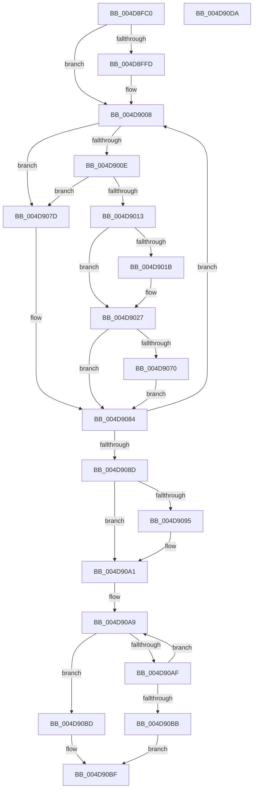

# MiWaitForAsynchronousFlushes

- RVA: `0x004D8FC0`–`0x004D90DB` (길이 `283` bytes)
- VA: `0x00000001404D8FC0`
- 실행 섹션: `.text`
- PDB 이름 있음: `예`; PDB Function 태그: `아니요`
- unwind 정보 RVA: `0x00093E28`
- 디코드: `77`개 명령, `283/283` bytes 표시
- 미해석 바이트: `0` (있으면 어셈블리에 `.byte`로 보존)

> 이 문서는 커널 이미지의 기계어와 PDB 기호를 분석해 생성했습니다. 4번과 5번은 함수 원형과 자료형을 바이너리 사용 방식에서 추정한 C 해석이며 원본 소스 복구 결과는 아닙니다.

## 1. Dependencies

- 직접 호출 지점: **5**; 고유 호출 대상: **3**
- 직접 호출자로 확인된 함수: **1**
- RIP 상대 이미지 참조: **1**

### Outgoing calls
- `0x004D9003` → [KiRaiseIrqlProcessIrqlFlags](../4F/KiRaiseIrqlProcessIrqlFlags_function_004F56FC.md) (function, `0x004F56FC`)
- `0x004D9022` → [KiLowerIrqlProcessIrqlFlags](../4F/KiLowerIrqlProcessIrqlFlags_function_004F5698.md) (function, `0x004F5698`)
- `0x004D9058` → [KeWaitForMultipleObjects](../20/KeWaitForMultipleObjects_function_0020D110.md) (function, `0x0020D110`)
- `0x004D9076` → [KiRaiseIrqlProcessIrqlFlags](../4F/KiRaiseIrqlProcessIrqlFlags_function_004F56FC.md) (function, `0x004F56FC`)
- `0x004D909C` → [KiLowerIrqlProcessIrqlFlags](../4F/KiLowerIrqlProcessIrqlFlags_function_004F5698.md) (function, `0x004F5698`)

### Direct callers
- [MiFlushSection](../40/MiFlushSection_function_004036B0.md) at `0x00404339`

### Static image references
- `0x004D8FF5` → RVA `0x00FC6D20` (`ALMOSTRO`; read)

## 2. Other-region calls and transfers

- 다른 실행 섹션으로 향하는 call: **0**
- 별도 외부 분기/꼬리 이동을 확인하지 못했습니다.

## 3. Assembly (complete function range)

```asm
004D8FC0  48 89 5C 24 08                  mov qword ptr [rsp + 8], rbx
004D8FC5  48 89 6C 24 10                  mov qword ptr [rsp + 0x10], rbp
004D8FCA  48 89 74 24 18                  mov qword ptr [rsp + 0x18], rsi
004D8FCF  57                              push rdi
004D8FD0  41 56                           push r14
004D8FD2  41 57                           push r15
004D8FD4  48 83 EC 40                     sub rsp, 0x40
004D8FD8  48 8B F9                        mov rdi, rcx
004D8FDB  4C 8D B1 40 08 00 00            lea r14, [rcx + 0x840]
004D8FE2  48 8B F1                        mov rsi, rcx
004D8FE5  44 0F 20 C5                     mov rbp, cr8
004D8FE9  41 BF 01 00 00 00               mov r15d, 1
004D8FEF  45 0F 22 C7                     mov cr8, r15
004D8FF3  33 DB                           xor ebx, ebx
004D8FF5  39 1D 25 DD AE 00               cmp dword ptr [rip + 0xaedd25], ebx
004D8FFB  74 0B                           je 0x1404d9008
004D8FFD  41 8A D7                        mov dl, r15b
004D9000  40 8A CD                        mov cl, bpl
004D9003  E8 F4 C6 01 00                  call 0x1404f56fc
004D9008  48 39 5E 10                     cmp qword ptr [rsi + 0x10], rbx
004D900C  74 6F                           je 0x1404d907d
004D900E  39 5E 34                        cmp dword ptr [rsi + 0x34], ebx
004D9011  75 6A                           jne 0x1404d907d
004D9013  39 1D 07 DD AE 00               cmp dword ptr [rip + 0xaedd07], ebx
004D9019  74 0C                           je 0x1404d9027
004D901B  44 0F 20 C1                     mov rcx, cr8
004D901F  40 8A D5                        mov dl, bpl
004D9022  E8 71 C6 01 00                  call 0x1404f5698
004D9027  40 0F B6 C5                     movzx eax, bpl
004D902B  44 0F 22 C0                     mov cr8, rax
004D902F  41 B9 13 00 00 00               mov r9d, 0x13
004D9035  48 8D 87 80 08 00 00            lea rax, [rdi + 0x880]
004D903C  48 89 44 24 38                  mov qword ptr [rsp + 0x38], rax
004D9041  45 8B C7                        mov r8d, r15d
004D9044  48 89 5C 24 30                  mov qword ptr [rsp + 0x30], rbx
004D9049  49 8B D6                        mov rdx, r14
004D904C  88 5C 24 28                     mov byte ptr [rsp + 0x28], bl
004D9050  41 8D 49 F5                     lea ecx, [r9 - 0xb]
004D9054  88 5C 24 20                     mov byte ptr [rsp + 0x20], bl
004D9058  E8 B3 40 D3 FF                  call 0x14020d110
004D905D  48 8B F7                        mov rsi, rdi
004D9060  44 0F 20 C5                     mov rbp, cr8
004D9064  45 0F 22 C7                     mov cr8, r15
004D9068  39 1D B2 DC AE 00               cmp dword ptr [rip + 0xaedcb2], ebx
004D906E  74 14                           je 0x1404d9084
004D9070  41 8A D7                        mov dl, r15b
004D9073  40 8A CD                        mov cl, bpl
004D9076  E8 81 C6 01 00                  call 0x1404f56fc
004D907B  EB 07                           jmp 0x1404d9084
004D907D  48 81 C6 08 01 00 00            add rsi, 0x108
004D9084  49 3B F6                        cmp rsi, r14
004D9087  0F 82 7B FF FF FF               jb 0x1404d9008
004D908D  39 1D 8D DC AE 00               cmp dword ptr [rip + 0xaedc8d], ebx
004D9093  74 0C                           je 0x1404d90a1
004D9095  44 0F 20 C1                     mov rcx, cr8
004D9099  40 8A D5                        mov dl, bpl
004D909C  E8 F7 C5 01 00                  call 0x1404f5698
004D90A1  40 0F B6 C5                     movzx eax, bpl
004D90A5  44 0F 22 C0                     mov cr8, rax
004D90A9  8B 07                           mov eax, dword ptr [rdi]
004D90AB  85 C0                           test eax, eax
004D90AD  78 0E                           js 0x1404d90bd
004D90AF  48 81 C7 08 01 00 00            add rdi, 0x108
004D90B6  49 3B FE                        cmp rdi, r14
004D90B9  72 EE                           jb 0x1404d90a9
004D90BB  EB 02                           jmp 0x1404d90bf
004D90BD  8B D8                           mov ebx, eax
004D90BF  48 8B 6C 24 68                  mov rbp, qword ptr [rsp + 0x68]
004D90C4  8B C3                           mov eax, ebx
004D90C6  48 8B 5C 24 60                  mov rbx, qword ptr [rsp + 0x60]
004D90CB  48 8B 74 24 70                  mov rsi, qword ptr [rsp + 0x70]
004D90D0  48 83 C4 40                     add rsp, 0x40
004D90D4  41 5F                           pop r15
004D90D6  41 5E                           pop r14
004D90D8  5F                              pop rdi
004D90D9  C3                              ret
004D90DA  CC                              int3
```

## 4. C-style interpretation (structured pseudocode)

```c
__int64 __fastcall MiWaitForAsynchronousFlushes(__int64 a1)
{
    __int64 result;
    __int64 v_rbx;
    __int64 v_rdi;
    __int64 v_rsi;
    __int64 v_rsp;
    unsigned __int64 v_stack_m20;
    unsigned __int64 v_stack_m28;
    unsigned __int8 v_stack_m30;
    unsigned __int8 v_stack_m38;
    unsigned __int64 v_stack_p10;
    unsigned __int64 v_stack_p18;
    unsigned __int64 v_stack_p8;

    v_stack_p8 = v_rbx;
    v_stack_p10 = v_rbp;
    v_stack_p18 = v_rsi;
    v_rsp = (v_rsp) - (64);
    v_rbx = 0;
    if ((*(unsigned int *)(v_rip + 11459877)) != 0) {
        a2 = 1;
        a1 = (unsigned __int8)(v_cr8);
        result = KiRaiseIrqlProcessIrqlFlags(a1, a2, a3, a4);
    }
    if ((*(unsigned __int64 *)(a1 + 16)) == 0) goto loc_004D907D;
    if ((*(unsigned int *)(a1 + 52)) != 0) goto loc_004D907D;
    if ((*(unsigned int *)(v_rip + 11459847)) != 0) {
        a1 = 1;
        a2 = (unsigned __int8)(v_cr8);
        result = KiLowerIrqlProcessIrqlFlags(a1, a2, a3, a4);
    }
    v_stack_m20 = a1 + 2176;
    v_stack_m28 = 0;
    v_stack_m30 = 0;
    v_stack_m38 = 0;
    result = KeWaitForMultipleObjects(19 - 11, a1 + 2112, 1, 19);
    if ((*(unsigned int *)(v_rip + 11459762)) == 0) goto loc_004D9084;
    result = KiRaiseIrqlProcessIrqlFlags((unsigned __int8)((unsigned __int8)(v_cr8)), 1, 1, 19);
    goto loc_004D9084;
loc_004D907D:
    v_rsi = (a1) + (264);
loc_004D9084:
    if (v_rsi < (a1 + 2112)) goto loc_004D9008;
    if ((*(unsigned int *)(v_rip + 11459725)) != 0) {
        a1 = 1;
        a2 = (unsigned __int8)((unsigned __int8)(v_cr8));
        result = KiLowerIrqlProcessIrqlFlags(a1, a2, 1, 19);
    }
loc_004D90A9:
    if (sign_flag) goto loc_004D90BD;
    v_rdi = (a1) + (264);
    if (v_rdi < (a1 + 2112)) goto loc_004D90A9;
    goto loc_004D90BF;
loc_004D90BD:
loc_004D90BF:
    v_rsp = (v_rsp) + (64);
    return (unsigned int)((unsigned int)((unsigned int)((unsigned int)((unsigned int)(*(unsigned int *)(a1))))));
}
```

## 5. (Beta) C Style

```c
int64_t MiWaitForAsynchronousFlushes(void *Arg1)
{
    uint8_t *arg1 = (uint8_t *)Arg1;

    int64_t result;
    int64_t local_rbx;
    int64_t local_rdi;
    int64_t local_rsi;
    int64_t local_rsp;
    uint64_t v_stack_m20;
    uint64_t v_stack_m28;
    uint8_t v_stack_m30;
    uint8_t v_stack_m38;
    uint64_t v_stack_p10;
    uint64_t v_stack_p18;
    uint64_t v_stack_p8;

    v_stack_p8 = local_rbx;
    v_stack_p10 = local_rbp;
    v_stack_p18 = local_rsi;
    local_rsp = (local_rsp) - (64);
    local_rbx = 0;
    if ((*(uint32_t *)(v_rip + 0xAEDD25)) != 0) {
        a2 = 1;
        Arg1 = (uint8_t)(v_cr8);
        result = KiRaiseIrqlProcessIrqlFlags(Arg1, a2, a3, a4);
    }
    if ((*(uint64_t *)(arg1 + 0x10)) == 0) goto loc_004D907D;
    if ((*(uint32_t *)(arg1 + 0x34)) != 0) goto loc_004D907D;
    if ((*(uint32_t *)(v_rip + 0xAEDD07)) != 0) {
        Arg1 = 1;
        a2 = (uint8_t)(v_cr8);
        result = KiLowerIrqlProcessIrqlFlags(Arg1, a2, a3, a4);
    }
    v_stack_m20 = Arg1 + 2176;
    v_stack_m28 = 0;
    v_stack_m30 = 0;
    v_stack_m38 = 0;
    result = KeWaitForMultipleObjects(19 - 11, Arg1 + 2112, 1, 19);
    if ((*(uint32_t *)(v_rip + 0xAEDCB2)) == 0) goto loc_004D9084;
    result = KiRaiseIrqlProcessIrqlFlags((uint8_t)((uint8_t)(v_cr8)), 1, 1, 19);
    goto loc_004D9084;
loc_004D907D:
    local_rsi = (Arg1) + (264);
loc_004D9084:
    if (local_rsi < (Arg1 + 2112)) goto loc_004D9008;
    if ((*(uint32_t *)(v_rip + 0xAEDC8D)) != 0) {
        Arg1 = 1;
        a2 = (uint8_t)((uint8_t)(v_cr8));
        result = KiLowerIrqlProcessIrqlFlags(Arg1, a2, 1, 19);
    }
loc_004D90A9:
    if (sign_flag) goto loc_004D90BD;
    local_rdi = (Arg1) + (264);
    if (local_rdi < (Arg1 + 2112)) goto loc_004D90A9;
    goto loc_004D90BF;
loc_004D90BD:
loc_004D90BF:
    local_rsp = (local_rsp) + (64);
    return (uint32_t)((uint32_t)((uint32_t)((uint32_t)((uint32_t)(*(uint32_t *)(arg1))))));
}
```

### 관측된 메모리 오프셋

구조체 형식이 확인되지 않은 접근은 인자 기준의 오프셋으로만 기록했습니다.

| 기준 인자 | 오프셋 표현 | 폭 (bit) | 접근 |
|---|---:|---:|---|
| `Arg1` | `+ 0x840` | `64` | `R` |
| `Arg1` | `+ 0x880` | `64` | `R` |

## 6. Execution-region graph

[열기: 2D/3D 그래프와 함수 탐색 컨트롤 패널](../../../control-panel.html?section=text&rva=0x004D8FC0&view=graph)

- 2D 그래프는 위에서 아래로 흐르고, 3D 그래프는 빈 공간을 드래그해 회전합니다. Shift+드래그는 이동, 휠은 확대·축소, 함수 노드 선택은 대상 보고서 이동입니다.

### Static fallback


