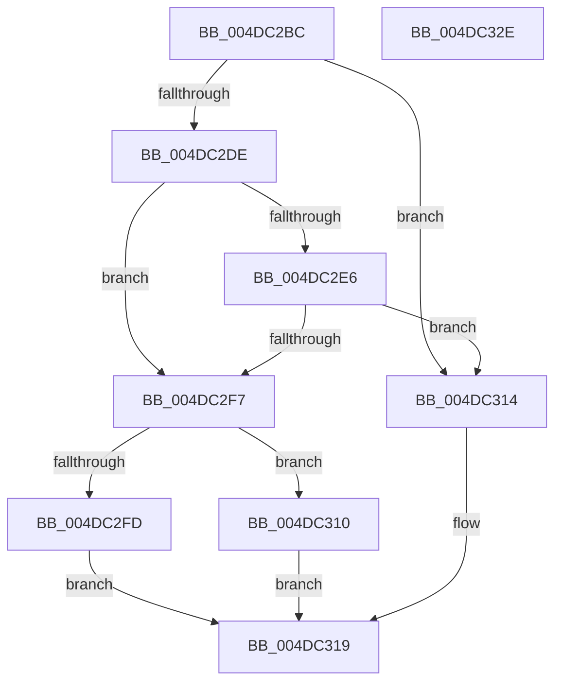

# MiWalkEntireImagePageNeedsProcessing

- RVA: `0x004DC2BC`–`0x004DC32F` (길이 `115` bytes)
- VA: `0x00000001404DC2BC`
- 실행 섹션: `.text`
- PDB 이름 있음: `예`; PDB Function 태그: `아니요`
- unwind 정보 RVA: `0x0005C954`
- 디코드: `37`개 명령, `115/115` bytes 표시
- 미해석 바이트: `0` (있으면 어셈블리에 `.byte`로 보존)

> 이 문서는 커널 이미지의 기계어와 PDB 기호를 분석해 생성했습니다. 4번과 5번은 함수 원형과 자료형을 바이너리 사용 방식에서 추정한 C 해석이며 원본 소스 복구 결과는 아닙니다.

## 1. Dependencies

- 직접 호출 지점: **2**; 고유 호출 대상: **2**
- 직접 호출자로 확인된 함수: **1**
- RIP 상대 이미지 참조: **0**

### Outgoing calls
- `0x004DC2EE` → [MiPageHasRelocations](../../page/93/MiPageHasRelocations_function_0093EEC0.md) (function, `0x0093EEC0`)
- `0x004DC302` → [MiDoesPageRequireImportLinkingFixups](../44/MiDoesPageRequireImportLinkingFixups_function_0044A084.md) (function, `0x0044A084`)

### Direct callers
- [MiWalkEntireImage](../36/MiWalkEntireImage_function_00365D70.md) at `0x00366AB2`

### Static image references
- 디코드된 RIP-relative 메모리 참조가 없습니다.

## 2. Other-region calls and transfers

- 다른 실행 섹션으로 향하는 call: **1**
  - `0x004DC2EE` → [MiPageHasRelocations](../../page/93/MiPageHasRelocations_function_0093EEC0.md) (`.text` → `PAGE`)
- 별도 외부 분기/꼬리 이동을 확인하지 못했습니다.

## 3. Assembly (complete function range)

```asm
004DC2BC  48 89 5C 24 08                  mov qword ptr [rsp + 8], rbx
004DC2C1  48 89 6C 24 10                  mov qword ptr [rsp + 0x10], rbp
004DC2C6  48 89 74 24 18                  mov qword ptr [rsp + 0x18], rsi
004DC2CB  57                              push rdi
004DC2CC  48 83 EC 20                     sub rsp, 0x20
004DC2D0  41 8B F8                        mov edi, r8d
004DC2D3  8B F2                           mov esi, edx
004DC2D5  48 8B E9                        mov rbp, rcx
004DC2D8  41 F6 C0 01                     test r8b, 1
004DC2DC  75 36                           jne 0x1404dc314
004DC2DE  33 DB                           xor ebx, ebx
004DC2E0  40 F6 C7 06                     test dil, 6
004DC2E4  74 11                           je 0x1404dc2f7
004DC2E6  48 8B 49 20                     mov rcx, qword ptr [rcx + 0x20]
004DC2EA  44 8D 43 01                     lea r8d, [rbx + 1]
004DC2EE  E8 CD 2B 46 00                  call 0x14093eec0
004DC2F3  85 C0                           test eax, eax
004DC2F5  75 1D                           jne 0x1404dc314
004DC2F7  40 F6 C7 08                     test dil, 8
004DC2FB  74 13                           je 0x1404dc310
004DC2FD  8B D6                           mov edx, esi
004DC2FF  48 8B CD                        mov rcx, rbp
004DC302  E8 7D DD F6 FF                  call 0x14044a084
004DC307  85 C0                           test eax, eax
004DC309  0F 95 C3                        setne bl
004DC30C  8B C3                           mov eax, ebx
004DC30E  EB 09                           jmp 0x1404dc319
004DC310  33 C0                           xor eax, eax
004DC312  EB 05                           jmp 0x1404dc319
004DC314  B8 01 00 00 00                  mov eax, 1
004DC319  48 8B 5C 24 30                  mov rbx, qword ptr [rsp + 0x30]
004DC31E  48 8B 6C 24 38                  mov rbp, qword ptr [rsp + 0x38]
004DC323  48 8B 74 24 40                  mov rsi, qword ptr [rsp + 0x40]
004DC328  48 83 C4 20                     add rsp, 0x20
004DC32C  5F                              pop rdi
004DC32D  C3                              ret
004DC32E  CC                              int3
```

## 4. C-style interpretation (structured pseudocode)

```c
__int64 __fastcall MiWalkEntireImagePageNeedsProcessing(__int64 a1, int a2, int a3)
{
    __int64 result;
    __int64 v_rbx;
    __int64 v_rsp;
    unsigned __int64 v_stack_p10;
    unsigned __int64 v_stack_p18;
    unsigned __int64 v_stack_p8;

    v_stack_p8 = v_rbx;
    v_stack_p10 = v_rbp;
    v_stack_p18 = v_rsi;
    v_rsp = (v_rsp) - (32);
    if ((((unsigned __int8)(a3)) & (1)) != 0) goto loc_004DC314;
    v_rbx = 0;
    if ((((unsigned __int8)((unsigned int)(a3))) & (6)) == 0) goto loc_004DC2F7;
    result = MiPageHasRelocations(*(unsigned __int64 *)(a1 + 32), a2, v_rbx + 1, a4);
    if ((unsigned int)(result) != 0) goto loc_004DC314;
loc_004DC2F7:
    if ((((unsigned __int8)((unsigned int)(a3))) & (8)) == 0) goto loc_004DC310;
    result = MiDoesPageRequireImportLinkingFixups(a1, (unsigned int)((unsigned int)((unsigned int)(a2))), v_rbx + 1, a4);
    v_rbx = ((unsigned int)(result) != 0) ? 1 : 0;
    goto loc_004DC319;
loc_004DC310:
    result = 0;
    goto loc_004DC319;
loc_004DC314:
loc_004DC319:
    v_rsp = (v_rsp) + (32);
    return 1;
}
```

## 5. (Beta) C Style

```c
int64_t MiWalkEntireImagePageNeedsProcessing(void *Arg1, int32_t Arg2, int32_t Arg3)
{
    uint8_t *arg1 = (uint8_t *)Arg1;

    int64_t result;
    int64_t local_rbx;
    int64_t local_rsp;
    uint64_t v_stack_p10;
    uint64_t v_stack_p18;
    uint64_t v_stack_p8;

    v_stack_p8 = local_rbx;
    v_stack_p10 = local_rbp;
    v_stack_p18 = local_rsi;
    local_rsp = (local_rsp) - (32);
    if ((((uint8_t)(Arg3)) & (1)) != 0) goto loc_004DC314;
    local_rbx = 0;
    if ((((uint8_t)((uint32_t)(Arg3))) & (6)) == 0) goto loc_004DC2F7;
    result = MiPageHasRelocations(*(uint64_t *)(arg1 + 0x20), Arg2, local_rbx + 1, a4);
    if ((uint32_t)(result) != 0) goto loc_004DC314;
loc_004DC2F7:
    if ((((uint8_t)((uint32_t)(Arg3))) & (8)) == 0) goto loc_004DC310;
    result = MiDoesPageRequireImportLinkingFixups(Arg1, (uint32_t)((uint32_t)((uint32_t)(Arg2))), local_rbx + 1, a4);
    local_rbx = ((uint32_t)(result) != 0) ? 1 : 0;
    goto loc_004DC319;
loc_004DC310:
    result = 0;
    goto loc_004DC319;
loc_004DC314:
loc_004DC319:
    local_rsp = (local_rsp) + (32);
    return 1;
}
```

### 관측된 메모리 오프셋

구조체 형식이 확인되지 않은 접근은 인자 기준의 오프셋으로만 기록했습니다.

| 기준 인자 | 오프셋 표현 | 폭 (bit) | 접근 |
|---|---:|---:|---|
| `Arg1` | `+ 0x20` | `64` | `R` |

## 6. Execution-region graph

[열기: 2D/3D 그래프와 함수 탐색 컨트롤 패널](../../../control-panel.html?section=text&rva=0x004DC2BC&view=graph)

- 2D 그래프는 위에서 아래로 흐르고, 3D 그래프는 빈 공간을 드래그해 회전합니다. Shift+드래그는 이동, 휠은 확대·축소, 함수 노드 선택은 대상 보고서 이동입니다.

### Static fallback


