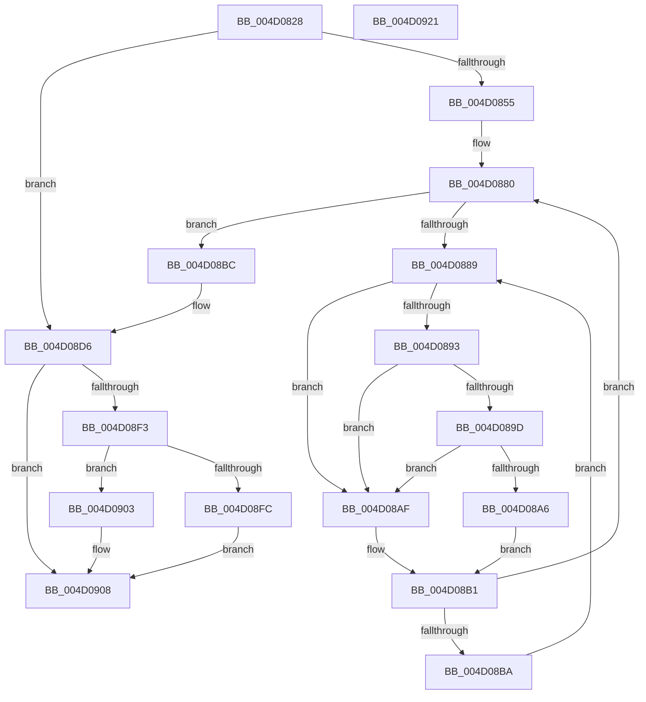

# MiZeroAndFlushGoodCitizen

- RVA: `0x004D0828`–`0x004D0922` (길이 `250` bytes)
- VA: `0x00000001404D0828`
- 실행 섹션: `.text`
- PDB 이름 있음: `예`; PDB Function 태그: `아니요`
- unwind 정보 RVA: `0x00060300`
- 디코드: `69`개 명령, `250/250` bytes 표시
- 미해석 바이트: `0` (있으면 어셈블리에 `.byte`로 보존)

> 이 문서는 커널 이미지의 기계어와 PDB 기호를 분석해 생성했습니다. 4번과 5번은 함수 원형과 자료형을 바이너리 사용 방식에서 추정한 C 해석이며 원본 소스 복구 결과는 아닙니다.

## 1. Dependencies

- 직접 호출 지점: **7**; 고유 호출 대상: **7**
- 직접 호출자로 확인된 함수: **1**
- RIP 상대 이미지 참조: **2**

### Outgoing calls
- `0x004D089D` → [KiCheckVpBackingLongSpinWaitHypercall](../30/KiCheckVpBackingLongSpinWaitHypercall_function_0030F490.md) (function, `0x0030F490`)
- `0x004D08A8` → [HvlNotifyLongSpinWait](../30/HvlNotifyLongSpinWait_function_0030F460.md) (function, `0x0030F460`)
- `0x004D08C2` → [MiReduceShareCount](../37/MiReduceShareCount_function_00370E90.md) (function, `0x00370E90`)
- `0x004D08DC` → [MiUnlockPageTable](../21/MiUnlockPageTable_function_00216EC0.md) (function, `0x00216EC0`)
- `0x004D08E7` → [MiUnlockWorkingSetShared](../27/MiUnlockWorkingSetShared_function_0027D690.md) (function, `0x0027D690`)
- `0x004D08FC` → [MiLockWorkingSetSharedAtDpc](../23/MiLockWorkingSetSharedAtDpc_function_00239574.md) (function, `0x00239574`)
- `0x004D0903` → [MiLockWorkingSetShared](../27/MiLockWorkingSetShared_function_0027CBF0.md) (function, `0x0027CBF0`)

### Direct callers
- [MiClearMappingAndDereferenceIoSpace](../24/MiClearMappingAndDereferenceIoSpace_function_00247DF0.md) at `0x00248130`
- [MiClearMappingAndDereferenceIoSpace](../24/MiClearMappingAndDereferenceIoSpace_function_00247DF0.md) at `0x002481A9`
- [MiClearMappingAndDereferenceIoSpace](../24/MiClearMappingAndDereferenceIoSpace_function_00247DF0.md) at `0x00248265`

### Static image references
- `0x004D088B` → RVA `0x00FC52AC` (`ALMOSTRO`; reference)
- `0x004D0893` → RVA `0x00FC6AB8` (`ALMOSTRO`; read)

## 2. Other-region calls and transfers

- 다른 실행 섹션으로 향하는 call: **0**
- 별도 외부 분기/꼬리 이동을 확인하지 못했습니다.

## 3. Assembly (complete function range)

```asm
004D0828  48 89 5C 24 08                  mov qword ptr [rsp + 8], rbx
004D082D  48 89 6C 24 10                  mov qword ptr [rsp + 0x10], rbp
004D0832  48 89 74 24 18                  mov qword ptr [rsp + 0x18], rsi
004D0837  57                              push rdi
004D0838  41 56                           push r14
004D083A  41 57                           push r15
004D083C  48 83 EC 20                     sub rsp, 0x20
004D0840  45 8B F1                        mov r14d, r9d
004D0843  41 8A E8                        mov bpl, r8b
004D0846  4C 8B FA                        mov r15, rdx
004D0849  48 8B F9                        mov rdi, rcx
004D084C  45 85 C9                        test r9d, r9d
004D084F  0F 84 81 00 00 00               je 0x1404d08d6
004D0855  48 8B 02                        mov rax, qword ptr [rdx]
004D0858  48 B9 FF FF FF FF FF 00 00 00   movabs rcx, 0xffffffffff
004D0862  48 C1 E8 0C                     shr rax, 0xc
004D0866  48 23 C1                        and rax, rcx
004D0869  48 8D 1C 40                     lea rbx, [rax + rax*2]
004D086D  48 C1 E3 04                     shl rbx, 4
004D0871  48 B8 00 00 00 00 00 DE FF FF   movabs rax, 0xffffde0000000000
004D087B  48 03 D8                        add rbx, rax
004D087E  33 F6                           xor esi, esi
004D0880  F0 48 0F BA 6B 18 3F            lock bts qword ptr [rbx + 0x18], 0x3f
004D0887  73 33                           jae 0x1404d08bc
004D0889  FF C6                           inc esi
004D088B  85 35 1B 4A AF 00               test dword ptr [rip + 0xaf4a1b], esi
004D0891  75 1C                           jne 0x1404d08af
004D0893  8B 05 1F 62 AF 00               mov eax, dword ptr [rip + 0xaf621f]
004D0899  A8 40                           test al, 0x40
004D089B  74 12                           je 0x1404d08af
004D089D  E8 EE EB E3 FF                  call 0x14030f490
004D08A2  84 C0                           test al, al
004D08A4  74 09                           je 0x1404d08af
004D08A6  8B CE                           mov ecx, esi
004D08A8  E8 B3 EB E3 FF                  call 0x14030f460
004D08AD  EB 02                           jmp 0x1404d08b1
004D08AF  F3 90                           pause
004D08B1  48 8B 43 18                     mov rax, qword ptr [rbx + 0x18]
004D08B5  48 85 C0                        test rax, rax
004D08B8  79 C6                           jns 0x1404d0880
004D08BA  EB CD                           jmp 0x1404d0889
004D08BC  49 8B D6                        mov rdx, r14
004D08BF  48 8B CB                        mov rcx, rbx
004D08C2  E8 C9 05 EA FF                  call 0x140370e90
004D08C7  48 B8 FF FF FF FF FF FF FF 7F   movabs rax, 0x7fffffffffffffff
004D08D1  F0 48 21 43 18                  lock and qword ptr [rbx + 0x18], rax
004D08D6  49 8B D7                        mov rdx, r15
004D08D9  48 8B CF                        mov rcx, rdi
004D08DC  E8 DF 65 D4 FF                  call 0x140216ec0
004D08E1  40 8A D5                        mov dl, bpl
004D08E4  48 8B CF                        mov rcx, rdi
004D08E7  E8 A4 CD DA FF                  call 0x14027d690
004D08EC  83 7C 24 60 00                  cmp dword ptr [rsp + 0x60], 0
004D08F1  74 15                           je 0x1404d0908
004D08F3  48 8B CF                        mov rcx, rdi
004D08F6  40 80 FD 11                     cmp bpl, 0x11
004D08FA  75 07                           jne 0x1404d0903
004D08FC  E8 73 8C D6 FF                  call 0x140239574
004D0901  EB 05                           jmp 0x1404d0908
004D0903  E8 E8 C2 DA FF                  call 0x14027cbf0
004D0908  48 8B 5C 24 40                  mov rbx, qword ptr [rsp + 0x40]
004D090D  48 8B 6C 24 48                  mov rbp, qword ptr [rsp + 0x48]
004D0912  48 8B 74 24 50                  mov rsi, qword ptr [rsp + 0x50]
004D0917  48 83 C4 20                     add rsp, 0x20
004D091B  41 5F                           pop r15
004D091D  41 5E                           pop r14
004D091F  5F                              pop rdi
004D0920  C3                              ret
004D0921  CC                              int3
```

## 4. C-style interpretation (structured pseudocode)

```c
__int64 __fastcall MiZeroAndFlushGoodCitizen(__int64 a1, __int64 a2, unsigned __int8 a3, int a4, unsigned int a5)
{
    __int64 result;
    __int64 v_rbx;
    __int64 v_rsi;
    __int64 v_rsp;
    unsigned __int64 v_stack_p10;
    unsigned __int64 v_stack_p18;
    unsigned __int64 v_stack_p8;

    v_stack_p8 = v_rbx;
    v_stack_p10 = v_rbp;
    v_stack_p18 = v_rsi;
    v_rsp = (v_rsp) - (32);
    if (a4 == 0) goto loc_004D08D6;
    result = (*(unsigned __int64 *)(a2)) >> (12);
    result = (result) & (a1);
    v_rbx = (result + result * 2) << (4);
    v_rbx = (v_rbx) + (result);
    v_rsi = 0;
loc_004D0880:
    if (condition_is_above_or_equal) goto loc_004D08BC;
loc_004D0889:
    v_rsi = (unsigned int)((v_rsi) + 1);
    if (((*(unsigned int *)(v_rip + 11487771)) & ((unsigned int)(v_rsi))) != 0) goto loc_004D08AF;
    if ((((unsigned __int8)((unsigned int)(*(unsigned int *)(v_rip + 11493919)))) & (64)) == 0) goto loc_004D08AF;
    result = KiCheckVpBackingLongSpinWaitHypercall(a1, a2, a3, a4);
    if ((unsigned __int8)(result) == 0) goto loc_004D08AF;
    result = HvlNotifyLongSpinWait((unsigned int)((unsigned int)(v_rsi)), a2, a3, a4);
    goto loc_004D08B1;
loc_004D08AF:
loc_004D08B1:
    if (!sign_flag) goto loc_004D0880;
    goto loc_004D0889;
loc_004D08BC:
    result = MiReduceShareCount(v_rbx, (unsigned int)(a4), a3, a4);
loc_004D08D6:
    result = MiUnlockPageTable(a1, a2, a3, a4);
    result = MiUnlockWorkingSetShared(a1, a3, a3, a4);
    if (a5 == 0) goto loc_004D0908;
    if (a3 != 17) goto loc_004D0903;
    result = MiLockWorkingSetSharedAtDpc(a1, a3, a3, a4);
    goto loc_004D0908;
loc_004D0903:
    result = MiLockWorkingSetShared(a1, a3, a3, a4);
loc_004D0908:
    v_rsp = (v_rsp) + (32);
    return result;
}
```

## 5. (Beta) C Style

```c
int64_t MiZeroAndFlushGoodCitizen(int64_t Arg1, void *Arg2, uint8_t Arg3, int32_t Arg4, uint32_t Arg5)
{
    uint8_t *arg2 = (uint8_t *)Arg2;

    int64_t result;
    int64_t local_rbx;
    int64_t local_rsi;
    int64_t local_rsp;
    uint64_t v_stack_p10;
    uint64_t v_stack_p18;
    uint64_t v_stack_p8;

    v_stack_p8 = local_rbx;
    v_stack_p10 = local_rbp;
    v_stack_p18 = local_rsi;
    local_rsp = (local_rsp) - (32);
    if (Arg4 == 0) goto loc_004D08D6;
    result = (*(uint64_t *)(arg2)) >> (12);
    result = (result) & (Arg1);
    local_rbx = (result + result * 2) << (4);
    local_rbx = (local_rbx) + (result);
    local_rsi = 0;
loc_004D0880:
    if (condition_is_above_or_equal) goto loc_004D08BC;
loc_004D0889:
    local_rsi = (uint32_t)((local_rsi) + 1);
    if (((*(uint32_t *)(v_rip + 0xAF4A1B)) & ((uint32_t)(local_rsi))) != 0) goto loc_004D08AF;
    if ((((uint8_t)((uint32_t)(*(uint32_t *)(v_rip + 0xAF621F)))) & (64)) == 0) goto loc_004D08AF;
    result = KiCheckVpBackingLongSpinWaitHypercall(Arg1, Arg2, Arg3, Arg4);
    if ((uint8_t)(result) == 0) goto loc_004D08AF;
    result = HvlNotifyLongSpinWait((uint32_t)((uint32_t)(local_rsi)), Arg2, Arg3, Arg4);
    goto loc_004D08B1;
loc_004D08AF:
loc_004D08B1:
    if (!sign_flag) goto loc_004D0880;
    goto loc_004D0889;
loc_004D08BC:
    result = MiReduceShareCount(local_rbx, (uint32_t)(Arg4), Arg3, Arg4);
loc_004D08D6:
    result = MiUnlockPageTable(Arg1, Arg2, Arg3, Arg4);
    result = MiUnlockWorkingSetShared(Arg1, Arg3, Arg3, Arg4);
    if (Arg5 == 0) goto loc_004D0908;
    if (Arg3 != 17) goto loc_004D0903;
    result = MiLockWorkingSetSharedAtDpc(Arg1, Arg3, Arg3, Arg4);
    goto loc_004D0908;
loc_004D0903:
    result = MiLockWorkingSetShared(Arg1, Arg3, Arg3, Arg4);
loc_004D0908:
    local_rsp = (local_rsp) + (32);
    return result;
}
```

### 관측된 메모리 오프셋

구조체 형식이 확인되지 않은 접근은 인자 기준의 오프셋으로만 기록했습니다.

| 기준 인자 | 오프셋 표현 | 폭 (bit) | 접근 |
|---|---:|---:|---|
| `Arg2` | `+ 0x0` | `64` | `R` |

## 6. Execution-region graph

[열기: 2D/3D 그래프와 함수 탐색 컨트롤 패널](../../../control-panel.html?section=text&rva=0x004D0828&view=graph)

- 2D 그래프는 위에서 아래로 흐르고, 3D 그래프는 빈 공간을 드래그해 회전합니다. Shift+드래그는 이동, 휠은 확대·축소, 함수 노드 선택은 대상 보고서 이동입니다.

### Static fallback


