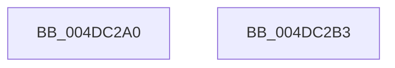

# MmAcquireLoadLock

- RVA: `0x004DC2A0`–`0x004DC2B4` (길이 `20` bytes)
- VA: `0x00000001404DC2A0`
- 실행 섹션: `.text`
- PDB 이름 있음: `예`; PDB Function 태그: `아니요`
- unwind 정보 RVA: `0x0005C788`
- 디코드: `6`개 명령, `20/20` bytes 표시
- 미해석 바이트: `0` (있으면 어셈블리에 `.byte`로 보존)

> 이 문서는 커널 이미지의 기계어와 PDB 기호를 분석해 생성했습니다. 4번과 5번은 함수 원형과 자료형을 바이너리 사용 방식에서 추정한 C 해석이며 원본 소스 복구 결과는 아닙니다.

## 1. Dependencies

- 직접 호출 지점: **1**; 고유 호출 대상: **1**
- 직접 호출자로 확인된 함수: **15**
- RIP 상대 이미지 참조: **0**

### Outgoing calls
- `0x004DC2A9` → [MiAcquireLoadLock](../2A/MiAcquireLoadLock_function_002A3950.md) (function, `0x002A3950`)

### Direct callers
- [MiFlushDeferredRetpolineImageLoadEvents](../../page/80/MiFlushDeferredRetpolineImageLoadEvents_function_00801540.md) at `0x0080154F`
- [MiLogHotPatchRundown](../../page/80/MiLogHotPatchRundown_function_008057A4.md) at `0x00805B54`
- [MmInsertSecureImageActivePatch](../../page/80/MmInsertSecureImageActivePatch_function_008073E4.md) at `0x0080747F`
- [MmRemoveSecureImageActivePatch](../../page/80/MmRemoveSecureImageActivePatch_function_0080760C.md) at `0x00807639`
- [MmLoadSystemImageEx](../../page/99/MmLoadSystemImageEx_function_00999B8C.md) at `0x00999C77`
- [MiObtainSectionForDriver](../../page/A2/MiObtainSectionForDriver_function_00A24494.md) at `0x00A246B9`
- [MiObtainSectionForDriver](../../page/A2/MiObtainSectionForDriver_function_00A24494.md) at `0x00A24726`
- [MiObtainSectionForDriver](../../page/A2/MiObtainSectionForDriver_function_00A24494.md) at `0x00A24758`
- [MiMarkRetpolineBits](../../page/AA/MiMarkRetpolineBits_function_00AA0394.md) at `0x00AA03D3`
- [MiLoadHotPatch](../../page/AB/MiLoadHotPatch_function_00AB521C.md) at `0x00AB5357`
- [MiLoadHotPatch](../../page/AB/MiLoadHotPatch_function_00AB521C.md) at `0x00AB54B4`
- [MiLogStrongCodeDriverLoadFailure](../../page/AC/MiLogStrongCodeDriverLoadFailure_function_00AC2E6C.md) at `0x00AC2FF4`
- [MiQueryProcessActivePatches](../../page/AC/MiQueryProcessActivePatches_function_00AC6164.md) at `0x00AC6202`
- [MiShutdownSystem](../../pagelk/B7/MiShutdownSystem_function_00B73934.md) at `0x00B73A5F`
- [VfDriverEnableDisableVerifier](../../pagevrfy/B9/VfDriverEnableDisableVerifier_function_00B9A1B0.md) at `0x00B9A1D4`
- [VfDriverEnableVerifierForAll](../../pagevrfy/B9/VfDriverEnableVerifierForAll_function_00B9A3A4.md) at `0x00B9A3C2`
- [ViDriverReApplyVerifierForAll](../../pagevrfy/B9/ViDriverReApplyVerifierForAll_function_00B9A8D4.md) at `0x00B9A8F7`
- [VfAddVerifierEntry](../../pagevrfy/BA/VfAddVerifierEntry_function_00BAC31C.md) at `0x00BAC3DB`
- [VfAddVerifierEntry](../../pagevrfy/BA/VfAddVerifierEntry_function_00BAC31C.md) at `0x00BAC410`

### Static image references
- 디코드된 RIP-relative 메모리 참조가 없습니다.

## 2. Other-region calls and transfers

- 다른 실행 섹션으로 향하는 call: **0**
- 별도 외부 분기/꼬리 이동을 확인하지 못했습니다.

## 3. Assembly (complete function range)

```asm
004DC2A0  48 83 EC 28                     sub rsp, 0x28
004DC2A4  B9 01 00 00 00                  mov ecx, 1
004DC2A9  E8 A2 76 DC FF                  call 0x1402a3950
004DC2AE  48 83 C4 28                     add rsp, 0x28
004DC2B2  C3                              ret
004DC2B3  CC                              int3
```

## 4. C-style interpretation (structured pseudocode)

```c
__int64 __fastcall MmAcquireLoadLock(void)
{
    __int64 result;
    __int64 v_rsp;

    v_rsp = (v_rsp) - (40);
    result = MiAcquireLoadLock(1, a2, a3, a4);
    v_rsp = (v_rsp) + (40);
    return result;
}
```

## 5. (Beta) C Style

```c
void MmAcquireLoadLock(void)
{
    int64_t result;
    int64_t local_rsp;

    local_rsp = (local_rsp) - (40);
    result = MiAcquireLoadLock(1, a2, a3, a4);
    local_rsp = (local_rsp) + (40);
    return result;
}
```

## 6. Execution-region graph

[열기: 2D/3D 그래프와 함수 탐색 컨트롤 패널](../../../control-panel.html?section=text&rva=0x004DC2A0&view=graph)

- 2D 그래프는 위에서 아래로 흐르고, 3D 그래프는 빈 공간을 드래그해 회전합니다. Shift+드래그는 이동, 휠은 확대·축소, 함수 노드 선택은 대상 보고서 이동입니다.

### Static fallback


