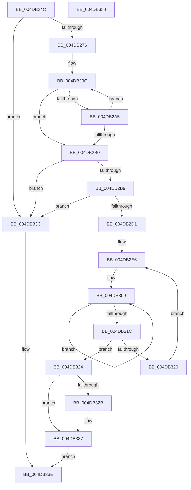

# MmGetNodeFastLargePageCounts

- RVA: `0x004DB24C`–`0x004DB355` (길이 `265` bytes)
- VA: `0x00000001404DB24C`
- 실행 섹션: `.text`
- PDB 이름 있음: `예`; PDB Function 태그: `아니요`
- unwind 정보 RVA: `0x0008CED4`
- 디코드: `69`개 명령, `265/265` bytes 표시
- 미해석 바이트: `0` (있으면 어셈블리에 `.byte`로 보존)

> 이 문서는 커널 이미지의 기계어와 PDB 기호를 분석해 생성했습니다. 4번과 5번은 함수 원형과 자료형을 바이너리 사용 방식에서 추정한 C 해석이며 원본 소스 복구 결과는 아닙니다.

## 1. Dependencies

- 직접 호출 지점: **2**; 고유 호출 대상: **2**
- 직접 호출자로 확인된 함수: **1**
- RIP 상대 이미지 참조: **3**

### Outgoing calls
- `0x004DB2C4` → [MiPartitionObjectToPartition](../3E/MiPartitionObjectToPartition_function_003EAB0C.md) (function, `0x003EAB0C`)
- `0x004DB332` → [PsDereferencePartition](../34/PsDereferencePartition_function_00342E70.md) (function, `0x00342E70`)

### Direct callers
- [VmpAccessFaultBatchResolve](../../page/9F/VmpAccessFaultBatchResolve_function_009FF710.md) at `0x009FF95D`

### Static image references
- `0x004DB265` → RVA `0x00FC5000` (`ALMOSTRO`; read)
- `0x004DB276` → RVA `0x00FC6B30` (`ALMOSTRO`; read)
- `0x004DB27F` → RVA `0x00000000` (`image boundary/outside`; read)

## 2. Other-region calls and transfers

- 다른 실행 섹션으로 향하는 call: **0**
- 별도 외부 분기/꼬리 이동을 확인하지 못했습니다.

## 3. Assembly (complete function range)

```asm
004DB24C  48 8B C4                        mov rax, rsp
004DB24F  48 89 58 08                     mov qword ptr [rax + 8], rbx
004DB253  48 89 70 18                     mov qword ptr [rax + 0x18], rsi
004DB257  48 89 78 20                     mov qword ptr [rax + 0x20], rdi
004DB25B  41 56                           push r14
004DB25D  48 83 EC 20                     sub rsp, 0x20
004DB261  C6 40 10 00                     mov byte ptr [rax + 0x10], 0
004DB265  0F B7 05 94 9D AE 00            movzx eax, word ptr [rip + 0xae9d94]
004DB26C  8B FA                           mov edi, edx
004DB26E  3B D0                           cmp edx, eax
004DB270  0F 83 C6 00 00 00               jae 0x1404db33c
004DB276  48 0F BA 25 B1 B8 AE 00 25      bt qword ptr [rip + 0xaeb8b1], 0x25
004DB27F  4C 8D 35 7A 4D B2 FF            lea r14, [rip - 0x4db286]
004DB286  BB 00 00 00 00                  mov ebx, 0
004DB28B  49 8D 8E 60 1C 01 00            lea rcx, [r14 + 0x11c60]
004DB292  8D 73 01                        lea esi, [rbx + 1]
004DB295  0F 43 DE                        cmovae ebx, esi
004DB298  48 8D 0C D9                     lea rcx, [rcx + rbx*8]
004DB29C  48 81 39 00 02 00 00            cmp qword ptr [rcx], 0x200
004DB2A3  74 0B                           je 0x1404db2b0
004DB2A5  03 DE                           add ebx, esi
004DB2A7  48 83 C1 08                     add rcx, 8
004DB2AB  83 FB 03                        cmp ebx, 3
004DB2AE  72 EC                           jb 0x1404db29c
004DB2B0  83 FB 03                        cmp ebx, 3
004DB2B3  0F 84 83 00 00 00               je 0x1404db33c
004DB2B9  4C 8D 44 24 38                  lea r8, [rsp + 0x38]
004DB2BE  33 D2                           xor edx, edx
004DB2C0  48 83 C9 FF                     or rcx, 0xffffffffffffffff
004DB2C4  E8 43 F8 F0 FF                  call 0x1403eab0c
004DB2C9  48 8B D0                        mov rdx, rax
004DB2CC  48 85 C0                        test rax, rax
004DB2CF  74 6B                           je 0x1404db33c
004DB2D1  45 8B 9C 9E E8 35 01 00         mov r11d, dword ptr [r14 + rbx*4 + 0x135e8]
004DB2D9  4C 69 C7 80 DF 00 00            imul r8, rdi, 0xdf80
004DB2E0  4C 03 40 10                     add r8, qword ptr [rax + 0x10]
004DB2E4  33 FF                           xor edi, edi
004DB2E6  4D 8B 94 DE 60 1C 01 00         mov r10, qword ptr [r14 + rbx*8 + 0x11c60]
004DB2EE  41 8B CB                        mov ecx, r11d
004DB2F1  49 D3 EA                        shr r10, cl
004DB2F4  41 B9 02 00 00 00               mov r9d, 2
004DB2FA  48 8D 0C 9B                     lea rcx, [rbx + rbx*4]
004DB2FE  48 C1 E1 08                     shl rcx, 8
004DB302  48 83 C1 08                     add rcx, 8
004DB306  49 03 C8                        add rcx, r8
004DB309  48 8B 01                        mov rax, qword ptr [rcx]
004DB30C  48 8D 49 08                     lea rcx, [rcx + 8]
004DB310  49 0F AF C2                     imul rax, r10
004DB314  48 03 F8                        add rdi, rax
004DB317  4C 2B CE                        sub r9, rsi
004DB31A  75 ED                           jne 0x1404db309
004DB31C  85 DB                           test ebx, ebx
004DB31E  74 04                           je 0x1404db324
004DB320  FF CB                           dec ebx
004DB322  EB C2                           jmp 0x1404db2e6
004DB324  80 7C 24 38 00                  cmp byte ptr [rsp + 0x38], 0
004DB329  74 0C                           je 0x1404db337
004DB32B  48 8B 8A B8 00 00 00            mov rcx, qword ptr [rdx + 0xb8]
004DB332  E8 39 7B E6 FF                  call 0x140342e70
004DB337  48 8B C7                        mov rax, rdi
004DB33A  EB 02                           jmp 0x1404db33e
004DB33C  33 C0                           xor eax, eax
004DB33E  48 8B 5C 24 30                  mov rbx, qword ptr [rsp + 0x30]
004DB343  48 8B 74 24 40                  mov rsi, qword ptr [rsp + 0x40]
004DB348  48 8B 7C 24 48                  mov rdi, qword ptr [rsp + 0x48]
004DB34D  48 83 C4 20                     add rsp, 0x20
004DB351  41 5E                           pop r14
004DB353  C3                              ret
004DB354  CC                              int3
```

## 4. C-style interpretation (structured pseudocode)

```c
__int64 __fastcall MmGetNodeFastLargePageCounts(__int64 a1, int a2)
{
    __int64 result;
    __int64 v_r10;
    __int64 v_rbx;
    __int64 v_rdi;
    __int64 v_rsp;
    unsigned __int64 v_stack_p10;
    unsigned __int64 v_stack_p18;
    unsigned __int64 v_stack_p20;
    unsigned __int64 v_stack_p8;

    *(unsigned __int64 *)(v_rsp + 8) = v_rbx;
    *(unsigned __int64 *)(v_rsp + 24) = v_rsi;
    *(unsigned __int64 *)(v_rsp + 32) = v_rdi;
    v_rsp = (v_rsp) - (32);
    *(unsigned __int8 *)(v_rsp + 16) = 0;
    if (a2 >= ((unsigned int)(*(unsigned __int16 *)(v_rip + 11443604)))) goto loc_004DB33C;
    v_rbx = 0;
    if (a2 >= ((unsigned int)(*(unsigned __int16 *)(v_rip + 11443604)))) { v_rbx = (unsigned int)(0 + 1); }
loc_004DB29C:
    if ((*(unsigned __int64 *)(v_rip - 5091974 + 72800 + v_rbx * 8)) == 512) goto loc_004DB2B0;
    v_rbx = (unsigned int)((v_rbx) + ((unsigned int)(0 + 1)));
    a1 = (v_rip - 5091974 + 72800 + v_rbx * 8) + (8);
    if (((unsigned int)(v_rbx)) < 3) goto loc_004DB29C;
loc_004DB2B0:
    if (((unsigned int)(v_rbx)) == 3) goto loc_004DB33C;
    a2 = 0;
    a1 = (a1) | (-1);
    result = MiPartitionObjectToPartition(a1, a2, v_stack_p10, a4);
    if (result == 0) goto loc_004DB33C;
    a3 = (v_stack_p10) * ((unsigned int)(a2));
    a3 = (a3) + (*(unsigned __int64 *)(result + 16));
    v_rdi = 0;
loc_004DB2E6:
    v_r10 = (*(unsigned __int64 *)(v_rip - 5091974 + v_rbx * 8 + 72800)) >> ((unsigned __int8)((unsigned int)((unsigned int)((unsigned int)(*(unsigned int *)(v_rip - 5091974 + v_rbx * 4 + 79336))))));
    a1 = (v_rbx + v_rbx * 4) << (8);
    a1 = (a1) + (8);
    a1 = (a1) + (a3);
loc_004DB309:
    result = (*(unsigned __int64 *)(a1)) * (v_r10);
    v_rdi = (v_rdi) + (result);
    a4 = (2) - (0 + 1);
    if (condition_is_not_equal) goto loc_004DB309;
    if ((unsigned int)(v_rbx) == 0) goto loc_004DB324;
    v_rbx = (unsigned int)((v_rbx) - 1);
    goto loc_004DB2E6;
loc_004DB324:
    if (v_stack_p10 != 0) {
        a1 = *(unsigned __int64 *)(result + 184);
        result = PsDereferencePartition(a1, result, a3, a4);
    }
    goto loc_004DB33E;
loc_004DB33C:
    result = 0;
loc_004DB33E:
    v_rsp = (v_rsp) + (32);
    return result;
}
```

## 5. (Beta) C Style

```c
int64_t MmGetNodeFastLargePageCounts(int64_t Arg1, int32_t Arg2)
{
    int64_t result;
    int64_t local_r10;
    int64_t local_rbx;
    int64_t local_rdi;
    int64_t local_rsp;
    uint64_t v_stack_p10;
    uint64_t v_stack_p18;
    uint64_t v_stack_p20;
    uint64_t v_stack_p8;

    *(uint64_t *)(local_rsp + 0x8) = local_rbx;
    *(uint64_t *)(local_rsp + 0x18) = local_rsi;
    *(uint64_t *)(local_rsp + 0x20) = local_rdi;
    local_rsp = (local_rsp) - (32);
    *(uint8_t *)(local_rsp + 0x10) = 0;
    if (Arg2 >= ((uint32_t)(*(uint16_t *)(v_rip + 0xAE9D94)))) goto loc_004DB33C;
    local_rbx = 0;
    if (Arg2 >= ((uint32_t)(*(uint16_t *)(v_rip + 0xAE9D94)))) { local_rbx = (uint32_t)(0 + 1); }
loc_004DB29C:
    if ((*(uint64_t *)(v_rip - 0x4DB286 + 0x11C60 + local_rbx * 8)) == 512) goto loc_004DB2B0;
    local_rbx = (uint32_t)((local_rbx) + ((uint32_t)(0 + 1)));
    Arg1 = (v_rip - 5091974 + 72800 + local_rbx * 8) + (8);
    if (((uint32_t)(local_rbx)) < 3) goto loc_004DB29C;
loc_004DB2B0:
    if (((uint32_t)(local_rbx)) == 3) goto loc_004DB33C;
    Arg2 = 0;
    Arg1 = (Arg1) | (-1);
    result = MiPartitionObjectToPartition(Arg1, Arg2, v_stack_p10, a4);
    if (result == 0) goto loc_004DB33C;
    a3 = (v_stack_p10) * ((uint32_t)(Arg2));
    a3 = (a3) + (*(uint64_t *)(result + 0x10));
    local_rdi = 0;
loc_004DB2E6:
    local_r10 = (*(uint64_t *)(v_rip - 0x4DB286 + local_rbx * 8 + 0x11C60)) >> ((uint8_t)((uint32_t)((uint32_t)((uint32_t)(*(uint32_t *)(v_rip - 0x4DB286 + local_rbx * 4 + 0x135E8))))));
    Arg1 = (local_rbx + local_rbx * 4) << (8);
    Arg1 = (Arg1) + (8);
    Arg1 = (Arg1) + (a3);
loc_004DB309:
    result = (*(uint64_t *)(Arg1)) * (local_r10);
    local_rdi = (local_rdi) + (result);
    a4 = (2) - (0 + 1);
    if (condition_is_not_equal) goto loc_004DB309;
    if ((uint32_t)(local_rbx) == 0) goto loc_004DB324;
    local_rbx = (uint32_t)((local_rbx) - 1);
    goto loc_004DB2E6;
loc_004DB324:
    if (v_stack_p10 != 0) {
        Arg1 = *(uint64_t *)(result + 0xB8);
        result = PsDereferencePartition(Arg1, result, a3, a4);
    }
    goto loc_004DB33E;
loc_004DB33C:
    result = 0;
loc_004DB33E:
    local_rsp = (local_rsp) + (32);
    return result;
}
```

## 6. Execution-region graph

[열기: 2D/3D 그래프와 함수 탐색 컨트롤 패널](../../../control-panel.html?section=text&rva=0x004DB24C&view=graph)

- 2D 그래프는 위에서 아래로 흐르고, 3D 그래프는 빈 공간을 드래그해 회전합니다. Shift+드래그는 이동, 휠은 확대·축소, 함수 노드 선택은 대상 보고서 이동입니다.

### Static fallback


