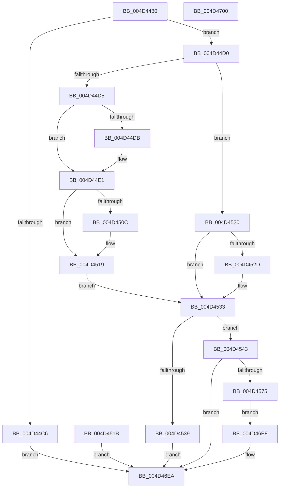

# NtQueryInformationWorkerFactory

- RVA: `0x004D4480`–`0x004D4701` (길이 `641` bytes)
- VA: `0x00000001404D4480`
- 실행 섹션: `.text`
- PDB 이름 있음: `예`; PDB Function 태그: `아니요`
- unwind 정보 RVA: `0x000BE0DC`
- 디코드: `141`개 명령, `641/641` bytes 표시
- 미해석 바이트: `0` (있으면 어셈블리에 `.byte`로 보존)

> 이 문서는 커널 이미지의 기계어와 PDB 기호를 분석해 생성했습니다. 4번과 5번은 함수 원형과 자료형을 바이너리 사용 방식에서 추정한 C 해석이며 원본 소스 복구 결과는 아닙니다.

## 1. Dependencies

- 직접 호출 지점: **5**; 고유 호출 대상: **5**
- 직접 호출자로 확인된 함수: **0**
- RIP 상대 이미지 참조: **1**

### Outgoing calls
- `0x004D44DB` → [ExRaiseDatatypeMisalignment](../../page/89/ExRaiseDatatypeMisalignment_function_00899FD0.md) (function, `0x00899FD0`)
- `0x004D4568` → [ObReferenceObjectByHandle](../../page/86/ObReferenceObjectByHandle_function_00868DB0.md) (function, `0x00868DB0`)
- `0x004D4597` → [KeAcquireInStackQueuedSpinLock](../27/KeAcquireInStackQueuedSpinLock_function_002757A0.md) (function, `0x002757A0`)
- `0x004D4683` → [KeReleaseInStackQueuedSpinLock](../34/KeReleaseInStackQueuedSpinLock_function_00342CE0.md) (function, `0x00342CE0`)
- `0x004D4690` → [ObfDereferenceObjectWithTag](../2F/ObfDereferenceObjectWithTag_function_002F78E0.md) (function, `0x002F78E0`)

### Direct callers
- 이 함수 시작 RVA로 연결되는 직접 call은 확인되지 않았습니다. 간접 호출은 완전히 역산할 수 없습니다.

### Static image references
- `0x004D4543` → RVA `0x00FC51E0` (`ALMOSTRO`; read)

## 2. Other-region calls and transfers

- 다른 실행 섹션으로 향하는 call: **2**
  - `0x004D44DB` → [ExRaiseDatatypeMisalignment](../../page/89/ExRaiseDatatypeMisalignment_function_00899FD0.md) (`.text` → `PAGE`)
  - `0x004D4568` → [ObReferenceObjectByHandle](../../page/86/ObReferenceObjectByHandle_function_00868DB0.md) (`.text` → `PAGE`)
- 별도 외부 분기/꼬리 이동을 확인하지 못했습니다.

## 3. Assembly (complete function range)

```asm
004D4480  48 8B C4                        mov rax, rsp
004D4483  48 89 58 08                     mov qword ptr [rax + 8], rbx
004D4487  57                              push rdi
004D4488  48 81 EC F0 00 00 00            sub rsp, 0xf0
004D448F  0F 29 70 E8                     movaps xmmword ptr [rax - 0x18], xmm6
004D4493  45 8B D1                        mov r10d, r9d
004D4496  49 8B F8                        mov rdi, r8
004D4499  4C 8B D9                        mov r11, rcx
004D449C  0F 57 C0                        xorps xmm0, xmm0
004D449F  33 C0                           xor eax, eax
004D44A1  0F 11 84 24 C0 00 00 00         movups xmmword ptr [rsp + 0xc0], xmm0
004D44A9  48 89 84 24 D0 00 00 00         mov qword ptr [rsp + 0xd0], rax
004D44B1  65 48 8B 04 25 88 01 00 00      mov rax, qword ptr gs:[0x188]
004D44BA  44 8A 88 32 02 00 00            mov r9b, byte ptr [rax + 0x232]
004D44C1  83 FA 07                        cmp edx, 7
004D44C4  74 0A                           je 0x1404d44d0
004D44C6  B8 03 00 00 C0                  mov eax, 0xc0000003
004D44CB  E9 1A 02 00 00                  jmp 0x1404d46ea
004D44D0  45 84 C9                        test r9b, r9b
004D44D3  74 4B                           je 0x1404d4520
004D44D5  40 F6 C7 03                     test dil, 3
004D44D9  74 06                           je 0x1404d44e1
004D44DB  E8 F0 5A 3C 00                  call 0x140899fd0
004D44E0  CC                              int3
004D44E1  48 BA 00 00 FF FF FF 7F 00 00   movabs rdx, 0x7fffffff0000
004D44EB  48 8B CA                        mov rcx, rdx
004D44EE  48 3B FA                        cmp rdi, rdx
004D44F1  48 0F 42 CF                     cmovb rcx, rdi
004D44F5  8A 01                           mov al, byte ptr [rcx]
004D44F7  88 01                           mov byte ptr [rcx], al
004D44F9  8A 41 77                        mov al, byte ptr [rcx + 0x77]
004D44FC  88 41 77                        mov byte ptr [rcx + 0x77], al
004D44FF  48 8B 84 24 20 01 00 00         mov rax, qword ptr [rsp + 0x120]
004D4507  48 85 C0                        test rax, rax
004D450A  74 0D                           je 0x1404d4519
004D450C  48 3B C2                        cmp rax, rdx
004D450F  48 0F 42 D0                     cmovb rdx, rax
004D4513  C7 02 78 00 00 00               mov dword ptr [rdx], 0x78
004D4519  EB 18                           jmp 0x1404d4533
004D451B  E9 CA 01 00 00                  jmp 0x1404d46ea
004D4520  48 8B 84 24 20 01 00 00         mov rax, qword ptr [rsp + 0x120]
004D4528  48 85 C0                        test rax, rax
004D452B  74 06                           je 0x1404d4533
004D452D  C7 00 78 00 00 00               mov dword ptr [rax], 0x78
004D4533  41 83 FA 78                     cmp r10d, 0x78
004D4537  74 0A                           je 0x1404d4543
004D4539  B8 04 00 00 C0                  mov eax, 0xc0000004
004D453E  E9 A7 01 00 00                  jmp 0x1404d46ea
004D4543  4C 8B 05 96 0C AF 00            mov r8, qword ptr [rip + 0xaf0c96]
004D454A  48 83 64 24 30 00               and qword ptr [rsp + 0x30], 0
004D4550  48 83 64 24 28 00               and qword ptr [rsp + 0x28], 0
004D4556  48 8D 44 24 30                  lea rax, [rsp + 0x30]
004D455B  48 89 44 24 20                  mov qword ptr [rsp + 0x20], rax
004D4560  BA 08 00 00 00                  mov edx, 8
004D4565  49 8B CB                        mov rcx, r11
004D4568  E8 43 48 39 00                  call 0x140868db0
004D456D  85 C0                           test eax, eax
004D456F  0F 88 75 01 00 00               js 0x1404d46ea
004D4575  33 C0                           xor eax, eax
004D4577  88 44 24 5F                     mov byte ptr [rsp + 0x5f], al
004D457B  89 44 24 7C                     mov dword ptr [rsp + 0x7c], eax
004D457F  89 84 24 B4 00 00 00            mov dword ptr [rsp + 0xb4], eax
004D4586  48 8B 5C 24 30                  mov rbx, qword ptr [rsp + 0x30]
004D458B  48 8D 94 24 C0 00 00 00         lea rdx, [rsp + 0xc0]
004D4593  48 8B 4B 10                     mov rcx, qword ptr [rbx + 0x10]
004D4597  E8 04 12 DA FF                  call 0x1402757a0
004D459C  0F 57 F6                        xorps xmm6, xmm6
004D459F  48 8B 43 70                     mov rax, qword ptr [rbx + 0x70]
004D45A3  48 89 44 24 50                  mov qword ptr [rsp + 0x50], rax
004D45A8  66 83 64 24 58 00               and word ptr [rsp + 0x58], 0
004D45AE  8A 83 98 01 00 00               mov al, byte ptr [rbx + 0x198]
004D45B4  C0 E8 03                        shr al, 3
004D45B7  24 01                           and al, 1
004D45B9  88 44 24 5A                     mov byte ptr [rsp + 0x5a], al
004D45BD  48 8B 53 10                     mov rdx, qword ptr [rbx + 0x10]
004D45C1  8B 4A 1C                        mov ecx, dword ptr [rdx + 0x1c]
004D45C4  85 C9                           test ecx, ecx
004D45C6  0F 94 44 24 5B                  sete byte ptr [rsp + 0x5b]
004D45CB  83 BB 90 01 00 00 00            cmp dword ptr [rbx + 0x190], 0
004D45D2  0F 97 44 24 5C                  seta byte ptr [rsp + 0x5c]
004D45D7  8A 42 20                        mov al, byte ptr [rdx + 0x20]
004D45DA  88 44 24 5D                     mov byte ptr [rsp + 0x5d], al
004D45DE  8A 42 21                        mov al, byte ptr [rdx + 0x21]
004D45E1  88 44 24 5E                     mov byte ptr [rsp + 0x5e], al
004D45E5  8B 83 94 01 00 00               mov eax, dword ptr [rbx + 0x194]
004D45EB  89 44 24 60                     mov dword ptr [rsp + 0x60], eax
004D45EF  8B 83 78 01 00 00               mov eax, dword ptr [rbx + 0x178]
004D45F5  89 44 24 64                     mov dword ptr [rsp + 0x64], eax
004D45F9  8B 83 7C 01 00 00               mov eax, dword ptr [rbx + 0x17c]
004D45FF  89 44 24 68                     mov dword ptr [rsp + 0x68], eax
004D4603  8B 83 88 01 00 00               mov eax, dword ptr [rbx + 0x188]
004D4609  89 44 24 6C                     mov dword ptr [rsp + 0x6c], eax
004D460D  89 4C 24 70                     mov dword ptr [rsp + 0x70], ecx
004D4611  8B 83 84 01 00 00               mov eax, dword ptr [rbx + 0x184]
004D4617  89 44 24 74                     mov dword ptr [rsp + 0x74], eax
004D461B  8B 42 18                        mov eax, dword ptr [rdx + 0x18]
004D461E  89 44 24 78                     mov dword ptr [rsp + 0x78], eax
004D4622  48 83 A4 24 80 00 00 00 00      and qword ptr [rsp + 0x80], 0
004D462B  48 8B 43 18                     mov rax, qword ptr [rbx + 0x18]
004D462F  48 89 84 24 88 00 00 00         mov qword ptr [rsp + 0x88], rax
004D4637  48 8B 43 20                     mov rax, qword ptr [rbx + 0x20]
004D463B  48 89 84 24 90 00 00 00         mov qword ptr [rsp + 0x90], rax
004D4643  48 8B 43 30                     mov rax, qword ptr [rbx + 0x30]
004D4647  48 8B 90 D0 01 00 00            mov rdx, qword ptr [rax + 0x1d0]
004D464E  48 89 94 24 98 00 00 00         mov qword ptr [rsp + 0x98], rdx
004D4656  48 8B 43 38                     mov rax, qword ptr [rbx + 0x38]
004D465A  48 89 84 24 A0 00 00 00         mov qword ptr [rsp + 0xa0], rax
004D4662  48 8B 43 40                     mov rax, qword ptr [rbx + 0x40]
004D4666  48 89 84 24 A8 00 00 00         mov qword ptr [rsp + 0xa8], rax
004D466E  8B 83 A0 01 00 00               mov eax, dword ptr [rbx + 0x1a0]
004D4674  89 84 24 B0 00 00 00            mov dword ptr [rsp + 0xb0], eax
004D467B  48 8D 8C 24 C0 00 00 00         lea rcx, [rsp + 0xc0]
004D4683  E8 58 E6 E6 FF                  call 0x140342ce0
004D4688  BA 44 66 6C 74                  mov edx, 0x746c6644
004D468D  48 8B CB                        mov rcx, rbx
004D4690  E8 4B 32 E2 FF                  call 0x1402f78e0
004D4695  90                              nop
004D4696  0F 11 37                        movups xmmword ptr [rdi], xmm6
004D4699  0F 28 44 24 50                  movaps xmm0, xmmword ptr [rsp + 0x50]
004D469E  0F 11 47 10                     movups xmmword ptr [rdi + 0x10], xmm0
004D46A2  0F 28 4C 24 60                  movaps xmm1, xmmword ptr [rsp + 0x60]
004D46A7  0F 11 4F 20                     movups xmmword ptr [rdi + 0x20], xmm1
004D46AB  0F 28 44 24 70                  movaps xmm0, xmmword ptr [rsp + 0x70]
004D46B0  0F 11 47 30                     movups xmmword ptr [rdi + 0x30], xmm0
004D46B4  0F 28 8C 24 80 00 00 00         movaps xmm1, xmmword ptr [rsp + 0x80]
004D46BC  0F 11 4F 40                     movups xmmword ptr [rdi + 0x40], xmm1
004D46C0  0F 28 84 24 90 00 00 00         movaps xmm0, xmmword ptr [rsp + 0x90]
004D46C8  0F 11 47 50                     movups xmmword ptr [rdi + 0x50], xmm0
004D46CC  0F 28 8C 24 A0 00 00 00         movaps xmm1, xmmword ptr [rsp + 0xa0]
004D46D4  0F 11 4F 60                     movups xmmword ptr [rdi + 0x60], xmm1
004D46D8  F2 0F 10 84 24 B0 00 00 00      movsd xmm0, qword ptr [rsp + 0xb0]
004D46E1  F2 0F 11 47 70                  movsd qword ptr [rdi + 0x70], xmm0
004D46E6  EB 00                           jmp 0x1404d46e8
004D46E8  33 C0                           xor eax, eax
004D46EA  4C 8D 9C 24 F0 00 00 00         lea r11, [rsp + 0xf0]
004D46F2  49 8B 5B 10                     mov rbx, qword ptr [r11 + 0x10]
004D46F6  41 0F 28 73 F0                  movaps xmm6, xmmword ptr [r11 - 0x10]
004D46FB  49 8B E3                        mov rsp, r11
004D46FE  5F                              pop rdi
004D46FF  C3                              ret
004D4700  CC                              int3
```

## 4. C-style interpretation (structured pseudocode)

```c
__int64 __fastcall NtQueryInformationWorkerFactory(__int64 a1, int a2, __int64 a3, int a4, __int64 a5)
{
    __int64 result;
    __int64 v_rsp;
    unsigned __int64 v_stack_m28;
    unsigned __int64 v_stack_m38;
    unsigned int v_stack_m44;
    unsigned int v_stack_m48;
    unsigned __int64 v_stack_m50;
    unsigned __int64 v_stack_m58;
    unsigned __int64 v_stack_m60;
    unsigned __int64 v_stack_m68;
    unsigned __int64 v_stack_m70;
    unsigned __int64 v_stack_m78;
    unsigned int v_stack_m7C;
    unsigned __int64 v_stack_m8;
    unsigned int v_stack_m80;
    unsigned int v_stack_m84;
    unsigned int v_stack_m88;
    unsigned int v_stack_m8C;
    unsigned int v_stack_m90;
    unsigned int v_stack_m94;
    unsigned int v_stack_m98;
    unsigned __int8 v_stack_m99;
    unsigned __int8 v_stack_m9A;
    unsigned __int8 v_stack_m9B;
    unsigned __int8 v_stack_m9C;
    unsigned __int8 v_stack_m9D;
    unsigned __int8 v_stack_m9E;
    unsigned __int16 v_stack_mA0;
    unsigned __int64 v_stack_mA8;
    unsigned __int64 v_stack_mC8;
    unsigned __int64 v_stack_mD0;
    unsigned __int64 v_stack_mD8;

    *(unsigned __int64 *)(v_rsp + 8) = v_rbx;
    v_rsp = (v_rsp) - (240);
    *(unsigned __int64 *)(v_rsp - 24) = v_xmm6;
    result = 0;
    v_stack_m38 = v_xmm0;
    v_stack_m28 = 0;
    if (a2 == 7) goto loc_004D44D0;
    goto loc_004D46EA;
loc_004D44D0:
    if ((unsigned __int8)(*(unsigned __int8 *)(*(unsigned __int64 *)(gs_base + (0 + 392)) + 562)) == 0) goto loc_004D4520;
    result = (unsigned int)(0xC0000003ULL);
    if ((((unsigned __int8)(a3)) & (3)) != 0) {
        result = ExRaiseDatatypeMisalignment(a1, a2, a3, *(unsigned __int8 *)(*(unsigned __int64 *)(gs_base + (0 + 392)) + 562));
    }
    if (a3 < a2) { a2 = a3; }
    *(unsigned __int8 *)(a2) = (unsigned __int8)(*(unsigned __int8 *)(a2));
    *(unsigned __int8 *)(a2 + 119) = (unsigned __int8)(*(unsigned __int8 *)(a2 + 119));
    if (a5 != 0) {
        if (a5 < a2) { a2 = a5; }
        *(unsigned int *)(a2) = 120;
    }
    goto loc_004D4533;
loc_004D4520:
    if (a5 != 0) {
        *(unsigned int *)(a5) = 120;
    }
    if (((unsigned int)((unsigned int)(a4))) == 120) goto loc_004D4543;
    goto loc_004D46EA;
loc_004D4543:
    v_stack_mD8 = v_stack_mC8;
    result = ObReferenceObjectByHandle(a1, 8, *(unsigned __int64 *)(v_rip + 11472022), *(unsigned __int8 *)(*(unsigned __int64 *)(gs_base + (0 + 392)) + 562));
    if (sign_flag) goto loc_004D46EA;
    result = 0;
    v_stack_m99 = 0;
    v_stack_m7C = 0;
    v_stack_m44 = 0;
    result = KeAcquireInStackQueuedSpinLock(*(unsigned __int64 *)(v_stack_mC8 + 16), v_stack_m38, *(unsigned __int64 *)(v_rip + 11472022), *(unsigned __int8 *)(*(unsigned __int64 *)(gs_base + (0 + 392)) + 562));
    v_stack_mA8 = *(unsigned __int64 *)(v_stack_mC8 + 112);
    result = (unsigned __int8)((*(unsigned __int8 *)(v_stack_mC8 + 408)) >> (3));
    result = (unsigned __int8)((result) & (1));
    v_stack_m9E = (unsigned __int8)(result);
    v_stack_m9B = (unsigned __int8)(*(unsigned __int8 *)(*(unsigned __int64 *)(v_stack_mC8 + 16) + 32));
    v_stack_m9A = (unsigned __int8)(*(unsigned __int8 *)(*(unsigned __int64 *)(v_stack_mC8 + 16) + 33));
    v_stack_m98 = (unsigned int)((unsigned int)(*(unsigned int *)(v_stack_mC8 + 404)));
    v_stack_m94 = (unsigned int)((unsigned int)(*(unsigned int *)(v_stack_mC8 + 376)));
    v_stack_m90 = (unsigned int)((unsigned int)(*(unsigned int *)(v_stack_mC8 + 380)));
    v_stack_m8C = (unsigned int)((unsigned int)(*(unsigned int *)(v_stack_mC8 + 392)));
    v_stack_m88 = (unsigned int)((unsigned int)(*(unsigned int *)(*(unsigned __int64 *)(v_stack_mC8 + 16) + 28)));
    v_stack_m84 = (unsigned int)((unsigned int)(*(unsigned int *)(v_stack_mC8 + 388)));
    v_stack_m80 = (unsigned int)((unsigned int)(*(unsigned int *)(*(unsigned __int64 *)(v_stack_mC8 + 16) + 24)));
    v_stack_m70 = *(unsigned __int64 *)(v_stack_mC8 + 24);
    v_stack_m68 = *(unsigned __int64 *)(v_stack_mC8 + 32);
    v_stack_m60 = *(unsigned __int64 *)(*(unsigned __int64 *)(v_stack_mC8 + 48) + 464);
    v_stack_m58 = *(unsigned __int64 *)(v_stack_mC8 + 56);
    v_stack_m50 = *(unsigned __int64 *)(v_stack_mC8 + 64);
    v_stack_m48 = (unsigned int)((unsigned int)(*(unsigned int *)(v_stack_mC8 + 416)));
    result = KeReleaseInStackQueuedSpinLock(v_stack_m38, *(unsigned __int64 *)(*(unsigned __int64 *)(v_stack_mC8 + 48) + 464), *(unsigned __int64 *)(v_rip + 11472022), *(unsigned __int8 *)(*(unsigned __int64 *)(gs_base + (0 + 392)) + 562));
    result = ObfDereferenceObjectWithTag(v_stack_mC8, (unsigned int)(0x746C6644ULL), *(unsigned __int64 *)(v_rip + 11472022), *(unsigned __int8 *)(*(unsigned __int64 *)(gs_base + (0 + 392)) + 562));
    *(unsigned __int64 *)(a3) = v_xmm6;
    *(unsigned __int64 *)(a3 + 16) = v_xmm0;
    *(unsigned __int64 *)(a3 + 32) = v_xmm1;
    *(unsigned __int64 *)(a3 + 48) = v_xmm0;
    *(unsigned __int64 *)(a3 + 64) = v_xmm1;
    *(unsigned __int64 *)(a3 + 80) = v_xmm0;
    *(unsigned __int64 *)(a3 + 96) = v_xmm1;
    *(unsigned __int64 *)(a3 + 112) = v_xmm0;
    goto loc_004D46E8;
loc_004D46E8:
    result = 0;
loc_004D46EA:
    return result;
}
```

## 5. (Beta) C Style

```c
int64_t NtQueryInformationWorkerFactory(int64_t Arg1, int32_t Arg2, int64_t Arg3, int32_t Arg4, int64_t Arg5)
{
    int64_t result;
    int64_t local_rsp;
    uint64_t v_stack_m28;
    uint64_t v_stack_m38;
    uint32_t v_stack_m44;
    uint32_t v_stack_m48;
    uint64_t v_stack_m50;
    uint64_t v_stack_m58;
    uint64_t v_stack_m60;
    uint64_t v_stack_m68;
    uint64_t v_stack_m70;
    uint64_t v_stack_m78;
    uint32_t v_stack_m7C;
    uint64_t v_stack_m8;
    uint32_t v_stack_m80;
    uint32_t v_stack_m84;
    uint32_t v_stack_m88;
    uint32_t v_stack_m8C;
    uint32_t v_stack_m90;
    uint32_t v_stack_m94;
    uint32_t v_stack_m98;
    uint8_t v_stack_m99;
    uint8_t v_stack_m9A;
    uint8_t v_stack_m9B;
    uint8_t v_stack_m9C;
    uint8_t v_stack_m9D;
    uint8_t v_stack_m9E;
    uint16_t v_stack_mA0;
    uint64_t v_stack_mA8;
    uint64_t v_stack_mC8;
    uint64_t v_stack_mD0;
    uint64_t v_stack_mD8;

    *(uint64_t *)(local_rsp + 0x8) = local_rbx;
    local_rsp = (local_rsp) - (240);
    *(uint64_t *)(local_rsp - 0x18) = v_xmm6;
    result = 0;
    v_stack_m38 = v_xmm0;
    v_stack_m28 = 0;
    if (Arg2 == 7) goto loc_004D44D0;
    goto loc_004D46EA;
loc_004D44D0:
    if ((uint8_t)(*(uint8_t *)(*(uint64_t *)(gs_base + (0 + 0x188)) + 0x232)) == 0) goto loc_004D4520;
    result = (uint32_t)(0xC0000003ULL);
    if ((((uint8_t)(Arg3)) & (3)) != 0) {
        result = ExRaiseDatatypeMisalignment(Arg1, Arg2, Arg3, *(uint8_t *)(*(uint64_t *)(gs_base + (0 + 0x188)) + 0x232));
    }
    if (Arg3 < Arg2) { Arg2 = Arg3; }
    *(uint8_t *)(Arg2) = (uint8_t)(*(uint8_t *)(Arg2));
    *(uint8_t *)(Arg2 + 0x77) = (uint8_t)(*(uint8_t *)(Arg2 + 0x77));
    if (Arg5 != 0) {
        if (Arg5 < Arg2) { Arg2 = Arg5; }
        *(uint32_t *)(Arg2) = 120;
    }
    goto loc_004D4533;
loc_004D4520:
    if (Arg5 != 0) {
        *(uint32_t *)(Arg5) = 120;
    }
    if (((uint32_t)((uint32_t)(Arg4))) == 120) goto loc_004D4543;
    goto loc_004D46EA;
loc_004D4543:
    v_stack_mD8 = v_stack_mC8;
    result = ObReferenceObjectByHandle(Arg1, 8, *(uint64_t *)(v_rip + 0xAF0C96), *(uint8_t *)(*(uint64_t *)(gs_base + (0 + 0x188)) + 0x232));
    if (sign_flag) goto loc_004D46EA;
    result = 0;
    v_stack_m99 = 0;
    v_stack_m7C = 0;
    v_stack_m44 = 0;
    result = KeAcquireInStackQueuedSpinLock(*(uint64_t *)(v_stack_mC8 + 0x10), v_stack_m38, *(uint64_t *)(v_rip + 0xAF0C96), *(uint8_t *)(*(uint64_t *)(gs_base + (0 + 0x188)) + 0x232));
    v_stack_mA8 = *(uint64_t *)(v_stack_mC8 + 0x70);
    result = (uint8_t)((*(uint8_t *)(v_stack_mC8 + 0x198)) >> (3));
    result = (uint8_t)((result) & (1));
    v_stack_m9E = (uint8_t)(result);
    v_stack_m9B = (uint8_t)(*(uint8_t *)(*(uint64_t *)(v_stack_mC8 + 0x10) + 0x20));
    v_stack_m9A = (uint8_t)(*(uint8_t *)(*(uint64_t *)(v_stack_mC8 + 0x10) + 0x21));
    v_stack_m98 = (uint32_t)((uint32_t)(*(uint32_t *)(v_stack_mC8 + 0x194)));
    v_stack_m94 = (uint32_t)((uint32_t)(*(uint32_t *)(v_stack_mC8 + 0x178)));
    v_stack_m90 = (uint32_t)((uint32_t)(*(uint32_t *)(v_stack_mC8 + 0x17C)));
    v_stack_m8C = (uint32_t)((uint32_t)(*(uint32_t *)(v_stack_mC8 + 0x188)));
    v_stack_m88 = (uint32_t)((uint32_t)(*(uint32_t *)(*(uint64_t *)(v_stack_mC8 + 0x10) + 0x1C)));
    v_stack_m84 = (uint32_t)((uint32_t)(*(uint32_t *)(v_stack_mC8 + 0x184)));
    v_stack_m80 = (uint32_t)((uint32_t)(*(uint32_t *)(*(uint64_t *)(v_stack_mC8 + 0x10) + 0x18)));
    v_stack_m70 = *(uint64_t *)(v_stack_mC8 + 0x18);
    v_stack_m68 = *(uint64_t *)(v_stack_mC8 + 0x20);
    v_stack_m60 = *(uint64_t *)(*(uint64_t *)(v_stack_mC8 + 0x30) + 0x1D0);
    v_stack_m58 = *(uint64_t *)(v_stack_mC8 + 0x38);
    v_stack_m50 = *(uint64_t *)(v_stack_mC8 + 0x40);
    v_stack_m48 = (uint32_t)((uint32_t)(*(uint32_t *)(v_stack_mC8 + 0x1A0)));
    result = KeReleaseInStackQueuedSpinLock(v_stack_m38, *(uint64_t *)(*(uint64_t *)(v_stack_mC8 + 0x30) + 0x1D0), *(uint64_t *)(v_rip + 0xAF0C96), *(uint8_t *)(*(uint64_t *)(gs_base + (0 + 0x188)) + 0x232));
    result = ObfDereferenceObjectWithTag(v_stack_mC8, (uint32_t)(0x746C6644ULL), *(uint64_t *)(v_rip + 0xAF0C96), *(uint8_t *)(*(uint64_t *)(gs_base + (0 + 0x188)) + 0x232));
    *(uint64_t *)(Arg3) = v_xmm6;
    *(uint64_t *)(Arg3 + 0x10) = v_xmm0;
    *(uint64_t *)(Arg3 + 0x20) = v_xmm1;
    *(uint64_t *)(Arg3 + 0x30) = v_xmm0;
    *(uint64_t *)(Arg3 + 0x40) = v_xmm1;
    *(uint64_t *)(Arg3 + 0x50) = v_xmm0;
    *(uint64_t *)(Arg3 + 0x60) = v_xmm1;
    *(uint64_t *)(Arg3 + 0x70) = v_xmm0;
    goto loc_004D46E8;
loc_004D46E8:
    result = 0;
loc_004D46EA:
    return result;
}
```

## 6. Execution-region graph

[열기: 2D/3D 그래프와 함수 탐색 컨트롤 패널](../../../control-panel.html?section=text&rva=0x004D4480&view=graph)

- 2D 그래프는 위에서 아래로 흐르고, 3D 그래프는 빈 공간을 드래그해 회전합니다. Shift+드래그는 이동, 휠은 확대·축소, 함수 노드 선택은 대상 보고서 이동입니다.

### Static fallback


