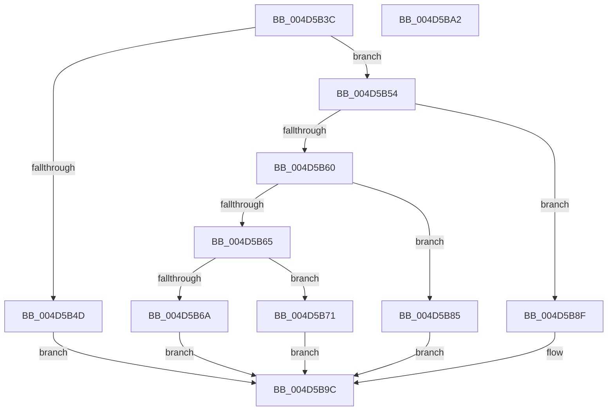

# OpenGlobalizationUserSettingsKey

- RVA: `0x004D5B3C`–`0x004D5BA3` (길이 `103` bytes)
- VA: `0x00000001404D5B3C`
- 실행 섹션: `.text`
- PDB 이름 있음: `예`; PDB Function 태그: `아니요`
- unwind 정보 RVA: `0x0008A2E0`
- 디코드: `33`개 명령, `103/103` bytes 표시
- 미해석 바이트: `0` (있으면 어셈블리에 `.byte`로 보존)

> 이 문서는 커널 이미지의 기계어와 PDB 기호를 분석해 생성했습니다. 4번과 5번은 함수 원형과 자료형을 바이너리 사용 방식에서 추정한 C 해석이며 원본 소스 복구 결과는 아닙니다.

## 1. Dependencies

- 직접 호출 지점: **4**; 고유 호출 대상: **4**
- 직접 호출자로 확인된 함수: **2**
- RIP 상대 이미지 참조: **0**

### Outgoing calls
- `0x004D5B54` → [GetGlobalizationUserModelType](../65/GetGlobalizationUserModelType_function_0065D088.md) (function, `0x0065D088`)
- `0x004D5B7E` → [OpenGlobalizationUserSettingsKey_ForMua](../65/OpenGlobalizationUserSettingsKey_ForMua_function_0065D0C8.md) (function, `0x0065D0C8`)
- `0x004D5B88` → [OpenGlobalizationUserSettingsKey_ForSingleUserModel](../65/OpenGlobalizationUserSettingsKey_ForSingleUserModel_function_0065D368.md) (function, `0x0065D368`)
- `0x004D5B97` → [RtlOpenCurrentUser](../../page/78/RtlOpenCurrentUser_function_0078F940.md) (function, `0x0078F940`)

### Direct callers
- [ExpSetPendingUILanguage](../../page/A8/ExpSetPendingUILanguage_function_00A87E70.md) at `0x00A87F06`
- [NtSetDefaultLocale](../../page/AA/NtSetDefaultLocale_function_00AAE850.md) at `0x00AAE8C0`

### Static image references
- 디코드된 RIP-relative 메모리 참조가 없습니다.

## 2. Other-region calls and transfers

- 다른 실행 섹션으로 향하는 call: **1**
  - `0x004D5B97` → [RtlOpenCurrentUser](../../page/78/RtlOpenCurrentUser_function_0078F940.md) (`.text` → `PAGE`)
- 별도 외부 분기/꼬리 이동을 확인하지 못했습니다.

## 3. Assembly (complete function range)

```asm
004D5B3C  89 4C 24 08                     mov dword ptr [rsp + 8], ecx
004D5B40  53                              push rbx
004D5B41  48 83 EC 20                     sub rsp, 0x20
004D5B45  49 8B D8                        mov rbx, r8
004D5B48  4D 85 C0                        test r8, r8
004D5B4B  75 07                           jne 0x1404d5b54
004D5B4D  B8 0D 00 00 C0                  mov eax, 0xc000000d
004D5B52  EB 48                           jmp 0x1404d5b9c
004D5B54  E8 2F 75 18 00                  call 0x14065d088
004D5B59  8B C8                           mov ecx, eax
004D5B5B  83 E9 01                        sub ecx, 1
004D5B5E  74 2F                           je 0x1404d5b8f
004D5B60  83 E9 01                        sub ecx, 1
004D5B63  74 20                           je 0x1404d5b85
004D5B65  83 F9 01                        cmp ecx, 1
004D5B68  74 07                           je 0x1404d5b71
004D5B6A  B8 E5 00 00 C0                  mov eax, 0xc00000e5
004D5B6F  EB 2B                           jmp 0x1404d5b9c
004D5B71  83 64 24 30 00                  and dword ptr [rsp + 0x30], 0
004D5B76  4C 8D 4C 24 30                  lea r9, [rsp + 0x30]
004D5B7B  4C 8B C3                        mov r8, rbx
004D5B7E  E8 45 75 18 00                  call 0x14065d0c8
004D5B83  EB 17                           jmp 0x1404d5b9c
004D5B85  48 8B D3                        mov rdx, rbx
004D5B88  E8 DB 77 18 00                  call 0x14065d368
004D5B8D  EB 0D                           jmp 0x1404d5b9c
004D5B8F  48 8B D3                        mov rdx, rbx
004D5B92  B9 08 00 00 00                  mov ecx, 8
004D5B97  E8 A4 9D 2B 00                  call 0x14078f940
004D5B9C  48 83 C4 20                     add rsp, 0x20
004D5BA0  5B                              pop rbx
004D5BA1  C3                              ret
004D5BA2  CC                              int3
```

## 4. C-style interpretation (structured pseudocode)

```c
__int64 __fastcall OpenGlobalizationUserSettingsKey(int a1, __int64 a2, __int64 a3)
{
    __int64 result;
    __int64 v_rsp;
    unsigned int v_stack_p8;

    v_stack_p8 = a1;
    v_rsp = (v_rsp) - (32);
    if (a3 != 0) goto loc_004D5B54;
    goto loc_004D5B9C;
loc_004D5B54:
    result = GetGlobalizationUserModelType(a1, a2, a3, a4);
    a1 = (unsigned int)(((unsigned int)((unsigned int)(result))) - (1));
    if (condition_is_equal) goto loc_004D5B8F;
    a1 = (unsigned int)((a1) - (1));
    if (condition_is_equal) goto loc_004D5B85;
    if (a1 == 1) goto loc_004D5B71;
    goto loc_004D5B9C;
loc_004D5B71:
    result = OpenGlobalizationUserSettingsKey_ForMua(a1, a2, a3, v_stack_p8);
    goto loc_004D5B9C;
loc_004D5B85:
    result = OpenGlobalizationUserSettingsKey_ForSingleUserModel(a1, a3, a3, v_stack_p8);
    goto loc_004D5B9C;
loc_004D5B8F:
    result = RtlOpenCurrentUser(8, a3, a3, v_stack_p8);
loc_004D5B9C:
    v_rsp = (v_rsp) + (32);
    return result;
}
```

## 5. (Beta) C Style

```c
int64_t OpenGlobalizationUserSettingsKey(int32_t Arg1, int64_t Arg2, int64_t Arg3)
{
    int64_t result;
    int64_t local_rsp;
    uint32_t v_stack_p8;

    v_stack_p8 = Arg1;
    local_rsp = (local_rsp) - (32);
    if (Arg3 != 0) goto loc_004D5B54;
    goto loc_004D5B9C;
loc_004D5B54:
    result = GetGlobalizationUserModelType(Arg1, Arg2, Arg3, a4);
    Arg1 = (uint32_t)(((uint32_t)((uint32_t)(result))) - (1));
    if (condition_is_equal) goto loc_004D5B8F;
    Arg1 = (uint32_t)((Arg1) - (1));
    if (condition_is_equal) goto loc_004D5B85;
    if (Arg1 == 1) goto loc_004D5B71;
    goto loc_004D5B9C;
loc_004D5B71:
    result = OpenGlobalizationUserSettingsKey_ForMua(Arg1, Arg2, Arg3, v_stack_p8);
    goto loc_004D5B9C;
loc_004D5B85:
    result = OpenGlobalizationUserSettingsKey_ForSingleUserModel(Arg1, Arg3, Arg3, v_stack_p8);
    goto loc_004D5B9C;
loc_004D5B8F:
    result = RtlOpenCurrentUser(8, Arg3, Arg3, v_stack_p8);
loc_004D5B9C:
    local_rsp = (local_rsp) + (32);
    return result;
}
```

## 6. Execution-region graph

[열기: 2D/3D 그래프와 함수 탐색 컨트롤 패널](../../../control-panel.html?section=text&rva=0x004D5B3C&view=graph)

- 2D 그래프는 위에서 아래로 흐르고, 3D 그래프는 빈 공간을 드래그해 회전합니다. Shift+드래그는 이동, 휠은 확대·축소, 함수 노드 선택은 대상 보고서 이동입니다.

### Static fallback


