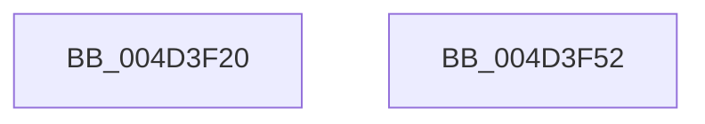

# PdcPoLowPower

- RVA: `0x004D3F20`–`0x004D3F53` (길이 `51` bytes)
- VA: `0x00000001404D3F20`
- 실행 섹션: `.text`
- PDB 이름 있음: `예`; PDB Function 태그: `아니요`
- unwind 정보 RVA: `0x0005C788`
- 디코드: `13`개 명령, `51/51` bytes 표시
- 미해석 바이트: `0` (있으면 어셈블리에 `.byte`로 보존)

> 이 문서는 커널 이미지의 기계어와 PDB 기호를 분석해 생성했습니다. 4번과 5번은 함수 원형과 자료형을 바이너리 사용 방식에서 추정한 C 해석이며 원본 소스 복구 결과는 아닙니다.

## 1. Dependencies

- 직접 호출 지점: **3**; 고유 호출 대상: **3**
- 직접 호출자로 확인된 함수: **0**
- RIP 상대 이미지 참조: **1**

### Outgoing calls
- `0x004D3F2B` → [PopAcquirePolicyLock](../../pagelk/B7/PopAcquirePolicyLock_function_00B783C0.md) (function, `0x00B783C0`)
- `0x004D3F41` → [PopSetPowerSettingValueAcDc](../../page/91/PopSetPowerSettingValueAcDc_function_00914D6C.md) (function, `0x00914D6C`)
- `0x004D3F46` → [PopReleasePolicyLock](../../pagelk/B7/PopReleasePolicyLock_function_00B78410.md) (function, `0x00B78410`)

### Direct callers
- 이 함수 시작 RVA로 연결되는 직접 call은 확인되지 않았습니다. 간접 호출은 완전히 역산할 수 없습니다.

### Static image references
- `0x004D3F3A` → RVA `0x0001C740` (`.rdata`; read)

## 2. Other-region calls and transfers

- 다른 실행 섹션으로 향하는 call: **3**
  - `0x004D3F2B` → [PopAcquirePolicyLock](../../pagelk/B7/PopAcquirePolicyLock_function_00B783C0.md) (`.text` → `PAGELK`)
  - `0x004D3F41` → [PopSetPowerSettingValueAcDc](../../page/91/PopSetPowerSettingValueAcDc_function_00914D6C.md) (`.text` → `PAGE`)
  - `0x004D3F46` → [PopReleasePolicyLock](../../pagelk/B7/PopReleasePolicyLock_function_00B78410.md) (`.text` → `PAGELK`)
- 별도 외부 분기/꼬리 이동을 확인하지 못했습니다.

## 3. Assembly (complete function range)

```asm
004D3F20  48 83 EC 28                     sub rsp, 0x28
004D3F24  0F B6 C1                        movzx eax, cl
004D3F27  89 44 24 30                     mov dword ptr [rsp + 0x30], eax
004D3F2B  E8 90 44 6A 00                  call 0x140b783c0
004D3F30  4C 8D 44 24 30                  lea r8, [rsp + 0x30]
004D3F35  BA 04 00 00 00                  mov edx, 4
004D3F3A  48 8D 0D FF 87 B4 FF            lea rcx, [rip - 0x4b7801]
004D3F41  E8 26 0E 44 00                  call 0x140914d6c
004D3F46  E8 C5 44 6A 00                  call 0x140b78410
004D3F4B  33 C0                           xor eax, eax
004D3F4D  48 83 C4 28                     add rsp, 0x28
004D3F51  C3                              ret
004D3F52  CC                              int3
```

## 4. C-style interpretation (structured pseudocode)

```c
__int64 __fastcall PdcPoLowPower(unsigned __int8 a1)
{
    __int64 result;
    __int64 v_rsp;
    unsigned int v_stack_p8;

    v_rsp = (v_rsp) - (40);
    v_stack_p8 = a1;
    result = PopAcquirePolicyLock(a1, a2, a3, a4);
    result = PopSetPowerSettingValueAcDc(v_rip - 4945921, 4, v_stack_p8, a4);
    result = PopReleasePolicyLock(v_rip - 4945921, 4, v_stack_p8, a4);
    result = 0;
    v_rsp = (v_rsp) + (40);
    return result;
}
```

## 5. (Beta) C Style

```c
int64_t PdcPoLowPower(uint8_t Arg1)
{
    int64_t result;
    int64_t local_rsp;
    uint32_t v_stack_p8;

    local_rsp = (local_rsp) - (40);
    v_stack_p8 = Arg1;
    result = PopAcquirePolicyLock(Arg1, a2, a3, a4);
    result = PopSetPowerSettingValueAcDc(v_rip - 4945921, 4, v_stack_p8, a4);
    result = PopReleasePolicyLock(v_rip - 4945921, 4, v_stack_p8, a4);
    result = 0;
    local_rsp = (local_rsp) + (40);
    return result;
}
```

## 6. Execution-region graph

[열기: 2D/3D 그래프와 함수 탐색 컨트롤 패널](../../../control-panel.html?section=text&rva=0x004D3F20&view=graph)

- 2D 그래프는 위에서 아래로 흐르고, 3D 그래프는 빈 공간을 드래그해 회전합니다. Shift+드래그는 이동, 휠은 확대·축소, 함수 노드 선택은 대상 보고서 이동입니다.

### Static fallback


