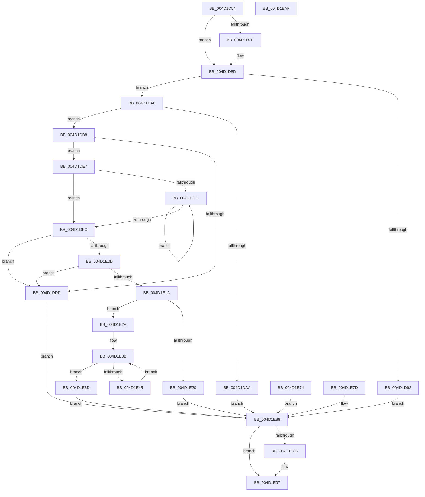

# PfpMemoryRangesQuery

- RVA: `0x004D1D54`–`0x004D1EB0` (길이 `348` bytes)
- VA: `0x00000001404D1D54`
- 실행 섹션: `.text`
- PDB 이름 있음: `예`; PDB Function 태그: `아니요`
- unwind 정보 RVA: `0x000BDDC4`
- 디코드: `102`개 명령, `348/348` bytes 표시
- 미해석 바이트: `0` (있으면 어셈블리에 `.byte`로 보존)

> 이 문서는 커널 이미지의 기계어와 PDB 기호를 분석해 생성했습니다. 4번과 5번은 함수 원형과 자료형을 바이너리 사용 방식에서 추정한 C 해석이며 원본 소스 복구 결과는 아닙니다.

## 1. Dependencies

- 직접 호출 지점: **3**; 고유 호출 대상: **3**
- 직접 호출자로 확인된 함수: **1**
- RIP 상대 이미지 참조: **0**

### Outgoing calls
- `0x004D1D88` → [ProbeForWrite](../../page/8E/ProbeForWrite_function_008E91C0.md) (function, `0x008E91C0`)
- `0x004D1DCB` → [MmGetPhysicalMemoryRangesEx2](../../page/AC/MmGetPhysicalMemoryRangesEx2_function_00AC3870.md) (function, `0x00AC3870`)
- `0x004D1E92` → [ExFreePoolWithTag](../../poolcode/B8/ExFreePoolWithTag_function_00B82870.md) (function, `0x00B82870`)

### Direct callers
- [PfQuerySuperfetchInformation](../../page/90/PfQuerySuperfetchInformation_function_0090210C.md) at `0x00902472`

### Static image references
- 디코드된 RIP-relative 메모리 참조가 없습니다.

## 2. Other-region calls and transfers

- 다른 실행 섹션으로 향하는 call: **3**
  - `0x004D1D88` → [ProbeForWrite](../../page/8E/ProbeForWrite_function_008E91C0.md) (`.text` → `PAGE`)
  - `0x004D1DCB` → [MmGetPhysicalMemoryRangesEx2](../../page/AC/MmGetPhysicalMemoryRangesEx2_function_00AC3870.md) (`.text` → `PAGE`)
  - `0x004D1E92` → [ExFreePoolWithTag](../../poolcode/B8/ExFreePoolWithTag_function_00B82870.md) (`.text` → `POOLCODE`)
- 별도 외부 분기/꼬리 이동을 확인하지 못했습니다.

## 3. Assembly (complete function range)

```asm
004D1D54  48 89 5C 24 10                  mov qword ptr [rsp + 0x10], rbx
004D1D59  48 89 74 24 18                  mov qword ptr [rsp + 0x18], rsi
004D1D5E  48 89 7C 24 20                  mov qword ptr [rsp + 0x20], rdi
004D1D63  41 56                           push r14
004D1D65  48 83 EC 30                     sub rsp, 0x30
004D1D69  4D 8B F0                        mov r14, r8
004D1D6C  48 8B D9                        mov rbx, rcx
004D1D6F  33 FF                           xor edi, edi
004D1D71  48 89 7C 24 40                  mov qword ptr [rsp + 0x40], rdi
004D1D76  48 8B 71 10                     mov rsi, qword ptr [rcx + 0x10]
004D1D7A  84 D2                           test dl, dl
004D1D7C  74 0F                           je 0x1404d1d8d
004D1D7E  8B 51 18                        mov edx, dword ptr [rcx + 0x18]
004D1D81  44 8D 47 08                     lea r8d, [rdi + 8]
004D1D85  48 8B CE                        mov rcx, rsi
004D1D88  E8 33 74 41 00                  call 0x1408e91c0
004D1D8D  83 3E 02                        cmp dword ptr [rsi], 2
004D1D90  74 0E                           je 0x1404d1da0
004D1D92  BB 0D 00 00 C0                  mov ebx, 0xc000000d
004D1D97  89 5C 24 20                     mov dword ptr [rsp + 0x20], ebx
004D1D9B  E9 E8 00 00 00                  jmp 0x1404d1e88
004D1DA0  8B 46 04                        mov eax, dword ptr [rsi + 4]
004D1DA3  A9 FE FF FF FF                  test eax, 0xfffffffe
004D1DA8  74 0E                           je 0x1404d1db8
004D1DAA  BB 0D 00 00 C0                  mov ebx, 0xc000000d
004D1DAF  89 5C 24 20                     mov dword ptr [rsp + 0x20], ebx
004D1DB3  E9 D0 00 00 00                  jmp 0x1404d1e88
004D1DB8  A8 01                           test al, 1
004D1DBA  BA 00 00 00 00                  mov edx, 0
004D1DBF  8D 42 03                        lea eax, [rdx + 3]
004D1DC2  0F 45 D0                        cmovne edx, eax
004D1DC5  89 54 24 24                     mov dword ptr [rsp + 0x24], edx
004D1DC9  33 C9                           xor ecx, ecx
004D1DCB  E8 A0 1A 5F 00                  call 0x140ac3870
004D1DD0  48 8B F8                        mov rdi, rax
004D1DD3  48 89 44 24 40                  mov qword ptr [rsp + 0x40], rax
004D1DD8  48 85 C0                        test rax, rax
004D1DDB  75 0A                           jne 0x1404d1de7
004D1DDD  BB 9A 00 00 C0                  mov ebx, 0xc000009a
004D1DE2  E9 A1 00 00 00                  jmp 0x1404d1e88
004D1DE7  4C 8B C7                        mov r8, rdi
004D1DEA  48 83 78 08 00                  cmp qword ptr [rax + 8], 0
004D1DEF  7E 0B                           jle 0x1404d1dfc
004D1DF1  49 83 C0 10                     add r8, 0x10
004D1DF5  49 83 78 08 00                  cmp qword ptr [r8 + 8], 0
004D1DFA  7F F5                           jg 0x1404d1df1
004D1DFC  4C 2B C7                        sub r8, rdi
004D1DFF  49 C1 F8 04                     sar r8, 4
004D1E03  B8 FF FF FF FF                  mov eax, 0xffffffff
004D1E08  4C 3B C0                        cmp r8, rax
004D1E0B  77 D0                           ja 0x1404d1ddd
004D1E0D  4D 8D 48 01                     lea r9, [r8 + 1]
004D1E11  49 C1 E1 04                     shl r9, 4
004D1E15  4C 3B C8                        cmp r9, rax
004D1E18  77 C3                           ja 0x1404d1ddd
004D1E1A  44 39 4B 18                     cmp dword ptr [rbx + 0x18], r9d
004D1E1E  73 0A                           jae 0x1404d1e2a
004D1E20  BB 23 00 00 C0                  mov ebx, 0xc0000023
004D1E25  45 89 0E                        mov dword ptr [r14], r9d
004D1E28  EB 5E                           jmp 0x1404d1e88
004D1E2A  4C 8B 5B 10                     mov r11, qword ptr [rbx + 0x10]
004D1E2E  45 89 43 08                     mov dword ptr [r11 + 8], r8d
004D1E32  90                              nop
004D1E33  45 33 D2                        xor r10d, r10d
004D1E36  BB 00 10 00 00                  mov ebx, 0x1000
004D1E3B  4C 89 54 24 28                  mov qword ptr [rsp + 0x28], r10
004D1E40  4D 3B D0                        cmp r10, r8
004D1E43  73 28                           jae 0x1404d1e6d
004D1E45  49 8B CA                        mov rcx, r10
004D1E48  48 03 C9                        add rcx, rcx
004D1E4B  48 8B 04 CF                     mov rax, qword ptr [rdi + rcx*8]
004D1E4F  48 99                           cqo
004D1E51  48 F7 FB                        idiv rbx
004D1E54  49 89 44 CB 10                  mov qword ptr [r11 + rcx*8 + 0x10], rax
004D1E59  48 8B 44 CF 08                  mov rax, qword ptr [rdi + rcx*8 + 8]
004D1E5E  48 99                           cqo
004D1E60  48 F7 FB                        idiv rbx
004D1E63  49 89 44 CB 18                  mov qword ptr [r11 + rcx*8 + 0x18], rax
004D1E68  49 FF C2                        inc r10
004D1E6B  EB CE                           jmp 0x1404d1e3b
004D1E6D  45 89 0E                        mov dword ptr [r14], r9d
004D1E70  33 DB                           xor ebx, ebx
004D1E72  EB 14                           jmp 0x1404d1e88
004D1E74  8B D8                           mov ebx, eax
004D1E76  48 8B 7C 24 40                  mov rdi, qword ptr [rsp + 0x40]
004D1E7B  EB 0B                           jmp 0x1404d1e88
004D1E7D  8B D8                           mov ebx, eax
004D1E7F  89 44 24 20                     mov dword ptr [rsp + 0x20], eax
004D1E83  48 8B 7C 24 40                  mov rdi, qword ptr [rsp + 0x40]
004D1E88  48 85 FF                        test rdi, rdi
004D1E8B  74 0A                           je 0x1404d1e97
004D1E8D  33 D2                           xor edx, edx
004D1E8F  48 8B CF                        mov rcx, rdi
004D1E92  E8 D9 09 6B 00                  call 0x140b82870
004D1E97  8B C3                           mov eax, ebx
004D1E99  48 8B 5C 24 48                  mov rbx, qword ptr [rsp + 0x48]
004D1E9E  48 8B 74 24 50                  mov rsi, qword ptr [rsp + 0x50]
004D1EA3  48 8B 7C 24 58                  mov rdi, qword ptr [rsp + 0x58]
004D1EA8  48 83 C4 30                     add rsp, 0x30
004D1EAC  41 5E                           pop r14
004D1EAE  C3                              ret
004D1EAF  CC                              int3
```

## 4. C-style interpretation (structured pseudocode)

```c
__int64 __fastcall PfpMemoryRangesQuery(__int64 a1, unsigned __int8 a2, __int64 a3)
{
    __int64 result;
    __int64 v_r10;
    __int64 v_rbx;
    __int64 v_rdi;
    __int64 v_rsp;
    unsigned __int64 v_stack_m10;
    unsigned int v_stack_m14;
    unsigned int v_stack_m18;
    unsigned __int64 v_stack_p10;
    unsigned __int64 v_stack_p18;
    unsigned __int64 v_stack_p20;
    unsigned __int64 v_stack_p8;

    v_stack_p10 = v_rbx;
    v_stack_p18 = v_rsi;
    v_stack_p20 = v_rdi;
    v_rsp = (v_rsp) - (48);
    v_rdi = 0;
    v_stack_p8 = 0;
    if (a2 != 0) {
        a2 = *(unsigned int *)(a1 + 24);
        a3 = v_rdi + 8;
        a1 = *(unsigned __int64 *)(a1 + 16);
        result = ProbeForWrite(a1, a2, a3, a4);
    }
    if ((*(unsigned int *)(*(unsigned __int64 *)(a1 + 16))) == 2) goto loc_004D1DA0;
    v_stack_m18 = (unsigned int)((unsigned int)(0xC000000DULL));
    goto loc_004D1E88;
loc_004D1DA0:
    if ((((unsigned int)((unsigned int)(*(unsigned int *)(*(unsigned __int64 *)(a1 + 16) + 4)))) & (0xFFFFFFFEULL)) == 0) goto loc_004D1DB8;
    v_stack_m18 = (unsigned int)((unsigned int)(0xC000000DULL));
    goto loc_004D1E88;
loc_004D1DB8:
    a2 = 0;
    if ((((unsigned __int8)((unsigned int)(*(unsigned int *)(*(unsigned __int64 *)(a1 + 16) + 4)))) & (1)) != 0) { a2 = (unsigned int)(0 + 3); }
    v_stack_m14 = a2;
    a1 = 0;
    result = MmGetPhysicalMemoryRangesEx2(a1, a2, a3, a4);
    v_stack_p8 = result;
    if (result != 0) goto loc_004D1DE7;
loc_004D1DDD:
    goto loc_004D1E88;
loc_004D1DE7:
    if ((*(unsigned __int64 *)(result + 8)) <= 0) goto loc_004D1DFC;
loc_004D1DF1:
    a3 = (result) + (16);
    if ((*(unsigned __int64 *)(a3 + 8)) > 0) goto loc_004D1DF1;
loc_004D1DFC:
    a3 = (a3) - (result);
    a3 = (a3) >> (4);
    if (a3 > ((unsigned int)(0xFFFFFFFFULL))) goto loc_004D1DDD;
    a4 = (a3 + 1) << (4);
    if (a4 > ((unsigned int)(0xFFFFFFFFULL))) goto loc_004D1DDD;
    if ((*(unsigned int *)((unsigned int)(0xC000009AULL) + 24)) >= ((unsigned int)(a4))) goto loc_004D1E2A;
    *(unsigned int *)(a3) = (unsigned int)(a4);
    goto loc_004D1E88;
loc_004D1E2A:
    *(unsigned int *)(*(unsigned __int64 *)((unsigned int)(0xC0000023ULL) + 16) + 8) = (unsigned int)(a3);
    v_r10 = 0;
loc_004D1E3B:
    v_stack_m10 = 0;
    if (0 >= a3) goto loc_004D1E6D;
    a1 = (0) + (0);
    *(unsigned __int64 *)(*(unsigned __int64 *)((unsigned int)(0xC0000023ULL) + 16) + a1 * 8 + 16) = *(unsigned __int64 *)(result + a1 * 8);
    *(unsigned __int64 *)(*(unsigned __int64 *)((unsigned int)(0xC0000023ULL) + 16) + a1 * 8 + 24) = *(unsigned __int64 *)(result + a1 * 8 + 8);
    v_r10 = (v_r10) + 1;
    goto loc_004D1E3B;
loc_004D1E6D:
    *(unsigned int *)(a3) = (unsigned int)(a4);
    v_rbx = 0;
    goto loc_004D1E88;
loc_004D1E88:
    result = *(unsigned __int64 *)(result + a1 * 8 + 8);
    if (result != 0) {
        a2 = 0;
        a1 = result;
        result = ExFreePoolWithTag(a1, a2, a3, a4);
    }
    v_rsp = (v_rsp) + (48);
    return 0;
}
```

## 5. (Beta) C Style

```c
int64_t PfpMemoryRangesQuery(void *Arg1, uint8_t Arg2, void *Arg3)
{
    uint8_t *arg1 = (uint8_t *)Arg1;
    uint8_t *arg3 = (uint8_t *)Arg3;

    int64_t result;
    int64_t local_r10;
    int64_t local_rbx;
    int64_t local_rdi;
    int64_t local_rsp;
    uint64_t v_stack_m10;
    uint32_t v_stack_m14;
    uint32_t v_stack_m18;
    uint64_t v_stack_p10;
    uint64_t v_stack_p18;
    uint64_t v_stack_p20;
    uint64_t v_stack_p8;

    v_stack_p10 = local_rbx;
    v_stack_p18 = local_rsi;
    v_stack_p20 = local_rdi;
    local_rsp = (local_rsp) - (48);
    local_rdi = 0;
    v_stack_p8 = 0;
    if (Arg2 != 0) {
        Arg2 = *(uint32_t *)(arg1 + 0x18);
        Arg3 = local_rdi + 8;
        Arg1 = *(uint64_t *)(arg1 + 0x10);
        result = ProbeForWrite(Arg1, Arg2, Arg3, a4);
    }
    if ((*(uint32_t *)(*(uint64_t *)(arg1 + 0x10))) == 2) goto loc_004D1DA0;
    v_stack_m18 = (uint32_t)((uint32_t)(0xC000000DULL));
    goto loc_004D1E88;
loc_004D1DA0:
    if ((((uint32_t)((uint32_t)(*(uint32_t *)(*(uint64_t *)(arg1 + 0x10) + 0x4)))) & (0xFFFFFFFEULL)) == 0) goto loc_004D1DB8;
    v_stack_m18 = (uint32_t)((uint32_t)(0xC000000DULL));
    goto loc_004D1E88;
loc_004D1DB8:
    Arg2 = 0;
    if ((((uint8_t)((uint32_t)(*(uint32_t *)(*(uint64_t *)(arg1 + 0x10) + 0x4)))) & (1)) != 0) { Arg2 = (uint32_t)(0 + 3); }
    v_stack_m14 = Arg2;
    Arg1 = 0;
    result = MmGetPhysicalMemoryRangesEx2(Arg1, Arg2, Arg3, a4);
    v_stack_p8 = result;
    if (result != 0) goto loc_004D1DE7;
loc_004D1DDD:
    goto loc_004D1E88;
loc_004D1DE7:
    if ((*(uint64_t *)(result + 0x8)) <= 0) goto loc_004D1DFC;
loc_004D1DF1:
    Arg3 = (result) + (16);
    if ((*(uint64_t *)(arg3 + 0x8)) > 0) goto loc_004D1DF1;
loc_004D1DFC:
    Arg3 = (Arg3) - (result);
    Arg3 = (Arg3) >> (4);
    if (Arg3 > ((uint32_t)(0xFFFFFFFFULL))) goto loc_004D1DDD;
    a4 = (Arg3 + 1) << (4);
    if (a4 > ((uint32_t)(0xFFFFFFFFULL))) goto loc_004D1DDD;
    if ((*(uint32_t *)((uint32_t)(0xC000009AULL) + 0x18)) >= ((uint32_t)(a4))) goto loc_004D1E2A;
    *(uint32_t *)(arg3) = (uint32_t)(a4);
    goto loc_004D1E88;
loc_004D1E2A:
    *(uint32_t *)(*(uint64_t *)((uint32_t)(0xC0000023ULL) + 0x10) + 0x8) = (uint32_t)(Arg3);
    local_r10 = 0;
loc_004D1E3B:
    v_stack_m10 = 0;
    if (0 >= Arg3) goto loc_004D1E6D;
    Arg1 = (0) + (0);
    *(uint64_t *)(*(uint64_t *)((uint32_t)(0xC0000023ULL) + 0x10) + arg1 * 8 + 0x10) = *(uint64_t *)(result + arg1 * 8);
    *(uint64_t *)(*(uint64_t *)((uint32_t)(0xC0000023ULL) + 0x10) + arg1 * 8 + 0x18) = *(uint64_t *)(result + arg1 * 8 + 0x8);
    local_r10 = (local_r10) + 1;
    goto loc_004D1E3B;
loc_004D1E6D:
    *(uint32_t *)(arg3) = (uint32_t)(a4);
    local_rbx = 0;
    goto loc_004D1E88;
loc_004D1E88:
    result = *(uint64_t *)(result + arg1 * 8 + 0x8);
    if (result != 0) {
        Arg2 = 0;
        Arg1 = result;
        result = ExFreePoolWithTag(Arg1, Arg2, Arg3, a4);
    }
    local_rsp = (local_rsp) + (48);
    return 0;
}
```

### 관측된 메모리 오프셋

구조체 형식이 확인되지 않은 접근은 인자 기준의 오프셋으로만 기록했습니다.

| 기준 인자 | 오프셋 표현 | 폭 (bit) | 접근 |
|---|---:|---:|---|
| `Arg1` | `+ 0x10` | `64` | `R` |
| `Arg1` | `+ 0x18` | `32` | `R` |
| `Arg3` | `+ 0x0` | `32` | `W` |

## 6. Execution-region graph

[열기: 2D/3D 그래프와 함수 탐색 컨트롤 패널](../../../control-panel.html?section=text&rva=0x004D1D54&view=graph)

- 2D 그래프는 위에서 아래로 흐르고, 3D 그래프는 빈 공간을 드래그해 회전합니다. Shift+드래그는 이동, 휠은 확대·축소, 함수 노드 선택은 대상 보고서 이동입니다.

### Static fallback


