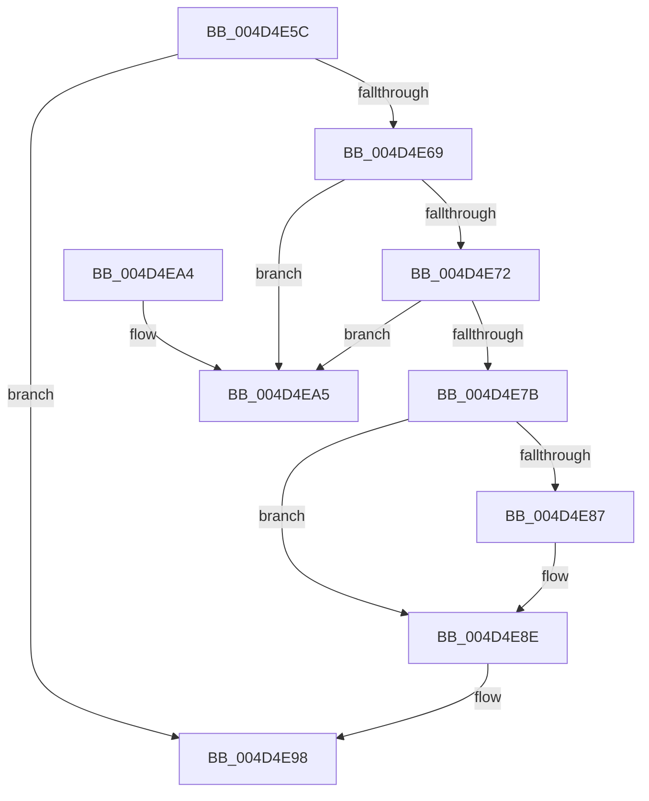

# PiDevCfgPopDriverNodeEntry

- RVA: `0x004D4E5C`–`0x004D4EAC` (길이 `80` bytes)
- VA: `0x00000001404D4E5C`
- 실행 섹션: `.text`
- PDB 이름 있음: `예`; PDB Function 태그: `아니요`
- unwind 정보 RVA: `0x0005DAC8`
- 디코드: `28`개 명령, `80/80` bytes 표시
- 미해석 바이트: `0` (있으면 어셈블리에 `.byte`로 보존)

> 이 문서는 커널 이미지의 기계어와 PDB 기호를 분석해 생성했습니다. 4번과 5번은 함수 원형과 자료형을 바이너리 사용 방식에서 추정한 C 해석이며 원본 소스 복구 결과는 아닙니다.

## 1. Dependencies

- 직접 호출 지점: **1**; 고유 호출 대상: **1**
- 직접 호출자로 확인된 함수: **1**
- RIP 상대 이미지 참조: **0**

### Outgoing calls
- `0x004D4E93` → [ExFreePoolWithTag](../../poolcode/B8/ExFreePoolWithTag_function_00B82870.md) (function, `0x00B82870`)

### Direct callers
- [PiDevCfgQueryIncludedDriverConfigurations](../../page/97/PiDevCfgQueryIncludedDriverConfigurations_function_009754BC.md) at `0x0097552B`

### Static image references
- 디코드된 RIP-relative 메모리 참조가 없습니다.

## 2. Other-region calls and transfers

- 다른 실행 섹션으로 향하는 call: **1**
  - `0x004D4E93` → [ExFreePoolWithTag](../../poolcode/B8/ExFreePoolWithTag_function_00B82870.md) (`.text` → `POOLCODE`)
- 별도 외부 분기/꼬리 이동을 확인하지 못했습니다.

## 3. Assembly (complete function range)

```asm
004D4E5C  40 53                           push rbx
004D4E5E  48 83 EC 20                     sub rsp, 0x20
004D4E62  33 DB                           xor ebx, ebx
004D4E64  48 39 09                        cmp qword ptr [rcx], rcx
004D4E67  74 2F                           je 0x1404d4e98
004D4E69  48 8B 59 08                     mov rbx, qword ptr [rcx + 8]
004D4E6D  48 39 0B                        cmp qword ptr [rbx], rcx
004D4E70  75 33                           jne 0x1404d4ea5
004D4E72  48 8B 43 08                     mov rax, qword ptr [rbx + 8]
004D4E76  48 39 18                        cmp qword ptr [rax], rbx
004D4E79  75 2A                           jne 0x1404d4ea5
004D4E7B  48 89 41 08                     mov qword ptr [rcx + 8], rax
004D4E7F  48 89 08                        mov qword ptr [rax], rcx
004D4E82  48 85 D2                        test rdx, rdx
004D4E85  74 07                           je 0x1404d4e8e
004D4E87  48 8B 43 10                     mov rax, qword ptr [rbx + 0x10]
004D4E8B  48 89 02                        mov qword ptr [rdx], rax
004D4E8E  33 D2                           xor edx, edx
004D4E90  48 8B CB                        mov rcx, rbx
004D4E93  E8 D8 D9 6A 00                  call 0x140b82870
004D4E98  48 85 DB                        test rbx, rbx
004D4E9B  0F 95 C0                        setne al
004D4E9E  48 83 C4 20                     add rsp, 0x20
004D4EA2  5B                              pop rbx
004D4EA3  C3                              ret
004D4EA4  CC                              int3
004D4EA5  B9 03 00 00 00                  mov ecx, 3
004D4EAA  CD 29                           int 0x29
```

## 4. C-style interpretation (structured pseudocode)

```c
__int64 __fastcall PiDevCfgPopDriverNodeEntry(__int64 a1, __int64 a2)
{
    __int64 result;
    __int64 v_rbx;
    __int64 v_rsp;

    v_rsp = (v_rsp) - (32);
    v_rbx = 0;
    if ((*(unsigned __int64 *)(a1)) == a1) goto loc_004D4E98;
    if ((*(unsigned __int64 *)(*(unsigned __int64 *)(a1 + 8))) != a1) goto loc_004D4EA5;
    if ((*(unsigned __int64 *)(*(unsigned __int64 *)(*(unsigned __int64 *)(a1 + 8) + 8))) != (*(unsigned __int64 *)(a1 + 8))) goto loc_004D4EA5;
    *(unsigned __int64 *)(a1 + 8) = *(unsigned __int64 *)(*(unsigned __int64 *)(a1 + 8) + 8);
    *(unsigned __int64 *)(*(unsigned __int64 *)(*(unsigned __int64 *)(a1 + 8) + 8)) = a1;
    result = *(unsigned __int64 *)(*(unsigned __int64 *)(a1 + 8) + 8);
    if (a2 != 0) {
        result = *(unsigned __int64 *)(*(unsigned __int64 *)(a1 + 8) + 16);
        *(unsigned __int64 *)(a2) = result;
    }
    a2 = 0;
    result = ExFreePoolWithTag(*(unsigned __int64 *)(a1 + 8), a2, a3, a4);
loc_004D4E98:
    result = (*(unsigned __int64 *)(a1 + 8) != 0) ? 1 : 0;
    v_rsp = (v_rsp) + (32);
    return result;
loc_004D4EA5:
    return result;
}
```

## 5. (Beta) C Style

```c
int64_t PiDevCfgPopDriverNodeEntry(void *Arg1, int64_t Arg2)
{
    uint8_t *arg1 = (uint8_t *)Arg1;

    int64_t result;
    int64_t local_rbx;
    int64_t local_rsp;

    local_rsp = (local_rsp) - (32);
    local_rbx = 0;
    if ((*(uint64_t *)(arg1)) == Arg1) goto loc_004D4E98;
    if ((*(uint64_t *)(*(uint64_t *)(arg1 + 0x8))) != Arg1) goto loc_004D4EA5;
    if ((*(uint64_t *)(*(uint64_t *)(*(uint64_t *)(arg1 + 0x8) + 0x8))) != (*(uint64_t *)(arg1 + 0x8))) goto loc_004D4EA5;
    *(uint64_t *)(arg1 + 0x8) = *(uint64_t *)(*(uint64_t *)(arg1 + 0x8) + 0x8);
    *(void **)(*(uint64_t *)(*(uint64_t *)(arg1 + 0x8) + 0x8)) = Arg1;
    result = *(uint64_t *)(*(uint64_t *)(arg1 + 0x8) + 0x8);
    if (Arg2 != 0) {
        result = *(uint64_t *)(*(uint64_t *)(arg1 + 0x8) + 0x10);
        *(uint64_t *)(Arg2) = result;
    }
    Arg2 = 0;
    result = ExFreePoolWithTag(*(uint64_t *)(arg1 + 0x8), Arg2, a3, a4);
loc_004D4E98:
    result = (*(uint64_t *)(arg1 + 0x8) != 0) ? 1 : 0;
    local_rsp = (local_rsp) + (32);
    return result;
loc_004D4EA5:
    return result;
}
```

### 관측된 메모리 오프셋

구조체 형식이 확인되지 않은 접근은 인자 기준의 오프셋으로만 기록했습니다.

| 기준 인자 | 오프셋 표현 | 폭 (bit) | 접근 |
|---|---:|---:|---|
| `Arg1` | `+ 0x0` | `64` | `R` |
| `Arg1` | `+ 0x8` | `64` | `R` |
| `Arg1` | `+ 0x8` | `64` | `W` |

## 6. Execution-region graph

[열기: 2D/3D 그래프와 함수 탐색 컨트롤 패널](../../../control-panel.html?section=text&rva=0x004D4E5C&view=graph)

- 2D 그래프는 위에서 아래로 흐르고, 3D 그래프는 빈 공간을 드래그해 회전합니다. Shift+드래그는 이동, 휠은 확대·축소, 함수 노드 선택은 대상 보고서 이동입니다.

### Static fallback


