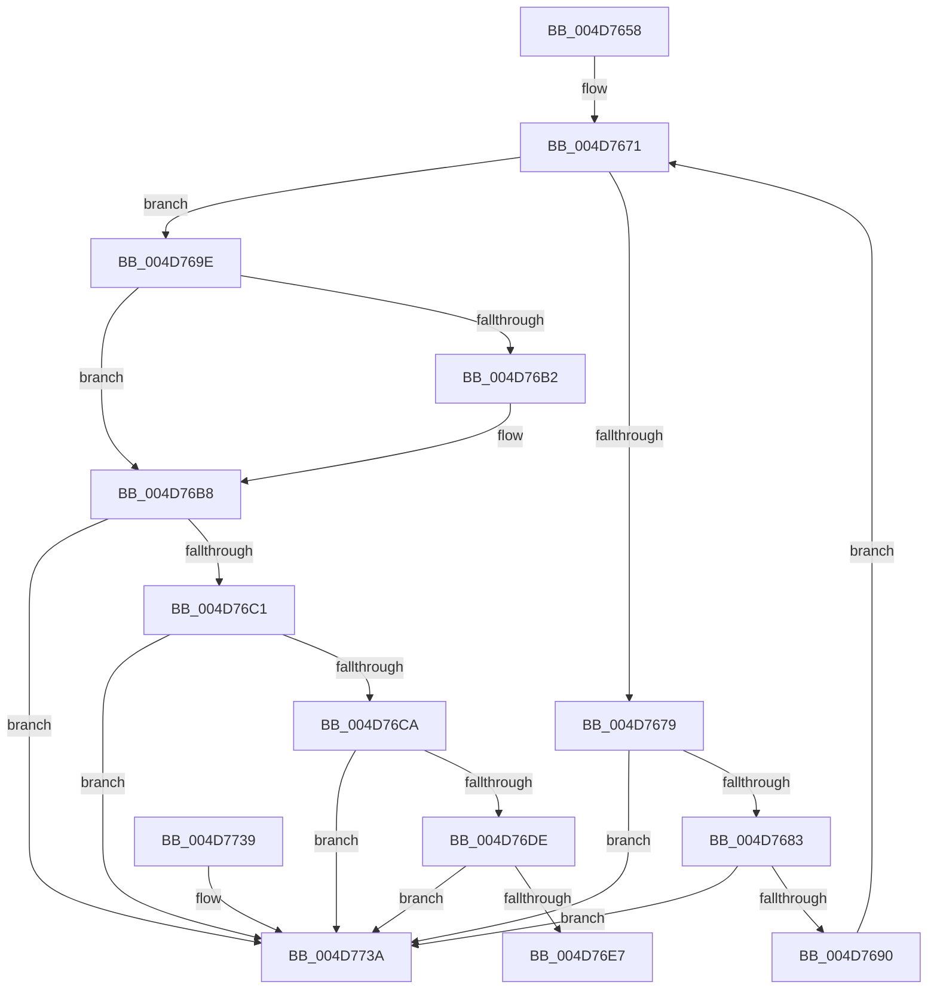

# PipFreeDependencyEdge

- RVA: `0x004D7658`–`0x004D7741` (길이 `233` bytes)
- VA: `0x00000001404D7658`
- 실행 섹션: `.text`
- PDB 이름 있음: `예`; PDB Function 태그: `아니요`
- unwind 정보 RVA: `0x0006383C`
- 디코드: `64`개 명령, `233/233` bytes 표시
- 미해석 바이트: `0` (있으면 어셈블리에 `.byte`로 보존)

> 이 문서는 커널 이미지의 기계어와 PDB 기호를 분석해 생성했습니다. 4번과 5번은 함수 원형과 자료형을 바이너리 사용 방식에서 추정한 C 해석이며 원본 소스 복구 결과는 아닙니다.

## 1. Dependencies

- 직접 호출 지점: **7**; 고유 호출 대상: **6**
- 직접 호출자로 확인된 함수: **2**
- RIP 상대 이미지 참조: **1**

### Outgoing calls
- `0x004D7697` → [PipFreeBindingRequestEntry](../../page/72/PipFreeBindingRequestEntry_function_00727C84.md) (function, `0x00727C84`)
- `0x004D76A5` → [KeAcquireSpinLockRaiseToDpc](../20/KeAcquireSpinLockRaiseToDpc_function_00208470.md) (function, `0x00208470`)
- `0x004D76F8` → [KeReleaseSpinLock](../39/KeReleaseSpinLock_function_00392BA0.md) (function, `0x00392BA0`)
- `0x004D7705` → [PipNotifyDependenciesChanged](../../page/70/PipNotifyDependenciesChanged_function_007038F8.md) (function, `0x007038F8`)
- `0x004D770E` → [PipDereferenceDependencyNode](../../page/AC/PipDereferenceDependencyNode_function_00ACD5A0.md) (function, `0x00ACD5A0`)
- `0x004D7717` → [PipDereferenceDependencyNode](../../page/AC/PipDereferenceDependencyNode_function_00ACD5A0.md) (function, `0x00ACD5A0`)
- `0x004D7724` → [ExFreePoolWithTag](../../poolcode/B8/ExFreePoolWithTag_function_00B82870.md) (function, `0x00B82870`)

### Direct callers
- [PipMergeDependencyEdgeList](../../page/72/PipMergeDependencyEdgeList_function_00727D4C.md) at `0x00727E2D`
- [PipDeleteAllDependencyRelations](../../page/A0/PipDeleteAllDependencyRelations_function_00A06950.md) at `0x00A069AD`
- [PipDeleteAllDependencyRelations](../../page/A0/PipDeleteAllDependencyRelations_function_00A06950.md) at `0x00A069DC`

### Static image references
- `0x004D769E` → RVA `0x00F8CF08` (`.data`; read)

## 2. Other-region calls and transfers

- 다른 실행 섹션으로 향하는 call: **5**
  - `0x004D7697` → [PipFreeBindingRequestEntry](../../page/72/PipFreeBindingRequestEntry_function_00727C84.md) (`.text` → `PAGE`)
  - `0x004D7705` → [PipNotifyDependenciesChanged](../../page/70/PipNotifyDependenciesChanged_function_007038F8.md) (`.text` → `PAGE`)
  - `0x004D770E` → [PipDereferenceDependencyNode](../../page/AC/PipDereferenceDependencyNode_function_00ACD5A0.md) (`.text` → `PAGE`)
  - `0x004D7717` → [PipDereferenceDependencyNode](../../page/AC/PipDereferenceDependencyNode_function_00ACD5A0.md) (`.text` → `PAGE`)
  - `0x004D7724` → [ExFreePoolWithTag](../../poolcode/B8/ExFreePoolWithTag_function_00B82870.md) (`.text` → `POOLCODE`)
- 별도 외부 분기/꼬리 이동을 확인하지 못했습니다.

## 3. Assembly (complete function range)

```asm
004D7658  48 89 5C 24 08                  mov qword ptr [rsp + 8], rbx
004D765D  48 89 74 24 10                  mov qword ptr [rsp + 0x10], rsi
004D7662  57                              push rdi
004D7663  48 83 EC 20                     sub rsp, 0x20
004D7667  48 8B F2                        mov rsi, rdx
004D766A  48 8D 79 38                     lea rdi, [rcx + 0x38]
004D766E  48 8B D9                        mov rbx, rcx
004D7671  48 8B 0F                        mov rcx, qword ptr [rdi]
004D7674  48 3B CF                        cmp rcx, rdi
004D7677  74 25                           je 0x1404d769e
004D7679  48 39 79 08                     cmp qword ptr [rcx + 8], rdi
004D767D  0F 85 B7 00 00 00               jne 0x1404d773a
004D7683  48 8B 01                        mov rax, qword ptr [rcx]
004D7686  48 39 48 08                     cmp qword ptr [rax + 8], rcx
004D768A  0F 85 AA 00 00 00               jne 0x1404d773a
004D7690  48 89 07                        mov qword ptr [rdi], rax
004D7693  48 89 78 08                     mov qword ptr [rax + 8], rdi
004D7697  E8 E8 05 25 00                  call 0x140727c84
004D769C  EB D3                           jmp 0x1404d7671
004D769E  48 8D 0D 63 58 AB 00            lea rcx, [rip + 0xab5863]
004D76A5  E8 C6 0D D3 FF                  call 0x140208470
004D76AA  44 8A C8                        mov r9b, al
004D76AD  48 85 F6                        test rsi, rsi
004D76B0  74 06                           je 0x1404d76b8
004D76B2  8B 4B 30                        mov ecx, dword ptr [rbx + 0x30]
004D76B5  09 4E 30                        or dword ptr [rsi + 0x30], ecx
004D76B8  48 8B 0B                        mov rcx, qword ptr [rbx]
004D76BB  48 39 59 08                     cmp qword ptr [rcx + 8], rbx
004D76BF  75 79                           jne 0x1404d773a
004D76C1  48 8B 43 08                     mov rax, qword ptr [rbx + 8]
004D76C5  48 39 18                        cmp qword ptr [rax], rbx
004D76C8  75 70                           jne 0x1404d773a
004D76CA  48 89 08                        mov qword ptr [rax], rcx
004D76CD  48 89 41 08                     mov qword ptr [rcx + 8], rax
004D76D1  48 8D 43 10                     lea rax, [rbx + 0x10]
004D76D5  4C 8B 00                        mov r8, qword ptr [rax]
004D76D8  49 39 40 08                     cmp qword ptr [r8 + 8], rax
004D76DC  75 5C                           jne 0x1404d773a
004D76DE  48 8B 50 08                     mov rdx, qword ptr [rax + 8]
004D76E2  48 39 02                        cmp qword ptr [rdx], rax
004D76E5  75 53                           jne 0x1404d773a
004D76E7  4C 89 02                        mov qword ptr [rdx], r8
004D76EA  48 8D 0D 17 58 AB 00            lea rcx, [rip + 0xab5817]
004D76F1  49 89 50 08                     mov qword ptr [r8 + 8], rdx
004D76F5  41 8A D1                        mov dl, r9b
004D76F8  E8 A3 B4 EB FF                  call 0x140392ba0
004D76FD  48 8B 53 20                     mov rdx, qword ptr [rbx + 0x20]
004D7701  48 8B 4B 28                     mov rcx, qword ptr [rbx + 0x28]
004D7705  E8 EE C1 22 00                  call 0x1407038f8
004D770A  48 8B 4B 20                     mov rcx, qword ptr [rbx + 0x20]
004D770E  E8 8D 5E 5F 00                  call 0x140acd5a0
004D7713  48 8B 4B 28                     mov rcx, qword ptr [rbx + 0x28]
004D7717  E8 84 5E 5F 00                  call 0x140acd5a0
004D771C  BA 50 6E 70 53                  mov edx, 0x53706e50
004D7721  48 8B CB                        mov rcx, rbx
004D7724  E8 47 B1 6A 00                  call 0x140b82870
004D7729  48 8B 5C 24 30                  mov rbx, qword ptr [rsp + 0x30]
004D772E  48 8B 74 24 38                  mov rsi, qword ptr [rsp + 0x38]
004D7733  48 83 C4 20                     add rsp, 0x20
004D7737  5F                              pop rdi
004D7738  C3                              ret
004D7739  CC                              int3
004D773A  B9 03 00 00 00                  mov ecx, 3
004D773F  CD 29                           int 0x29
```

## 4. C-style interpretation (structured pseudocode)

```c
__int64 __fastcall PipFreeDependencyEdge(__int64 a1, __int64 a2)
{
    __int64 result;
    __int64 v_rsp;
    unsigned __int64 v_stack_p10;
    unsigned __int64 v_stack_p8;

    v_stack_p8 = v_rbx;
    v_stack_p10 = v_rsi;
    v_rsp = (v_rsp) - (32);
loc_004D7671:
    if ((*(unsigned __int64 *)(a1 + 56)) == (a1 + 56)) goto loc_004D769E;
    if ((*(unsigned __int64 *)(*(unsigned __int64 *)(a1 + 56) + 8)) != (a1 + 56)) goto loc_004D773A;
    if ((*(unsigned __int64 *)(*(unsigned __int64 *)(*(unsigned __int64 *)(a1 + 56)) + 8)) != (*(unsigned __int64 *)(a1 + 56))) goto loc_004D773A;
    *(unsigned __int64 *)(a1 + 56) = *(unsigned __int64 *)(*(unsigned __int64 *)(a1 + 56));
    *(unsigned __int64 *)(*(unsigned __int64 *)(*(unsigned __int64 *)(a1 + 56)) + 8) = a1 + 56;
    result = PipFreeBindingRequestEntry(*(unsigned __int64 *)(a1 + 56), a2, a3, a4);
    goto loc_004D7671;
loc_004D769E:
    result = KeAcquireSpinLockRaiseToDpc(v_rip + 11229283, a2, a3, a4);
    if (a2 != 0) {
        a1 = *(unsigned int *)(a1 + 48);
    }
    if ((*(unsigned __int64 *)(*(unsigned __int64 *)(a1) + 8)) != a1) goto loc_004D773A;
    if ((*(unsigned __int64 *)(*(unsigned __int64 *)(a1 + 8))) != a1) goto loc_004D773A;
    *(unsigned __int64 *)(*(unsigned __int64 *)(a1 + 8)) = *(unsigned __int64 *)(a1);
    *(unsigned __int64 *)(*(unsigned __int64 *)(a1) + 8) = *(unsigned __int64 *)(a1 + 8);
    if ((*(unsigned __int64 *)(*(unsigned __int64 *)(a1 + 16) + 8)) != (a1 + 16)) goto loc_004D773A;
    if ((*(unsigned __int64 *)(*(unsigned __int64 *)(a1 + 16 + 8))) != (a1 + 16)) goto loc_004D773A;
    *(unsigned __int64 *)(*(unsigned __int64 *)(a1 + 16 + 8)) = *(unsigned __int64 *)(a1 + 16);
    *(unsigned __int64 *)(*(unsigned __int64 *)(a1 + 16) + 8) = *(unsigned __int64 *)(a1 + 16 + 8);
    result = KeReleaseSpinLock(v_rip + 11229207, (unsigned __int8)((unsigned __int8)(result)), *(unsigned __int64 *)(a1 + 16), (unsigned __int8)(result));
    result = PipNotifyDependenciesChanged(*(unsigned __int64 *)(a1 + 40), *(unsigned __int64 *)(a1 + 32), *(unsigned __int64 *)(a1 + 16), (unsigned __int8)(result));
    result = PipDereferenceDependencyNode(*(unsigned __int64 *)(a1 + 32), *(unsigned __int64 *)(a1 + 32), *(unsigned __int64 *)(a1 + 16), (unsigned __int8)(result));
    result = PipDereferenceDependencyNode(*(unsigned __int64 *)(a1 + 40), *(unsigned __int64 *)(a1 + 32), *(unsigned __int64 *)(a1 + 16), (unsigned __int8)(result));
    result = ExFreePoolWithTag(a1, (unsigned int)(0x53706E50ULL), *(unsigned __int64 *)(a1 + 16), (unsigned __int8)(result));
    v_rsp = (v_rsp) + (32);
    return result;
loc_004D773A:
    return result;
}
```

## 5. (Beta) C Style

```c
int64_t PipFreeDependencyEdge(void *Arg1, int64_t Arg2)
{
    uint8_t *arg1 = (uint8_t *)Arg1;

    int64_t result;
    int64_t local_rsp;
    uint64_t v_stack_p10;
    uint64_t v_stack_p8;

    v_stack_p8 = local_rbx;
    v_stack_p10 = local_rsi;
    local_rsp = (local_rsp) - (32);
loc_004D7671:
    if ((*(uint64_t *)(arg1 + 0x38)) == (Arg1 + 56)) goto loc_004D769E;
    if ((*(uint64_t *)(*(uint64_t *)(arg1 + 0x38) + 0x8)) != (Arg1 + 56)) goto loc_004D773A;
    if ((*(uint64_t *)(*(uint64_t *)(*(uint64_t *)(arg1 + 0x38)) + 0x8)) != (*(uint64_t *)(arg1 + 0x38))) goto loc_004D773A;
    *(uint64_t *)(arg1 + 0x38) = *(uint64_t *)(*(uint64_t *)(arg1 + 0x38));
    *(void **)(*(uint64_t *)(*(uint64_t *)(arg1 + 0x38)) + 0x8) = Arg1 + 56;
    result = PipFreeBindingRequestEntry(*(uint64_t *)(arg1 + 0x38), Arg2, a3, a4);
    goto loc_004D7671;
loc_004D769E:
    result = KeAcquireSpinLockRaiseToDpc(v_rip + 11229283, Arg2, a3, a4);
    if (Arg2 != 0) {
        Arg1 = *(uint32_t *)(arg1 + 0x30);
    }
    if ((*(uint64_t *)(*(uint64_t *)(arg1) + 0x8)) != Arg1) goto loc_004D773A;
    if ((*(uint64_t *)(*(uint64_t *)(arg1 + 0x8))) != Arg1) goto loc_004D773A;
    *(uint64_t *)(*(uint64_t *)(arg1 + 0x8)) = *(uint64_t *)(arg1);
    *(uint64_t *)(*(uint64_t *)(arg1) + 0x8) = *(uint64_t *)(arg1 + 0x8);
    if ((*(uint64_t *)(*(uint64_t *)(arg1 + 0x10) + 0x8)) != (Arg1 + 16)) goto loc_004D773A;
    if ((*(uint64_t *)(*(uint64_t *)(arg1 + 0x10 + 0x8))) != (Arg1 + 16)) goto loc_004D773A;
    *(uint64_t *)(*(uint64_t *)(arg1 + 0x10 + 0x8)) = *(uint64_t *)(arg1 + 0x10);
    *(uint64_t *)(*(uint64_t *)(arg1 + 0x10) + 0x8) = *(uint64_t *)(arg1 + 0x10 + 0x8);
    result = KeReleaseSpinLock(v_rip + 11229207, (uint8_t)((uint8_t)(result)), *(uint64_t *)(arg1 + 0x10), (uint8_t)(result));
    result = PipNotifyDependenciesChanged(*(uint64_t *)(arg1 + 0x28), *(uint64_t *)(arg1 + 0x20), *(uint64_t *)(arg1 + 0x10), (uint8_t)(result));
    result = PipDereferenceDependencyNode(*(uint64_t *)(arg1 + 0x20), *(uint64_t *)(arg1 + 0x20), *(uint64_t *)(arg1 + 0x10), (uint8_t)(result));
    result = PipDereferenceDependencyNode(*(uint64_t *)(arg1 + 0x28), *(uint64_t *)(arg1 + 0x20), *(uint64_t *)(arg1 + 0x10), (uint8_t)(result));
    result = ExFreePoolWithTag(Arg1, (uint32_t)(0x53706E50ULL), *(uint64_t *)(arg1 + 0x10), (uint8_t)(result));
    local_rsp = (local_rsp) + (32);
    return result;
loc_004D773A:
    return result;
}
```

### 관측된 메모리 오프셋

구조체 형식이 확인되지 않은 접근은 인자 기준의 오프셋으로만 기록했습니다.

| 기준 인자 | 오프셋 표현 | 폭 (bit) | 접근 |
|---|---:|---:|---|
| `Arg1` | `+ 0x0` | `64` | `R` |
| `Arg1` | `+ 0x0` | `64` | `W` |
| `Arg1` | `+ 0x8` | `64` | `R` |
| `Arg1` | `+ 0x10` | `64` | `R` |
| `Arg1` | `+ 0x20` | `64` | `R` |
| `Arg1` | `+ 0x28` | `64` | `R` |
| `Arg1` | `+ 0x30` | `32` | `R` |
| `Arg1` | `+ 0x38` | `64` | `R` |

## 6. Execution-region graph

[열기: 2D/3D 그래프와 함수 탐색 컨트롤 패널](../../../control-panel.html?section=text&rva=0x004D7658&view=graph)

- 2D 그래프는 위에서 아래로 흐르고, 3D 그래프는 빈 공간을 드래그해 회전합니다. Shift+드래그는 이동, 휠은 확대·축소, 함수 노드 선택은 대상 보고서 이동입니다.

### Static fallback


