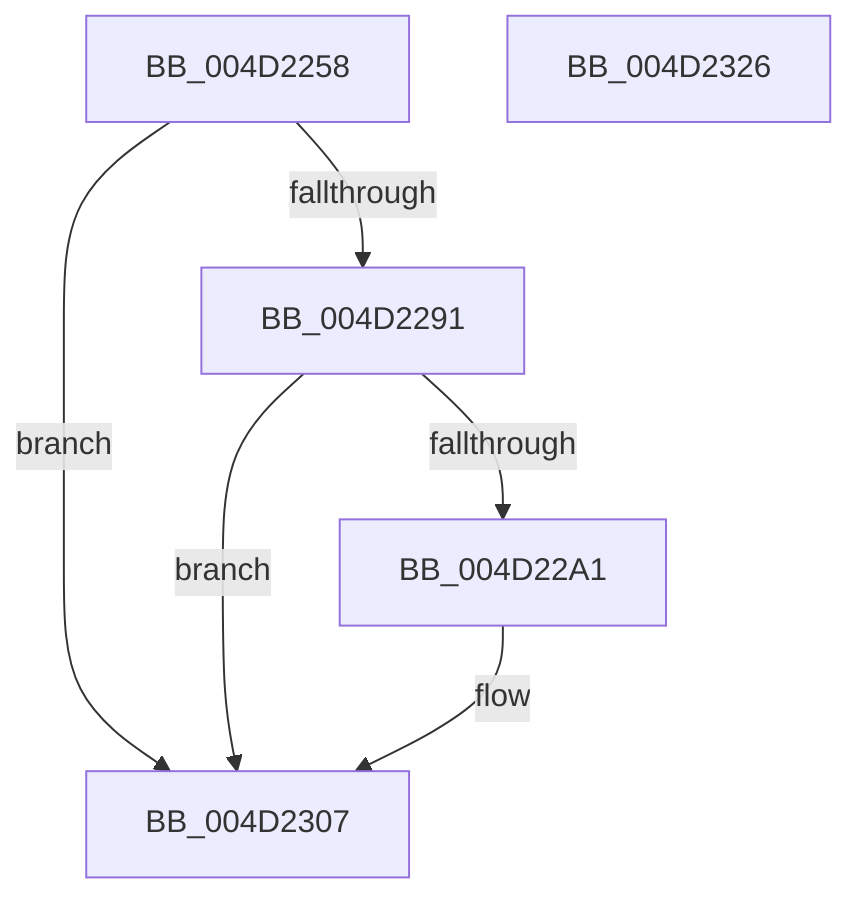

# PnpDiagnosticTraceElamDecision

- RVA: `0x004D2258`–`0x004D2327` (길이 `207` bytes)
- VA: `0x00000001404D2258`
- 실행 섹션: `.text`
- PDB 이름 있음: `예`; PDB Function 태그: `아니요`
- unwind 정보 RVA: `0x000BAAF0`
- 디코드: `48`개 명령, `207/207` bytes 표시
- 미해석 바이트: `0` (있으면 어셈블리에 `.byte`로 보존)

> 이 문서는 커널 이미지의 기계어와 PDB 기호를 분석해 생성했습니다. 4번과 5번은 함수 원형과 자료형을 바이너리 사용 방식에서 추정한 C 해석이며 원본 소스 복구 결과는 아닙니다.

## 1. Dependencies

- 직접 호출 지점: **3**; 고유 호출 대상: **3**
- 직접 호출자로 확인된 함수: **1**
- RIP 상대 이미지 참조: **3**

### Outgoing calls
- `0x004D2298` → [EtwEventEnabled](../39/EtwEventEnabled_function_00392450.md) (function, `0x00392450`)
- `0x004D2300` → [EtwWriteEx](../25/EtwWriteEx_function_0025F0D0.md) (function, `0x0025F0D0`)
- `0x004D2310` → [_security_check_cookie](../6A/_security_check_cookie_function_006AC640.md) (function, `0x006AC640`)

### Direct callers
- [PnpDoPolicyCheck](../../init/BE/PnpDoPolicyCheck_function_00BEECE0.md) at `0x00BEED41`

### Static image references
- `0x004D2275` → RVA `0x00E0A740` (`.data`; read)
- `0x004D2283` → RVA `0x00E662D8` (`.data`; read)
- `0x004D2291` → RVA `0x000273E0` (`.rdata`; read)

## 2. Other-region calls and transfers

- 다른 실행 섹션으로 향하는 call: **0**
- 별도 외부 분기/꼬리 이동을 확인하지 못했습니다.

## 3. Assembly (complete function range)

```asm
004D2258  48 8B C4                        mov rax, rsp
004D225B  48 89 58 08                     mov qword ptr [rax + 8], rbx
004D225F  44 89 48 20                     mov dword ptr [rax + 0x20], r9d
004D2263  44 89 40 18                     mov dword ptr [rax + 0x18], r8d
004D2267  89 50 10                        mov dword ptr [rax + 0x10], edx
004D226A  55                              push rbp
004D226B  48 8B EC                        mov rbp, rsp
004D226E  48 81 EC 80 00 00 00            sub rsp, 0x80
004D2275  48 8B 05 C4 84 93 00            mov rax, qword ptr [rip + 0x9384c4]
004D227C  48 33 C4                        xor rax, rsp
004D227F  48 89 45 F0                     mov qword ptr [rbp - 0x10], rax
004D2283  48 8B 0D 4E 40 99 00            mov rcx, qword ptr [rip + 0x99404e]
004D228A  33 DB                           xor ebx, ebx
004D228C  48 85 C9                        test rcx, rcx
004D228F  74 76                           je 0x1404d2307
004D2291  48 8D 15 48 51 B5 FF            lea rdx, [rip - 0x4aaeb8]
004D2298  E8 B3 01 EC FF                  call 0x140392450
004D229D  84 C0                           test al, al
004D229F  74 66                           je 0x1404d2307
004D22A1  48 8B 0D 30 40 99 00            mov rcx, qword ptr [rip + 0x994030]
004D22A8  48 8D 45 18                     lea rax, [rbp + 0x18]
004D22AC  48 89 45 C0                     mov qword ptr [rbp - 0x40], rax
004D22B0  48 8D 15 29 51 B5 FF            lea rdx, [rip - 0x4aaed7]
004D22B7  48 8D 45 20                     lea rax, [rbp + 0x20]
004D22BB  48 C7 45 C8 04 00 00 00         mov qword ptr [rbp - 0x38], 4
004D22C3  48 89 45 D0                     mov qword ptr [rbp - 0x30], rax
004D22C7  45 33 C9                        xor r9d, r9d
004D22CA  48 8D 45 28                     lea rax, [rbp + 0x28]
004D22CE  48 C7 45 D8 04 00 00 00         mov qword ptr [rbp - 0x28], 4
004D22D6  48 89 45 E0                     mov qword ptr [rbp - 0x20], rax
004D22DA  45 33 C0                        xor r8d, r8d
004D22DD  48 8D 45 C0                     lea rax, [rbp - 0x40]
004D22E1  48 C7 45 E8 04 00 00 00         mov qword ptr [rbp - 0x18], 4
004D22E9  48 89 44 24 38                  mov qword ptr [rsp + 0x38], rax
004D22EE  C7 44 24 30 03 00 00 00         mov dword ptr [rsp + 0x30], 3
004D22F6  48 89 5C 24 28                  mov qword ptr [rsp + 0x28], rbx
004D22FB  48 89 5C 24 20                  mov qword ptr [rsp + 0x20], rbx
004D2300  E8 CB CD D8 FF                  call 0x14025f0d0
004D2305  8B D8                           mov ebx, eax
004D2307  8B C3                           mov eax, ebx
004D2309  48 8B 4D F0                     mov rcx, qword ptr [rbp - 0x10]
004D230D  48 33 CC                        xor rcx, rsp
004D2310  E8 2B A3 1D 00                  call 0x1406ac640
004D2315  48 8B 9C 24 90 00 00 00         mov rbx, qword ptr [rsp + 0x90]
004D231D  48 81 C4 80 00 00 00            add rsp, 0x80
004D2324  5D                              pop rbp
004D2325  C3                              ret
004D2326  CC                              int3
```

## 4. C-style interpretation (structured pseudocode)

```c
__int64 __fastcall PnpDiagnosticTraceElamDecision(__int64 a1, int a2, int a3, int a4)
{
    __int64 result;
    __int64 v_rbx;
    __int64 v_rsp;
    unsigned __int64 v_stack_m18;
    unsigned __int64 v_stack_m20;
    unsigned __int64 v_stack_m28;
    unsigned __int64 v_stack_m30;
    unsigned __int64 v_stack_m38;
    unsigned __int64 v_stack_m40;
    unsigned __int64 v_stack_m48;
    unsigned __int64 v_stack_m50;
    unsigned int v_stack_m58;
    unsigned __int64 v_stack_m60;
    unsigned __int64 v_stack_m68;
    unsigned __int64 v_stack_p10;
    unsigned __int64 v_stack_p18;
    unsigned __int64 v_stack_p20;
    unsigned __int64 v_stack_p8;

    *(unsigned __int64 *)(v_rsp + 8) = v_rbx;
    *(unsigned int *)(v_rsp + 32) = a4;
    *(unsigned int *)(v_rsp + 24) = a3;
    *(unsigned int *)(v_rsp + 16) = a2;
    v_rsp = (v_rsp) - (128);
    result = (*(unsigned __int64 *)(v_rip + 9667780)) ^ (v_rsp);
    v_stack_m18 = result;
    v_rbx = 0;
    if (*(unsigned __int64 *)(v_rip + 10043470) == 0) goto loc_004D2307;
    result = EtwEventEnabled(*(unsigned __int64 *)(v_rip + 10043470), v_rip - 4894392, a3, a4);
    if ((unsigned __int8)(result) != 0) {
        a1 = *(unsigned __int64 *)(v_rip + 10043440);
        result = v_stack_p10;
        v_stack_m48 = result;
        a2 = v_rip - 4894423;
        result = v_stack_p18;
        v_stack_m40 = 4;
        v_stack_m38 = result;
        a4 = 0;
        result = v_stack_p20;
        v_stack_m30 = 4;
        v_stack_m28 = result;
        a3 = 0;
        result = v_stack_m48;
        v_stack_m20 = 4;
        v_stack_m50 = result;
        v_stack_m58 = 3;
        v_stack_m60 = 0;
        v_stack_m68 = 0;
        result = EtwWriteEx(a1, a2, a3, a4);
        v_rbx = (unsigned int)(result);
    }
    a1 = (v_stack_m18) ^ (v_rsp);
    result = _security_check_cookie(a1, a2, a3, a4);
    v_rsp = (v_rsp) + (128);
    return result;
}
```

## 5. (Beta) C Style

```c
int64_t PnpDiagnosticTraceElamDecision(int64_t Arg1, int32_t Arg2, int32_t Arg3, int32_t Arg4)
{
    int64_t result;
    int64_t local_rbx;
    int64_t local_rsp;
    uint64_t v_stack_m18;
    uint64_t v_stack_m20;
    uint64_t v_stack_m28;
    uint64_t v_stack_m30;
    uint64_t v_stack_m38;
    uint64_t v_stack_m40;
    uint64_t v_stack_m48;
    uint64_t v_stack_m50;
    uint32_t v_stack_m58;
    uint64_t v_stack_m60;
    uint64_t v_stack_m68;
    uint64_t v_stack_p10;
    uint64_t v_stack_p18;
    uint64_t v_stack_p20;
    uint64_t v_stack_p8;

    *(uint64_t *)(local_rsp + 0x8) = local_rbx;
    *(uint32_t *)(local_rsp + 0x20) = Arg4;
    *(uint32_t *)(local_rsp + 0x18) = Arg3;
    *(uint32_t *)(local_rsp + 0x10) = Arg2;
    local_rsp = (local_rsp) - (128);
    result = (*(uint64_t *)(v_rip + 0x9384C4)) ^ (local_rsp);
    v_stack_m18 = result;
    local_rbx = 0;
    if (*(uint64_t *)(v_rip + 0x99404E) == 0) goto loc_004D2307;
    result = EtwEventEnabled(*(uint64_t *)(v_rip + 0x99404E), v_rip - 4894392, Arg3, Arg4);
    if ((uint8_t)(result) != 0) {
        Arg1 = *(uint64_t *)(v_rip + 0x994030);
        result = v_stack_p10;
        v_stack_m48 = result;
        Arg2 = v_rip - 4894423;
        result = v_stack_p18;
        v_stack_m40 = 4;
        v_stack_m38 = result;
        Arg4 = 0;
        result = v_stack_p20;
        v_stack_m30 = 4;
        v_stack_m28 = result;
        Arg3 = 0;
        result = v_stack_m48;
        v_stack_m20 = 4;
        v_stack_m50 = result;
        v_stack_m58 = 3;
        v_stack_m60 = 0;
        v_stack_m68 = 0;
        result = EtwWriteEx(Arg1, Arg2, Arg3, Arg4);
        local_rbx = (uint32_t)(result);
    }
    Arg1 = (v_stack_m18) ^ (local_rsp);
    result = _security_check_cookie(Arg1, Arg2, Arg3, Arg4);
    local_rsp = (local_rsp) + (128);
    return result;
}
```

## 6. Execution-region graph

[열기: 2D/3D 그래프와 함수 탐색 컨트롤 패널](../../../control-panel.html?section=text&rva=0x004D2258&view=graph)

- 2D 그래프는 위에서 아래로 흐르고, 3D 그래프는 빈 공간을 드래그해 회전합니다. Shift+드래그는 이동, 휠은 확대·축소, 함수 노드 선택은 대상 보고서 이동입니다.

### Static fallback


