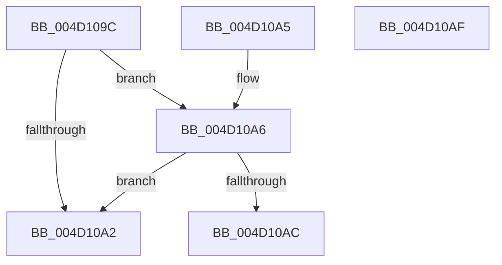

# PnpValidateRegistryDword

- RVA: `0x004D109C`–`0x004D10B0` (길이 `20` bytes)
- VA: `0x00000001404D109C`
- 실행 섹션: `.text`
- PDB 이름 있음: `예`; PDB Function 태그: `아니요`
- unwind 정보 RVA: `0x000DB714`
- 디코드: `10`개 명령, `20/20` bytes 표시
- 미해석 바이트: `0` (있으면 어셈블리에 `.byte`로 보존)

> 이 문서는 커널 이미지의 기계어와 PDB 기호를 분석해 생성했습니다. 4번과 5번은 함수 원형과 자료형을 바이너리 사용 방식에서 추정한 C 해석이며 원본 소스 복구 결과는 아닙니다.

## 1. Dependencies

- 직접 호출 지점: **0**; 고유 호출 대상: **0**
- 직접 호출자로 확인된 함수: **12**
- RIP 상대 이미지 참조: **0**

### Outgoing calls
- 직접 디코드된 call 명령이 없습니다.

### Direct callers
- [PnpGetRegistryDword](../4B/PnpGetRegistryDword_function_004BFDE8.md) at `0x004BFE2A`
- [PipDmgInitReadGroupPolicy](../../page/73/PipDmgInitReadGroupPolicy_function_007309B8.md) at `0x00730A22`
- [PiDevCfgFindDeviceMigrationNode](../../page/73/PiDevCfgFindDeviceMigrationNode_function_00732920.md) at `0x00732B16`
- [PiDevCfgFindDeviceMigrationNode](../../page/73/PiDevCfgFindDeviceMigrationNode_function_00732920.md) at `0x00733277`
- [PiDevCfgMakeServiceBootStart](../../page/73/PiDevCfgMakeServiceBootStart_function_00733BC8.md) at `0x00733C5D`
- [PiDevCfgMigrateRootDevice](../../page/73/PiDevCfgMigrateRootDevice_function_00733DF0.md) at `0x00733E55`
- [PiDevCfgQueryPolicyEnabled](../../page/73/PiDevCfgQueryPolicyEnabled_function_007352E8.md) at `0x0073531C`
- [PiDevCfgQueryPolicyStringList](../../page/73/PiDevCfgQueryPolicyStringList_function_00735358.md) at `0x007353D0`
- [PiDevCfgMigrateDevice](../../page/96/PiDevCfgMigrateDevice_function_00963E60.md) at `0x00964276`
- [PiDevCfgConfigureDeviceKeys](../../page/96/PiDevCfgConfigureDeviceKeys_function_00964BA8.md) at `0x00964D29`
- [PiDevCfgConfigureDeviceKeys](../../page/96/PiDevCfgConfigureDeviceKeys_function_00964BA8.md) at `0x00964D65`
- [PiDevCfgConfigureDeviceKeys](../../page/96/PiDevCfgConfigureDeviceKeys_function_00964BA8.md) at `0x00964DA6`
- [PiDevCfgVerifyDeviceAllowed](../../page/96/PiDevCfgVerifyDeviceAllowed_function_009664E4.md) at `0x0096659F`
- [PiDevCfgVerifyService](../../page/97/PiDevCfgVerifyService_function_00975EA0.md) at `0x00975F38`
- [PiDevCfgVerifyService](../../page/97/PiDevCfgVerifyService_function_00975EA0.md) at `0x00975F8F`
- [PiDevCfgVerifyService](../../page/97/PiDevCfgVerifyService_function_00975EA0.md) at `0x00975FE9`
- [PiDevCfgResolveVariableDeviceProperty](../../page/AA/PiDevCfgResolveVariableDeviceProperty_function_00AA63A0.md) at `0x00AA64C6`

### Static image references
- 디코드된 RIP-relative 메모리 참조가 없습니다.

## 2. Other-region calls and transfers

- 다른 실행 섹션으로 향하는 call: **0**
- 별도 외부 분기/꼬리 이동을 확인하지 못했습니다.

## 3. Assembly (complete function range)

```asm
004D109C  83 79 04 04                     cmp dword ptr [rcx + 4], 4
004D10A0  74 04                           je 0x1404d10a6
004D10A2  32 C0                           xor al, al
004D10A4  C3                              ret
004D10A5  CC                              int3
004D10A6  83 79 0C 04                     cmp dword ptr [rcx + 0xc], 4
004D10AA  75 F6                           jne 0x1404d10a2
004D10AC  B0 01                           mov al, 1
004D10AE  C3                              ret
004D10AF  CC                              int3
```

## 4. C-style interpretation (structured pseudocode)

```c
__int64 __fastcall PnpValidateRegistryDword(__int64 a1)
{
    __int64 result;

    if ((*(unsigned int *)(a1 + 4)) == 4) goto loc_004D10A6;
loc_004D10A2:
    result = 0;
    return result;
loc_004D10A6:
    if ((*(unsigned int *)(a1 + 12)) != 4) goto loc_004D10A2;
    return 1;
}
```

## 5. (Beta) C Style

```c
int64_t PnpValidateRegistryDword(void *Arg1)
{
    uint8_t *arg1 = (uint8_t *)Arg1;

    int64_t result;

    if ((*(uint32_t *)(arg1 + 0x4)) == 4) goto loc_004D10A6;
loc_004D10A2:
    result = 0;
    return result;
loc_004D10A6:
    if ((*(uint32_t *)(arg1 + 0xC)) != 4) goto loc_004D10A2;
    return 1;
}
```

### 관측된 메모리 오프셋

구조체 형식이 확인되지 않은 접근은 인자 기준의 오프셋으로만 기록했습니다.

| 기준 인자 | 오프셋 표현 | 폭 (bit) | 접근 |
|---|---:|---:|---|
| `Arg1` | `+ 0x4` | `32` | `R` |
| `Arg1` | `+ 0xC` | `32` | `R` |

## 6. Execution-region graph

[열기: 2D/3D 그래프와 함수 탐색 컨트롤 패널](../../../control-panel.html?section=text&rva=0x004D109C&view=graph)

- 2D 그래프는 위에서 아래로 흐르고, 3D 그래프는 빈 공간을 드래그해 회전합니다. Shift+드래그는 이동, 휠은 확대·축소, 함수 노드 선택은 대상 보고서 이동입니다.

### Static fallback


