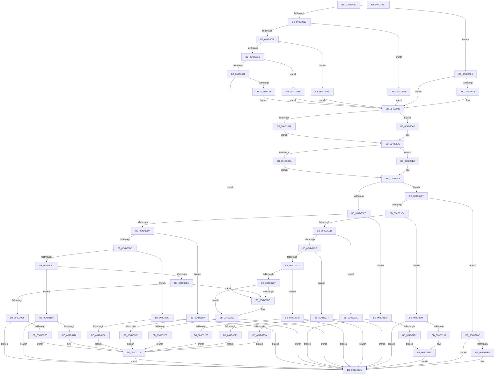

# PnpWatchdogEtwWrite

- RVA: `0x004D2FB0`–`0x004D32E8` (길이 `824` bytes)
- VA: `0x00000001404D2FB0`
- 실행 섹션: `.text`
- PDB 이름 있음: `예`; PDB Function 태그: `아니요`
- unwind 정보 RVA: `0x0007FA5C`
- 디코드: `201`개 명령, `824/824` bytes 표시
- 미해석 바이트: `0` (있으면 어셈블리에 `.byte`로 보존)

> 이 문서는 커널 이미지의 기계어와 PDB 기호를 분석해 생성했습니다. 4번과 5번은 함수 원형과 자료형을 바이너리 사용 방식에서 추정한 C 해석이며 원본 소스 복구 결과는 아닙니다.

## 1. Dependencies

- 직접 호출 지점: **3**; 고유 호출 대상: **3**
- 직접 호출자로 확인된 함수: **3**
- RIP 상대 이미지 참조: **17**

### Outgoing calls
- `0x004D3138` → [McTemplateK0izzx_EtwWriteTransfer](../5A/McTemplateK0izzx_EtwWriteTransfer_function_005A6134.md) (function, `0x005A6134`)
- `0x004D32A7` → [McTemplateK0izzxqjddjz_EtwWriteTransfer](../5A/McTemplateK0izzxqjddjz_EtwWriteTransfer_function_005A6238.md) (function, `0x005A6238`)
- `0x004D32C5` → [PnpTraceWatchdogViolation](../5A/PnpTraceWatchdogViolation_function_005AA2FC.md) (function, `0x005AA2FC`)

### Direct callers
- [PnpWatchdogSecondChanceCallback](../5A/PnpWatchdogSecondChanceCallback_function_005A67F0.md) at `0x005A6835`
- [PnpWatchdogFirstChanceCallback](../../page/72/PnpWatchdogFirstChanceCallback_function_0072B8C0.md) at `0x0072B8DA`
- [PnpDisableWatchdog](../../page/95/PnpDisableWatchdog_function_00955B00.md) at `0x00955B4C`
- [PnpDisableWatchdog](../../page/95/PnpDisableWatchdog_function_00955B00.md) at `0x00955B5F`

### Static image references
- `0x004D2FD1` → RVA `0x006C8EC0` (` ?? ::FNODOBFM::`string'`; read)
- `0x004D3043` → RVA `0x00F8CB20` (`.data`; read)
- `0x004D3053` → RVA `0x00E663B0` (`.data`; read)
- `0x004D3064` → RVA `0x00E663B8` (`.data`; read)
- `0x004D308A` → RVA `0x00E06F48` (`.data`; read)
- `0x004D30EF` → RVA `0x00EF012B` (`.data`; read)
- `0x004D30FD` → RVA `0x00027758` (`.rdata`; read)
- `0x004D3114` → RVA `0x000270F0` (`.rdata`; read)
- `0x004D3150` → RVA `0x00026F80` (`.rdata`; read)
- `0x004D3167` → RVA `0x00027060` (`.rdata`; read)
- `0x004D31AB` → RVA `0x00027370` (`.rdata`; read)
- `0x004D31E2` → RVA `0x00EF012C` (`.data`; reference)
- `0x004D31EF` → RVA `0x00027300` (`.rdata`; read)
- `0x004D3208` → RVA `0x00027160` (`.rdata`; read)
- `0x004D3221` → RVA `0x00026CA0` (`.rdata`; read)
- `0x004D323A` → RVA `0x00027560` (`.rdata`; read)
- `0x004D327C` → RVA `0x00027490` (`.rdata`; read)

## 2. Other-region calls and transfers

- 다른 실행 섹션으로 향하는 call: **0**
- 별도 외부 분기/꼬리 이동을 확인하지 못했습니다.

## 3. Assembly (complete function range)

```asm
004D2FB0  4C 8B DC                        mov r11, rsp
004D2FB3  49 89 5B 08                     mov qword ptr [r11 + 8], rbx
004D2FB7  49 89 6B 10                     mov qword ptr [r11 + 0x10], rbp
004D2FBB  49 89 73 18                     mov qword ptr [r11 + 0x18], rsi
004D2FBF  57                              push rdi
004D2FC0  48 81 EC 80 00 00 00            sub rsp, 0x80
004D2FC7  33 F6                           xor esi, esi
004D2FC9  49 C7 43 E8 00 00 02 00         mov qword ptr [r11 - 0x18], 0x20000
004D2FD1  48 8D 05 E8 5E 1F 00            lea rax, [rip + 0x1f5ee8]
004D2FD8  48 8B D9                        mov rbx, rcx
004D2FDB  49 89 43 F0                     mov qword ptr [r11 - 0x10], rax
004D2FDF  8B FA                           mov edi, edx
004D2FE1  48 A1 08 00 00 00 80 F7 FF FF   movabs rax, qword ptr [0xfffff78000000008]
004D2FEB  44 8B D6                        mov r10d, esi
004D2FEE  4C 8B C0                        mov r8, rax
004D2FF1  8D 6E 02                        lea ebp, [rsi + 2]
004D2FF4  4C 2B 01                        sub r8, qword ptr [rcx]
004D2FF7  48 B8 4B 59 86 38 D6 C5 6D 34   movabs rax, 0x346dc5d63886594b
004D3001  8B 49 10                        mov ecx, dword ptr [rcx + 0x10]
004D3004  49 F7 E0                        mul r8
004D3007  4C 8B C2                        mov r8, rdx
004D300A  49 C1 E8 0B                     shr r8, 0xb
004D300E  83 E9 01                        sub ecx, 1
004D3011  74 51                           je 0x1404d3064
004D3013  83 E9 01                        sub ecx, 1
004D3016  74 3B                           je 0x1404d3053
004D3018  83 E9 01                        sub ecx, 1
004D301B  74 26                           je 0x1404d3043
004D301D  83 E9 01                        sub ecx, 1
004D3020  74 13                           je 0x1404d3035
004D3022  83 F9 01                        cmp ecx, 1
004D3025  0F 85 B0 01 00 00               jne 0x1404d31db
004D302B  48 8B 43 18                     mov rax, qword ptr [rbx + 0x18]
004D302F  4C 8B 58 10                     mov r11, qword ptr [rax + 0x10]
004D3033  EB 4E                           jmp 0x1404d3083
004D3035  48 8B 43 18                     mov rax, qword ptr [rbx + 0x18]
004D3039  4C 8B 58 18                     mov r11, qword ptr [rax + 0x18]
004D303D  4C 8B 50 08                     mov r10, qword ptr [rax + 8]
004D3041  EB 40                           jmp 0x1404d3083
004D3043  4C 8B 1D D6 9A AB 00            mov r11, qword ptr [rip + 0xab9ad6]
004D304A  48 8B 43 18                     mov rax, qword ptr [rbx + 0x18]
004D304E  4C 8B 10                        mov r10, qword ptr [rax]
004D3051  EB 30                           jmp 0x1404d3083
004D3053  4C 8B 1D 56 33 99 00            mov r11, qword ptr [rip + 0x993356]
004D305A  48 8B 43 18                     mov rax, qword ptr [rbx + 0x18]
004D305E  4C 8B 50 10                     mov r10, qword ptr [rax + 0x10]
004D3062  EB 1F                           jmp 0x1404d3083
004D3064  4C 8B 1D 4D 33 99 00            mov r11, qword ptr [rip + 0x99334d]
004D306B  48 8B 43 18                     mov rax, qword ptr [rbx + 0x18]
004D306F  48 8B 40 08                     mov rax, qword ptr [rax + 8]
004D3073  48 85 C0                        test rax, rax
004D3076  74 0B                           je 0x1404d3083
004D3078  48 8B 80 38 01 00 00            mov rax, qword ptr [rax + 0x138]
004D307F  4C 8B 50 28                     mov r10, qword ptr [rax + 0x28]
004D3083  48 8D 43 28                     lea rax, [rbx + 0x28]
004D3087  66 39 30                        cmp word ptr [rax], si
004D308A  4C 8D 0D B7 3E 93 00            lea r9, [rip + 0x933eb7]
004D3091  4C 0F 47 C8                     cmova r9, rax
004D3095  4D 85 D2                        test r10, r10
004D3098  74 06                           je 0x1404d30a0
004D309A  49 83 C2 28                     add r10, 0x28
004D309E  EB 05                           jmp 0x1404d30a5
004D30A0  4C 8D 54 24 70                  lea r10, [rsp + 0x70]
004D30A5  4D 85 DB                        test r11, r11
004D30A8  74 09                           je 0x1404d30b3
004D30AA  4D 8B 9B 10 05 00 00            mov r11, qword ptr [r11 + 0x510]
004D30B1  EB 10                           jmp 0x1404d30c3
004D30B3  65 48 8B 04 25 88 01 00 00      mov rax, qword ptr gs:[0x188]
004D30BC  4C 8B 98 10 05 00 00            mov r11, qword ptr [rax + 0x510]
004D30C3  85 FF                           test edi, edi
004D30C5  0F 85 EC 00 00 00               jne 0x1404d31b7
004D30CB  8B 4B 10                        mov ecx, dword ptr [rbx + 0x10]
004D30CE  83 E9 01                        sub ecx, 1
004D30D1  0F 84 99 00 00 00               je 0x1404d3170
004D30D7  83 E9 01                        sub ecx, 1
004D30DA  74 7D                           je 0x1404d3159
004D30DC  83 E9 01                        sub ecx, 1
004D30DF  74 61                           je 0x1404d3142
004D30E1  83 E9 01                        sub ecx, 1
004D30E4  74 20                           je 0x1404d3106
004D30E6  83 F9 01                        cmp ecx, 1
004D30E9  0F 85 EC 00 00 00               jne 0x1404d31db
004D30EF  8A 05 36 D0 A1 00               mov al, byte ptr [rip + 0xa1d036]
004D30F5  84 C0                           test al, al
004D30F7  0F 89 D1 01 00 00               jns 0x1404d32ce
004D30FD  48 8D 15 54 46 B5 FF            lea rdx, [rip - 0x4ab9ac]
004D3104  EB 15                           jmp 0x1404d311b
004D3106  8A 05 1F D0 A1 00               mov al, byte ptr [rip + 0xa1d01f]
004D310C  84 C0                           test al, al
004D310E  0F 89 BA 01 00 00               jns 0x1404d32ce
004D3114  48 8D 15 D5 3F B5 FF            lea rdx, [rip - 0x4ac02b]
004D311B  41 8B C0                        mov eax, r8d
004D311E  48 89 44 24 30                  mov qword ptr [rsp + 0x30], rax
004D3123  49 8B 41 08                     mov rax, qword ptr [r9 + 8]
004D3127  4D 8B CB                        mov r9, r11
004D312A  48 89 44 24 28                  mov qword ptr [rsp + 0x28], rax
004D312F  49 8B 42 08                     mov rax, qword ptr [r10 + 8]
004D3133  48 89 44 24 20                  mov qword ptr [rsp + 0x20], rax
004D3138  E8 F7 2F 0D 00                  call 0x1405a6134
004D313D  E9 8C 01 00 00                  jmp 0x1404d32ce
004D3142  8A 05 E3 CF A1 00               mov al, byte ptr [rip + 0xa1cfe3]
004D3148  84 C0                           test al, al
004D314A  0F 89 7E 01 00 00               jns 0x1404d32ce
004D3150  48 8D 15 29 3E B5 FF            lea rdx, [rip - 0x4ac1d7]
004D3157  EB C2                           jmp 0x1404d311b
004D3159  8A 05 CC CF A1 00               mov al, byte ptr [rip + 0xa1cfcc]
004D315F  84 C0                           test al, al
004D3161  0F 89 67 01 00 00               jns 0x1404d32ce
004D3167  48 8D 15 F2 3E B5 FF            lea rdx, [rip - 0x4ac10e]
004D316E  EB AB                           jmp 0x1404d311b
004D3170  8A 05 B5 CF A1 00               mov al, byte ptr [rip + 0xa1cfb5]
004D3176  48 8B 5B 18                     mov rbx, qword ptr [rbx + 0x18]
004D317A  84 C0                           test al, al
004D317C  0F 89 4C 01 00 00               jns 0x1404d32ce
004D3182  48 8B 43 48                     mov rax, qword ptr [rbx + 0x48]
004D3186  48 8D 53 1C                     lea rdx, [rbx + 0x1c]
004D318A  48 89 44 24 60                  mov qword ptr [rsp + 0x60], rax
004D318F  48 8D 4B 2C                     lea rcx, [rbx + 0x2c]
004D3193  8B 43 18                        mov eax, dword ptr [rbx + 0x18]
004D3196  48 89 4C 24 58                  mov qword ptr [rsp + 0x58], rcx
004D319B  89 44 24 50                     mov dword ptr [rsp + 0x50], eax
004D319F  8B 43 10                        mov eax, dword ptr [rbx + 0x10]
004D31A2  89 44 24 48                     mov dword ptr [rsp + 0x48], eax
004D31A6  48 89 54 24 40                  mov qword ptr [rsp + 0x40], rdx
004D31AB  48 8D 15 BE 41 B5 FF            lea rdx, [rip - 0x4abe42]
004D31B2  E9 CC 00 00 00                  jmp 0x1404d3283
004D31B7  BE 01 00 00 00                  mov esi, 1
004D31BC  3B FE                           cmp edi, esi
004D31BE  0F 85 EA 00 00 00               jne 0x1404d32ae
004D31C4  8B 4B 10                        mov ecx, dword ptr [rbx + 0x10]
004D31C7  2B CE                           sub ecx, esi
004D31C9  74 7B                           je 0x1404d3246
004D31CB  2B CE                           sub ecx, esi
004D31CD  74 5E                           je 0x1404d322d
004D31CF  2B CE                           sub ecx, esi
004D31D1  74 41                           je 0x1404d3214
004D31D3  2B CE                           sub ecx, esi
004D31D5  74 24                           je 0x1404d31fb
004D31D7  3B CE                           cmp ecx, esi
004D31D9  74 07                           je 0x1404d31e2
004D31DB  B9 05 00 00 00                  mov ecx, 5
004D31E0  CD 29                           int 0x29
004D31E2  40 84 35 43 CF A1 00            test byte ptr [rip + 0xa1cf43], sil
004D31E9  0F 84 DF 00 00 00               je 0x1404d32ce
004D31EF  48 8D 15 0A 41 B5 FF            lea rdx, [rip - 0x4abef6]
004D31F6  E9 20 FF FF FF                  jmp 0x1404d311b
004D31FB  40 84 35 2A CF A1 00            test byte ptr [rip + 0xa1cf2a], sil
004D3202  0F 84 C6 00 00 00               je 0x1404d32ce
004D3208  48 8D 15 51 3F B5 FF            lea rdx, [rip - 0x4ac0af]
004D320F  E9 07 FF FF FF                  jmp 0x1404d311b
004D3214  40 84 35 11 CF A1 00            test byte ptr [rip + 0xa1cf11], sil
004D321B  0F 84 AD 00 00 00               je 0x1404d32ce
004D3221  48 8D 15 78 3A B5 FF            lea rdx, [rip - 0x4ac588]
004D3228  E9 EE FE FF FF                  jmp 0x1404d311b
004D322D  40 84 35 F8 CE A1 00            test byte ptr [rip + 0xa1cef8], sil
004D3234  0F 84 94 00 00 00               je 0x1404d32ce
004D323A  48 8D 15 1F 43 B5 FF            lea rdx, [rip - 0x4abce1]
004D3241  E9 D5 FE FF FF                  jmp 0x1404d311b
004D3246  40 84 35 DF CE A1 00            test byte ptr [rip + 0xa1cedf], sil
004D324D  48 8B 5B 18                     mov rbx, qword ptr [rbx + 0x18]
004D3251  74 7B                           je 0x1404d32ce
004D3253  48 8B 43 48                     mov rax, qword ptr [rbx + 0x48]
004D3257  48 8D 53 1C                     lea rdx, [rbx + 0x1c]
004D325B  48 89 44 24 60                  mov qword ptr [rsp + 0x60], rax
004D3260  48 8D 4B 2C                     lea rcx, [rbx + 0x2c]
004D3264  8B 43 18                        mov eax, dword ptr [rbx + 0x18]
004D3267  48 89 4C 24 58                  mov qword ptr [rsp + 0x58], rcx
004D326C  89 44 24 50                     mov dword ptr [rsp + 0x50], eax
004D3270  8B 43 10                        mov eax, dword ptr [rbx + 0x10]
004D3273  89 44 24 48                     mov dword ptr [rsp + 0x48], eax
004D3277  48 89 54 24 40                  mov qword ptr [rsp + 0x40], rdx
004D327C  48 8D 15 0D 42 B5 FF            lea rdx, [rip - 0x4abdf3]
004D3283  8B 43 14                        mov eax, dword ptr [rbx + 0x14]
004D3286  89 44 24 38                     mov dword ptr [rsp + 0x38], eax
004D328A  49 8B 41 08                     mov rax, qword ptr [r9 + 8]
004D328E  4D 8B CB                        mov r9, r11
004D3291  45 8B C0                        mov r8d, r8d
004D3294  4C 89 44 24 30                  mov qword ptr [rsp + 0x30], r8
004D3299  48 89 44 24 28                  mov qword ptr [rsp + 0x28], rax
004D329E  49 8B 42 08                     mov rax, qword ptr [r10 + 8]
004D32A2  48 89 44 24 20                  mov qword ptr [rsp + 0x20], rax
004D32A7  E8 8C 2F 0D 00                  call 0x1405a6238
004D32AC  EB 20                           jmp 0x1404d32ce
004D32AE  8D 47 FE                        lea eax, [rdi - 2]
004D32B1  3B C6                           cmp eax, esi
004D32B3  77 19                           ja 0x1404d32ce
004D32B5  8B 4B 10                        mov ecx, dword ptr [rbx + 0x10]
004D32B8  3B FD                           cmp edi, ebp
004D32BA  4C 89 4C 24 20                  mov qword ptr [rsp + 0x20], r9
004D32BF  4D 8B CA                        mov r9, r10
004D32C2  0F 94 C2                        sete dl
004D32C5  E8 32 70 0D 00                  call 0x1405aa2fc
004D32CA  40 88 73 21                     mov byte ptr [rbx + 0x21], sil
004D32CE  4C 8D 9C 24 80 00 00 00         lea r11, [rsp + 0x80]
004D32D6  49 8B 5B 10                     mov rbx, qword ptr [r11 + 0x10]
004D32DA  49 8B 6B 18                     mov rbp, qword ptr [r11 + 0x18]
004D32DE  49 8B 73 20                     mov rsi, qword ptr [r11 + 0x20]
004D32E2  49 8B E3                        mov rsp, r11
004D32E5  5F                              pop rdi
004D32E6  C3                              ret
004D32E7  CC                              int3
```

## 4. C-style interpretation (structured pseudocode)

```c
__int64 __fastcall PnpWatchdogEtwWrite(__int64 a1, __int64 a2)
{
    __int64 result;
    __int64 v_r10;
    __int64 v_rsi;
    __int64 v_rsp;
    unsigned __int64 v_stack_m18;
    unsigned __int64 v_stack_m28;
    unsigned __int64 v_stack_m30;
    unsigned int v_stack_m38;
    unsigned int v_stack_m40;
    unsigned __int64 v_stack_m48;
    unsigned int v_stack_m50;
    unsigned __int64 v_stack_m58;
    unsigned __int64 v_stack_m60;
    unsigned __int64 v_stack_m68;
    unsigned __int64 v_stack_m8;

    *(unsigned __int64 *)(v_rsp + 8) = v_rbx;
    *(unsigned __int64 *)(v_rsp + 16) = v_rbp;
    *(unsigned __int64 *)(v_rsp + 24) = v_rsi;
    v_rsp = (v_rsp) - (128);
    v_rsi = 0;
    *(unsigned __int64 *)(v_rsp - 24) = 0x20000ULL;
    *(unsigned __int64 *)(v_rsp - 16) = v_rip + 2055912;
    a3 = (v_rip + 2055912) - (*(unsigned __int64 *)(a1));
    a3 = (a2) >> (11);
    a1 = (unsigned int)(((unsigned int)(*(unsigned int *)(a1 + 16))) - (1));
    if (condition_is_equal) goto loc_004D3064;
    a1 = (unsigned int)((a1) - (1));
    if (condition_is_equal) goto loc_004D3053;
    a1 = (unsigned int)((a1) - (1));
    if (condition_is_equal) goto loc_004D3043;
    a1 = (unsigned int)((a1) - (1));
    if (condition_is_equal) goto loc_004D3035;
    if (((unsigned int)(a1)) != 1) goto loc_004D31DB;
    goto loc_004D3083;
loc_004D3035:
    goto loc_004D3083;
loc_004D3043:
    goto loc_004D3083;
loc_004D3053:
    goto loc_004D3083;
loc_004D3064:
    result = *(unsigned __int64 *)(*(unsigned __int64 *)(a1 + 24) + 8);
    v_r10 = *(unsigned __int64 *)(*(unsigned __int64 *)(a1 + 24) + 16);
    if (*(unsigned __int64 *)(*(unsigned __int64 *)(a1 + 24) + 8) != 0) {
        result = *(unsigned __int64 *)(*(unsigned __int64 *)(*(unsigned __int64 *)(a1 + 24) + 8) + 312);
        v_r10 = *(unsigned __int64 *)(result + 40);
    }
    a4 = v_rip + 9649847;
    if ((*(unsigned __int16 *)(a1 + 40)) > 0) { a4 = a1 + 40; }
    if (v_r10 == 0) goto loc_004D30A0;
    v_r10 = (v_r10) + (40);
    goto loc_004D30A5;
loc_004D30A0:
loc_004D30A5:
    if (*(unsigned __int64 *)(v_rip + 10040141) == 0) goto loc_004D30B3;
    goto loc_004D30C3;
loc_004D30B3:
loc_004D30C3:
    if ((unsigned int)((unsigned int)((unsigned int)(a2))) != 0) goto loc_004D31B7;
    a1 = (unsigned int)(((unsigned int)(*(unsigned int *)(a1 + 16))) - (1));
    if (condition_is_equal) goto loc_004D3170;
    a1 = (unsigned int)((a1) - (1));
    if (condition_is_equal) goto loc_004D3159;
    a1 = (unsigned int)((a1) - (1));
    if (condition_is_equal) goto loc_004D3142;
    a1 = (unsigned int)((a1) - (1));
    if (condition_is_equal) goto loc_004D3106;
    if (((unsigned int)(a1)) != 1) goto loc_004D31DB;
    if (!sign_flag) goto loc_004D32CE;
    goto loc_004D311B;
loc_004D3106:
    if (!sign_flag) goto loc_004D32CE;
loc_004D311B:
    v_stack_m58 = (unsigned int)((unsigned int)(a3));
    v_stack_m60 = *(unsigned __int64 *)(a4 + 8);
    v_stack_m68 = *(unsigned __int64 *)(v_stack_m18 + 8);
    result = McTemplateK0izzx_EtwWriteTransfer(a1, v_rip - 4898859, a3, *(unsigned __int64 *)(*(unsigned __int64 *)(gs_base + (0 + 392)) + 1296));
    goto loc_004D32CE;
loc_004D3142:
    if (!sign_flag) goto loc_004D32CE;
    goto loc_004D311B;
loc_004D3159:
    if (!sign_flag) goto loc_004D32CE;
    goto loc_004D311B;
loc_004D3170:
    if (!sign_flag) goto loc_004D32CE;
    v_stack_m28 = *(unsigned __int64 *)(*(unsigned __int64 *)(a1 + 24) + 72);
    v_stack_m30 = *(unsigned __int64 *)(a1 + 24) + 44;
    v_stack_m38 = (unsigned int)((unsigned int)(*(unsigned int *)(*(unsigned __int64 *)(a1 + 24) + 24)));
    v_stack_m40 = (unsigned int)((unsigned int)(*(unsigned int *)(*(unsigned __int64 *)(a1 + 24) + 16)));
    v_stack_m48 = *(unsigned __int64 *)(a1 + 24) + 28;
    goto loc_004D3283;
loc_004D31B7:
    if (((unsigned int)((unsigned int)((unsigned int)(a2)))) != 1) goto loc_004D32AE;
    a1 = (unsigned int)(((unsigned int)(*(unsigned int *)(*(unsigned __int64 *)(a1 + 24) + 16))) - (1));
    if (condition_is_equal) goto loc_004D3246;
    a1 = (unsigned int)((a1) - (1));
    if (condition_is_equal) goto loc_004D322D;
    a1 = (unsigned int)((a1) - (1));
    if (condition_is_equal) goto loc_004D3214;
    a1 = (unsigned int)((a1) - (1));
    if (condition_is_equal) goto loc_004D31FB;
    if (((unsigned int)(a1)) != 1) {
        a1 = 5;
    }
    if (((*(unsigned __int8 *)(v_rip + 10604355)) & (1)) == 0) goto loc_004D32CE;
    goto loc_004D311B;
loc_004D31FB:
    if (((*(unsigned __int8 *)(v_rip + 10604330)) & (1)) == 0) goto loc_004D32CE;
    goto loc_004D311B;
loc_004D3214:
    if (((*(unsigned __int8 *)(v_rip + 10604305)) & (1)) == 0) goto loc_004D32CE;
    goto loc_004D311B;
loc_004D322D:
    if (((*(unsigned __int8 *)(v_rip + 10604280)) & (1)) == 0) goto loc_004D32CE;
    goto loc_004D311B;
loc_004D3246:
    if (((*(unsigned __int8 *)(v_rip + 10604255)) & (1)) == 0) goto loc_004D32CE;
    v_stack_m28 = *(unsigned __int64 *)(*(unsigned __int64 *)(*(unsigned __int64 *)(a1 + 24) + 24) + 72);
    v_stack_m30 = *(unsigned __int64 *)(*(unsigned __int64 *)(a1 + 24) + 24) + 44;
    v_stack_m38 = (unsigned int)((unsigned int)(*(unsigned int *)(*(unsigned __int64 *)(*(unsigned __int64 *)(a1 + 24) + 24) + 24)));
    v_stack_m40 = (unsigned int)((unsigned int)(*(unsigned int *)(*(unsigned __int64 *)(*(unsigned __int64 *)(a1 + 24) + 24) + 16)));
    v_stack_m48 = *(unsigned __int64 *)(*(unsigned __int64 *)(a1 + 24) + 24) + 28;
loc_004D3283:
    v_stack_m50 = (unsigned int)((unsigned int)(*(unsigned int *)(*(unsigned __int64 *)(*(unsigned __int64 *)(a1 + 24) + 24) + 20)));
    v_stack_m58 = (unsigned int)((unsigned int)(a3));
    v_stack_m60 = *(unsigned __int64 *)(*(unsigned __int64 *)(*(unsigned __int64 *)(gs_base + (0 + 392)) + 1296) + 8);
    v_stack_m68 = *(unsigned __int64 *)(v_stack_m18 + 8);
    result = McTemplateK0izzxqjddjz_EtwWriteTransfer(*(unsigned __int64 *)(*(unsigned __int64 *)(a1 + 24) + 24) + 44, v_rip - 4898291, (unsigned int)((unsigned int)(a3)), *(unsigned __int64 *)(*(unsigned __int64 *)(gs_base + (0 + 392)) + 1296));
    goto loc_004D32CE;
loc_004D32AE:
    result = (unsigned int)((unsigned int)(a2)) - 2;
    if (((unsigned int)((unsigned int)((unsigned int)(a2)) - 2)) <= 1) {
        a1 = *(unsigned int *)(*(unsigned __int64 *)(*(unsigned __int64 *)(a1 + 24) + 24) + 16);
        v_stack_m68 = *(unsigned __int64 *)(*(unsigned __int64 *)(gs_base + (0 + 392)) + 1296);
        a4 = v_stack_m18;
        a2 = (((unsigned int)((unsigned int)((unsigned int)(a2)))) == ((unsigned int)(v_rsi + 2))) ? 1 : 0;
        result = PnpTraceWatchdogViolation(a1, a2, (unsigned int)((unsigned int)(a3)), a4);
        *(unsigned __int8 *)(*(unsigned __int64 *)(*(unsigned __int64 *)(a1 + 24) + 24) + 33) = 1;
    }
    return result;
}
```

## 5. (Beta) C Style

```c
int64_t PnpWatchdogEtwWrite(void *Arg1, int64_t Arg2)
{
    uint8_t *arg1 = (uint8_t *)Arg1;

    int64_t result;
    int64_t local_r10;
    int64_t local_rsi;
    int64_t local_rsp;
    uint64_t v_stack_m18;
    uint64_t v_stack_m28;
    uint64_t v_stack_m30;
    uint32_t v_stack_m38;
    uint32_t v_stack_m40;
    uint64_t v_stack_m48;
    uint32_t v_stack_m50;
    uint64_t v_stack_m58;
    uint64_t v_stack_m60;
    uint64_t v_stack_m68;
    uint64_t v_stack_m8;

    *(uint64_t *)(local_rsp + 0x8) = local_rbx;
    *(uint64_t *)(local_rsp + 0x10) = local_rbp;
    *(uint64_t *)(local_rsp + 0x18) = local_rsi;
    local_rsp = (local_rsp) - (128);
    local_rsi = 0;
    *(uint64_t *)(local_rsp - 0x18) = 0x20000ULL;
    *(uint64_t *)(local_rsp - 0x10) = v_rip + 2055912;
    a3 = (v_rip + 2055912) - (*(uint64_t *)(arg1));
    a3 = (Arg2) >> (11);
    Arg1 = (uint32_t)(((uint32_t)(*(uint32_t *)(arg1 + 0x10))) - (1));
    if (condition_is_equal) goto loc_004D3064;
    Arg1 = (uint32_t)((Arg1) - (1));
    if (condition_is_equal) goto loc_004D3053;
    Arg1 = (uint32_t)((Arg1) - (1));
    if (condition_is_equal) goto loc_004D3043;
    Arg1 = (uint32_t)((Arg1) - (1));
    if (condition_is_equal) goto loc_004D3035;
    if (((uint32_t)(Arg1)) != 1) goto loc_004D31DB;
    goto loc_004D3083;
loc_004D3035:
    goto loc_004D3083;
loc_004D3043:
    goto loc_004D3083;
loc_004D3053:
    goto loc_004D3083;
loc_004D3064:
    result = *(uint64_t *)(*(uint64_t *)(arg1 + 0x18) + 0x8);
    local_r10 = *(uint64_t *)(*(uint64_t *)(arg1 + 0x18) + 0x10);
    if (*(uint64_t *)(*(uint64_t *)(arg1 + 0x18) + 0x8) != 0) {
        result = *(uint64_t *)(*(uint64_t *)(*(uint64_t *)(arg1 + 0x18) + 0x8) + 0x138);
        local_r10 = *(uint64_t *)(result + 0x28);
    }
    a4 = v_rip + 9649847;
    if ((*(uint16_t *)(arg1 + 0x28)) > 0) { a4 = Arg1 + 40; }
    if (local_r10 == 0) goto loc_004D30A0;
    local_r10 = (local_r10) + (40);
    goto loc_004D30A5;
loc_004D30A0:
loc_004D30A5:
    if (*(uint64_t *)(v_rip + 0x99334D) == 0) goto loc_004D30B3;
    goto loc_004D30C3;
loc_004D30B3:
loc_004D30C3:
    if ((uint32_t)((uint32_t)((uint32_t)(Arg2))) != 0) goto loc_004D31B7;
    Arg1 = (uint32_t)(((uint32_t)(*(uint32_t *)(arg1 + 0x10))) - (1));
    if (condition_is_equal) goto loc_004D3170;
    Arg1 = (uint32_t)((Arg1) - (1));
    if (condition_is_equal) goto loc_004D3159;
    Arg1 = (uint32_t)((Arg1) - (1));
    if (condition_is_equal) goto loc_004D3142;
    Arg1 = (uint32_t)((Arg1) - (1));
    if (condition_is_equal) goto loc_004D3106;
    if (((uint32_t)(Arg1)) != 1) goto loc_004D31DB;
    if (!sign_flag) goto loc_004D32CE;
    goto loc_004D311B;
loc_004D3106:
    if (!sign_flag) goto loc_004D32CE;
loc_004D311B:
    v_stack_m58 = (uint32_t)((uint32_t)(a3));
    v_stack_m60 = *(uint64_t *)(a4 + 0x8);
    v_stack_m68 = *(uint64_t *)(v_stack_m18 + 0x8);
    result = McTemplateK0izzx_EtwWriteTransfer(Arg1, v_rip - 4898859, a3, *(uint64_t *)(*(uint64_t *)(gs_base + (0 + 0x188)) + 0x510));
    goto loc_004D32CE;
loc_004D3142:
    if (!sign_flag) goto loc_004D32CE;
    goto loc_004D311B;
loc_004D3159:
    if (!sign_flag) goto loc_004D32CE;
    goto loc_004D311B;
loc_004D3170:
    if (!sign_flag) goto loc_004D32CE;
    v_stack_m28 = *(uint64_t *)(*(uint64_t *)(arg1 + 0x18) + 0x48);
    v_stack_m30 = *(uint64_t *)(arg1 + 0x18) + 44;
    v_stack_m38 = (uint32_t)((uint32_t)(*(uint32_t *)(*(uint64_t *)(arg1 + 0x18) + 0x18)));
    v_stack_m40 = (uint32_t)((uint32_t)(*(uint32_t *)(*(uint64_t *)(arg1 + 0x18) + 0x10)));
    v_stack_m48 = *(uint64_t *)(arg1 + 0x18) + 28;
    goto loc_004D3283;
loc_004D31B7:
    if (((uint32_t)((uint32_t)((uint32_t)(Arg2)))) != 1) goto loc_004D32AE;
    Arg1 = (uint32_t)(((uint32_t)(*(uint32_t *)(*(uint64_t *)(arg1 + 0x18) + 0x10))) - (1));
    if (condition_is_equal) goto loc_004D3246;
    Arg1 = (uint32_t)((Arg1) - (1));
    if (condition_is_equal) goto loc_004D322D;
    Arg1 = (uint32_t)((Arg1) - (1));
    if (condition_is_equal) goto loc_004D3214;
    Arg1 = (uint32_t)((Arg1) - (1));
    if (condition_is_equal) goto loc_004D31FB;
    if (((uint32_t)(Arg1)) != 1) {
        Arg1 = 5;
    }
    if (((*(uint8_t *)(v_rip + 0xA1CF43)) & (1)) == 0) goto loc_004D32CE;
    goto loc_004D311B;
loc_004D31FB:
    if (((*(uint8_t *)(v_rip + 0xA1CF2A)) & (1)) == 0) goto loc_004D32CE;
    goto loc_004D311B;
loc_004D3214:
    if (((*(uint8_t *)(v_rip + 0xA1CF11)) & (1)) == 0) goto loc_004D32CE;
    goto loc_004D311B;
loc_004D322D:
    if (((*(uint8_t *)(v_rip + 0xA1CEF8)) & (1)) == 0) goto loc_004D32CE;
    goto loc_004D311B;
loc_004D3246:
    if (((*(uint8_t *)(v_rip + 0xA1CEDF)) & (1)) == 0) goto loc_004D32CE;
    v_stack_m28 = *(uint64_t *)(*(uint64_t *)(*(uint64_t *)(arg1 + 0x18) + 0x18) + 0x48);
    v_stack_m30 = *(uint64_t *)(*(uint64_t *)(arg1 + 0x18) + 0x18) + 44;
    v_stack_m38 = (uint32_t)((uint32_t)(*(uint32_t *)(*(uint64_t *)(*(uint64_t *)(arg1 + 0x18) + 0x18) + 0x18)));
    v_stack_m40 = (uint32_t)((uint32_t)(*(uint32_t *)(*(uint64_t *)(*(uint64_t *)(arg1 + 0x18) + 0x18) + 0x10)));
    v_stack_m48 = *(uint64_t *)(*(uint64_t *)(arg1 + 0x18) + 0x18) + 28;
loc_004D3283:
    v_stack_m50 = (uint32_t)((uint32_t)(*(uint32_t *)(*(uint64_t *)(*(uint64_t *)(arg1 + 0x18) + 0x18) + 0x14)));
    v_stack_m58 = (uint32_t)((uint32_t)(a3));
    v_stack_m60 = *(uint64_t *)(*(uint64_t *)(*(uint64_t *)(gs_base + (0 + 0x188)) + 0x510) + 0x8);
    v_stack_m68 = *(uint64_t *)(v_stack_m18 + 0x8);
    result = McTemplateK0izzxqjddjz_EtwWriteTransfer(*(uint64_t *)(*(uint64_t *)(arg1 + 0x18) + 0x18) + 44, v_rip - 4898291, (uint32_t)((uint32_t)(a3)), *(uint64_t *)(*(uint64_t *)(gs_base + (0 + 0x188)) + 0x510));
    goto loc_004D32CE;
loc_004D32AE:
    result = (uint32_t)((uint32_t)(Arg2)) - 2;
    if (((uint32_t)((uint32_t)((uint32_t)(Arg2)) - 2)) <= 1) {
        Arg1 = *(uint32_t *)(*(uint64_t *)(*(uint64_t *)(arg1 + 0x18) + 0x18) + 0x10);
        v_stack_m68 = *(uint64_t *)(*(uint64_t *)(gs_base + (0 + 0x188)) + 0x510);
        a4 = v_stack_m18;
        Arg2 = (((uint32_t)((uint32_t)((uint32_t)(Arg2)))) == ((uint32_t)(local_rsi + 2))) ? 1 : 0;
        result = PnpTraceWatchdogViolation(Arg1, Arg2, (uint32_t)((uint32_t)(a3)), a4);
        *(uint8_t *)(*(uint64_t *)(*(uint64_t *)(arg1 + 0x18) + 0x18) + 0x21) = 1;
    }
    return result;
}
```

### 관측된 메모리 오프셋

구조체 형식이 확인되지 않은 접근은 인자 기준의 오프셋으로만 기록했습니다.

| 기준 인자 | 오프셋 표현 | 폭 (bit) | 접근 |
|---|---:|---:|---|
| `Arg1` | `+ 0x0` | `16` | `R` |
| `Arg1` | `+ 0x0` | `64` | `R` |
| `Arg1` | `+ 0x10` | `32` | `R` |
| `Arg1` | `+ 0x18` | `64` | `R` |
| `Arg1` | `+ 0x21` | `8` | `W` |
| `Arg1` | `+ 0x28` | `64` | `R` |

## 6. Execution-region graph

[열기: 2D/3D 그래프와 함수 탐색 컨트롤 패널](../../../control-panel.html?section=text&rva=0x004D2FB0&view=graph)

- 2D 그래프는 위에서 아래로 흐르고, 3D 그래프는 빈 공간을 드래그해 회전합니다. Shift+드래그는 이동, 휠은 확대·축소, 함수 노드 선택은 대상 보고서 이동입니다.

### Static fallback


