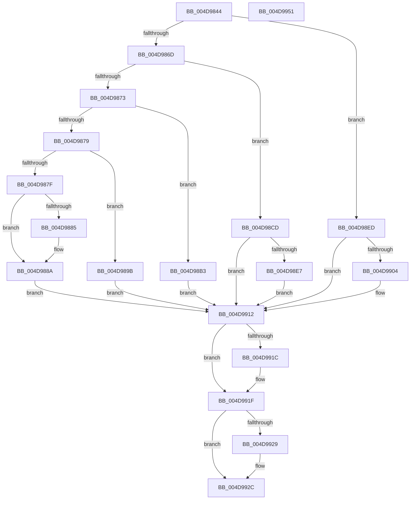

# PnpWatchdogExtractTriageInformation

- RVA: `0x004D9844`–`0x004D9952` (길이 `270` bytes)
- VA: `0x00000001404D9844`
- 실행 섹션: `.text`
- PDB 이름 있음: `예`; PDB Function 태그: `아니요`
- unwind 정보 RVA: `0x00069588`
- 디코드: `76`개 명령, `270/270` bytes 표시
- 미해석 바이트: `0` (있으면 어셈블리에 `.byte`로 보존)

> 이 문서는 커널 이미지의 기계어와 PDB 기호를 분석해 생성했습니다. 4번과 5번은 함수 원형과 자료형을 바이너리 사용 방식에서 추정한 C 해석이며 원본 소스 복구 결과는 아닙니다.

## 1. Dependencies

- 직접 호출 지점: **0**; 고유 호출 대상: **0**
- 직접 호출자로 확인된 함수: **1**
- RIP 상대 이미지 참조: **4**

### Outgoing calls
- 직접 디코드된 call 명령이 없습니다.

### Direct callers
- [PnpWatchdogBugcheck](../5A/PnpWatchdogBugcheck_function_005A6494.md) at `0x005A6522`

### Static image references
- `0x004D98B3` → RVA `0x00F8CB20` (`.data`; read)
- `0x004D98CD` → RVA `0x00E663B0` (`.data`; read)
- `0x004D98ED` → RVA `0x00E663B8` (`.data`; read)
- `0x004D9938` → RVA `0x00E06F48` (`.data`; read)

## 2. Other-region calls and transfers

- 다른 실행 섹션으로 향하는 call: **0**
- 별도 외부 분기/꼬리 이동을 확인하지 못했습니다.

## 3. Assembly (complete function range)

```asm
004D9844  48 89 5C 24 08                  mov qword ptr [rsp + 8], rbx
004D9849  48 89 74 24 10                  mov qword ptr [rsp + 0x10], rsi
004D984E  48 89 7C 24 18                  mov qword ptr [rsp + 0x18], rdi
004D9853  44 8B 51 10                     mov r10d, dword ptr [rcx + 0x10]
004D9857  33 F6                           xor esi, esi
004D9859  48 89 32                        mov qword ptr [rdx], rsi
004D985C  4C 8B D9                        mov r11, rcx
004D985F  8B DE                           mov ebx, esi
004D9861  8B FE                           mov edi, esi
004D9863  41 83 EA 01                     sub r10d, 1
004D9867  0F 84 80 00 00 00               je 0x1404d98ed
004D986D  41 83 EA 01                     sub r10d, 1
004D9871  74 5A                           je 0x1404d98cd
004D9873  41 83 EA 01                     sub r10d, 1
004D9877  74 3A                           je 0x1404d98b3
004D9879  41 83 EA 01                     sub r10d, 1
004D987D  74 1C                           je 0x1404d989b
004D987F  41 83 FA 01                     cmp r10d, 1
004D9883  74 05                           je 0x1404d988a
004D9885  8D 4E 05                        lea ecx, [rsi + 5]
004D9888  CD 29                           int 0x29
004D988A  48 8B 49 18                     mov rcx, qword ptr [rcx + 0x18]
004D988E  48 8B 41 10                     mov rax, qword ptr [rcx + 0x10]
004D9892  48 8B 79 08                     mov rdi, qword ptr [rcx + 8]
004D9896  49 89 00                        mov qword ptr [r8], rax
004D9899  EB 77                           jmp 0x1404d9912
004D989B  48 8B 49 18                     mov rcx, qword ptr [rcx + 0x18]
004D989F  48 8B 41 18                     mov rax, qword ptr [rcx + 0x18]
004D98A3  48 8B 79 10                     mov rdi, qword ptr [rcx + 0x10]
004D98A7  49 89 00                        mov qword ptr [r8], rax
004D98AA  48 8B 41 08                     mov rax, qword ptr [rcx + 8]
004D98AE  48 89 02                        mov qword ptr [rdx], rax
004D98B1  EB 5F                           jmp 0x1404d9912
004D98B3  48 8B 05 66 32 AB 00            mov rax, qword ptr [rip + 0xab3266]
004D98BA  48 8B 49 18                     mov rcx, qword ptr [rcx + 0x18]
004D98BE  49 89 00                        mov qword ptr [r8], rax
004D98C1  48 8B 01                        mov rax, qword ptr [rcx]
004D98C4  48 8B 59 08                     mov rbx, qword ptr [rcx + 8]
004D98C8  48 89 02                        mov qword ptr [rdx], rax
004D98CB  EB 45                           jmp 0x1404d9912
004D98CD  48 8B 05 DC CA 98 00            mov rax, qword ptr [rip + 0x98cadc]
004D98D4  49 89 00                        mov qword ptr [r8], rax
004D98D7  48 8B 41 18                     mov rax, qword ptr [rcx + 0x18]
004D98DB  48 8B 48 10                     mov rcx, qword ptr [rax + 0x10]
004D98DF  48 89 0A                        mov qword ptr [rdx], rcx
004D98E2  48 85 C9                        test rcx, rcx
004D98E5  74 2B                           je 0x1404d9912
004D98E7  48 8B 59 20                     mov rbx, qword ptr [rcx + 0x20]
004D98EB  EB 25                           jmp 0x1404d9912
004D98ED  48 8B 05 C4 CA 98 00            mov rax, qword ptr [rip + 0x98cac4]
004D98F4  49 89 00                        mov qword ptr [r8], rax
004D98F7  48 8B 41 18                     mov rax, qword ptr [rcx + 0x18]
004D98FB  48 8B 58 08                     mov rbx, qword ptr [rax + 8]
004D98FF  48 85 DB                        test rbx, rbx
004D9902  74 0E                           je 0x1404d9912
004D9904  48 8B 83 38 01 00 00            mov rax, qword ptr [rbx + 0x138]
004D990B  48 8B 48 28                     mov rcx, qword ptr [rax + 0x28]
004D990F  48 89 0A                        mov qword ptr [rdx], rcx
004D9912  48 8B 44 24 28                  mov rax, qword ptr [rsp + 0x28]
004D9917  48 85 C0                        test rax, rax
004D991A  74 03                           je 0x1404d991f
004D991C  48 89 18                        mov qword ptr [rax], rbx
004D991F  48 8B 44 24 30                  mov rax, qword ptr [rsp + 0x30]
004D9924  48 85 C0                        test rax, rax
004D9927  74 03                           je 0x1404d992c
004D9929  48 89 38                        mov qword ptr [rax], rdi
004D992C  48 8B 5C 24 08                  mov rbx, qword ptr [rsp + 8]
004D9931  49 8D 4B 28                     lea rcx, [r11 + 0x28]
004D9935  66 39 31                        cmp word ptr [rcx], si
004D9938  48 8D 05 09 D6 92 00            lea rax, [rip + 0x92d609]
004D993F  48 8B 74 24 10                  mov rsi, qword ptr [rsp + 0x10]
004D9944  48 8B 7C 24 18                  mov rdi, qword ptr [rsp + 0x18]
004D9949  48 0F 47 C1                     cmova rax, rcx
004D994D  49 89 01                        mov qword ptr [r9], rax
004D9950  C3                              ret
004D9951  CC                              int3
```

## 4. C-style interpretation (structured pseudocode)

```c
__int64 __fastcall PnpWatchdogExtractTriageInformation(__int64 a1, __int64 a2, __int64 a3, __int64 a4, __int64 a5, __int64 a6)
{
    __int64 result;
    __int64 v_r10;
    __int64 v_rsi;
    unsigned __int64 v_stack_p10;
    unsigned __int64 v_stack_p18;
    unsigned __int64 v_stack_p8;

    v_stack_p8 = v_rbx;
    v_stack_p10 = v_rsi;
    v_stack_p18 = v_rdi;
    v_rsi = 0;
    *(unsigned __int64 *)(a2) = 0;
    v_r10 = (unsigned int)(((unsigned int)(*(unsigned int *)(a1 + 16))) - (1));
    if (condition_is_equal) goto loc_004D98ED;
    v_r10 = (unsigned int)((v_r10) - (1));
    if (condition_is_equal) goto loc_004D98CD;
    v_r10 = (unsigned int)((v_r10) - (1));
    if (condition_is_equal) goto loc_004D98B3;
    v_r10 = (unsigned int)((v_r10) - (1));
    if (condition_is_equal) goto loc_004D989B;
    if (((unsigned int)(v_r10)) != 1) {
        a1 = v_rsi + 5;
    }
    *(unsigned __int64 *)(a3) = *(unsigned __int64 *)(*(unsigned __int64 *)(a1 + 24) + 16);
    goto loc_004D9912;
loc_004D989B:
    *(unsigned __int64 *)(a3) = *(unsigned __int64 *)(*(unsigned __int64 *)(*(unsigned __int64 *)(a1 + 24) + 24) + 24);
    *(unsigned __int64 *)(a2) = *(unsigned __int64 *)(*(unsigned __int64 *)(*(unsigned __int64 *)(a1 + 24) + 24) + 8);
    goto loc_004D9912;
loc_004D98B3:
    *(unsigned __int64 *)(a3) = *(unsigned __int64 *)(v_rip + 11219558);
    *(unsigned __int64 *)(a2) = *(unsigned __int64 *)(*(unsigned __int64 *)(*(unsigned __int64 *)(*(unsigned __int64 *)(a1 + 24) + 24) + 24));
    goto loc_004D9912;
loc_004D98CD:
    *(unsigned __int64 *)(a3) = *(unsigned __int64 *)(v_rip + 10013404);
    *(unsigned __int64 *)(a2) = *(unsigned __int64 *)(*(unsigned __int64 *)(*(unsigned __int64 *)(*(unsigned __int64 *)(*(unsigned __int64 *)(a1 + 24) + 24) + 24) + 24) + 16);
    if (*(unsigned __int64 *)(*(unsigned __int64 *)(*(unsigned __int64 *)(*(unsigned __int64 *)(*(unsigned __int64 *)(a1 + 24) + 24) + 24) + 24) + 16) == 0) goto loc_004D9912;
    goto loc_004D9912;
loc_004D98ED:
    *(unsigned __int64 *)(a3) = *(unsigned __int64 *)(v_rip + 10013380);
    result = *(unsigned __int64 *)(*(unsigned __int64 *)(*(unsigned __int64 *)(*(unsigned __int64 *)(*(unsigned __int64 *)(*(unsigned __int64 *)(a1 + 24) + 24) + 24) + 24) + 16) + 24);
    if (*(unsigned __int64 *)(*(unsigned __int64 *)(*(unsigned __int64 *)(*(unsigned __int64 *)(*(unsigned __int64 *)(*(unsigned __int64 *)(*(unsigned __int64 *)(a1 + 24) + 24) + 24) + 24) + 16) + 24) + 8) != 0) {
        result = *(unsigned __int64 *)(*(unsigned __int64 *)(*(unsigned __int64 *)(*(unsigned __int64 *)(*(unsigned __int64 *)(*(unsigned __int64 *)(*(unsigned __int64 *)(*(unsigned __int64 *)(a1 + 24) + 24) + 24) + 24) + 16) + 24) + 8) + 312);
        a1 = *(unsigned __int64 *)(result + 40);
        *(unsigned __int64 *)(a2) = a1;
    }
    if (a5 != 0) {
        *(unsigned __int64 *)(a5) = *(unsigned __int64 *)(*(unsigned __int64 *)(*(unsigned __int64 *)(*(unsigned __int64 *)(*(unsigned __int64 *)(*(unsigned __int64 *)(*(unsigned __int64 *)(a1 + 24) + 24) + 24) + 24) + 16) + 24) + 8);
    }
    if (a6 != 0) {
        *(unsigned __int64 *)(a6) = *(unsigned __int64 *)(*(unsigned __int64 *)(*(unsigned __int64 *)(a1 + 24) + 24) + 16);
    }
    result = v_rip + 9623049;
    if ((*(unsigned __int16 *)(a1 + 40)) > 0) { result = a1 + 40; }
    *(unsigned __int64 *)(a4) = result;
    return result;
}
```

## 5. (Beta) C Style

```c
int64_t PnpWatchdogExtractTriageInformation(void *Arg1, void *Arg2, void *Arg3, void *Arg4, int64_t Arg5, int64_t Arg6)
{
    uint8_t *arg1 = (uint8_t *)Arg1;
    uint8_t *arg2 = (uint8_t *)Arg2;
    uint8_t *arg3 = (uint8_t *)Arg3;
    uint8_t *arg4 = (uint8_t *)Arg4;

    int64_t result;
    int64_t local_r10;
    int64_t local_rsi;
    uint64_t v_stack_p10;
    uint64_t v_stack_p18;
    uint64_t v_stack_p8;

    v_stack_p8 = local_rbx;
    v_stack_p10 = local_rsi;
    v_stack_p18 = local_rdi;
    local_rsi = 0;
    *(uint64_t *)(arg2) = 0;
    local_r10 = (uint32_t)(((uint32_t)(*(uint32_t *)(arg1 + 0x10))) - (1));
    if (condition_is_equal) goto loc_004D98ED;
    local_r10 = (uint32_t)((local_r10) - (1));
    if (condition_is_equal) goto loc_004D98CD;
    local_r10 = (uint32_t)((local_r10) - (1));
    if (condition_is_equal) goto loc_004D98B3;
    local_r10 = (uint32_t)((local_r10) - (1));
    if (condition_is_equal) goto loc_004D989B;
    if (((uint32_t)(local_r10)) != 1) {
        Arg1 = local_rsi + 5;
    }
    *(uint64_t *)(arg3) = *(uint64_t *)(*(uint64_t *)(arg1 + 0x18) + 0x10);
    goto loc_004D9912;
loc_004D989B:
    *(uint64_t *)(arg3) = *(uint64_t *)(*(uint64_t *)(*(uint64_t *)(arg1 + 0x18) + 0x18) + 0x18);
    *(uint64_t *)(arg2) = *(uint64_t *)(*(uint64_t *)(*(uint64_t *)(arg1 + 0x18) + 0x18) + 0x8);
    goto loc_004D9912;
loc_004D98B3:
    *(uint64_t *)(arg3) = *(uint64_t *)(v_rip + 0xAB3266);
    *(uint64_t *)(arg2) = *(uint64_t *)(*(uint64_t *)(*(uint64_t *)(*(uint64_t *)(arg1 + 0x18) + 0x18) + 0x18));
    goto loc_004D9912;
loc_004D98CD:
    *(uint64_t *)(arg3) = *(uint64_t *)(v_rip + 0x98CADC);
    *(uint64_t *)(arg2) = *(uint64_t *)(*(uint64_t *)(*(uint64_t *)(*(uint64_t *)(*(uint64_t *)(arg1 + 0x18) + 0x18) + 0x18) + 0x18) + 0x10);
    if (*(uint64_t *)(*(uint64_t *)(*(uint64_t *)(*(uint64_t *)(*(uint64_t *)(arg1 + 0x18) + 0x18) + 0x18) + 0x18) + 0x10) == 0) goto loc_004D9912;
    goto loc_004D9912;
loc_004D98ED:
    *(uint64_t *)(arg3) = *(uint64_t *)(v_rip + 0x98CAC4);
    result = *(uint64_t *)(*(uint64_t *)(*(uint64_t *)(*(uint64_t *)(*(uint64_t *)(*(uint64_t *)(arg1 + 0x18) + 0x18) + 0x18) + 0x18) + 0x10) + 0x18);
    if (*(uint64_t *)(*(uint64_t *)(*(uint64_t *)(*(uint64_t *)(*(uint64_t *)(*(uint64_t *)(*(uint64_t *)(arg1 + 0x18) + 0x18) + 0x18) + 0x18) + 0x10) + 0x18) + 0x8) != 0) {
        result = *(uint64_t *)(*(uint64_t *)(*(uint64_t *)(*(uint64_t *)(*(uint64_t *)(*(uint64_t *)(*(uint64_t *)(*(uint64_t *)(arg1 + 0x18) + 0x18) + 0x18) + 0x18) + 0x10) + 0x18) + 0x8) + 0x138);
        Arg1 = *(uint64_t *)(result + 0x28);
        *(void **)(arg2) = Arg1;
    }
    if (Arg5 != 0) {
        *(uint64_t *)(Arg5) = *(uint64_t *)(*(uint64_t *)(*(uint64_t *)(*(uint64_t *)(*(uint64_t *)(*(uint64_t *)(*(uint64_t *)(arg1 + 0x18) + 0x18) + 0x18) + 0x18) + 0x10) + 0x18) + 0x8);
    }
    if (Arg6 != 0) {
        *(uint64_t *)(Arg6) = *(uint64_t *)(*(uint64_t *)(*(uint64_t *)(arg1 + 0x18) + 0x18) + 0x10);
    }
    result = v_rip + 9623049;
    if ((*(uint16_t *)(arg1 + 0x28)) > 0) { result = Arg1 + 40; }
    *(uint64_t *)(arg4) = result;
    return result;
}
```

### 관측된 메모리 오프셋

구조체 형식이 확인되지 않은 접근은 인자 기준의 오프셋으로만 기록했습니다.

| 기준 인자 | 오프셋 표현 | 폭 (bit) | 접근 |
|---|---:|---:|---|
| `Arg1` | `+ 0x0` | `16` | `R` |
| `Arg1` | `+ 0x10` | `32` | `R` |
| `Arg1` | `+ 0x18` | `64` | `R` |
| `Arg1` | `+ 0x28` | `64` | `R` |
| `Arg2` | `+ 0x0` | `64` | `W` |
| `Arg3` | `+ 0x0` | `64` | `W` |
| `Arg4` | `+ 0x0` | `64` | `W` |

## 6. Execution-region graph

[열기: 2D/3D 그래프와 함수 탐색 컨트롤 패널](../../../control-panel.html?section=text&rva=0x004D9844&view=graph)

- 2D 그래프는 위에서 아래로 흐르고, 3D 그래프는 빈 공간을 드래그해 회전합니다. Shift+드래그는 이동, 휠은 확대·축소, 함수 노드 선택은 대상 보고서 이동입니다.

### Static fallback


