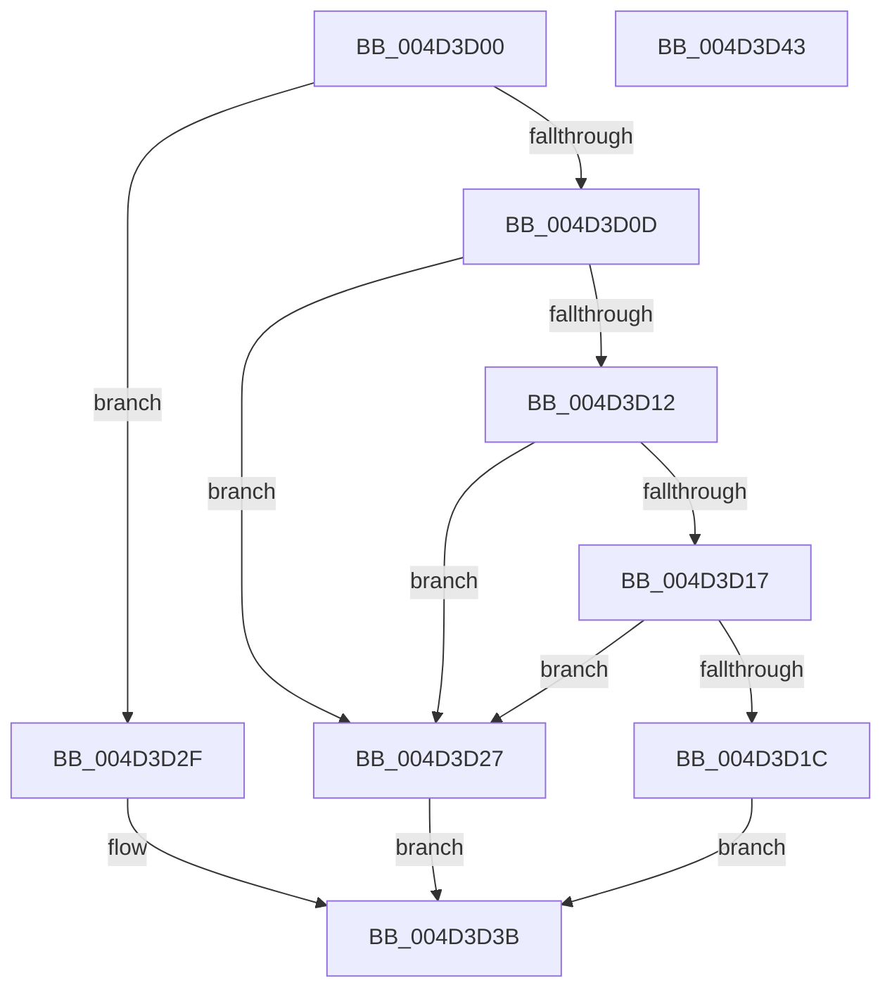

# PoFxPlatformRequestHandler

- RVA: `0x004D3D00`–`0x004D3D44` (길이 `68` bytes)
- VA: `0x00000001404D3D00`
- 실행 섹션: `.text`
- PDB 이름 있음: `예`; PDB Function 태그: `아니요`
- unwind 정보 RVA: `0x0005C788`
- 디코드: `23`개 명령, `68/68` bytes 표시
- 미해석 바이트: `0` (있으면 어셈블리에 `.byte`로 보존)

> 이 문서는 커널 이미지의 기계어와 PDB 기호를 분석해 생성했습니다. 4번과 5번은 함수 원형과 자료형을 바이너리 사용 방식에서 추정한 C 해석이며 원본 소스 복구 결과는 아닙니다.

## 1. Dependencies

- 직접 호출 지점: **1**; 고유 호출 대상: **1**
- 직접 호출자로 확인된 함수: **0**
- RIP 상대 이미지 참조: **1**

### Outgoing calls
- `0x004D3D33` → [PopFxAcpiDispatchNotification](../5D/PopFxAcpiDispatchNotification_function_005DD450.md) (function, `0x005DD450`)

### Direct callers
- 이 함수 시작 RVA로 연결되는 직접 call은 확인되지 않았습니다. 간접 호출은 완전히 역산할 수 없습니다.

### Static image references
- `0x004D3D1C` → RVA `0x00F070C8` (`.data`; read)

## 2. Other-region calls and transfers

- 다른 실행 섹션으로 향하는 call: **0**
- 별도 외부 분기/꼬리 이동을 확인하지 못했습니다.

## 3. Assembly (complete function range)

```asm
004D3D00  48 83 EC 28                     sub rsp, 0x28
004D3D04  8B 11                           mov edx, dword ptr [rcx]
004D3D06  45 33 C0                        xor r8d, r8d
004D3D09  85 D2                           test edx, edx
004D3D0B  74 22                           je 0x1404d3d2f
004D3D0D  83 EA 01                        sub edx, 1
004D3D10  74 15                           je 0x1404d3d27
004D3D12  83 FA 01                        cmp edx, 1
004D3D15  75 10                           jne 0x1404d3d27
004D3D17  39 51 10                        cmp dword ptr [rcx + 0x10], edx
004D3D1A  75 0B                           jne 0x1404d3d27
004D3D1C  8A 05 A6 33 A3 00               mov al, byte ptr [rip + 0xa333a6]
004D3D22  88 41 14                        mov byte ptr [rcx + 0x14], al
004D3D25  EB 14                           jmp 0x1404d3d3b
004D3D27  41 B8 BB 00 00 C0               mov r8d, 0xc00000bb
004D3D2D  EB 0C                           jmp 0x1404d3d3b
004D3D2F  48 83 C1 10                     add rcx, 0x10
004D3D33  E8 18 97 10 00                  call 0x1405dd450
004D3D38  44 8B C0                        mov r8d, eax
004D3D3B  41 8B C0                        mov eax, r8d
004D3D3E  48 83 C4 28                     add rsp, 0x28
004D3D42  C3                              ret
004D3D43  CC                              int3
```

## 4. C-style interpretation (structured pseudocode)

```c
__int64 __fastcall PoFxPlatformRequestHandler(__int64 a1, __int64 a2, int a3)
{
    __int64 result;
    __int64 v_rsp;

    v_rsp = (v_rsp) - (40);
    a3 = 0;
    if ((unsigned int)((unsigned int)(*(unsigned int *)(a1))) == 0) goto loc_004D3D2F;
    a2 = (unsigned int)(((unsigned int)(*(unsigned int *)(a1))) - (1));
    if (condition_is_equal) goto loc_004D3D27;
    if (((unsigned int)(a2)) != 1) goto loc_004D3D27;
    if ((*(unsigned int *)(a1 + 16)) != ((unsigned int)(a2))) goto loc_004D3D27;
    *(unsigned __int8 *)(a1 + 20) = (unsigned __int8)(*(unsigned __int8 *)(v_rip + 10695590));
    goto loc_004D3D3B;
loc_004D3D27:
    goto loc_004D3D3B;
loc_004D3D2F:
    a1 = (a1) + (16);
    result = PopFxAcpiDispatchNotification(a1, a2, (unsigned int)(0xC00000BBULL), a4);
loc_004D3D3B:
    v_rsp = (v_rsp) + (40);
    return (unsigned int)((unsigned int)((unsigned int)((unsigned int)(result))));
}
```

## 5. (Beta) C Style

```c
int64_t PoFxPlatformRequestHandler(void *Arg1, int64_t Arg2, int32_t Arg3)
{
    uint8_t *arg1 = (uint8_t *)Arg1;

    int64_t result;
    int64_t local_rsp;

    local_rsp = (local_rsp) - (40);
    Arg3 = 0;
    if ((uint32_t)((uint32_t)(*(uint32_t *)(arg1))) == 0) goto loc_004D3D2F;
    Arg2 = (uint32_t)(((uint32_t)(*(uint32_t *)(arg1))) - (1));
    if (condition_is_equal) goto loc_004D3D27;
    if (((uint32_t)(Arg2)) != 1) goto loc_004D3D27;
    if ((*(uint32_t *)(arg1 + 0x10)) != ((uint32_t)(Arg2))) goto loc_004D3D27;
    *(uint8_t *)(arg1 + 0x14) = (uint8_t)(*(uint8_t *)(v_rip + 0xA333A6));
    goto loc_004D3D3B;
loc_004D3D27:
    goto loc_004D3D3B;
loc_004D3D2F:
    Arg1 = (Arg1) + (16);
    result = PopFxAcpiDispatchNotification(Arg1, Arg2, (uint32_t)(0xC00000BBULL), a4);
loc_004D3D3B:
    local_rsp = (local_rsp) + (40);
    return (uint32_t)((uint32_t)((uint32_t)((uint32_t)(result))));
}
```

### 관측된 메모리 오프셋

구조체 형식이 확인되지 않은 접근은 인자 기준의 오프셋으로만 기록했습니다.

| 기준 인자 | 오프셋 표현 | 폭 (bit) | 접근 |
|---|---:|---:|---|
| `Arg1` | `+ 0x0` | `32` | `R` |
| `Arg1` | `+ 0x10` | `32` | `R` |
| `Arg1` | `+ 0x14` | `8` | `W` |

## 6. Execution-region graph

[열기: 2D/3D 그래프와 함수 탐색 컨트롤 패널](../../../control-panel.html?section=text&rva=0x004D3D00&view=graph)

- 2D 그래프는 위에서 아래로 흐르고, 3D 그래프는 빈 공간을 드래그해 회전합니다. Shift+드래그는 이동, 휠은 확대·축소, 함수 노드 선택은 대상 보고서 이동입니다.

### Static fallback


