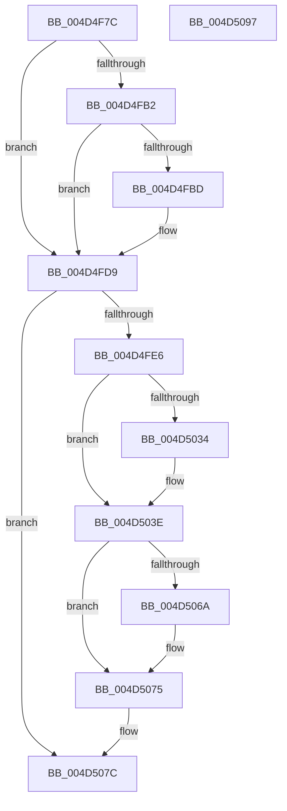

# PoNotifySystemTimeSet

- RVA: `0x004D4F7C`–`0x004D5098` (길이 `284` bytes)
- VA: `0x00000001404D4F7C`
- 실행 섹션: `.text`
- PDB 이름 있음: `예`; PDB Function 태그: `아니요`
- unwind 정보 RVA: `0x000BE230`
- 디코드: `71`개 명령, `284/284` bytes 표시
- 미해석 바이트: `0` (있으면 어셈블리에 `.byte`로 보존)

> 이 문서는 커널 이미지의 기계어와 PDB 기호를 분석해 생성했습니다. 4번과 5번은 함수 원형과 자료형을 바이너리 사용 방식에서 추정한 C 해석이며 원본 소스 복구 결과는 아닙니다.

## 1. Dependencies

- 직접 호출 지점: **8**; 고유 호출 대상: **8**
- 직접 호출자로 확인된 함수: **4**
- RIP 상대 이미지 참조: **7**

### Outgoing calls
- `0x004D4FCC` → [PpmConvertTime](../44/PpmConvertTime_function_00447530.md) (function, `0x00447530`)
- `0x004D4FD4` → [PopSstDiagAddResumeTimestampAdjustment](../../pagelk/B7/PopSstDiagAddResumeTimestampAdjustment_function_00B7D7EC.md) (function, `0x00B7D7EC`)
- `0x004D501E` → [EtwTraceSystemTimeChange](../../pagelk/B7/EtwTraceSystemTimeChange_function_00B7C93C.md) (function, `0x00B7C93C`)
- `0x004D5039` → [KiRaiseIrqlProcessIrqlFlags](../4F/KiRaiseIrqlProcessIrqlFlags_function_004F56FC.md) (function, `0x004F56FC`)
- `0x004D504D` → [ExNotifyWithProcessing](../45/ExNotifyWithProcessing_function_004523F4.md) (function, `0x004523F4`)
- `0x004D5057` → [PopGetPolicyWorker](../48/PopGetPolicyWorker_function_00482D24.md) (function, `0x00482D24`)
- `0x004D505C` → [PopCheckForWork](../48/PopCheckForWork_function_00482CAC.md) (function, `0x00482CAC`)
- `0x004D5070` → [KiLowerIrqlProcessIrqlFlags](../4F/KiLowerIrqlProcessIrqlFlags_function_004F5698.md) (function, `0x004F5698`)

### Direct callers
- [ExpRefreshSystemTime](../../page/7C/ExpRefreshSystemTime_function_007C6264.md) at `0x007C634B`
- [NtSetSystemTime](../../page/7C/NtSetSystemTime_function_007C65F0.md) at `0x007C685B`
- [ExpSetSystemTime](../../pagelk/B7/ExpSetSystemTime_function_00B7C838.md) at `0x00B7C919`
- [Phase1InitializationDiscard](../../init/C1/Phase1InitializationDiscard_function_00C1C728.md) at `0x00C1CEA1`

### Static image references
- `0x004D4F95` → RVA `0x00E68570` (`.data`; read)
- `0x004D4FBD` → RVA `0x00FC6BE0` (`ALMOSTRO`; read)
- `0x004D4FD9` → RVA `0x00F06628` (`.data`; read)
- `0x004D4FEC` → RVA `0x00F0F080` (`.data`; write)
- `0x004D4FFC` → RVA `0x00F0F088` (`.data`; write)
- `0x004D502B` → RVA `0x00FC6D20` (`ALMOSTRO`; read)
- `0x004D503E` → RVA `0x00EFED70` (`.data`; read)

## 2. Other-region calls and transfers

- 다른 실행 섹션으로 향하는 call: **2**
  - `0x004D4FD4` → [PopSstDiagAddResumeTimestampAdjustment](../../pagelk/B7/PopSstDiagAddResumeTimestampAdjustment_function_00B7D7EC.md) (`.text` → `PAGELK`)
  - `0x004D501E` → [EtwTraceSystemTimeChange](../../pagelk/B7/EtwTraceSystemTimeChange_function_00B7C93C.md) (`.text` → `PAGELK`)
- 별도 외부 분기/꼬리 이동을 확인하지 못했습니다.

## 3. Assembly (complete function range)

```asm
004D4F7C  48 8B C4                        mov rax, rsp
004D4F7F  48 89 58 08                     mov qword ptr [rax + 8], rbx
004D4F83  48 89 68 10                     mov qword ptr [rax + 0x10], rbp
004D4F87  48 89 70 18                     mov qword ptr [rax + 0x18], rsi
004D4F8B  48 89 78 20                     mov qword ptr [rax + 0x20], rdi
004D4F8F  41 57                           push r15
004D4F91  48 83 EC 40                     sub rsp, 0x40
004D4F95  8B 2D D5 35 99 00               mov ebp, dword ptr [rip + 0x9935d5]
004D4F9B  41 BF 02 00 00 00               mov r15d, 2
004D4FA1  49 8B F1                        mov rsi, r9
004D4FA4  41 8B F8                        mov edi, r8d
004D4FA7  4C 8B DA                        mov r11, rdx
004D4FAA  48 8B D9                        mov rbx, rcx
004D4FAD  45 3B C7                        cmp r8d, r15d
004D4FB0  75 27                           jne 0x1404d4fd9
004D4FB2  48 8B 09                        mov rcx, qword ptr [rcx]
004D4FB5  48 8B 02                        mov rax, qword ptr [rdx]
004D4FB8  48 3B C8                        cmp rcx, rax
004D4FBB  7E 1C                           jle 0x1404d4fd9
004D4FBD  4C 8B 05 1C 1C AF 00            mov r8, qword ptr [rip + 0xaf1c1c]
004D4FC4  48 2B C8                        sub rcx, rax
004D4FC7  BA 80 96 98 00                  mov edx, 0x989680
004D4FCC  E8 5F 25 F7 FF                  call 0x140447530
004D4FD1  48 8B C8                        mov rcx, rax
004D4FD4  E8 13 88 6A 00                  call 0x140b7d7ec
004D4FD9  80 3D 48 16 A3 00 00            cmp byte ptr [rip + 0xa31648], 0
004D4FE0  0F 84 96 00 00 00               je 0x1404d507c
004D4FE6  48 8B 03                        mov rax, qword ptr [rbx]
004D4FE9  4C 8B CE                        mov r9, rsi
004D4FEC  48 89 05 8D A0 A3 00            mov qword ptr [rip + 0xa3a08d], rax
004D4FF3  44 8B C7                        mov r8d, edi
004D4FF6  49 8B 03                        mov rax, qword ptr [r11]
004D4FF9  49 8B D3                        mov rdx, r11
004D4FFC  48 89 05 85 A0 A3 00            mov qword ptr [rip + 0xa3a085], rax
004D5003  48 8B CB                        mov rcx, rbx
004D5006  0F B6 84 24 80 00 00 00         movzx eax, byte ptr [rsp + 0x80]
004D500E  89 44 24 30                     mov dword ptr [rsp + 0x30], eax
004D5012  8B 44 24 70                     mov eax, dword ptr [rsp + 0x70]
004D5016  89 6C 24 28                     mov dword ptr [rsp + 0x28], ebp
004D501A  89 44 24 20                     mov dword ptr [rsp + 0x20], eax
004D501E  E8 19 79 6A 00                  call 0x140b7c93c
004D5023  44 0F 20 C3                     mov rbx, cr8
004D5027  45 0F 22 C7                     mov cr8, r15
004D502B  83 3D EE 1C AF 00 00            cmp dword ptr [rip + 0xaf1cee], 0
004D5032  74 0A                           je 0x1404d503e
004D5034  41 8A D7                        mov dl, r15b
004D5037  8A CB                           mov cl, bl
004D5039  E8 BE 06 02 00                  call 0x1404f56fc
004D503E  48 8B 0D 2B 9D A2 00            mov rcx, qword ptr [rip + 0xa29d2b]
004D5045  45 33 C9                        xor r9d, r9d
004D5048  45 33 C0                        xor r8d, r8d
004D504B  33 D2                           xor edx, edx
004D504D  E8 A2 D3 F7 FF                  call 0x1404523f4
004D5052  B9 10 00 00 00                  mov ecx, 0x10
004D5057  E8 C8 DC FA FF                  call 0x140482d24
004D505C  E8 4B DC FA FF                  call 0x140482cac
004D5061  83 3D B8 1C AF 00 00            cmp dword ptr [rip + 0xaf1cb8], 0
004D5068  74 0B                           je 0x1404d5075
004D506A  44 0F 20 C1                     mov rcx, cr8
004D506E  8A D3                           mov dl, bl
004D5070  E8 23 06 02 00                  call 0x1404f5698
004D5075  0F B6 C3                        movzx eax, bl
004D5078  44 0F 22 C0                     mov cr8, rax
004D507C  48 8B 5C 24 50                  mov rbx, qword ptr [rsp + 0x50]
004D5081  48 8B 6C 24 58                  mov rbp, qword ptr [rsp + 0x58]
004D5086  48 8B 74 24 60                  mov rsi, qword ptr [rsp + 0x60]
004D508B  48 8B 7C 24 68                  mov rdi, qword ptr [rsp + 0x68]
004D5090  48 83 C4 40                     add rsp, 0x40
004D5094  41 5F                           pop r15
004D5096  C3                              ret
004D5097  CC                              int3
```

## 4. C-style interpretation (structured pseudocode)

```c
__int64 __fastcall PoNotifySystemTimeSet(__int64 a1, __int64 a2, int a3, __int64 a4, unsigned int a5, __int64 a6, unsigned __int8 a7)
{
    __int64 result;
    __int64 v_rsp;
    unsigned int v_stack_m18;
    unsigned int v_stack_m20;
    unsigned int v_stack_m28;
    unsigned __int64 v_stack_p10;
    unsigned __int64 v_stack_p18;
    unsigned __int64 v_stack_p20;
    unsigned __int64 v_stack_p8;

    *(unsigned __int64 *)(v_rsp + 8) = v_rbx;
    *(unsigned __int64 *)(v_rsp + 16) = v_rbp;
    *(unsigned __int64 *)(v_rsp + 24) = v_rsi;
    *(unsigned __int64 *)(v_rsp + 32) = v_rdi;
    v_rsp = (v_rsp) - (64);
    if (a3 != 2) goto loc_004D4FD9;
    result = *(unsigned __int64 *)(a2);
    if ((*(unsigned __int64 *)(a1)) >= = (*(unsigned __int64 *)(a2))) {
        a3 = *(unsigned __int64 *)(v_rip + 11475996);
        a1 = (*(unsigned __int64 *)(a1)) - (*(unsigned __int64 *)(a2));
        a2 = 0x989680ULL;
        result = PpmConvertTime(a1, a2, a3, a4);
        a1 = result;
        result = PopSstDiagAddResumeTimestampAdjustment(a1, a2, a3, a4);
    }
    if ((*(unsigned __int8 *)(v_rip + 10688072)) == 0) goto loc_004D507C;
    *(unsigned __int64 *)(v_rip + 10723469) = *(unsigned __int64 *)(a1);
    *(unsigned __int64 *)(v_rip + 10723461) = *(unsigned __int64 *)(a2);
    v_stack_m18 = a7;
    v_stack_m20 = (unsigned int)((unsigned int)(*(unsigned int *)(v_rip + 10040789)));
    v_stack_m28 = (unsigned int)((unsigned int)(a5));
    result = EtwTraceSystemTimeChange(a1, a2, (unsigned int)((unsigned int)((unsigned int)(a3))), a4);
    if ((*(unsigned int *)(v_rip + 11476206)) != 0) {
        a2 = 2;
        a1 = (unsigned __int8)(v_cr8);
        result = KiRaiseIrqlProcessIrqlFlags(a1, a2, (unsigned int)((unsigned int)((unsigned int)(a3))), a4);
    }
    a4 = 0;
    a3 = 0;
    a2 = 0;
    result = ExNotifyWithProcessing(*(unsigned __int64 *)(v_rip + 10657067), a2, a3, a4);
    result = PopGetPolicyWorker(16, a2, a3, a4);
    result = PopCheckForWork(16, a2, a3, a4);
    if ((*(unsigned int *)(v_rip + 11476152)) != 0) {
        a1 = 2;
        a2 = (unsigned __int8)(v_cr8);
        result = KiLowerIrqlProcessIrqlFlags(a1, a2, a3, a4);
    }
loc_004D507C:
    v_rsp = (v_rsp) + (64);
    return (unsigned __int8)(v_cr8);
}
```

## 5. (Beta) C Style

```c
int64_t PoNotifySystemTimeSet(void *Arg1, void *Arg2, int32_t Arg3, int64_t Arg4, uint32_t Arg5, uint64_t Arg6, uint8_t Arg7)
{
    uint8_t *arg1 = (uint8_t *)Arg1;
    uint8_t *arg2 = (uint8_t *)Arg2;

    int64_t result;
    int64_t local_rsp;
    uint32_t v_stack_m18;
    uint32_t v_stack_m20;
    uint32_t v_stack_m28;
    uint64_t v_stack_p10;
    uint64_t v_stack_p18;
    uint64_t v_stack_p20;
    uint64_t v_stack_p8;

    *(uint64_t *)(local_rsp + 0x8) = local_rbx;
    *(uint64_t *)(local_rsp + 0x10) = local_rbp;
    *(uint64_t *)(local_rsp + 0x18) = local_rsi;
    *(uint64_t *)(local_rsp + 0x20) = local_rdi;
    local_rsp = (local_rsp) - (64);
    if (Arg3 != 2) goto loc_004D4FD9;
    result = *(uint64_t *)(arg2);
    if ((*(uint64_t *)(arg1)) >= = (*(uint64_t *)(arg2))) {
        Arg3 = *(uint64_t *)(v_rip + 0xAF1C1C);
        Arg1 = (*(uint64_t *)(arg1)) - (*(uint64_t *)(arg2));
        Arg2 = 0x989680ULL;
        result = PpmConvertTime(Arg1, Arg2, Arg3, Arg4);
        Arg1 = result;
        result = PopSstDiagAddResumeTimestampAdjustment(Arg1, Arg2, Arg3, Arg4);
    }
    if ((*(uint8_t *)(v_rip + 0xA31648)) == 0) goto loc_004D507C;
    *(uint64_t *)(v_rip + 0xA3A08D) = *(uint64_t *)(arg1);
    *(uint64_t *)(v_rip + 0xA3A085) = *(uint64_t *)(arg2);
    v_stack_m18 = Arg7;
    v_stack_m20 = (uint32_t)((uint32_t)(*(uint32_t *)(v_rip + 0x9935D5)));
    v_stack_m28 = (uint32_t)((uint32_t)(Arg5));
    result = EtwTraceSystemTimeChange(Arg1, Arg2, (uint32_t)((uint32_t)((uint32_t)(Arg3))), Arg4);
    if ((*(uint32_t *)(v_rip + 0xAF1CEE)) != 0) {
        Arg2 = 2;
        Arg1 = (uint8_t)(v_cr8);
        result = KiRaiseIrqlProcessIrqlFlags(Arg1, Arg2, (uint32_t)((uint32_t)((uint32_t)(Arg3))), Arg4);
    }
    Arg4 = 0;
    Arg3 = 0;
    Arg2 = 0;
    result = ExNotifyWithProcessing(*(uint64_t *)(v_rip + 0xA29D2B), Arg2, Arg3, Arg4);
    result = PopGetPolicyWorker(16, Arg2, Arg3, Arg4);
    result = PopCheckForWork(16, Arg2, Arg3, Arg4);
    if ((*(uint32_t *)(v_rip + 0xAF1CB8)) != 0) {
        Arg1 = 2;
        Arg2 = (uint8_t)(v_cr8);
        result = KiLowerIrqlProcessIrqlFlags(Arg1, Arg2, Arg3, Arg4);
    }
loc_004D507C:
    local_rsp = (local_rsp) + (64);
    return (uint8_t)(v_cr8);
}
```

### 관측된 메모리 오프셋

구조체 형식이 확인되지 않은 접근은 인자 기준의 오프셋으로만 기록했습니다.

| 기준 인자 | 오프셋 표현 | 폭 (bit) | 접근 |
|---|---:|---:|---|
| `Arg1` | `+ 0x0` | `64` | `R` |
| `Arg2` | `+ 0x0` | `64` | `R` |

## 6. Execution-region graph

[열기: 2D/3D 그래프와 함수 탐색 컨트롤 패널](../../../control-panel.html?section=text&rva=0x004D4F7C&view=graph)

- 2D 그래프는 위에서 아래로 흐르고, 3D 그래프는 빈 공간을 드래그해 회전합니다. Shift+드래그는 이동, 휠은 확대·축소, 함수 노드 선택은 대상 보고서 이동입니다.

### Static fallback


