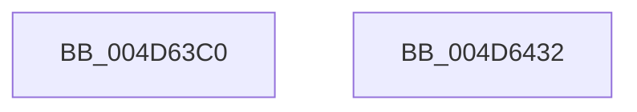

# PoPowerOffMonitor

- RVA: `0x004D63C0`–`0x004D6433` (길이 `115` bytes)
- VA: `0x00000001404D63C0`
- 실행 섹션: `.text`
- PDB 이름 있음: `예`; PDB Function 태그: `아니요`
- unwind 정보 RVA: `0x000BDDB4`
- 디코드: `31`개 명령, `115/115` bytes 표시
- 미해석 바이트: `0` (있으면 어셈블리에 `.byte`로 보존)

> 이 문서는 커널 이미지의 기계어와 PDB 기호를 분석해 생성했습니다. 4번과 5번은 함수 원형과 자료형을 바이너리 사용 방식에서 추정한 C 해석이며 원본 소스 복구 결과는 아닙니다.

## 1. Dependencies

- 직접 호출 지점: **5**; 고유 호출 대상: **5**
- 직접 호출자로 확인된 함수: **1**
- RIP 상대 이미지 참조: **0**

### Outgoing calls
- `0x004D63E9` → [PoBlockConsoleSwitch](../../page/AC/PoBlockConsoleSwitch_function_00ACCCA0.md) (function, `0x00ACCCA0`)
- `0x004D63F5` → [PoStartPowerStateTasks](../../page/70/PoStartPowerStateTasks_function_00702064.md) (function, `0x00702064`)
- `0x004D6409` → [PopDispatchStateCallout](../../page/91/PopDispatchStateCallout_function_0091248C.md) (function, `0x0091248C`)
- `0x004D6414` → [PoEndPowerStateTasks](../../page/70/PoEndPowerStateTasks_function_00702130.md) (function, `0x00702130`)
- `0x004D6420` → [PoUnblockConsoleSwitch](../../page/AD/PoUnblockConsoleSwitch_function_00ADB8A0.md) (function, `0x00ADB8A0`)

### Direct callers
- [NtPowerInformation](../../page/95/NtPowerInformation_function_00955D80.md) at `0x009569D4`

### Static image references
- 디코드된 RIP-relative 메모리 참조가 없습니다.

## 2. Other-region calls and transfers

- 다른 실행 섹션으로 향하는 call: **5**
  - `0x004D63E9` → [PoBlockConsoleSwitch](../../page/AC/PoBlockConsoleSwitch_function_00ACCCA0.md) (`.text` → `PAGE`)
  - `0x004D63F5` → [PoStartPowerStateTasks](../../page/70/PoStartPowerStateTasks_function_00702064.md) (`.text` → `PAGE`)
  - `0x004D6409` → [PopDispatchStateCallout](../../page/91/PopDispatchStateCallout_function_0091248C.md) (`.text` → `PAGE`)
  - `0x004D6414` → [PoEndPowerStateTasks](../../page/70/PoEndPowerStateTasks_function_00702130.md) (`.text` → `PAGE`)
  - `0x004D6420` → [PoUnblockConsoleSwitch](../../page/AD/PoUnblockConsoleSwitch_function_00ADB8A0.md) (`.text` → `PAGE`)
- 별도 외부 분기/꼬리 이동을 확인하지 못했습니다.

## 3. Assembly (complete function range)

```asm
004D63C0  48 89 5C 24 10                  mov qword ptr [rsp + 0x10], rbx
004D63C5  55                              push rbp
004D63C6  48 8B EC                        mov rbp, rsp
004D63C9  48 83 EC 50                     sub rsp, 0x50
004D63CD  0F 57 C0                        xorps xmm0, xmm0
004D63D0  48 8D 4D D0                     lea rcx, [rbp - 0x30]
004D63D4  33 C0                           xor eax, eax
004D63D6  0F 11 45 E0                     movups xmmword ptr [rbp - 0x20], xmm0
004D63DA  C7 45 E8 01 00 00 00            mov dword ptr [rbp - 0x18], 1
004D63E1  0F 11 45 D0                     movups xmmword ptr [rbp - 0x30], xmm0
004D63E5  48 89 45 F0                     mov qword ptr [rbp - 0x10], rax
004D63E9  E8 B2 68 5F 00                  call 0x140accca0
004D63EE  48 8D 4D D0                     lea rcx, [rbp - 0x30]
004D63F2  89 45 10                        mov dword ptr [rbp + 0x10], eax
004D63F5  E8 6A BC 22 00                  call 0x140702064
004D63FA  48 8D 55 10                     lea rdx, [rbp + 0x10]
004D63FE  C7 45 F0 0C 00 00 00            mov dword ptr [rbp - 0x10], 0xc
004D6405  48 8D 4D D0                     lea rcx, [rbp - 0x30]
004D6409  E8 7E C0 43 00                  call 0x14091248c
004D640E  48 8D 4D D0                     lea rcx, [rbp - 0x30]
004D6412  8B D8                           mov ebx, eax
004D6414  E8 17 BD 22 00                  call 0x140702130
004D6419  8B 55 10                        mov edx, dword ptr [rbp + 0x10]
004D641C  48 8D 4D D0                     lea rcx, [rbp - 0x30]
004D6420  E8 7B 54 60 00                  call 0x140adb8a0
004D6425  8B C3                           mov eax, ebx
004D6427  48 8B 5C 24 68                  mov rbx, qword ptr [rsp + 0x68]
004D642C  48 83 C4 50                     add rsp, 0x50
004D6430  5D                              pop rbp
004D6431  C3                              ret
004D6432  CC                              int3
```

## 4. C-style interpretation (structured pseudocode)

```c
__int64 __fastcall PoPowerOffMonitor(void)
{
    __int64 result;
    __int64 v_rsp;
    unsigned __int64 v_stack_m18;
    unsigned int v_stack_m20;
    unsigned __int64 v_stack_m28;
    unsigned __int64 v_stack_m38;
    unsigned __int64 v_stack_p10;
    unsigned int v_stack_p8;

    v_stack_p10 = v_rbx;
    v_rsp = (v_rsp) - (80);
    result = 0;
    v_stack_m28 = v_xmm0;
    v_stack_m20 = 1;
    v_stack_m38 = v_xmm0;
    v_stack_m18 = 0;
    result = PoBlockConsoleSwitch(v_stack_m38, a2, a3, a4);
    v_stack_p8 = (unsigned int)(result);
    result = PoStartPowerStateTasks(v_stack_m38, a2, a3, a4);
    v_stack_m18 = 12;
    result = PopDispatchStateCallout(v_stack_m38, v_stack_p8, a3, a4);
    result = PoEndPowerStateTasks(v_stack_m38, v_stack_p8, a3, a4);
    result = PoUnblockConsoleSwitch(v_stack_m38, (unsigned int)(v_stack_p8), a3, a4);
    v_rsp = (v_rsp) + (80);
    return (unsigned int)((unsigned int)((unsigned int)((unsigned int)(result))));
}
```

## 5. (Beta) C Style

```c
void PoPowerOffMonitor(void)
{
    int64_t result;
    int64_t local_rsp;
    uint64_t v_stack_m18;
    uint32_t v_stack_m20;
    uint64_t v_stack_m28;
    uint64_t v_stack_m38;
    uint64_t v_stack_p10;
    uint32_t v_stack_p8;

    v_stack_p10 = local_rbx;
    local_rsp = (local_rsp) - (80);
    result = 0;
    v_stack_m28 = v_xmm0;
    v_stack_m20 = 1;
    v_stack_m38 = v_xmm0;
    v_stack_m18 = 0;
    result = PoBlockConsoleSwitch(v_stack_m38, a2, a3, a4);
    v_stack_p8 = (uint32_t)(result);
    result = PoStartPowerStateTasks(v_stack_m38, a2, a3, a4);
    v_stack_m18 = 12;
    result = PopDispatchStateCallout(v_stack_m38, v_stack_p8, a3, a4);
    result = PoEndPowerStateTasks(v_stack_m38, v_stack_p8, a3, a4);
    result = PoUnblockConsoleSwitch(v_stack_m38, (uint32_t)(v_stack_p8), a3, a4);
    local_rsp = (local_rsp) + (80);
    return (uint32_t)((uint32_t)((uint32_t)((uint32_t)(result))));
}
```

## 6. Execution-region graph

[열기: 2D/3D 그래프와 함수 탐색 컨트롤 패널](../../../control-panel.html?section=text&rva=0x004D63C0&view=graph)

- 2D 그래프는 위에서 아래로 흐르고, 3D 그래프는 빈 공간을 드래그해 회전합니다. Shift+드래그는 이동, 휠은 확대·축소, 함수 노드 선택은 대상 보고서 이동입니다.

### Static fallback


