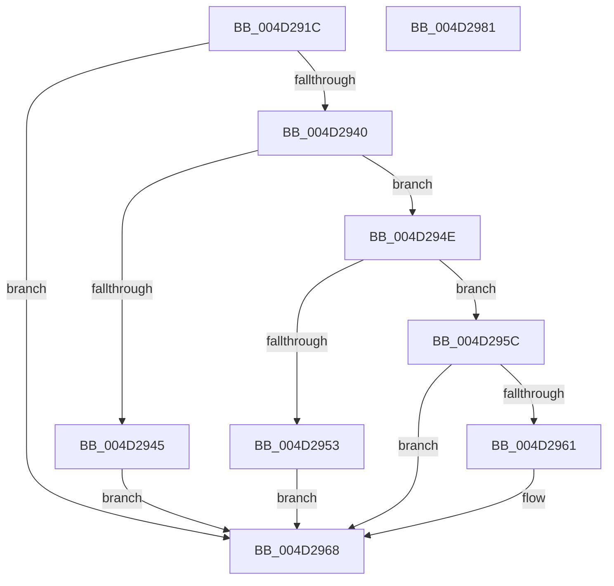

# PopCacheDisplayOnPhaseDuration

- RVA: `0x004D291C`–`0x004D2982` (길이 `102` bytes)
- VA: `0x00000001404D291C`
- 실행 섹션: `.text`
- PDB 이름 있음: `예`; PDB Function 태그: `아니요`
- unwind 정보 RVA: `0x0005CAAC`
- 디코드: `28`개 명령, `102/102` bytes 표시
- 미해석 바이트: `0` (있으면 어셈블리에 `.byte`로 보존)

> 이 문서는 커널 이미지의 기계어와 PDB 기호를 분석해 생성했습니다. 4번과 5번은 함수 원형과 자료형을 바이너리 사용 방식에서 추정한 C 해석이며 원본 소스 복구 결과는 아닙니다.

## 1. Dependencies

- 직접 호출 지점: **2**; 고유 호출 대상: **2**
- 직접 호출자로 확인된 함수: **1**
- RIP 상대 이미지 참조: **5**

### Outgoing calls
- `0x004D2932` → [KeAcquireSpinLockRaiseToDpc](../20/KeAcquireSpinLockRaiseToDpc_function_00208470.md) (function, `0x00208470`)
- `0x004D2971` → [KeReleaseSpinLock](../39/KeReleaseSpinLock_function_00392BA0.md) (function, `0x00392BA0`)

### Direct callers
- [PopSetWatchdog](../46/PopSetWatchdog_function_00460CAC.md) at `0x00461066`

### Static image references
- `0x004D292B` → RVA `0x00F0C9B8` (`.data`; read)
- `0x004D2937` → RVA `0x00F0C9C0` (`.data`; read)
- `0x004D2945` → RVA `0x00F0C9A0` (`.data`; write)
- `0x004D2953` → RVA `0x00F0C9A8` (`.data`; write)
- `0x004D2961` → RVA `0x00F0C9B0` (`.data`; write)

## 2. Other-region calls and transfers

- 다른 실행 섹션으로 향하는 call: **0**
- 별도 외부 분기/꼬리 이동을 확인하지 못했습니다.

## 3. Assembly (complete function range)

```asm
004D291C  48 89 5C 24 08                  mov qword ptr [rsp + 8], rbx
004D2921  57                              push rdi
004D2922  48 83 EC 20                     sub rsp, 0x20
004D2926  8B F9                           mov edi, ecx
004D2928  48 8B DA                        mov rbx, rdx
004D292B  48 8D 0D 86 A0 A3 00            lea rcx, [rip + 0xa3a086]
004D2932  E8 39 5B D3 FF                  call 0x140208470
004D2937  83 3D 82 A0 A3 00 00            cmp dword ptr [rip + 0xa3a082], 0
004D293E  74 28                           je 0x1404d2968
004D2940  83 FF 50                        cmp edi, 0x50
004D2943  75 09                           jne 0x1404d294e
004D2945  48 89 1D 54 A0 A3 00            mov qword ptr [rip + 0xa3a054], rbx
004D294C  EB 1A                           jmp 0x1404d2968
004D294E  83 FF 40                        cmp edi, 0x40
004D2951  75 09                           jne 0x1404d295c
004D2953  48 89 1D 4E A0 A3 00            mov qword ptr [rip + 0xa3a04e], rbx
004D295A  EB 0C                           jmp 0x1404d2968
004D295C  83 FF 30                        cmp edi, 0x30
004D295F  75 07                           jne 0x1404d2968
004D2961  48 89 1D 48 A0 A3 00            mov qword ptr [rip + 0xa3a048], rbx
004D2968  8A D0                           mov dl, al
004D296A  48 8D 0D 47 A0 A3 00            lea rcx, [rip + 0xa3a047]
004D2971  E8 2A 02 EC FF                  call 0x140392ba0
004D2976  48 8B 5C 24 30                  mov rbx, qword ptr [rsp + 0x30]
004D297B  48 83 C4 20                     add rsp, 0x20
004D297F  5F                              pop rdi
004D2980  C3                              ret
004D2981  CC                              int3
```

## 4. C-style interpretation (structured pseudocode)

```c
__int64 __fastcall PopCacheDisplayOnPhaseDuration(int a1, __int64 a2)
{
    __int64 result;
    __int64 v_rsp;
    unsigned __int64 v_stack_p8;

    v_stack_p8 = v_rbx;
    v_rsp = (v_rsp) - (32);
    result = KeAcquireSpinLockRaiseToDpc(v_rip + 10723462, a2, a3, a4);
    if ((*(unsigned int *)(v_rip + 10723458)) == 0) goto loc_004D2968;
    if (((unsigned int)((unsigned int)(a1))) != 80) goto loc_004D294E;
    *(unsigned __int64 *)(v_rip + 10723412) = a2;
    goto loc_004D2968;
loc_004D294E:
    if (((unsigned int)((unsigned int)(a1))) != 64) goto loc_004D295C;
    *(unsigned __int64 *)(v_rip + 10723406) = a2;
    goto loc_004D2968;
loc_004D295C:
    if (((unsigned int)((unsigned int)(a1))) == 48) {
        *(unsigned __int64 *)(v_rip + 10723400) = a2;
    }
    result = KeReleaseSpinLock(v_rip + 10723399, (unsigned __int8)(result), a3, a4);
    v_rsp = (v_rsp) + (32);
    return result;
}
```

## 5. (Beta) C Style

```c
int64_t PopCacheDisplayOnPhaseDuration(int32_t Arg1, int64_t Arg2)
{
    int64_t result;
    int64_t local_rsp;
    uint64_t v_stack_p8;

    v_stack_p8 = local_rbx;
    local_rsp = (local_rsp) - (32);
    result = KeAcquireSpinLockRaiseToDpc(v_rip + 10723462, Arg2, a3, a4);
    if ((*(uint32_t *)(v_rip + 0xA3A082)) == 0) goto loc_004D2968;
    if (((uint32_t)((uint32_t)(Arg1))) != 80) goto loc_004D294E;
    *(uint64_t *)(v_rip + 0xA3A054) = Arg2;
    goto loc_004D2968;
loc_004D294E:
    if (((uint32_t)((uint32_t)(Arg1))) != 64) goto loc_004D295C;
    *(uint64_t *)(v_rip + 0xA3A04E) = Arg2;
    goto loc_004D2968;
loc_004D295C:
    if (((uint32_t)((uint32_t)(Arg1))) == 48) {
        *(uint64_t *)(v_rip + 0xA3A048) = Arg2;
    }
    result = KeReleaseSpinLock(v_rip + 10723399, (uint8_t)(result), a3, a4);
    local_rsp = (local_rsp) + (32);
    return result;
}
```

## 6. Execution-region graph

[열기: 2D/3D 그래프와 함수 탐색 컨트롤 패널](../../../control-panel.html?section=text&rva=0x004D291C&view=graph)

- 2D 그래프는 위에서 아래로 흐르고, 3D 그래프는 빈 공간을 드래그해 회전합니다. Shift+드래그는 이동, 휠은 확대·축소, 함수 노드 선택은 대상 보고서 이동입니다.

### Static fallback


