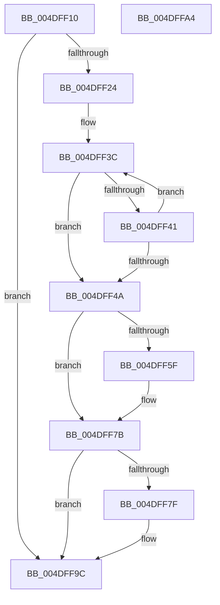

# PopCapabilityCheck

- RVA: `0x004DFF10`–`0x004DFFA5` (길이 `149` bytes)
- VA: `0x00000001404DFF10`
- 실행 섹션: `.text`
- PDB 이름 있음: `예`; PDB Function 태그: `아니요`
- unwind 정보 RVA: `0x00064C80`
- 디코드: `46`개 명령, `149/149` bytes 표시
- 미해석 바이트: `0` (있으면 어셈블리에 `.byte`로 보존)

> 이 문서는 커널 이미지의 기계어와 PDB 기호를 분석해 생성했습니다. 4번과 5번은 함수 원형과 자료형을 바이너리 사용 방식에서 추정한 C 해석이며 원본 소스 복구 결과는 아닙니다.

## 1. Dependencies

- 직접 호출 지점: **1**; 고유 호출 대상: **1**
- 직접 호출자로 확인된 함수: **1**
- RIP 상대 이미지 참조: **0**

### Outgoing calls
- `0x004DFF8B` → [RtlCapabilityCheck](../../page/A2/RtlCapabilityCheck_function_00A20340.md) (function, `0x00A20340`)

### Direct callers
- [NtPowerInformation](../../page/95/NtPowerInformation_function_00955D80.md) at `0x00955F12`
- [NtPowerInformation](../../page/95/NtPowerInformation_function_00955D80.md) at `0x00957B03`

### Static image references
- 디코드된 RIP-relative 메모리 참조가 없습니다.

## 2. Other-region calls and transfers

- 다른 실행 섹션으로 향하는 call: **1**
  - `0x004DFF8B` → [RtlCapabilityCheck](../../page/A2/RtlCapabilityCheck_function_00A20340.md) (`.text` → `PAGE`)
- 별도 외부 분기/꼬리 이동을 확인하지 못했습니다.

## 3. Assembly (complete function range)

```asm
004DFF10  40 53                           push rbx
004DFF12  48 83 EC 30                     sub rsp, 0x30
004DFF16  33 DB                           xor ebx, ebx
004DFF18  4C 8B C9                        mov r9, rcx
004DFF1B  88 5C 24 40                     mov byte ptr [rsp + 0x40], bl
004DFF1F  48 85 C9                        test rcx, rcx
004DFF22  74 78                           je 0x1404dff9c
004DFF24  0F 57 C0                        xorps xmm0, xmm0
004DFF27  44 8D 53 02                     lea r10d, [rbx + 2]
004DFF2B  41 B8 FF 7F 00 00               mov r8d, 0x7fff
004DFF31  48 8B C1                        mov rax, rcx
004DFF34  0F 11 44 24 20                  movups xmmword ptr [rsp + 0x20], xmm0
004DFF39  41 8B D0                        mov edx, r8d
004DFF3C  66 39 18                        cmp word ptr [rax], bx
004DFF3F  74 09                           je 0x1404dff4a
004DFF41  49 03 C2                        add rax, r10
004DFF44  48 83 EA 01                     sub rdx, 1
004DFF48  75 F2                           jne 0x1404dff3c
004DFF4A  48 8B C2                        mov rax, rdx
004DFF4D  48 F7 D8                        neg rax
004DFF50  1B C9                           sbb ecx, ecx
004DFF52  F7 D1                           not ecx
004DFF54  81 E1 0D 00 00 C0               and ecx, 0xc000000d
004DFF5A  48 85 D2                        test rdx, rdx
004DFF5D  74 1C                           je 0x1404dff7b
004DFF5F  4C 2B C2                        sub r8, rdx
004DFF62  4C 89 4C 24 28                  mov qword ptr [rsp + 0x28], r9
004DFF67  66 45 03 C0                     add r8w, r8w
004DFF6B  66 44 89 44 24 20               mov word ptr [rsp + 0x20], r8w
004DFF71  66 45 03 C2                     add r8w, r10w
004DFF75  66 44 89 44 24 22               mov word ptr [rsp + 0x22], r8w
004DFF7B  85 C9                           test ecx, ecx
004DFF7D  78 1D                           js 0x1404dff9c
004DFF7F  4C 8D 44 24 40                  lea r8, [rsp + 0x40]
004DFF84  33 C9                           xor ecx, ecx
004DFF86  48 8D 54 24 20                  lea rdx, [rsp + 0x20]
004DFF8B  E8 B0 03 54 00                  call 0x140a20340
004DFF90  0F B6 4C 24 40                  movzx ecx, byte ptr [rsp + 0x40]
004DFF95  85 C0                           test eax, eax
004DFF97  0F 48 CB                        cmovs ecx, ebx
004DFF9A  8A D9                           mov bl, cl
004DFF9C  8A C3                           mov al, bl
004DFF9E  48 83 C4 30                     add rsp, 0x30
004DFFA2  5B                              pop rbx
004DFFA3  C3                              ret
004DFFA4  CC                              int3
```

## 4. C-style interpretation (structured pseudocode)

```c
__int64 __fastcall PopCapabilityCheck(__int64 a1)
{
    __int64 result;
    __int64 v_rbx;
    __int64 v_rsp;
    unsigned __int64 v_stack_m10;
    unsigned __int16 v_stack_m16;
    unsigned __int64 v_stack_m18;
    unsigned __int8 v_stack_p8;

    v_rsp = (v_rsp) - (48);
    v_rbx = 0;
    v_stack_p8 = 0;
    if (a1 == 0) goto loc_004DFF9C;
    v_stack_m18 = v_xmm0;
loc_004DFF3C:
    if ((*(unsigned __int16 *)(a1)) == 0) goto loc_004DFF4A;
    result = (a1) + (v_rbx + 2);
    a2 = ((unsigned int)((unsigned int)((unsigned int)(0x7FFFULL)))) - (1);
    if (condition_is_not_equal) goto loc_004DFF3C;
loc_004DFF4A:
    result = -(a2);
    a1 = (unsigned int)(~(a1));
    a1 = (unsigned int)((a1) & (0xC000000DULL));
    if (a2 != 0) {
        a3 = ((unsigned int)(0x7FFFULL)) - (a2);
        v_stack_m10 = a1;
        a3 = (unsigned __int16)((a3) + ((unsigned __int16)(a3)));
        v_stack_m18 = (unsigned __int16)(a3);
        a3 = (unsigned __int16)((a3) + ((unsigned __int16)(v_rbx + 2)));
        v_stack_m16 = (unsigned __int16)(a3);
    }
    if (!(sign_flag)) {
        a3 = v_stack_p8;
        a1 = 0;
        a2 = v_stack_m18;
        result = RtlCapabilityCheck(a1, a2, a3, a1);
        a1 = v_stack_p8;
        if (sign_flag) { a1 = 0; }
        v_rbx = (unsigned __int8)(a1);
    }
    v_rsp = (v_rsp) + (48);
    return (unsigned __int8)(v_rbx);
}
```

## 5. (Beta) C Style

```c
int64_t PopCapabilityCheck(int64_t Arg1)
{
    int64_t result;
    int64_t local_rbx;
    int64_t local_rsp;
    uint64_t v_stack_m10;
    uint16_t v_stack_m16;
    uint64_t v_stack_m18;
    uint8_t v_stack_p8;

    local_rsp = (local_rsp) - (48);
    local_rbx = 0;
    v_stack_p8 = 0;
    if (Arg1 == 0) goto loc_004DFF9C;
    v_stack_m18 = v_xmm0;
loc_004DFF3C:
    if ((*(uint16_t *)(Arg1)) == 0) goto loc_004DFF4A;
    result = (Arg1) + (local_rbx + 2);
    a2 = ((uint32_t)((uint32_t)((uint32_t)(0x7FFFULL)))) - (1);
    if (condition_is_not_equal) goto loc_004DFF3C;
loc_004DFF4A:
    result = -(a2);
    Arg1 = (uint32_t)(~(Arg1));
    Arg1 = (uint32_t)((Arg1) & (0xC000000DULL));
    if (a2 != 0) {
        a3 = ((uint32_t)(0x7FFFULL)) - (a2);
        v_stack_m10 = Arg1;
        a3 = (uint16_t)((a3) + ((uint16_t)(a3)));
        v_stack_m18 = (uint16_t)(a3);
        a3 = (uint16_t)((a3) + ((uint16_t)(local_rbx + 2)));
        v_stack_m16 = (uint16_t)(a3);
    }
    if (!(sign_flag)) {
        a3 = v_stack_p8;
        Arg1 = 0;
        a2 = v_stack_m18;
        result = RtlCapabilityCheck(Arg1, a2, a3, Arg1);
        Arg1 = v_stack_p8;
        if (sign_flag) { Arg1 = 0; }
        local_rbx = (uint8_t)(Arg1);
    }
    local_rsp = (local_rsp) + (48);
    return (uint8_t)(local_rbx);
}
```

## 6. Execution-region graph

[열기: 2D/3D 그래프와 함수 탐색 컨트롤 패널](../../../control-panel.html?section=text&rva=0x004DFF10&view=graph)

- 2D 그래프는 위에서 아래로 흐르고, 3D 그래프는 빈 공간을 드래그해 회전합니다. Shift+드래그는 이동, 휠은 확대·축소, 함수 노드 선택은 대상 보고서 이동입니다.

### Static fallback


