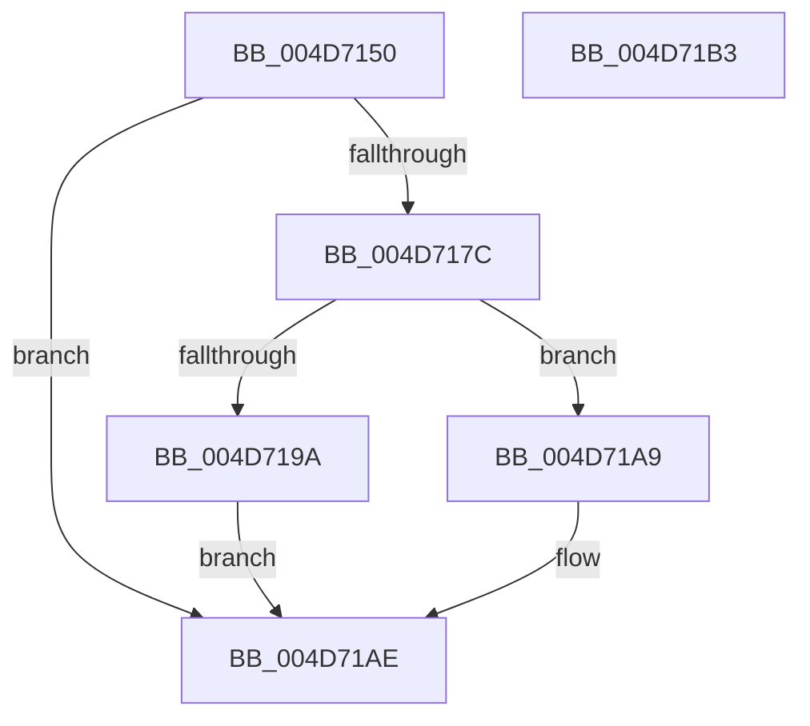

# PopCheckPowerSourceAfterRtcWakeCancel

- RVA: `0x004D7150`–`0x004D71B4` (길이 `100` bytes)
- VA: `0x00000001404D7150`
- 실행 섹션: `.text`
- PDB 이름 있음: `예`; PDB Function 태그: `아니요`
- unwind 정보 RVA: `0x0005D2F4`
- 디코드: `27`개 명령, `100/100` bytes 표시
- 미해석 바이트: `0` (있으면 어셈블리에 `.byte`로 보존)

> 이 문서는 커널 이미지의 기계어와 PDB 기호를 분석해 생성했습니다. 4번과 5번은 함수 원형과 자료형을 바이너리 사용 방식에서 추정한 C 해석이며 원본 소스 복구 결과는 아닙니다.

## 1. Dependencies

- 직접 호출 지점: **4**; 고유 호출 대상: **3**
- 직접 호출자로 확인된 함수: **1**
- RIP 상대 이미지 참조: **2**

### Outgoing calls
- `0x004D7173` → [KeWaitForSingleObject](../20/KeWaitForSingleObject_function_0020E6B0.md) (function, `0x0020E6B0`)
- `0x004D7185` → [KeCancelTimer2](../3A/KeCancelTimer2_function_003A01E0.md) (function, `0x003A01E0`)
- `0x004D71A2` → [KeWaitForSingleObject](../20/KeWaitForSingleObject_function_0020E6B0.md) (function, `0x0020E6B0`)
- `0x004D71A9` → [KeSetEvent](../33/KeSetEvent_function_0033F310.md) (function, `0x0033F310`)

### Direct callers
- [PopTransitionSystemPowerStateEx](../../pagelk/B7/PopTransitionSystemPowerStateEx_function_00B7E8C0.md) at `0x00B7EA53`

### Static image references
- `0x004D716A` → RVA `0x00F0B6E0` (`.data`; read)
- `0x004D717E` → RVA `0x00F0B720` (`.data`; read)

## 2. Other-region calls and transfers

- 다른 실행 섹션으로 향하는 call: **0**
- 별도 외부 분기/꼬리 이동을 확인하지 못했습니다.

## 3. Assembly (complete function range)

```asm
004D7150  48 83 EC 38                     sub rsp, 0x38
004D7154  48 83 64 24 40 00               and qword ptr [rsp + 0x40], 0
004D715A  48 8D 44 24 40                  lea rax, [rsp + 0x40]
004D715F  45 33 C9                        xor r9d, r9d
004D7162  48 89 44 24 20                  mov qword ptr [rsp + 0x20], rax
004D7167  45 33 C0                        xor r8d, r8d
004D716A  48 8D 0D 6F 45 A3 00            lea rcx, [rip + 0xa3456f]
004D7171  33 D2                           xor edx, edx
004D7173  E8 38 75 D3 FF                  call 0x14020e6b0
004D7178  85 C0                           test eax, eax
004D717A  74 32                           je 0x1404d71ae
004D717C  33 D2                           xor edx, edx
004D717E  48 8D 0D 9B 45 A3 00            lea rcx, [rip + 0xa3459b]
004D7185  E8 56 90 EC FF                  call 0x1403a01e0
004D718A  45 33 C0                        xor r8d, r8d
004D718D  48 8D 0D 4C 45 A3 00            lea rcx, [rip + 0xa3454c]
004D7194  33 D2                           xor edx, edx
004D7196  84 C0                           test al, al
004D7198  75 0F                           jne 0x1404d71a9
004D719A  48 21 54 24 20                  and qword ptr [rsp + 0x20], rdx
004D719F  45 33 C9                        xor r9d, r9d
004D71A2  E8 09 75 D3 FF                  call 0x14020e6b0
004D71A7  EB 05                           jmp 0x1404d71ae
004D71A9  E8 62 81 E6 FF                  call 0x14033f310
004D71AE  48 83 C4 38                     add rsp, 0x38
004D71B2  C3                              ret
004D71B3  CC                              int3
```

## 4. C-style interpretation (structured pseudocode)

```c
__int64 __fastcall PopCheckPowerSourceAfterRtcWakeCancel(__int64 a1, int a2, int a3, int a4)
{
    __int64 result;
    __int64 v_rsp;
    unsigned __int64 v_stack_m18;
    unsigned __int64 v_stack_p8;

    v_rsp = (v_rsp) - (56);
    a4 = 0;
    v_stack_m18 = v_stack_p8;
    a3 = 0;
    a2 = 0;
    result = KeWaitForSingleObject(v_rip + 10700143, a2, a3, a4);
    if ((unsigned int)(result) == 0) goto loc_004D71AE;
    a2 = 0;
    result = KeCancelTimer2(v_rip + 10700187, a2, a3, a4);
    a3 = 0;
    a2 = 0;
    if ((unsigned __int8)(result) != 0) goto loc_004D71A9;
    a4 = 0;
    result = KeWaitForSingleObject(v_rip + 10700108, a2, a3, a4);
    goto loc_004D71AE;
loc_004D71A9:
    result = KeSetEvent(v_rip + 10700108, a2, a3, a4);
loc_004D71AE:
    v_rsp = (v_rsp) + (56);
    return result;
}
```

## 5. (Beta) C Style

```c
int64_t PopCheckPowerSourceAfterRtcWakeCancel(int64_t Arg1, int32_t Arg2, int32_t Arg3, int32_t Arg4)
{
    int64_t result;
    int64_t local_rsp;
    uint64_t v_stack_m18;
    uint64_t v_stack_p8;

    local_rsp = (local_rsp) - (56);
    Arg4 = 0;
    v_stack_m18 = v_stack_p8;
    Arg3 = 0;
    Arg2 = 0;
    result = KeWaitForSingleObject(v_rip + 10700143, Arg2, Arg3, Arg4);
    if ((uint32_t)(result) == 0) goto loc_004D71AE;
    Arg2 = 0;
    result = KeCancelTimer2(v_rip + 10700187, Arg2, Arg3, Arg4);
    Arg3 = 0;
    Arg2 = 0;
    if ((uint8_t)(result) != 0) goto loc_004D71A9;
    Arg4 = 0;
    result = KeWaitForSingleObject(v_rip + 10700108, Arg2, Arg3, Arg4);
    goto loc_004D71AE;
loc_004D71A9:
    result = KeSetEvent(v_rip + 10700108, Arg2, Arg3, Arg4);
loc_004D71AE:
    local_rsp = (local_rsp) + (56);
    return result;
}
```

## 6. Execution-region graph

[열기: 2D/3D 그래프와 함수 탐색 컨트롤 패널](../../../control-panel.html?section=text&rva=0x004D7150&view=graph)

- 2D 그래프는 위에서 아래로 흐르고, 3D 그래프는 빈 공간을 드래그해 회전합니다. Shift+드래그는 이동, 휠은 확대·축소, 함수 노드 선택은 대상 보고서 이동입니다.

### Static fallback


