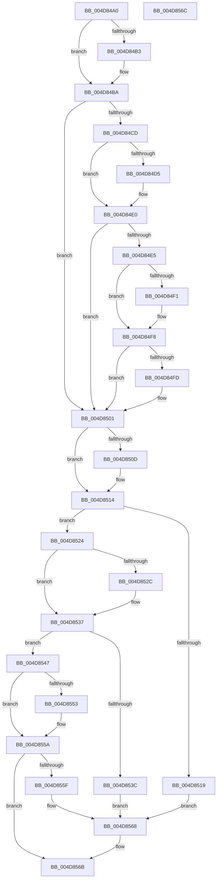

# PopDiagGetPowerSchemeInfo

- RVA: `0x004D84A0`–`0x004D856D` (길이 `205` bytes)
- VA: `0x00000001404D84A0`
- 실행 섹션: `.text`
- PDB 이름 있음: `예`; PDB Function 태그: `아니요`
- unwind 정보 RVA: `0x000DB714`
- 디코드: `60`개 명령, `205/205` bytes 표시
- 미해석 바이트: `0` (있으면 어셈블리에 `.byte`로 보존)

> 이 문서는 커널 이미지의 기계어와 PDB 기호를 분석해 생성했습니다. 4번과 5번은 함수 원형과 자료형을 바이너리 사용 방식에서 추정한 C 해석이며 원본 소스 복구 결과는 아닙니다.

## 1. Dependencies

- 직접 호출 지점: **0**; 고유 호출 대상: **0**
- 직접 호출자로 확인된 함수: **1**
- RIP 상대 이미지 참조: **6**

### Outgoing calls
- 직접 디코드된 call 명령이 없습니다.

### Direct callers
- [PopCaptureSleepStudyStatistics](../43/PopCaptureSleepStudyStatistics_function_004399F4.md) at `0x00439E3C`

### Static image references
- `0x004D84A3` → RVA `0x0001ECE8` (`.rdata`; read)
- `0x004D84AA` → RVA `0x0001ECF0` (`.rdata`; read)
- `0x004D84BA` → RVA `0x0001ECC8` (`.rdata`; read)
- `0x004D84C1` → RVA `0x0001ECE0` (`.rdata`; read)
- `0x004D84D9` → RVA `0x0001ECD0` (`.rdata`; read)
- `0x004D84E8` → RVA `0x0001ECD8` (`.rdata`; read)

## 2. Other-region calls and transfers

- 다른 실행 섹션으로 향하는 call: **0**
- 별도 외부 분기/꼬리 이동을 확인하지 못했습니다.

## 3. Assembly (complete function range)

```asm
004D84A0  48 8B 01                        mov rax, qword ptr [rcx]
004D84A3  48 2B 05 3E 68 B4 FF            sub rax, qword ptr [rip - 0x4b97c2]
004D84AA  4C 8B 0D 3F 68 B4 FF            mov r9, qword ptr [rip - 0x4b97c1]
004D84B1  75 07                           jne 0x1404d84ba
004D84B3  48 8B 41 08                     mov rax, qword ptr [rcx + 8]
004D84B7  49 2B C1                        sub rax, r9
004D84BA  4C 8B 1D 07 68 B4 FF            mov r11, qword ptr [rip - 0x4b97f9]
004D84C1  4C 8B 15 18 68 B4 FF            mov r10, qword ptr [rip - 0x4b97e8]
004D84C8  48 85 C0                        test rax, rax
004D84CB  74 34                           je 0x1404d8501
004D84CD  48 8B 01                        mov rax, qword ptr [rcx]
004D84D0  49 2B C3                        sub rax, r11
004D84D3  75 0B                           jne 0x1404d84e0
004D84D5  48 8B 41 08                     mov rax, qword ptr [rcx + 8]
004D84D9  48 2B 05 F0 67 B4 FF            sub rax, qword ptr [rip - 0x4b9810]
004D84E0  48 85 C0                        test rax, rax
004D84E3  74 1C                           je 0x1404d8501
004D84E5  48 8B 01                        mov rax, qword ptr [rcx]
004D84E8  48 2B 05 E9 67 B4 FF            sub rax, qword ptr [rip - 0x4b9817]
004D84EF  75 07                           jne 0x1404d84f8
004D84F1  48 8B 41 08                     mov rax, qword ptr [rcx + 8]
004D84F5  49 2B C2                        sub rax, r10
004D84F8  48 85 C0                        test rax, rax
004D84FB  74 04                           je 0x1404d8501
004D84FD  41 83 08 10                     or dword ptr [r8], 0x10
004D8501  48 8B 02                        mov rax, qword ptr [rdx]
004D8504  48 2B 05 DD 67 B4 FF            sub rax, qword ptr [rip - 0x4b9823]
004D850B  75 07                           jne 0x1404d8514
004D850D  48 8B 42 08                     mov rax, qword ptr [rdx + 8]
004D8511  49 2B C1                        sub rax, r9
004D8514  48 85 C0                        test rax, rax
004D8517  75 0B                           jne 0x1404d8524
004D8519  41 8B 00                        mov eax, dword ptr [r8]
004D851C  83 E0 F1                        and eax, 0xfffffff1
004D851F  83 C8 01                        or eax, 1
004D8522  EB 44                           jmp 0x1404d8568
004D8524  48 8B 02                        mov rax, qword ptr [rdx]
004D8527  49 2B C3                        sub rax, r11
004D852A  75 0B                           jne 0x1404d8537
004D852C  48 8B 42 08                     mov rax, qword ptr [rdx + 8]
004D8530  48 2B 05 99 67 B4 FF            sub rax, qword ptr [rip - 0x4b9867]
004D8537  48 85 C0                        test rax, rax
004D853A  75 0B                           jne 0x1404d8547
004D853C  41 8B 00                        mov eax, dword ptr [r8]
004D853F  83 E0 F2                        and eax, 0xfffffff2
004D8542  83 C8 02                        or eax, 2
004D8545  EB 21                           jmp 0x1404d8568
004D8547  48 8B 02                        mov rax, qword ptr [rdx]
004D854A  48 2B 05 87 67 B4 FF            sub rax, qword ptr [rip - 0x4b9879]
004D8551  75 07                           jne 0x1404d855a
004D8553  48 8B 42 08                     mov rax, qword ptr [rdx + 8]
004D8557  49 2B C2                        sub rax, r10
004D855A  48 85 C0                        test rax, rax
004D855D  75 0C                           jne 0x1404d856b
004D855F  41 8B 00                        mov eax, dword ptr [r8]
004D8562  83 E0 F4                        and eax, 0xfffffff4
004D8565  83 C8 04                        or eax, 4
004D8568  41 89 00                        mov dword ptr [r8], eax
004D856B  C3                              ret
004D856C  CC                              int3
```

## 4. C-style interpretation (structured pseudocode)

```c
__int64 __fastcall PopDiagGetPowerSchemeInfo(__int64 a1, __int64 a2, __int64 a3)
{
    __int64 result;

    result = (*(unsigned __int64 *)(a1)) - (*(unsigned __int64 *)(v_rip - 4954050));
    if (!(condition_is_not_equal)) {
        result = *(unsigned __int64 *)(a1 + 8);
        result = (result) - (*(unsigned __int64 *)(v_rip - 4954049));
    }
    if (result == 0) goto loc_004D8501;
    result = (*(unsigned __int64 *)(a1)) - (*(unsigned __int64 *)(v_rip - 4954105));
    if (!(condition_is_not_equal)) {
        result = *(unsigned __int64 *)(a1 + 8);
        result = (result) - (*(unsigned __int64 *)(v_rip - 4954128));
    }
    if (result == 0) goto loc_004D8501;
    result = (*(unsigned __int64 *)(a1)) - (*(unsigned __int64 *)(v_rip - 4954135));
    if (!(condition_is_not_equal)) {
        result = *(unsigned __int64 *)(a1 + 8);
        result = (result) - (*(unsigned __int64 *)(v_rip - 4954088));
    }
    if (result != 0) {
    }
    result = (*(unsigned __int64 *)(a2)) - (*(unsigned __int64 *)(v_rip - 4954147));
    if (!(condition_is_not_equal)) {
        result = *(unsigned __int64 *)(a2 + 8);
        result = (result) - (*(unsigned __int64 *)(v_rip - 4954049));
    }
    if (result != 0) goto loc_004D8524;
    result = (unsigned int)(((unsigned int)(*(unsigned int *)(a3))) & (0xFFFFFFF1ULL));
    result = (unsigned int)((result) | (1));
    goto loc_004D8568;
loc_004D8524:
    result = (*(unsigned __int64 *)(a2)) - (*(unsigned __int64 *)(v_rip - 4954105));
    if (!(condition_is_not_equal)) {
        result = *(unsigned __int64 *)(a2 + 8);
        result = (result) - (*(unsigned __int64 *)(v_rip - 4954215));
    }
    if (result != 0) goto loc_004D8547;
    result = (unsigned int)(((unsigned int)(*(unsigned int *)(a3))) & (0xFFFFFFF2ULL));
    result = (unsigned int)((result) | (2));
    goto loc_004D8568;
loc_004D8547:
    result = (*(unsigned __int64 *)(a2)) - (*(unsigned __int64 *)(v_rip - 4954233));
    if (!(condition_is_not_equal)) {
        result = *(unsigned __int64 *)(a2 + 8);
        result = (result) - (*(unsigned __int64 *)(v_rip - 4954088));
    }
    if (result != 0) goto loc_004D856B;
    result = (unsigned int)(((unsigned int)(*(unsigned int *)(a3))) & (0xFFFFFFF4ULL));
    result = (unsigned int)((result) | (4));
loc_004D8568:
    *(unsigned int *)(a3) = (unsigned int)(result);
loc_004D856B:
    return result;
}
```

## 5. (Beta) C Style

```c
int64_t PopDiagGetPowerSchemeInfo(void *Arg1, void *Arg2, void *Arg3)
{
    uint8_t *arg1 = (uint8_t *)Arg1;
    uint8_t *arg2 = (uint8_t *)Arg2;
    uint8_t *arg3 = (uint8_t *)Arg3;

    int64_t result;

    result = (*(uint64_t *)(arg1)) - (*(uint64_t *)(v_rip - 0x4B97C2));
    if (!(condition_is_not_equal)) {
        result = *(uint64_t *)(arg1 + 0x8);
        result = (result) - (*(uint64_t *)(v_rip - 0x4B97C1));
    }
    if (result == 0) goto loc_004D8501;
    result = (*(uint64_t *)(arg1)) - (*(uint64_t *)(v_rip - 0x4B97F9));
    if (!(condition_is_not_equal)) {
        result = *(uint64_t *)(arg1 + 0x8);
        result = (result) - (*(uint64_t *)(v_rip - 0x4B9810));
    }
    if (result == 0) goto loc_004D8501;
    result = (*(uint64_t *)(arg1)) - (*(uint64_t *)(v_rip - 0x4B9817));
    if (!(condition_is_not_equal)) {
        result = *(uint64_t *)(arg1 + 0x8);
        result = (result) - (*(uint64_t *)(v_rip - 0x4B97E8));
    }
    if (result != 0) {
    }
    result = (*(uint64_t *)(arg2)) - (*(uint64_t *)(v_rip - 0x4B9823));
    if (!(condition_is_not_equal)) {
        result = *(uint64_t *)(arg2 + 0x8);
        result = (result) - (*(uint64_t *)(v_rip - 0x4B97C1));
    }
    if (result != 0) goto loc_004D8524;
    result = (uint32_t)(((uint32_t)(*(uint32_t *)(arg3))) & (0xFFFFFFF1ULL));
    result = (uint32_t)((result) | (1));
    goto loc_004D8568;
loc_004D8524:
    result = (*(uint64_t *)(arg2)) - (*(uint64_t *)(v_rip - 0x4B97F9));
    if (!(condition_is_not_equal)) {
        result = *(uint64_t *)(arg2 + 0x8);
        result = (result) - (*(uint64_t *)(v_rip - 0x4B9867));
    }
    if (result != 0) goto loc_004D8547;
    result = (uint32_t)(((uint32_t)(*(uint32_t *)(arg3))) & (0xFFFFFFF2ULL));
    result = (uint32_t)((result) | (2));
    goto loc_004D8568;
loc_004D8547:
    result = (*(uint64_t *)(arg2)) - (*(uint64_t *)(v_rip - 0x4B9879));
    if (!(condition_is_not_equal)) {
        result = *(uint64_t *)(arg2 + 0x8);
        result = (result) - (*(uint64_t *)(v_rip - 0x4B97E8));
    }
    if (result != 0) goto loc_004D856B;
    result = (uint32_t)(((uint32_t)(*(uint32_t *)(arg3))) & (0xFFFFFFF4ULL));
    result = (uint32_t)((result) | (4));
loc_004D8568:
    *(uint32_t *)(arg3) = (uint32_t)(result);
loc_004D856B:
    return result;
}
```

### 관측된 메모리 오프셋

구조체 형식이 확인되지 않은 접근은 인자 기준의 오프셋으로만 기록했습니다.

| 기준 인자 | 오프셋 표현 | 폭 (bit) | 접근 |
|---|---:|---:|---|
| `Arg1` | `+ 0x0` | `64` | `R` |
| `Arg1` | `+ 0x8` | `64` | `R` |
| `Arg2` | `+ 0x0` | `64` | `R` |
| `Arg2` | `+ 0x8` | `64` | `R` |
| `Arg3` | `+ 0x0` | `32` | `R` |
| `Arg3` | `+ 0x0` | `32` | `R/W` |
| `Arg3` | `+ 0x0` | `32` | `W` |

## 6. Execution-region graph

[열기: 2D/3D 그래프와 함수 탐색 컨트롤 패널](../../../control-panel.html?section=text&rva=0x004D84A0&view=graph)

- 2D 그래프는 위에서 아래로 흐르고, 3D 그래프는 빈 공간을 드래그해 회전합니다. Shift+드래그는 이동, 휠은 확대·축소, 함수 노드 선택은 대상 보고서 이동입니다.

### Static fallback


