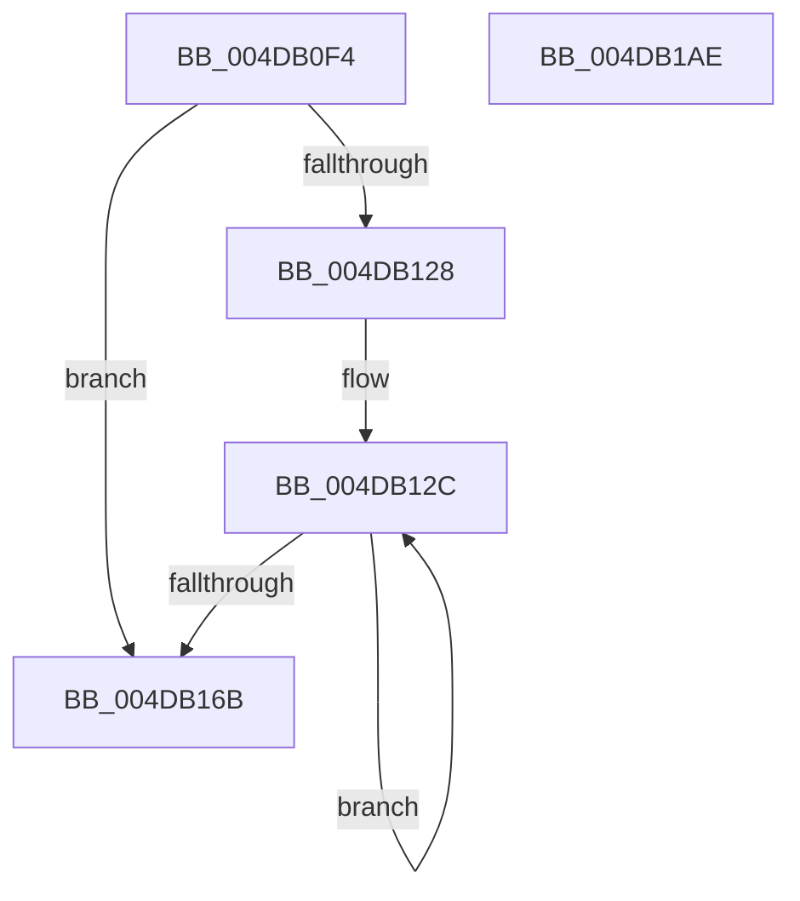

# PopDiagSnapActiveActivity

- RVA: `0x004DB0F4`–`0x004DB1AF` (길이 `187` bytes)
- VA: `0x00000001404DB0F4`
- 실행 섹션: `.text`
- PDB 이름 있음: `예`; PDB Function 태그: `아니요`
- unwind 정보 RVA: `0x000BE9E8`
- 디코드: `49`개 명령, `187/187` bytes 표시
- 미해석 바이트: `0` (있으면 어셈블리에 `.byte`로 보존)

> 이 문서는 커널 이미지의 기계어와 PDB 기호를 분석해 생성했습니다. 4번과 5번은 함수 원형과 자료형을 바이너리 사용 방식에서 추정한 C 해석이며 원본 소스 복구 결과는 아닙니다.

## 1. Dependencies

- 직접 호출 지점: **0**; 고유 호출 대상: **0**
- 직접 호출자로 확인된 함수: **2**
- RIP 상대 이미지 참조: **0**

### Outgoing calls
- 직접 디코드된 call 명령이 없습니다.

### Direct callers
- [PopTraceThermalRequestActiveActivity](../4E/PopTraceThermalRequestActiveActivity_function_004E9104.md) at `0x004E91EC`
- [PopTraceThermalZoneActiveActivity](../5D/PopTraceThermalZoneActiveActivity_function_005D7FE0.md) at `0x005D8055`

### Static image references
- 디코드된 RIP-relative 메모리 참조가 없습니다.

## 2. Other-region calls and transfers

- 다른 실행 섹션으로 향하는 call: **0**
- 별도 외부 분기/꼬리 이동을 확인하지 못했습니다.

## 3. Assembly (complete function range)

```asm
004DB0F4  48 8B C4                        mov rax, rsp
004DB0F7  48 89 58 08                     mov qword ptr [rax + 8], rbx
004DB0FB  48 89 68 10                     mov qword ptr [rax + 0x10], rbp
004DB0FF  48 89 70 18                     mov qword ptr [rax + 0x18], rsi
004DB103  48 89 78 20                     mov qword ptr [rax + 0x20], rdi
004DB107  41 56                           push r14
004DB109  41 57                           push r15
004DB10B  44 8A 59 01                     mov r11b, byte ptr [rcx + 1]
004DB10F  32 DB                           xor bl, bl
004DB111  33 FF                           xor edi, edi
004DB113  4C 8B F2                        mov r14, rdx
004DB116  4C 8B D1                        mov r10, rcx
004DB119  48 BD BD 42 7A E5 D5 94 BF D6   movabs rbp, 0xd6bf94d5e57a42bd
004DB123  45 84 DB                        test r11b, r11b
004DB126  74 43                           je 0x1404db16b
004DB128  44 8D 7F 01                     lea r15d, [rdi + 1]
004DB12C  49 8B 84 FA B8 01 00 00         mov rax, qword ptr [r10 + rdi*8 + 0x1b8]
004DB134  49 8B 8C FA 68 01 00 00         mov rcx, qword ptr [r10 + rdi*8 + 0x168]
004DB13C  49 89 84 FA 68 01 00 00         mov qword ptr [r10 + rdi*8 + 0x168], rax
004DB144  48 2B C8                        sub rcx, rax
004DB147  48 8B C5                        mov rax, rbp
004DB14A  0F B6 DB                        movzx ebx, bl
004DB14D  48 F7 E1                        mul rcx
004DB150  48 C1 EA 17                     shr rdx, 0x17
004DB154  85 D2                           test edx, edx
004DB156  41 89 14 B9                     mov dword ptr [r9 + rdi*4], edx
004DB15A  45 0F B6 5A 01                  movzx r11d, byte ptr [r10 + 1]
004DB15F  41 0F 45 DF                     cmovne ebx, r15d
004DB163  41 03 FF                        add edi, r15d
004DB166  41 3B FB                        cmp edi, r11d
004DB169  72 C1                           jb 0x1404db12c
004DB16B  49 8B 8A 10 02 00 00            mov rcx, qword ptr [r10 + 0x210]
004DB172  48 8B C5                        mov rax, rbp
004DB175  49 8B 92 08 02 00 00            mov rdx, qword ptr [r10 + 0x208]
004DB17C  48 8B 6C 24 20                  mov rbp, qword ptr [rsp + 0x20]
004DB181  48 2B D1                        sub rdx, rcx
004DB184  48 8B 74 24 28                  mov rsi, qword ptr [rsp + 0x28]
004DB189  48 8B 7C 24 30                  mov rdi, qword ptr [rsp + 0x30]
004DB18E  48 F7 E2                        mul rdx
004DB191  8A C3                           mov al, bl
004DB193  49 89 8A 08 02 00 00            mov qword ptr [r10 + 0x208], rcx
004DB19A  48 8B 5C 24 18                  mov rbx, qword ptr [rsp + 0x18]
004DB19F  48 C1 EA 17                     shr rdx, 0x17
004DB1A3  41 89 16                        mov dword ptr [r14], edx
004DB1A6  45 88 18                        mov byte ptr [r8], r11b
004DB1A9  41 5F                           pop r15
004DB1AB  41 5E                           pop r14
004DB1AD  C3                              ret
004DB1AE  CC                              int3
```

## 4. C-style interpretation (structured pseudocode)

```c
__int64 __fastcall PopDiagSnapActiveActivity(__int64 a1, __int64 a2, __int64 a3, __int64 a4)
{
    __int64 v_rbx;
    __int64 v_rdi;
    unsigned __int64 v_stack_p10;
    unsigned __int64 v_stack_p18;
    unsigned __int64 v_stack_p20;
    unsigned __int64 v_stack_p8;

    *(unsigned __int64 *)(v_rsp + 8) = v_rbx;
    *(unsigned __int64 *)(v_rsp + 16) = v_rbp;
    *(unsigned __int64 *)(v_rsp + 24) = v_rsi;
    *(unsigned __int64 *)(v_rsp + 32) = v_rdi;
    v_rbx = 0;
    v_rdi = 0;
    if ((unsigned __int8)(*(unsigned __int8 *)(a1 + 1)) == 0) goto loc_004DB16B;
loc_004DB12C:
    *(unsigned __int64 *)(a1 + v_rdi * 8 + 360) = *(unsigned __int64 *)(a1 + v_rdi * 8 + 440);
    a1 = (*(unsigned __int64 *)(a1 + v_rdi * 8 + 360)) - (*(unsigned __int64 *)(a1 + v_rdi * 8 + 440));
    a2 = (a2) >> (23);
    *(unsigned int *)(a4 + v_rdi * 4) = (unsigned int)(a2);
    v_rbx = 0;
    if ((unsigned int)(a2) != 0) { v_rbx = (unsigned int)(v_rdi + 1); }
    v_rdi = (unsigned int)((v_rdi) + ((unsigned int)(v_rdi + 1)));
    if (((unsigned int)(v_rdi)) < ((unsigned int)(*(unsigned __int8 *)(a1 + 1)))) goto loc_004DB12C;
loc_004DB16B:
    a2 = (*(unsigned __int64 *)(a1 + 520)) - (*(unsigned __int64 *)(a1 + 528));
    *(unsigned __int64 *)(a1 + 520) = *(unsigned __int64 *)(a1 + 528);
    a2 = (a2) >> (23);
    *(unsigned int *)(a2) = (unsigned int)(a2);
    *(unsigned __int8 *)(a3) = (unsigned __int8)(*(unsigned __int8 *)(a1 + 1));
    return (unsigned __int8)(v_rbx);
}
```

## 5. (Beta) C Style

```c
int64_t PopDiagSnapActiveActivity(void *Arg1, void *Arg2, void *Arg3, void *Arg4)
{
    uint8_t *arg1 = (uint8_t *)Arg1;
    uint8_t *arg2 = (uint8_t *)Arg2;
    uint8_t *arg3 = (uint8_t *)Arg3;
    uint8_t *arg4 = (uint8_t *)Arg4;

    int64_t local_rbx;
    int64_t local_rdi;
    uint64_t v_stack_p10;
    uint64_t v_stack_p18;
    uint64_t v_stack_p20;
    uint64_t v_stack_p8;

    *(uint64_t *)(local_rsp + 0x8) = local_rbx;
    *(uint64_t *)(local_rsp + 0x10) = local_rbp;
    *(uint64_t *)(local_rsp + 0x18) = local_rsi;
    *(uint64_t *)(local_rsp + 0x20) = local_rdi;
    local_rbx = 0;
    local_rdi = 0;
    if ((uint8_t)(*(uint8_t *)(arg1 + 0x1)) == 0) goto loc_004DB16B;
loc_004DB12C:
    *(uint64_t *)(arg1 + local_rdi * 8 + 0x168) = *(uint64_t *)(arg1 + local_rdi * 8 + 0x1B8);
    Arg1 = (*(uint64_t *)(arg1 + local_rdi * 8 + 0x168)) - (*(uint64_t *)(arg1 + local_rdi * 8 + 0x1B8));
    Arg2 = (Arg2) >> (23);
    *(uint32_t *)(arg4 + local_rdi * 4) = (uint32_t)(Arg2);
    local_rbx = 0;
    if ((uint32_t)(Arg2) != 0) { local_rbx = (uint32_t)(local_rdi + 1); }
    local_rdi = (uint32_t)((local_rdi) + ((uint32_t)(local_rdi + 1)));
    if (((uint32_t)(local_rdi)) < ((uint32_t)(*(uint8_t *)(arg1 + 0x1)))) goto loc_004DB12C;
loc_004DB16B:
    Arg2 = (*(uint64_t *)(arg1 + 0x208)) - (*(uint64_t *)(arg1 + 0x210));
    *(uint64_t *)(arg1 + 0x208) = *(uint64_t *)(arg1 + 0x210);
    Arg2 = (Arg2) >> (23);
    *(uint32_t *)(arg2) = (uint32_t)(Arg2);
    *(uint8_t *)(arg3) = (uint8_t)(*(uint8_t *)(arg1 + 0x1));
    return (uint8_t)(local_rbx);
}
```

### 관측된 메모리 오프셋

구조체 형식이 확인되지 않은 접근은 인자 기준의 오프셋으로만 기록했습니다.

| 기준 인자 | 오프셋 표현 | 폭 (bit) | 접근 |
|---|---:|---:|---|
| `Arg1` | `+ 0x1` | `8` | `R` |
| `Arg1` | `+ 0x168 + rdi*8` | `64` | `R` |
| `Arg1` | `+ 0x168 + rdi*8` | `64` | `W` |
| `Arg1` | `+ 0x1B8 + rdi*8` | `64` | `R` |
| `Arg1` | `+ 0x208` | `64` | `R` |
| `Arg1` | `+ 0x208` | `64` | `W` |
| `Arg1` | `+ 0x210` | `64` | `R` |
| `Arg2` | `+ 0x0` | `32` | `W` |
| `Arg3` | `+ 0x0` | `8` | `W` |
| `Arg4` | `+ 0x0 + rdi*4` | `32` | `W` |

## 6. Execution-region graph

[열기: 2D/3D 그래프와 함수 탐색 컨트롤 패널](../../../control-panel.html?section=text&rva=0x004DB0F4&view=graph)

- 2D 그래프는 위에서 아래로 흐르고, 3D 그래프는 빈 공간을 드래그해 회전합니다. Shift+드래그는 이동, 휠은 확대·축소, 함수 노드 선택은 대상 보고서 이동입니다.

### Static fallback


