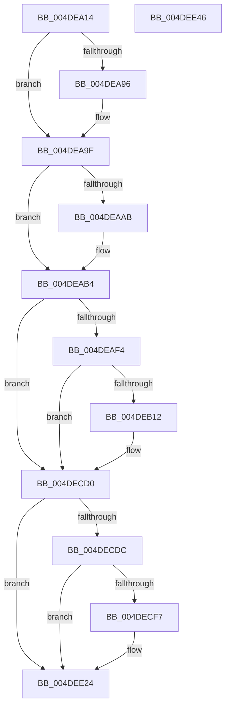

# PopDiagTraceRtcWakeInfo

- RVA: `0x004DEA14`–`0x004DEE47` (길이 `1,075` bytes)
- VA: `0x00000001404DEA14`
- 실행 섹션: `.text`
- PDB 이름 있음: `예`; PDB Function 태그: `아니요`
- unwind 정보 RVA: `0x000BECDC`
- 디코드: `198`개 명령, `1,075/1,075` bytes 표시
- 미해석 바이트: `0` (있으면 어셈블리에 `.byte`로 보존)

> 이 문서는 커널 이미지의 기계어와 PDB 기호를 분석해 생성했습니다. 4번과 5번은 함수 원형과 자료형을 바이너리 사용 방식에서 추정한 C 해석이며 원본 소스 복구 결과는 아닙니다.

## 1. Dependencies

- 직접 호출 지점: **9**; 고유 호출 대상: **6**
- 직접 호출자로 확인된 함수: **1**
- RIP 상대 이미지 참조: **11**

### Outgoing calls
- `0x004DEA9A` → [PopDiagInterruptTimeToSystemTime](../../pagelk/B7/PopDiagInterruptTimeToSystemTime_function_00B7D6F4.md) (function, `0x00B7D6F4`)
- `0x004DEAAF` → [PopDiagInterruptTimeToSystemTime](../../pagelk/B7/PopDiagInterruptTimeToSystemTime_function_00B7D6F4.md) (function, `0x00B7D6F4`)
- `0x004DEABF` → [PopDiagInterruptTimeToSystemTime](../../pagelk/B7/PopDiagInterruptTimeToSystemTime_function_00B7D6F4.md) (function, `0x00B7D6F4`)
- `0x004DEACF` → [PopDiagInterruptTimeToSystemTime](../../pagelk/B7/PopDiagInterruptTimeToSystemTime_function_00B7D6F4.md) (function, `0x00B7D6F4`)
- `0x004DEB05` → [tlgKeywordOn](../42/tlgKeywordOn_function_0042EAA0.md) (function, `0x0042EAA0`)
- `0x004DECCB` → [tlgWriteTransfer_EtwWriteTransfer](../42/tlgWriteTransfer_EtwWriteTransfer_function_004260E0.md) (function, `0x004260E0`)
- `0x004DECEA` → [EtwEventEnabled](../39/EtwEventEnabled_function_00392450.md) (function, `0x00392450`)
- `0x004DEE1F` → [EtwWriteEx](../25/EtwWriteEx_function_0025F0D0.md) (function, `0x0025F0D0`)
- `0x004DEE2E` → [_security_check_cookie](../6A/_security_check_cookie_function_006AC640.md) (function, `0x006AC640`)

### Direct callers
- [PopValidateRTCWake](../../pagelk/B7/PopValidateRTCWake_function_00B7CDE4.md) at `0x00B7CF53`

### Static image references
- `0x004DEA37` → RVA `0x00E0A740` (`.data`; read)
- `0x004DEA48` → RVA `0x00F0DEF4` (`.data`; read)
- `0x004DEA82` → RVA `0x00F0BDC0` (`.data`; read)
- `0x004DEA9F` → RVA `0x00F0BDD8` (`.data`; read)
- `0x004DEAB4` → RVA `0x00F0BD98` (`.data`; read)
- `0x004DEAD4` → RVA `0x00F0C684` (`.data`; read)
- `0x004DEAE3` → RVA `0x00E07748` (`.data`; read)
- `0x004DEB18` → RVA `0x00049EFA` (`.rdata`; read)
- `0x004DECD0` → RVA `0x00E67858` (`.data`; read)
- `0x004DECDC` → RVA `0x00F0B408` (`.data`; read)
- `0x004DECE3` → RVA `0x000226F8` (`.rdata`; read)

## 2. Other-region calls and transfers

- 다른 실행 섹션으로 향하는 call: **4**
  - `0x004DEA9A` → [PopDiagInterruptTimeToSystemTime](../../pagelk/B7/PopDiagInterruptTimeToSystemTime_function_00B7D6F4.md) (`.text` → `PAGELK`)
  - `0x004DEAAF` → [PopDiagInterruptTimeToSystemTime](../../pagelk/B7/PopDiagInterruptTimeToSystemTime_function_00B7D6F4.md) (`.text` → `PAGELK`)
  - `0x004DEABF` → [PopDiagInterruptTimeToSystemTime](../../pagelk/B7/PopDiagInterruptTimeToSystemTime_function_00B7D6F4.md) (`.text` → `PAGELK`)
  - `0x004DEACF` → [PopDiagInterruptTimeToSystemTime](../../pagelk/B7/PopDiagInterruptTimeToSystemTime_function_00B7D6F4.md) (`.text` → `PAGELK`)
- 별도 외부 분기/꼬리 이동을 확인하지 못했습니다.

## 3. Assembly (complete function range)

```asm
004DEA14  48 8B C4                        mov rax, rsp
004DEA17  48 89 58 08                     mov qword ptr [rax + 8], rbx
004DEA1B  44 89 48 20                     mov dword ptr [rax + 0x20], r9d
004DEA1F  44 89 40 18                     mov dword ptr [rax + 0x18], r8d
004DEA23  89 50 10                        mov dword ptr [rax + 0x10], edx
004DEA26  55                              push rbp
004DEA27  56                              push rsi
004DEA28  57                              push rdi
004DEA29  48 8D A8 48 FE FF FF            lea rbp, [rax - 0x1b8]
004DEA30  48 81 EC A0 02 00 00            sub rsp, 0x2a0
004DEA37  48 8B 05 02 BD 92 00            mov rax, qword ptr [rip + 0x92bd02]
004DEA3E  48 33 C4                        xor rax, rsp
004DEA41  48 89 85 90 01 00 00            mov qword ptr [rbp + 0x190], rax
004DEA48  8B 0D A6 F4 A2 00               mov ecx, dword ptr [rip + 0xa2f4a6]
004DEA4E  33 DB                           xor ebx, ebx
004DEA50  8B C1                           mov eax, ecx
004DEA52  89 4C 24 48                     mov dword ptr [rsp + 0x48], ecx
004DEA56  C1 E8 03                        shr eax, 3
004DEA59  48 89 5D 98                     mov qword ptr [rbp - 0x68], rbx
004DEA5D  44 8D 53 01                     lea r10d, [rbx + 1]
004DEA61  48 89 5D 88                     mov qword ptr [rbp - 0x78], rbx
004DEA65  41 23 C2                        and eax, r10d
004DEA68  48 89 5D 90                     mov qword ptr [rbp - 0x70], rbx
004DEA6C  89 44 24 50                     mov dword ptr [rsp + 0x50], eax
004DEA70  8B C1                           mov eax, ecx
004DEA72  C1 E9 02                        shr ecx, 2
004DEA75  41 23 CA                        and ecx, r10d
004DEA78  C1 E8 04                        shr eax, 4
004DEA7B  41 23 C2                        and eax, r10d
004DEA7E  89 4C 24 58                     mov dword ptr [rsp + 0x58], ecx
004DEA82  48 8B 0D 37 D3 A2 00            mov rcx, qword ptr [rip + 0xa2d337]
004DEA89  89 44 24 54                     mov dword ptr [rsp + 0x54], eax
004DEA8D  48 89 5D A0                     mov qword ptr [rbp - 0x60], rbx
004DEA91  48 85 C9                        test rcx, rcx
004DEA94  74 09                           je 0x1404dea9f
004DEA96  48 8D 55 88                     lea rdx, [rbp - 0x78]
004DEA9A  E8 55 EC 69 00                  call 0x140b7d6f4
004DEA9F  48 8B 0D 32 D3 A2 00            mov rcx, qword ptr [rip + 0xa2d332]
004DEAA6  48 85 C9                        test rcx, rcx
004DEAA9  74 09                           je 0x1404deab4
004DEAAB  48 8D 55 90                     lea rdx, [rbp - 0x70]
004DEAAF  E8 40 EC 69 00                  call 0x140b7d6f4
004DEAB4  48 8B 0D DD D2 A2 00            mov rcx, qword ptr [rip + 0xa2d2dd]
004DEABB  48 8D 55 98                     lea rdx, [rbp - 0x68]
004DEABF  E8 30 EC 69 00                  call 0x140b7d6f4
004DEAC4  48 8B 8D F0 01 00 00            mov rcx, qword ptr [rbp + 0x1f0]
004DEACB  48 8D 55 A0                     lea rdx, [rbp - 0x60]
004DEACF  E8 20 EC 69 00                  call 0x140b7d6f4
004DEAD4  8B 0D AA DB A2 00               mov ecx, dword ptr [rip + 0xa2dbaa]
004DEADA  44 8B C3                        mov r8d, ebx
004DEADD  85 C9                           test ecx, ecx
004DEADF  41 0F 95 C0                     setne r8b
004DEAE3  83 3D 5E 8C 92 00 05            cmp dword ptr [rip + 0x928c5e], 5
004DEAEA  44 89 45 80                     mov dword ptr [rbp - 0x80], r8d
004DEAEE  0F 86 DC 01 00 00               jbe 0x1404decd0
004DEAF4  48 BA 00 00 00 00 00 40 00 00   movabs rdx, 0x400000000000
004DEAFE  48 8D 0D 43 8C 92 00            lea rcx, [rip + 0x928c43]
004DEB05  E8 96 FF F4 FF                  call 0x14042eaa0
004DEB0A  84 C0                           test al, al
004DEB0C  0F 84 BE 01 00 00               je 0x1404decd0
004DEB12  8B 85 C8 01 00 00               mov eax, dword ptr [rbp + 0x1c8]
004DEB18  48 8D 15 DB B3 B6 FF            lea rdx, [rip - 0x494c25]
004DEB1F  89 44 24 5C                     mov dword ptr [rsp + 0x5c], eax
004DEB23  48 8D 0D 1E 8C 92 00            lea rcx, [rip + 0x928c1e]
004DEB2A  48 8D 44 24 5C                  lea rax, [rsp + 0x5c]
004DEB2F  44 89 44 24 7C                  mov dword ptr [rsp + 0x7c], r8d
004DEB34  48 89 85 B0 00 00 00            mov qword ptr [rbp + 0xb0], rax
004DEB3B  45 33 C9                        xor r9d, r9d
004DEB3E  8A 85 D0 01 00 00               mov al, byte ptr [rbp + 0x1d0]
004DEB44  45 33 C0                        xor r8d, r8d
004DEB47  88 44 24 40                     mov byte ptr [rsp + 0x40], al
004DEB4B  48 8D 44 24 40                  lea rax, [rsp + 0x40]
004DEB50  48 89 85 C0 00 00 00            mov qword ptr [rbp + 0xc0], rax
004DEB57  8B 85 D8 01 00 00               mov eax, dword ptr [rbp + 0x1d8]
004DEB5D  89 44 24 60                     mov dword ptr [rsp + 0x60], eax
004DEB61  48 8D 44 24 60                  lea rax, [rsp + 0x60]
004DEB66  48 89 85 D0 00 00 00            mov qword ptr [rbp + 0xd0], rax
004DEB6D  8B 85 E0 01 00 00               mov eax, dword ptr [rbp + 0x1e0]
004DEB73  89 44 24 64                     mov dword ptr [rsp + 0x64], eax
004DEB77  48 8D 44 24 64                  lea rax, [rsp + 0x64]
004DEB7C  48 89 85 E0 00 00 00            mov qword ptr [rbp + 0xe0], rax
004DEB83  8B 44 24 48                     mov eax, dword ptr [rsp + 0x48]
004DEB87  89 44 24 68                     mov dword ptr [rsp + 0x68], eax
004DEB8B  48 8D 44 24 68                  lea rax, [rsp + 0x68]
004DEB90  48 89 85 F0 00 00 00            mov qword ptr [rbp + 0xf0], rax
004DEB97  8B 44 24 50                     mov eax, dword ptr [rsp + 0x50]
004DEB9B  89 44 24 6C                     mov dword ptr [rsp + 0x6c], eax
004DEB9F  48 8D 44 24 6C                  lea rax, [rsp + 0x6c]
004DEBA4  48 89 85 00 01 00 00            mov qword ptr [rbp + 0x100], rax
004DEBAB  8B 44 24 54                     mov eax, dword ptr [rsp + 0x54]
004DEBAF  89 44 24 70                     mov dword ptr [rsp + 0x70], eax
004DEBB3  48 8D 44 24 70                  lea rax, [rsp + 0x70]
004DEBB8  48 89 85 10 01 00 00            mov qword ptr [rbp + 0x110], rax
004DEBBF  8B 44 24 58                     mov eax, dword ptr [rsp + 0x58]
004DEBC3  89 44 24 74                     mov dword ptr [rsp + 0x74], eax
004DEBC7  48 8D 44 24 74                  lea rax, [rsp + 0x74]
004DEBCC  48 89 85 20 01 00 00            mov qword ptr [rbp + 0x120], rax
004DEBD3  48 8D 45 88                     lea rax, [rbp - 0x78]
004DEBD7  48 89 85 30 01 00 00            mov qword ptr [rbp + 0x130], rax
004DEBDE  48 8D 45 90                     lea rax, [rbp - 0x70]
004DEBE2  48 89 85 40 01 00 00            mov qword ptr [rbp + 0x140], rax
004DEBE9  8B 85 E8 01 00 00               mov eax, dword ptr [rbp + 0x1e8]
004DEBEF  89 44 24 78                     mov dword ptr [rsp + 0x78], eax
004DEBF3  48 8D 44 24 78                  lea rax, [rsp + 0x78]
004DEBF8  48 89 85 50 01 00 00            mov qword ptr [rbp + 0x150], rax
004DEBFF  48 8D 45 98                     lea rax, [rbp - 0x68]
004DEC03  48 89 85 60 01 00 00            mov qword ptr [rbp + 0x160], rax
004DEC0A  48 8D 45 A0                     lea rax, [rbp - 0x60]
004DEC0E  48 89 85 70 01 00 00            mov qword ptr [rbp + 0x170], rax
004DEC15  48 8D 44 24 7C                  lea rax, [rsp + 0x7c]
004DEC1A  48 89 85 80 01 00 00            mov qword ptr [rbp + 0x180], rax
004DEC21  48 8D 85 90 00 00 00            lea rax, [rbp + 0x90]
004DEC28  48 89 44 24 28                  mov qword ptr [rsp + 0x28], rax
004DEC2D  C7 44 24 20 10 00 00 00         mov dword ptr [rsp + 0x20], 0x10
004DEC35  48 C7 85 B8 00 00 00 04 00 00 00  mov qword ptr [rbp + 0xb8], 4
004DEC40  4C 89 95 C8 00 00 00            mov qword ptr [rbp + 0xc8], r10
004DEC47  48 C7 85 D8 00 00 00 04 00 00 00  mov qword ptr [rbp + 0xd8], 4
004DEC52  48 C7 85 E8 00 00 00 04 00 00 00  mov qword ptr [rbp + 0xe8], 4
004DEC5D  48 C7 85 F8 00 00 00 04 00 00 00  mov qword ptr [rbp + 0xf8], 4
004DEC68  48 C7 85 08 01 00 00 04 00 00 00  mov qword ptr [rbp + 0x108], 4
004DEC73  48 C7 85 18 01 00 00 04 00 00 00  mov qword ptr [rbp + 0x118], 4
004DEC7E  48 C7 85 28 01 00 00 04 00 00 00  mov qword ptr [rbp + 0x128], 4
004DEC89  48 C7 85 38 01 00 00 08 00 00 00  mov qword ptr [rbp + 0x138], 8
004DEC94  48 C7 85 48 01 00 00 08 00 00 00  mov qword ptr [rbp + 0x148], 8
004DEC9F  48 C7 85 58 01 00 00 04 00 00 00  mov qword ptr [rbp + 0x158], 4
004DECAA  48 C7 85 68 01 00 00 08 00 00 00  mov qword ptr [rbp + 0x168], 8
004DECB5  48 C7 85 78 01 00 00 08 00 00 00  mov qword ptr [rbp + 0x178], 8
004DECC0  48 C7 85 88 01 00 00 04 00 00 00  mov qword ptr [rbp + 0x188], 4
004DECCB  E8 10 74 F4 FF                  call 0x1404260e0
004DECD0  38 1D 82 8B 98 00               cmp byte ptr [rip + 0x988b82], bl
004DECD6  0F 84 48 01 00 00               je 0x1404dee24
004DECDC  48 8B 0D 25 C7 A2 00            mov rcx, qword ptr [rip + 0xa2c725]
004DECE3  48 8D 15 0E 3A B4 FF            lea rdx, [rip - 0x4bc5f2]
004DECEA  E8 61 37 EB FF                  call 0x140392450
004DECEF  84 C0                           test al, al
004DECF1  0F 84 2D 01 00 00               je 0x1404dee24
004DECF7  48 8B 0D 0A C7 A2 00            mov rcx, qword ptr [rip + 0xa2c70a]
004DECFE  48 8D 85 C8 01 00 00            lea rax, [rbp + 0x1c8]
004DED05  48 89 45 B0                     mov qword ptr [rbp - 0x50], rax
004DED09  48 8D 15 E8 39 B4 FF            lea rdx, [rip - 0x4bc618]
004DED10  48 8D 85 D0 01 00 00            lea rax, [rbp + 0x1d0]
004DED17  48 C7 45 B8 04 00 00 00         mov qword ptr [rbp - 0x48], 4
004DED1F  48 89 45 C0                     mov qword ptr [rbp - 0x40], rax
004DED23  45 33 C9                        xor r9d, r9d
004DED26  48 8D 85 D8 01 00 00            lea rax, [rbp + 0x1d8]
004DED2D  48 C7 45 C8 04 00 00 00         mov qword ptr [rbp - 0x38], 4
004DED35  48 89 45 D0                     mov qword ptr [rbp - 0x30], rax
004DED39  45 33 C0                        xor r8d, r8d
004DED3C  48 8D 85 E0 01 00 00            lea rax, [rbp + 0x1e0]
004DED43  48 C7 45 D8 04 00 00 00         mov qword ptr [rbp - 0x28], 4
004DED4B  48 89 45 E0                     mov qword ptr [rbp - 0x20], rax
004DED4F  48 8D 44 24 48                  lea rax, [rsp + 0x48]
004DED54  48 89 45 F0                     mov qword ptr [rbp - 0x10], rax
004DED58  48 8D 44 24 50                  lea rax, [rsp + 0x50]
004DED5D  48 89 45 00                     mov qword ptr [rbp], rax
004DED61  48 8D 44 24 54                  lea rax, [rsp + 0x54]
004DED66  48 89 45 10                     mov qword ptr [rbp + 0x10], rax
004DED6A  48 8D 44 24 58                  lea rax, [rsp + 0x58]
004DED6F  48 89 45 20                     mov qword ptr [rbp + 0x20], rax
004DED73  48 8D 45 88                     lea rax, [rbp - 0x78]
004DED77  48 89 45 30                     mov qword ptr [rbp + 0x30], rax
004DED7B  48 8D 45 90                     lea rax, [rbp - 0x70]
004DED7F  48 89 45 40                     mov qword ptr [rbp + 0x40], rax
004DED83  48 8D 85 E8 01 00 00            lea rax, [rbp + 0x1e8]
004DED8A  48 89 45 50                     mov qword ptr [rbp + 0x50], rax
004DED8E  48 8D 45 98                     lea rax, [rbp - 0x68]
004DED92  48 89 45 60                     mov qword ptr [rbp + 0x60], rax
004DED96  48 8D 45 A0                     lea rax, [rbp - 0x60]
004DED9A  48 89 45 70                     mov qword ptr [rbp + 0x70], rax
004DED9E  48 8D 45 80                     lea rax, [rbp - 0x80]
004DEDA2  48 89 85 80 00 00 00            mov qword ptr [rbp + 0x80], rax
004DEDA9  48 8D 45 B0                     lea rax, [rbp - 0x50]
004DEDAD  48 89 44 24 38                  mov qword ptr [rsp + 0x38], rax
004DEDB2  C7 44 24 30 0E 00 00 00         mov dword ptr [rsp + 0x30], 0xe
004DEDBA  48 89 5C 24 28                  mov qword ptr [rsp + 0x28], rbx
004DEDBF  48 89 5C 24 20                  mov qword ptr [rsp + 0x20], rbx
004DEDC4  48 C7 45 E8 04 00 00 00         mov qword ptr [rbp - 0x18], 4
004DEDCC  48 C7 45 F8 04 00 00 00         mov qword ptr [rbp - 8], 4
004DEDD4  48 C7 45 08 04 00 00 00         mov qword ptr [rbp + 8], 4
004DEDDC  48 C7 45 18 04 00 00 00         mov qword ptr [rbp + 0x18], 4
004DEDE4  48 C7 45 28 04 00 00 00         mov qword ptr [rbp + 0x28], 4
004DEDEC  48 C7 45 38 08 00 00 00         mov qword ptr [rbp + 0x38], 8
004DEDF4  48 C7 45 48 08 00 00 00         mov qword ptr [rbp + 0x48], 8
004DEDFC  48 C7 45 58 04 00 00 00         mov qword ptr [rbp + 0x58], 4
004DEE04  48 C7 45 68 08 00 00 00         mov qword ptr [rbp + 0x68], 8
004DEE0C  48 C7 45 78 08 00 00 00         mov qword ptr [rbp + 0x78], 8
004DEE14  48 C7 85 88 00 00 00 04 00 00 00  mov qword ptr [rbp + 0x88], 4
004DEE1F  E8 AC 02 D8 FF                  call 0x14025f0d0
004DEE24  48 8B 8D 90 01 00 00            mov rcx, qword ptr [rbp + 0x190]
004DEE2B  48 33 CC                        xor rcx, rsp
004DEE2E  E8 0D D8 1C 00                  call 0x1406ac640
004DEE33  48 8B 9C 24 C0 02 00 00         mov rbx, qword ptr [rsp + 0x2c0]
004DEE3B  48 81 C4 A0 02 00 00            add rsp, 0x2a0
004DEE42  5F                              pop rdi
004DEE43  5E                              pop rsi
004DEE44  5D                              pop rbp
004DEE45  C3                              ret
004DEE46  CC                              int3
```

## 4. C-style interpretation (structured pseudocode)

```c
__int64 __fastcall PopDiagTraceRtcWakeInfo(__int64 a1, int a2, int a3, int a4)
{
    __int64 result;
    __int64 v_rbx;
    __int64 v_rsp;
    unsigned int v_stack_m23C;
    unsigned int v_stack_m240;
    unsigned int v_stack_m244;
    unsigned int v_stack_m248;
    unsigned int v_stack_m24C;
    unsigned int v_stack_m250;
    unsigned int v_stack_m254;
    unsigned int v_stack_m258;
    unsigned int v_stack_m25C;
    unsigned int v_stack_m260;
    unsigned int v_stack_m264;
    unsigned int v_stack_m268;
    unsigned int v_stack_m270;
    unsigned __int8 v_stack_m278;
    unsigned __int64 v_stack_m280;
    unsigned int v_stack_m288;
    unsigned __int64 v_stack_m290;
    unsigned int v_stack_m298;
    unsigned __int64 v_stack_p8;

    *(unsigned __int64 *)(v_rsp + 8) = v_rbx;
    *(unsigned int *)(v_rsp + 32) = a4;
    *(unsigned int *)(v_rsp + 24) = a3;
    *(unsigned int *)(v_rsp + 16) = a2;
    v_rsp = (v_rsp) - (672);
    result = (*(unsigned __int64 *)(v_rip + 9616642)) ^ (v_rsp);
    *(unsigned __int64 *)(v_rsp - 440 + 400) = result;
    v_rbx = 0;
    v_stack_m270 = (unsigned int)((unsigned int)(*(unsigned int *)(v_rip + 10679462)));
    result = (unsigned int)(((unsigned int)((unsigned int)((unsigned int)(*(unsigned int *)(v_rip + 10679462))))) >> (3));
    *(unsigned __int64 *)(v_rsp - 440 - 104) = 0;
    *(unsigned __int64 *)(v_rsp - 440 - 120) = 0;
    result = (unsigned int)((result) & ((unsigned int)(v_rbx + 1)));
    *(unsigned __int64 *)(v_rsp - 440 - 112) = 0;
    v_stack_m268 = (unsigned int)(result);
    a1 = (unsigned int)(((unsigned int)(*(unsigned int *)(v_rip + 10679462))) >> (2));
    a1 = (unsigned int)((a1) & ((unsigned int)(v_rbx + 1)));
    result = (unsigned int)(((unsigned int)((unsigned int)((unsigned int)(*(unsigned int *)(v_rip + 10679462))))) >> (4));
    result = (unsigned int)((result) & ((unsigned int)(v_rbx + 1)));
    v_stack_m260 = (unsigned int)(a1);
    v_stack_m264 = (unsigned int)(result);
    *(unsigned __int64 *)(v_rsp - 440 - 96) = 0;
    if (*(unsigned __int64 *)(v_rip + 10670903) != 0) {
        a2 = v_rsp - 440 - 120;
        result = PopDiagInterruptTimeToSystemTime(*(unsigned __int64 *)(v_rip + 10670903), a2, a3, a4);
    }
    if (*(unsigned __int64 *)(v_rip + 10670898) != 0) {
        a2 = v_rsp - 440 - 112;
        result = PopDiagInterruptTimeToSystemTime(*(unsigned __int64 *)(v_rip + 10670898), a2, a3, a4);
    }
    result = PopDiagInterruptTimeToSystemTime(*(unsigned __int64 *)(v_rip + 10670813), v_rsp - 440 - 104, a3, a4);
    result = PopDiagInterruptTimeToSystemTime(*(unsigned __int64 *)(v_rsp - 440 + 496), v_rsp - 440 - 96, a3, a4);
    a3 = ((unsigned int)((unsigned int)(*(unsigned int *)(v_rip + 10673066))) != 0) ? 1 : 0;
    *(unsigned int *)(v_rsp - 440 - 128) = a3;
    if ((*(unsigned int *)(v_rip + 9604190)) <= 5) goto loc_004DECD0;
    result = tlgKeywordOn(v_rip + 9604163, v_rsp - 440 - 96, a3, a4);
    if ((unsigned __int8)(result) != 0) {
        result = *(unsigned int *)(v_rsp - 440 + 456);
        a2 = v_rip - 4803621;
        v_stack_m25C = (unsigned int)(result);
        a1 = v_rip + 9604126;
        result = v_stack_m25C;
        v_stack_m23C = a3;
        *(unsigned __int64 *)(v_rsp - 440 + 176) = result;
        a4 = 0;
        result = *(unsigned __int8 *)(v_rsp - 440 + 464);
        a3 = 0;
        v_stack_m278 = (unsigned __int8)(result);
        result = v_stack_m278;
        *(unsigned __int64 *)(v_rsp - 440 + 192) = result;
        result = *(unsigned int *)(v_rsp - 440 + 472);
        v_stack_m258 = (unsigned int)(result);
        result = v_stack_m258;
        *(unsigned __int64 *)(v_rsp - 440 + 208) = result;
        result = *(unsigned int *)(v_rsp - 440 + 480);
        v_stack_m254 = (unsigned int)(result);
        result = v_stack_m254;
        *(unsigned __int64 *)(v_rsp - 440 + 224) = result;
        result = v_stack_m270;
        v_stack_m250 = (unsigned int)(result);
        result = v_stack_m250;
        *(unsigned __int64 *)(v_rsp - 440 + 240) = result;
        result = v_stack_m268;
        v_stack_m24C = (unsigned int)(result);
        result = v_stack_m24C;
        *(unsigned __int64 *)(v_rsp - 440 + 256) = result;
        result = v_stack_m264;
        v_stack_m248 = (unsigned int)(result);
        result = v_stack_m248;
        *(unsigned __int64 *)(v_rsp - 440 + 272) = result;
        result = v_stack_m260;
        v_stack_m244 = (unsigned int)(result);
        result = v_stack_m244;
        *(unsigned __int64 *)(v_rsp - 440 + 288) = result;
        result = v_rsp - 440 - 120;
        *(unsigned __int64 *)(v_rsp - 440 + 304) = result;
        result = v_rsp - 440 - 112;
        *(unsigned __int64 *)(v_rsp - 440 + 320) = result;
        result = *(unsigned int *)(v_rsp - 440 + 488);
        v_stack_m240 = (unsigned int)(result);
        result = v_stack_m240;
        *(unsigned __int64 *)(v_rsp - 440 + 336) = result;
        result = v_rsp - 440 - 104;
        *(unsigned __int64 *)(v_rsp - 440 + 352) = result;
        result = v_rsp - 440 - 96;
        *(unsigned __int64 *)(v_rsp - 440 + 368) = result;
        result = v_stack_m23C;
        *(unsigned __int64 *)(v_rsp - 440 + 384) = result;
        result = v_rsp - 440 + 144;
        v_stack_m290 = result;
        v_stack_m298 = 16;
        *(unsigned __int64 *)(v_rsp - 440 + 184) = 4;
        *(unsigned __int64 *)(v_rsp - 440 + 200) = v_rbx + 1;
        *(unsigned __int64 *)(v_rsp - 440 + 216) = 4;
        *(unsigned __int64 *)(v_rsp - 440 + 232) = 4;
        *(unsigned __int64 *)(v_rsp - 440 + 248) = 4;
        *(unsigned __int64 *)(v_rsp - 440 + 264) = 4;
        *(unsigned __int64 *)(v_rsp - 440 + 280) = 4;
        *(unsigned __int64 *)(v_rsp - 440 + 296) = 4;
        *(unsigned __int64 *)(v_rsp - 440 + 312) = 8;
        *(unsigned __int64 *)(v_rsp - 440 + 328) = 8;
        *(unsigned __int64 *)(v_rsp - 440 + 344) = 4;
        *(unsigned __int64 *)(v_rsp - 440 + 360) = 8;
        *(unsigned __int64 *)(v_rsp - 440 + 376) = 8;
        *(unsigned __int64 *)(v_rsp - 440 + 392) = 4;
        result = tlgWriteTransfer_EtwWriteTransfer(a1, a2, a3, a4);
    }
    if ((*(unsigned __int8 *)(v_rip + 9997186)) == 0) goto loc_004DEE24;
    result = EtwEventEnabled(*(unsigned __int64 *)(v_rip + 10667813), v_rip - 4965874, a3, a4);
    if ((unsigned __int8)(result) != 0) {
        a1 = *(unsigned __int64 *)(v_rip + 10667786);
        result = v_rsp - 440 + 456;
        *(unsigned __int64 *)(v_rsp - 440 - 80) = result;
        a2 = v_rip - 4965912;
        result = v_rsp - 440 + 464;
        *(unsigned __int64 *)(v_rsp - 440 - 72) = 4;
        *(unsigned __int64 *)(v_rsp - 440 - 64) = result;
        a4 = 0;
        result = v_rsp - 440 + 472;
        *(unsigned __int64 *)(v_rsp - 440 - 56) = 4;
        *(unsigned __int64 *)(v_rsp - 440 - 48) = result;
        a3 = 0;
        result = v_rsp - 440 + 480;
        *(unsigned __int64 *)(v_rsp - 440 - 40) = 4;
        *(unsigned __int64 *)(v_rsp - 440 - 32) = result;
        result = v_stack_m270;
        *(unsigned __int64 *)(v_rsp - 440 - 16) = result;
        result = v_stack_m268;
        *(unsigned __int64 *)(v_rsp - 440) = result;
        result = v_stack_m264;
        *(unsigned __int64 *)(v_rsp - 440 + 16) = result;
        result = v_stack_m260;
        *(unsigned __int64 *)(v_rsp - 440 + 32) = result;
        result = v_rsp - 440 - 120;
        *(unsigned __int64 *)(v_rsp - 440 + 48) = result;
        result = v_rsp - 440 - 112;
        *(unsigned __int64 *)(v_rsp - 440 + 64) = result;
        result = v_rsp - 440 + 488;
        *(unsigned __int64 *)(v_rsp - 440 + 80) = result;
        result = v_rsp - 440 - 104;
        *(unsigned __int64 *)(v_rsp - 440 + 96) = result;
        result = v_rsp - 440 - 96;
        *(unsigned __int64 *)(v_rsp - 440 + 112) = result;
        result = v_rsp - 440 - 128;
        *(unsigned __int64 *)(v_rsp - 440 + 128) = result;
        result = v_rsp - 440 - 80;
        v_stack_m280 = result;
        v_stack_m288 = 14;
        v_stack_m290 = 0;
        v_stack_m298 = 0;
        *(unsigned __int64 *)(v_rsp - 440 - 24) = 4;
        *(unsigned __int64 *)(v_rsp - 440 - 8) = 4;
        *(unsigned __int64 *)(v_rsp - 440 + 8) = 4;
        *(unsigned __int64 *)(v_rsp - 440 + 24) = 4;
        *(unsigned __int64 *)(v_rsp - 440 + 40) = 4;
        *(unsigned __int64 *)(v_rsp - 440 + 56) = 8;
        *(unsigned __int64 *)(v_rsp - 440 + 72) = 8;
        *(unsigned __int64 *)(v_rsp - 440 + 88) = 4;
        *(unsigned __int64 *)(v_rsp - 440 + 104) = 8;
        *(unsigned __int64 *)(v_rsp - 440 + 120) = 8;
        *(unsigned __int64 *)(v_rsp - 440 + 136) = 4;
        result = EtwWriteEx(a1, a2, a3, a4);
    }
    a1 = (*(unsigned __int64 *)(v_rsp - 440 + 400)) ^ (v_rsp);
    result = _security_check_cookie(a1, a2, a3, a4);
    v_rsp = (v_rsp) + (672);
    return result;
}
```

## 5. (Beta) C Style

```c
int64_t PopDiagTraceRtcWakeInfo(int64_t Arg1, int32_t Arg2, int32_t Arg3, int32_t Arg4)
{
    int64_t result;
    int64_t local_rbx;
    int64_t local_rsp;
    uint32_t v_stack_m23C;
    uint32_t v_stack_m240;
    uint32_t v_stack_m244;
    uint32_t v_stack_m248;
    uint32_t v_stack_m24C;
    uint32_t v_stack_m250;
    uint32_t v_stack_m254;
    uint32_t v_stack_m258;
    uint32_t v_stack_m25C;
    uint32_t v_stack_m260;
    uint32_t v_stack_m264;
    uint32_t v_stack_m268;
    uint32_t v_stack_m270;
    uint8_t v_stack_m278;
    uint64_t v_stack_m280;
    uint32_t v_stack_m288;
    uint64_t v_stack_m290;
    uint32_t v_stack_m298;
    uint64_t v_stack_p8;

    *(uint64_t *)(local_rsp + 0x8) = local_rbx;
    *(uint32_t *)(local_rsp + 0x20) = Arg4;
    *(uint32_t *)(local_rsp + 0x18) = Arg3;
    *(uint32_t *)(local_rsp + 0x10) = Arg2;
    local_rsp = (local_rsp) - (672);
    result = (*(uint64_t *)(v_rip + 0x92BD02)) ^ (local_rsp);
    *(uint64_t *)(local_rsp - 0x1B8 + 0x190) = result;
    local_rbx = 0;
    v_stack_m270 = (uint32_t)((uint32_t)(*(uint32_t *)(v_rip + 0xA2F4A6)));
    result = (uint32_t)(((uint32_t)((uint32_t)((uint32_t)(*(uint32_t *)(v_rip + 0xA2F4A6))))) >> (3));
    *(uint64_t *)(local_rsp - 0x1B8 - 0x68) = 0;
    *(uint64_t *)(local_rsp - 0x1B8 - 0x78) = 0;
    result = (uint32_t)((result) & ((uint32_t)(local_rbx + 1)));
    *(uint64_t *)(local_rsp - 0x1B8 - 0x70) = 0;
    v_stack_m268 = (uint32_t)(result);
    Arg1 = (uint32_t)(((uint32_t)(*(uint32_t *)(v_rip + 0xA2F4A6))) >> (2));
    Arg1 = (uint32_t)((Arg1) & ((uint32_t)(local_rbx + 1)));
    result = (uint32_t)(((uint32_t)((uint32_t)((uint32_t)(*(uint32_t *)(v_rip + 0xA2F4A6))))) >> (4));
    result = (uint32_t)((result) & ((uint32_t)(local_rbx + 1)));
    v_stack_m260 = (uint32_t)(Arg1);
    v_stack_m264 = (uint32_t)(result);
    *(uint64_t *)(local_rsp - 0x1B8 - 0x60) = 0;
    if (*(uint64_t *)(v_rip + 0xA2D337) != 0) {
        Arg2 = local_rsp - 440 - 120;
        result = PopDiagInterruptTimeToSystemTime(*(uint64_t *)(v_rip + 0xA2D337), Arg2, Arg3, Arg4);
    }
    if (*(uint64_t *)(v_rip + 0xA2D332) != 0) {
        Arg2 = local_rsp - 440 - 112;
        result = PopDiagInterruptTimeToSystemTime(*(uint64_t *)(v_rip + 0xA2D332), Arg2, Arg3, Arg4);
    }
    result = PopDiagInterruptTimeToSystemTime(*(uint64_t *)(v_rip + 0xA2D2DD), local_rsp - 440 - 104, Arg3, Arg4);
    result = PopDiagInterruptTimeToSystemTime(*(uint64_t *)(local_rsp - 0x1B8 + 0x1F0), local_rsp - 440 - 96, Arg3, Arg4);
    Arg3 = ((uint32_t)((uint32_t)(*(uint32_t *)(v_rip + 0xA2DBAA))) != 0) ? 1 : 0;
    *(uint32_t *)(local_rsp - 0x1B8 - 0x80) = Arg3;
    if ((*(uint32_t *)(v_rip + 0x928C5E)) <= 5) goto loc_004DECD0;
    result = tlgKeywordOn(v_rip + 9604163, local_rsp - 440 - 96, Arg3, Arg4);
    if ((uint8_t)(result) != 0) {
        result = *(uint32_t *)(local_rsp - 0x1B8 + 0x1C8);
        Arg2 = v_rip - 4803621;
        v_stack_m25C = (uint32_t)(result);
        Arg1 = v_rip + 9604126;
        result = v_stack_m25C;
        v_stack_m23C = Arg3;
        *(uint64_t *)(local_rsp - 0x1B8 + 0xB0) = result;
        Arg4 = 0;
        result = *(uint8_t *)(local_rsp - 0x1B8 + 0x1D0);
        Arg3 = 0;
        v_stack_m278 = (uint8_t)(result);
        result = v_stack_m278;
        *(uint64_t *)(local_rsp - 0x1B8 + 0xC0) = result;
        result = *(uint32_t *)(local_rsp - 0x1B8 + 0x1D8);
        v_stack_m258 = (uint32_t)(result);
        result = v_stack_m258;
        *(uint64_t *)(local_rsp - 0x1B8 + 0xD0) = result;
        result = *(uint32_t *)(local_rsp - 0x1B8 + 0x1E0);
        v_stack_m254 = (uint32_t)(result);
        result = v_stack_m254;
        *(uint64_t *)(local_rsp - 0x1B8 + 0xE0) = result;
        result = v_stack_m270;
        v_stack_m250 = (uint32_t)(result);
        result = v_stack_m250;
        *(uint64_t *)(local_rsp - 0x1B8 + 0xF0) = result;
        result = v_stack_m268;
        v_stack_m24C = (uint32_t)(result);
        result = v_stack_m24C;
        *(uint64_t *)(local_rsp - 0x1B8 + 0x100) = result;
        result = v_stack_m264;
        v_stack_m248 = (uint32_t)(result);
        result = v_stack_m248;
        *(uint64_t *)(local_rsp - 0x1B8 + 0x110) = result;
        result = v_stack_m260;
        v_stack_m244 = (uint32_t)(result);
        result = v_stack_m244;
        *(uint64_t *)(local_rsp - 0x1B8 + 0x120) = result;
        result = local_rsp - 440 - 120;
        *(uint64_t *)(local_rsp - 0x1B8 + 0x130) = result;
        result = local_rsp - 440 - 112;
        *(uint64_t *)(local_rsp - 0x1B8 + 0x140) = result;
        result = *(uint32_t *)(local_rsp - 0x1B8 + 0x1E8);
        v_stack_m240 = (uint32_t)(result);
        result = v_stack_m240;
        *(uint64_t *)(local_rsp - 0x1B8 + 0x150) = result;
        result = local_rsp - 440 - 104;
        *(uint64_t *)(local_rsp - 0x1B8 + 0x160) = result;
        result = local_rsp - 440 - 96;
        *(uint64_t *)(local_rsp - 0x1B8 + 0x170) = result;
        result = v_stack_m23C;
        *(uint64_t *)(local_rsp - 0x1B8 + 0x180) = result;
        result = local_rsp - 440 + 144;
        v_stack_m290 = result;
        v_stack_m298 = 16;
        *(uint64_t *)(local_rsp - 0x1B8 + 0xB8) = 4;
        *(uint64_t *)(local_rsp - 0x1B8 + 0xC8) = local_rbx + 1;
        *(uint64_t *)(local_rsp - 0x1B8 + 0xD8) = 4;
        *(uint64_t *)(local_rsp - 0x1B8 + 0xE8) = 4;
        *(uint64_t *)(local_rsp - 0x1B8 + 0xF8) = 4;
        *(uint64_t *)(local_rsp - 0x1B8 + 0x108) = 4;
        *(uint64_t *)(local_rsp - 0x1B8 + 0x118) = 4;
        *(uint64_t *)(local_rsp - 0x1B8 + 0x128) = 4;
        *(uint64_t *)(local_rsp - 0x1B8 + 0x138) = 8;
        *(uint64_t *)(local_rsp - 0x1B8 + 0x148) = 8;
        *(uint64_t *)(local_rsp - 0x1B8 + 0x158) = 4;
        *(uint64_t *)(local_rsp - 0x1B8 + 0x168) = 8;
        *(uint64_t *)(local_rsp - 0x1B8 + 0x178) = 8;
        *(uint64_t *)(local_rsp - 0x1B8 + 0x188) = 4;
        result = tlgWriteTransfer_EtwWriteTransfer(Arg1, Arg2, Arg3, Arg4);
    }
    if ((*(uint8_t *)(v_rip + 0x988B82)) == 0) goto loc_004DEE24;
    result = EtwEventEnabled(*(uint64_t *)(v_rip + 0xA2C725), v_rip - 4965874, Arg3, Arg4);
    if ((uint8_t)(result) != 0) {
        Arg1 = *(uint64_t *)(v_rip + 0xA2C70A);
        result = local_rsp - 440 + 456;
        *(uint64_t *)(local_rsp - 0x1B8 - 0x50) = result;
        Arg2 = v_rip - 4965912;
        result = local_rsp - 440 + 464;
        *(uint64_t *)(local_rsp - 0x1B8 - 0x48) = 4;
        *(uint64_t *)(local_rsp - 0x1B8 - 0x40) = result;
        Arg4 = 0;
        result = local_rsp - 440 + 472;
        *(uint64_t *)(local_rsp - 0x1B8 - 0x38) = 4;
        *(uint64_t *)(local_rsp - 0x1B8 - 0x30) = result;
        Arg3 = 0;
        result = local_rsp - 440 + 480;
        *(uint64_t *)(local_rsp - 0x1B8 - 0x28) = 4;
        *(uint64_t *)(local_rsp - 0x1B8 - 0x20) = result;
        result = v_stack_m270;
        *(uint64_t *)(local_rsp - 0x1B8 - 0x10) = result;
        result = v_stack_m268;
        *(uint64_t *)(local_rsp - 0x1B8) = result;
        result = v_stack_m264;
        *(uint64_t *)(local_rsp - 0x1B8 + 0x10) = result;
        result = v_stack_m260;
        *(uint64_t *)(local_rsp - 0x1B8 + 0x20) = result;
        result = local_rsp - 440 - 120;
        *(uint64_t *)(local_rsp - 0x1B8 + 0x30) = result;
        result = local_rsp - 440 - 112;
        *(uint64_t *)(local_rsp - 0x1B8 + 0x40) = result;
        result = local_rsp - 440 + 488;
        *(uint64_t *)(local_rsp - 0x1B8 + 0x50) = result;
        result = local_rsp - 440 - 104;
        *(uint64_t *)(local_rsp - 0x1B8 + 0x60) = result;
        result = local_rsp - 440 - 96;
        *(uint64_t *)(local_rsp - 0x1B8 + 0x70) = result;
        result = local_rsp - 440 - 128;
        *(uint64_t *)(local_rsp - 0x1B8 + 0x80) = result;
        result = local_rsp - 440 - 80;
        v_stack_m280 = result;
        v_stack_m288 = 14;
        v_stack_m290 = 0;
        v_stack_m298 = 0;
        *(uint64_t *)(local_rsp - 0x1B8 - 0x18) = 4;
        *(uint64_t *)(local_rsp - 0x1B8 - 0x8) = 4;
        *(uint64_t *)(local_rsp - 0x1B8 + 0x8) = 4;
        *(uint64_t *)(local_rsp - 0x1B8 + 0x18) = 4;
        *(uint64_t *)(local_rsp - 0x1B8 + 0x28) = 4;
        *(uint64_t *)(local_rsp - 0x1B8 + 0x38) = 8;
        *(uint64_t *)(local_rsp - 0x1B8 + 0x48) = 8;
        *(uint64_t *)(local_rsp - 0x1B8 + 0x58) = 4;
        *(uint64_t *)(local_rsp - 0x1B8 + 0x68) = 8;
        *(uint64_t *)(local_rsp - 0x1B8 + 0x78) = 8;
        *(uint64_t *)(local_rsp - 0x1B8 + 0x88) = 4;
        result = EtwWriteEx(Arg1, Arg2, Arg3, Arg4);
    }
    Arg1 = (*(uint64_t *)(local_rsp - 0x1B8 + 0x190)) ^ (local_rsp);
    result = _security_check_cookie(Arg1, Arg2, Arg3, Arg4);
    local_rsp = (local_rsp) + (672);
    return result;
}
```

## 6. Execution-region graph

[열기: 2D/3D 그래프와 함수 탐색 컨트롤 패널](../../../control-panel.html?section=text&rva=0x004DEA14&view=graph)

- 2D 그래프는 위에서 아래로 흐르고, 3D 그래프는 빈 공간을 드래그해 회전합니다. Shift+드래그는 이동, 휠은 확대·축소, 함수 노드 선택은 대상 보고서 이동입니다.

### Static fallback


